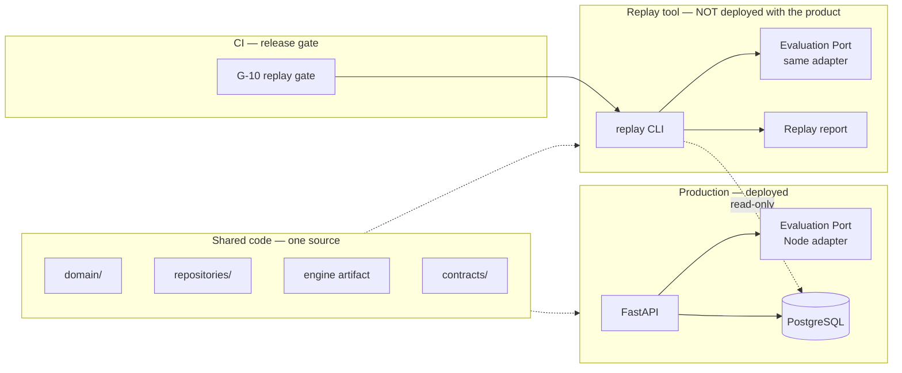

# SecureSphere X — Backend Architecture Decision Record

**Resolves:** the six decisions arising from the Final Backend Architecture Review
**Amends:** Backend Architecture Specification v1.0 → v1.1
**Status:** for ratification

> **Two of these decisions reverse recommendations made in my own review.** Decision 1 downgrades WebAssembly, which the review ranked first. Decision 4 rejects the Session/Knowledge merge the review proposed. Both reversals result from applying stricter criteria than the review used, and both are explained rather than quietly changed.

---

# Decision 1 — Engine Execution Strategy

## 1.1 What is actually being decided

Not "which runtime is best" but **which adapter ships first behind the Evaluation Port** (Decision 5). Because the port makes the runtime swappable, this decision is reversible at low cost — which changes the weighting: *toolchain risk* and *debuggability* matter more than operational elegance, because a broken build or an undiagnosable rule misfire late in the project is unrecoverable, whereas an extra container is not.

## 1.2 A fact that reframes the comparison

The engine is **an interpreter over twelve operators**, roughly 400–500 lines of logic. Every rule, weight, threshold, suppression and refinement set lives in the versioned JSON artifact (D0.3). Evaluation is microseconds of work over eleven rules.

**Performance is therefore irrelevant to this decision.** All three candidates are orders of magnitude faster than required. Any argument for a runtime on performance grounds is noise.

## 1.3 Comparison

| Criterion | Node sidecar | WebAssembly (Javy) | Embedded JS (py_mini_racer / PythonMonkey) |
|---|---|---|---|
| **Implementation complexity** | Low — run the bundle, expose loopback endpoint | **High** — TS → JS → Javy → WASM; host import surface must be defined | Low — load bundle, call function |
| **Operational complexity** | **Highest** — supervision, health gating, worker pool, restart policy, deploy coupling | Lowest — in-process | Lowest — in-process |
| **Replay determinism** | Good. Clock and randomness already forbidden in the engine by CI gate G-3 | **Strongest** — deterministic by specification; host controls the entire import surface | Good — same G-3 guarantee |
| **Debugging** | **Best** — Node inspector, source maps, standard stack traces | **Worst** — WASM traces are near-useless; a misfiring rule yields little | Good — JS stack traces, source maps work |
| **Tooling maturity** | **Highest** — Node is ubiquitous | **Lowest** — Javy is a niche Bytecode Alliance project | Medium — py_mini_racer has had maintenance gaps; PythonMonkey is young |
| **Maintainability** | High | Medium — longest toolchain, most build steps | High |
| **Deployment** | Two containers | One process | One process, native build dependencies |
| **CI/CD** | Simple; runtime available in CI | Extra build stage; artifact digest verification | Simple; native deps must build on CI image |
| **Byte-identity with extension** | **Yes, free** — same JS bundle | **Only if the extension also loads WASM**, which requires `wasm-unsafe-eval` in the MV3 CSP and complicates Web Store review | **Yes, free** — same JS bundle |
| **Long-term evolution** | Good | **Best** — runs anywhere a WASM runtime exists | Good |
| **Three-person team suitability** | **Best** — boring, debuggable, zero toolchain risk | Poor — highest risk of an unrecoverable late-project build failure | Good |

## 1.4 Why WebAssembly is downgraded from the review's first place

The review ranked WASM first on determinism and operational simplicity. Two facts it did not weigh:

**MV3 CSP.** Byte-identity — WASM's principal advantage — requires the *extension* to load WASM too. Manifest V3 blocks WebAssembly by default; enabling it requires `script-src 'self' 'wasm-unsafe-eval'` in the extension CSP. That is permitted, but it is a Web Store review signal and additional extension build complexity. If the extension keeps running JS while the backend runs WASM, they are two builds from one source — weaker than the two alternatives, which give byte-identity for free.

**Debuggability against team capacity.** Three students will spend real time diagnosing why a rule fired or did not. WASM stack traces will not help them. This cost recurs weekly for the life of the project; the sidecar's operational cost is paid once.

WASM remains architecturally elegant. It is the wrong first adapter for this team.

## 1.5 Recommendation

> ### Adopt the **Node.js sidecar** as the initial Evaluation Port adapter.
> ### Designate **embedded JS** as the pre-approved alternative adapter.

**Justification.**

1. **Zero toolchain risk.** The engine bundle is the same artifact the extension ships. Node executes it without a build step. No niche compiler sits between source and production.
2. **Byte-identity for free.** No extension change, no CSP relaxation, no second build.
3. **Best debuggability**, which is the cost that recurs.
4. **The operational objection is overstated for this deployment.** The review characterised supervision, health gating and worker pooling as substantial. On a single VM with docker-compose this is one service, one health check, and `restart: unless-stopped` — roughly half a day.
5. **Decision 5 makes it reversible.** The runtime sits behind a port. If operational cost proves annoying, the embedded-JS adapter is a contained change with no architectural consequence.

**Trade-off accepted.** Two processes instead of one, and a deployment topology marginally more complex than necessary — in exchange for the lowest probability of an unrecoverable toolchain failure.

**Risk retained.** Sidecar unavailability. Mitigated by Decision 2's corrected justification: backend evaluation supplies *better evidence*, not *authority*, so runtime unavailability degrades gracefully to a client-side Tier 2 verdict marked degraded (§15.2), rather than failing the gate.

---

# Decision 2 — Tier 0/1 Data, BI-24, and Analysis History

## 2.1 Why the review's own recommendation is rejected

The review recommended that the client upload Tier 0/1 **evidence** for backend re-evaluation. That recommendation is wrong, and its failure mode is severe:

**Tier 0 fires on every navigation.** Uploading Tier 0/1 evidence means transmitting evidence for every page the user visits. That would:

- increase backend load by roughly **two orders of magnitude**, destroying the load model of §1.8 and §16.1;
- transmit the user's **complete browsing history**, contradicting the transmission-minimisation property of §13.4 and the Privacy-by-Design commitment outright.

The review identified the contradiction correctly and proposed a remedy that would have caused a worse problem. It is rejected.

## 2.2 The only cross-pass dependency in the rule set

Examining all eleven rules: exactly one predicate depends on a prior pass — **DL-01's `priorFindingActive`**, which requires at least one active unsuppressed finding in an earlier committed pass of the current session (Specification v0.8 §7.2).

Nothing else in `rules-v0.1` looks backwards. This narrows the problem enormously: the backend does not need the client's prior *results*, only enough evidence to derive prior findings itself.

## 2.3 Recommended architecture — Deferred Session Materialisation

> **Evidence accumulates client-side across Tier 0 and Tier 1 and is transmitted only when a Tier 2 gate fires. The backend then materialises the Analysis Session and evaluates every pass in sequence from that accumulated evidence. All persisted passes are backend-computed. Client-side Tier 0/1 evaluation is a local UI optimisation with no persistence significance and is never authoritative.**

### What is transmitted

| When | What | What is not |
|---|---|---|
| Tier 0 | Nothing | — |
| Tier 1 | Nothing | — |
| **Tier 2 gate** | Accumulated Security Evidence for Tier 0, 1 and 2 for **this Target Resource only** | Findings, scores, tiers, capability sets, local pass results |
| Intervention | That an intervention was presented; the user's disposition | The tier or score that produced it |

### What is persisted

| Object | Where | Provenance |
|---|---|---|
| Security Evidence (all tiers) | SKR | Client-observed + backend-acquired, distinguished by `CollectionContext.collector` |
| Security Evaluations | SKR | **Backend-computed** |
| Correlation Findings | SKR | **Backend-computed** |
| Analysis Pass Results, all passes | SKR | **Backend-computed** |
| Current Security State | SKR | **Backend-computed** |
| Analysis History | SKR | Append-only, backend-computed |

### What remains client-local, permanently

- Authentication History Store — §20.2, never transmitted in any form.
- Tier 0/1 local evaluation results — used to render a passive badge, then discarded. Never uploaded, never persisted, never authoritative.
- Evidence for navigations that never reach a Tier 2 gate. **This is the large majority of browsing, and it never leaves the device.**

### Authoritative backend state

Everything the backend computes. The client's local tier is advisory to itself and is replaced by the Security State View (D0.9) on the Tier 2 response.

### Analysis History model

An Analysis Session is created in SKR **on first Tier 2 submission**, using the session identifier the client generated at navigation. Sessions that never reach Tier 2 have no backend record.

This is consistent with §3.1 — one session still corresponds to one navigation and one Target Resource. The backend simply records only those sessions where something consequential occurred. **The absence of a record for uneventful browsing is a privacy feature, not a gap.**

## 2.4 Verification against requirements

| Requirement | Satisfied |
|---|---|
| **BI-24** — no client-supplied findings, scores, tiers | ✓ Evidence only |
| **§13.4** — transmission bounded by gate frequency | ✓ Tier 2 only |
| **Privacy-by-Design** | ✓ Uneventful browsing never transmitted |
| **§4.3 / §12.4 determinism and replay** | ✓ All passes backend-computed from persisted evidence |
| **DL-01 `priorFindingActive`** | ✓ Backend derives prior-pass findings itself |
| **§16.1 Tier 0/1 no network I/O** | ✓ Constraint binds the client; backend reconstruction is later and unbound |
| **§11.3 monotonic escalation** | ✓ Computed across the reconstructed pass sequence |
| **§11.4 intervention lock** | ✓ Reported via D0.10 `InterventionReporter` |
| **§15.2 capability set** | ✓ Recorded per pass |

## 2.5 Accepted consequence

The client's local Tier 0/1 tier and the backend's reconstructed tier for the same passes **may differ**, because the backend has evidence the client could not gather. This is correct and expected. The client's badge is passive; the backend's determination is authoritative and replaces it.

---

# Decision 3 — Evidence Acquisition Privacy Model

This becomes **§10.13 of the Backend Architecture Specification**, not an implementation note.

## 3.1 The exposure

Tier 2 gates fire predominantly on credential submission. Naïve backend evidence acquisition therefore tells the backend, with high precision, **which sites the user authenticates to** — the most sensitive category of browsing data, and precisely what Privacy-by-Design exists to protect.

## 3.2 Principle

> **The backend learns the minimum necessary to improve a verdict, and learns nothing at all about routine authentication to well-known services.**

## 3.3 Trust boundary crossing — complete inventory

| Data | Crosses? | Mechanism |
|---|---|---|
| Target Resource URL | **Conditionally** — see §3.4 | Plaintext, only when both gates open |
| Registrable domain, for threat intelligence | **Never in plaintext** | k-anonymity hash prefix |
| Login form structure, field types, action domain | Yes | Structural description; no field values |
| Redirect chain | Yes | URLs in the chain |
| Script runtime observations | Yes | Behavioural flags; no script source |
| Page fingerprint | **Never** | Client-local, feeds the ACEM only |
| Authentication History Store | **Never** | §20.2 |
| Credential values, form inputs, cookies, tokens | **Never** | Never collected at all |
| Tier 0/1 evidence for non-gate navigations | **Never** | Decision 2 |

## 3.4 Two-gate acquisition policy

Backend DNS/TLS acquisition occurs **only when both conditions hold**:

**Gate 1 — Popularity allowlist, evaluated client-side.** A bundled list of the top *N* registrable domains ships with the extension and is evaluated locally. A domain on the list is never sent for acquisition. Routine authentication to major services therefore produces **no backend domain disclosure at all**.

**Gate 2 — Local risk threshold.** Acquisition is requested only where the client's local evaluation is **not Low**. A page that looks unremarkable locally is not escalated for infrastructure inspection.

The intersection — not well-known, and already locally suspicious — is a small, high-suspicion set. This is the entire population about which the backend learns a domain.

Where either gate closes, the affected evidence is `notCollected('policy_suppressed')`, the affected rules are `unevaluable`, and the pass is marked **degraded** (§15.2). Suppression is recorded, never silent.

## 3.5 Threat intelligence via k-anonymity

Following the Safe Browsing model:

1. Client computes a hash of the registrable domain.
2. Client transmits a **prefix only**.
3. Backend returns every intelligence entry in that prefix bucket.
4. Client performs the final match locally.

The backend learns a bucket containing many domains, never which one. Prefix length is an empirical parameter balancing bucket size against response payload; it belongs in §13.2.

**This applies to lookups regardless of the two-gate policy** — threat intelligence is consulted more often than DNS/TLS acquisition and must not be the channel that leaks what §3.4 protects.

## 3.6 Allowlist governance

Bundled with the extension, versioned, digest-verified, updated with releases. Fetching it dynamically would leak the very information it exists to protect. Its size is an empirical parameter: larger lists give better privacy and slightly weaker coverage of attacks on popular-but-not-top-N domains.

## 3.7 User disclosure

The extension must state plainly, in user-facing documentation and in the privacy surface of §20.9:

- Nothing is transmitted for ordinary browsing.
- At the moment credentials are about to be submitted, a download initiated, or a sensitive permission requested, security metadata about that page is sent for analysis.
- Well-known sites are excluded from domain disclosure entirely.
- Threat intelligence lookups use a partial hash; the exact site is not disclosed.
- Passwords, form values, cookies and page content are never transmitted.
- The authentication history used for impersonation detection never leaves the device, and is viewable and deletable.

## 3.8 Reconciliation of divergent evidence

The backend resolves DNS and TLS from a datacenter address. Phishing infrastructure cloaks against such ranges, so backend-observed infrastructure may differ from what the user reached.

**Rules:**

- **R-A — Client-observed evidence is authoritative for the rendered page.** DOM, forms, scripts, redirects as experienced.
- **R-B — Backend-observed evidence is authoritative for infrastructure the client cannot see.** DNS records, certificate chain, reputation.
- **R-C — Where both observe the same field and disagree, both are retained**, distinguished by `CollectionContext.collector`. Neither is discarded.
- **R-D — Divergence is recorded as an observation, not a finding.** It is a plausible cloaking indicator, but introducing a rule for it would modify `rules-v0.1`, which is frozen. Recorded now, available for a future rule-set version.
- **R-E — Divergence never silently changes a verdict.** Any rule reading a divergent field reads the collector-appropriate value per R-A and R-B.

---

# Decision 4 — Service Boundaries

Applying the four criteria supplied.

## 4.1 Session Service and Knowledge Service — **KEEP SEPARATE**

The review recommended merging these. Against the stated criteria the merge fails:

| Criterion | Assessment |
|---|---|
| Same aggregate boundary? | **No.** Persistence Spec §18 lists Analysis Session, Security Resource and Domain Entity as distinct aggregates with distinct lifecycles. Analysis Session is immutable once finalised; Security Resource evolves indefinitely. |
| Evolve together? | **No.** Session lifecycle rules (§19) and knowledge accumulation policy are independent concerns; a change to one does not imply a change to the other. |
| Cannot be maintained independently? | **They can.** Different developers can own them. A shared transaction is not shared ownership. |
| Improves cohesion without increasing coupling? | **No.** The merged service would own three aggregates with three lifecycles — lower cohesion, not higher. |

**The review's reasoning was wrong.** "They share a transaction" is not a boundary argument. The correct mechanism for a transaction spanning two aggregates is a **shared unit of work owned by the Application Layer** — which the specification already places in Analysis Orchestration. That is exactly what a unit of work is for.

**Corrected statement for §6.3:** TX 2 is a single unit of work coordinated by Analysis Orchestration, into which Session Service and Knowledge Service both enlist. Neither opens its own transaction.

## 4.2 Other boundaries

| Service | Verdict | Reasoning |
|---|---|---|
| **Authentication History** | **Must not exist** | §20.2. Architectural absence, BI-23. |
| **Evidence Acquisition** | **Keep**, amended by Decision 3 | Owns no aggregate; encapsulates external I/O and now the privacy policy |
| **Replay** | **Extract** — Decision 6 | Not a runtime product function |
| **Rule Distribution** | **Keep as a thin service** | Owns no aggregate, but distribution requires authentication; signed-URL object storage is more machinery than an endpoint at this scale. Reasoning now recorded. |
| **Intelligence** | **Keep separate** | TIR independent of SKR by Persistence Spec §11 and §36 |
| **Domain Security State computation** | **Add as a domain service** within the SKR subsystem | Resolves MS-1; ADR-007 places the algorithm out of scope of persistence but something must own it |

---

# Decision 5 — Evaluation Port and Runtime Adapters

## 5.1 Reclassification

The Evaluation Layer is **removed from the layer stack** and reclassified as an **Evaluation Port** — an interface owned by the Application Layer, with adapters in Infrastructure.

**Rationale.** It never occupied a position in the dependency graph: it is invoked by the Application Layer and depends on nothing internal. Calling it a layer implied other layers might depend on it, which they must not.

## 5.2 Port contract

```
EvaluationPort  (Protocol — Application Layer owns; Infrastructure implements)

    evaluate(
        evaluation_set: EvaluationSet,        # D0.2
        rule_set_version: str,
        rule_set_digest: str,
    ) -> AnalysisPassResult                   # D0.4

    health() -> RuntimeHealth
```

**Port invariants — binding on every adapter:**

- **EP-1** — Pure. No I/O, no database, no clock, no randomness.
- **EP-2** — Deterministic. Identical inputs and rule-set version produce an identical result.
- **EP-3** — The executed artifact is byte-identical to the extension's engine build.
- **EP-4** — The returned rule-set version is verified against the requested one.
- **EP-5** — Bounded by timeout; expiry is a failure, never a partial result.
- **EP-6** — Stateless between invocations.
- **EP-7** — Every adapter passes the identical golden-corpus conformance suite before it may be selected.

## 5.3 Adapters

| Adapter | Status |
|---|---|
| `NodeSidecarAdapter` | **Ships first** (Decision 1) |
| `EmbeddedJsAdapter` | Pre-approved alternative; no architectural change to adopt |
| `WasmAdapter` | Permitted; requires the MV3 CSP change for byte-identity |
| `InProcessPythonAdapter` | **Prohibited** — a second implementation (BI-5) |

Adapter selection is configuration (§9.2), not architecture. **Changing adapters is not an architecture change**, provided EP-1 through EP-7 hold.

## 5.4 Consequential amendments

- §3.4 "Evaluation Layer" → "Evaluation Port and Adapters", moved out of the layer stack.
- §17 — `evaluation/` becomes `infrastructure/evaluation/` with `port.py` and `adapters/`.
- BI-5 restated: **exactly one engine implementation**, executable by any conformant adapter.

---

# Decision 6 — Replay as a Standalone Engineering Tool

## 6.1 Rationale

The specification placed Replay in the production backend and disabled it there by feature flag. A capability disabled in production does not belong in the production service. Concretely, it is an endpoint that re-executes arbitrary historical sessions — an attack surface and a resource-exhaustion vector guarded by a boolean.

## 6.2 Architecture



## 6.3 Shared code ownership

Replay imports `domain/`, `repositories/`, `contracts/`, and the Evaluation Port from the same source tree as the backend — it is a second entry point, not a fork. This is what makes replay meaningful: it exercises production code paths.

Owner: Role B (Jayanth) for the port and determinism semantics; Role C (Durga Prasad) for corpus and reporting, per the Implementation Ownership Plan.

## 6.4 Repository interaction

**Read-only, always.** Replay reads persisted evaluations, sessions and pass results. It writes only its own run records, outside SKR. Executing against a production replica, or a restored dump, is preferred over the primary.

**Replay never re-derives evaluations.** It reads persisted ones (BI-10). Re-deriving would make a stale store or an unavailable resolver able to change a replay result, defeating its purpose.

## 6.5 CI integration

**Reconstruction replay** — every session in the golden corpus, under its own recorded rule-set version, must reproduce its original decision exactly. Any divergence blocks release (G-10).

**Regression replay** — the golden corpus under a candidate rule-set version. Divergences are expected, enumerated, and must be individually justified. Unexplained divergence blocks release.

## 6.6 Forensic workflow

1. Identify the session — from a user report, an audit event, or an anomaly.
2. Extract the session with its evaluations and pass results from a replica or dump.
3. Replay under the recorded rule-set version; confirm reproduction.
4. Inspect the Pass Result: which rules matched, which were suppressed and by which guard, which were unevaluable and why, the effective weights, and the tier before and after the monotonic floor.
5. Optionally re-score under a candidate rule set to test whether a proposed change would have altered the outcome.

Step 4 is possible only because D0.4 persists suppressed findings and guard evaluations. When diagnosing a false negative, the suppression record is where the answer will be.

## 6.7 Deployment boundary

**DI-3 (amended):** the Replay tool is never deployed with the product, exposes no network endpoint, and has no production ingress. The `replay_endpoint_enabled` feature flag is **removed** from §9.4.

---

# Final Consistency Review

## FC-1 — Architectural contradictions

| Previously identified | Status |
|---|---|
| **F-1** — BI-24 vs Tier 0/1 persistence | **Resolved** by Decision 2. Only evidence is transmitted; all persisted results are backend-computed. |
| **F-2** — GAP-5 overstated | **Resolved** by Decisions 1 and 5. The runtime is an adapter; the choice is justified by comparison. |
| **F-3** — Privacy exposure | **Resolved** by Decision 3, now §10.13 of the architecture. |
| **F-4** — Replay in production | **Resolved** by Decision 6. |
| **F-5** — Session/Knowledge boundary | **Resolved** by Decision 4 — separation retained; the review's merge recommendation rejected on its own criteria. |

**No contradiction remains among:** the layer model, the tier model, transmission minimisation, replay determinism, immutability guarantees, repository ownership, or the privacy commitments.

**One tension deliberately retained and recorded:** a single PostgreSQL instance hosting three schemas provides logical but not operational independence, against Persistence Spec §11's independence requirement. Correct at project scale; recorded rather than resolved.

## FC-2 — Service boundaries

Stable. Twelve services, each owning either an aggregate cluster or an external-integration concern. Two changes from v1.0: Replay extracted; a Domain Security State domain service added within the SKR subsystem.

## FC-3 — Runtime abstraction

Finalised. Evaluation Port with adapters; Node sidecar ships first; EP-1 through EP-7 bind every adapter; adapter selection is configuration.

## FC-4 — Deployment architecture

Internally consistent. The Evaluation Port is never network-reachable from outside the application tier; the commit path never reads a replica; Replay and calibration are never deployed with the product; evidence acquisition uses a dedicated egress path with the Decision 3 policy applied before any request is issued.

## FC-5 — Can Database Design begin?

| Scope | Ready | Blocked by |
|---|---|---|
| TIR schema | **Yes** | — |
| UIPR schema | **Yes** | — |
| SKR — Analysis Session, Pass Result, Evidence, Findings | **Yes** | Decision 2 fixed the provenance model |
| SKR — Security Resource identity, Current Security State | **No** | **GAP-3** |

## FC-6 — Can API Contracts begin?

| Scope | Ready |
|---|---|
| Identity, dashboard, rule distribution | **Yes** |
| Analysis — session materialisation, Tier 2 submission | **Yes** — Decision 2 fixes the payload as evidence-only |
| Intervention feedback | **Yes** — D0.10 |
| Threat intelligence lookup | **Yes** — Decision 3 fixes it as k-anonymity prefix |
| Evidence acquisition | **Yes** — Decision 3 fixes the two-gate policy |

## FC-7 — Can Implementation Planning begin?

**Yes, in full.** Sequencing is knowable; SKR identity work sequences last behind GAP-3.

## FC-8 — Remaining architectural uncertainty

| # | Uncertainty | Blocks | Severity |
|---|---|---|---|
| **U-1** | **GAP-3** — Persistence Spec §14 Canonical Identity Model, §15 Identity Lifecycle, §33 Current Security State Governance are unreadable | SKR identity schema only | **High** |
| **U-2** | Advisory-lock scope versus CAS (review MR-6) | SKR concurrency tests | Medium — resolvable in design |
| **U-3** | Promotion governance criteria (review MR-8) | Enabling the promotion pipeline | Medium — flag stays false |
| **U-4** | Evidence-acquisition latency is budgeted at 1200 ms with no measurement | Budget confidence | Low — Role C's capture pipeline may already hold the data |
| **U-5** | k-anonymity prefix length and allowlist size are unset | Tuning only | Low — empirical, §13.2 |

---

# Verdict

## BACKEND ARCHITECTURE FROZEN — with one carve-out

The Backend Architecture Specification is frozen at **v1.1**, incorporating Decisions 1 through 6. Every contradiction identified in the Final Architecture Review is resolved. Service boundaries, the runtime abstraction, the privacy model, and the deployment architecture are stable and internally consistent.

**Carve-out.** The **Security Resource identity model and Current Security State governance remain unfrozen**, blocked by GAP-3. Every other part of the backend is frozen and implementable.

**Database Design may begin** for TIR, UIPR, and the analysis-record portion of SKR.
**API Contracts may begin** in full.
**Implementation Planning may begin** in full.

GAP-3 has now been raised seven times. It blocks one schema, and it is the only thing standing between this architecture and complete freeze.
