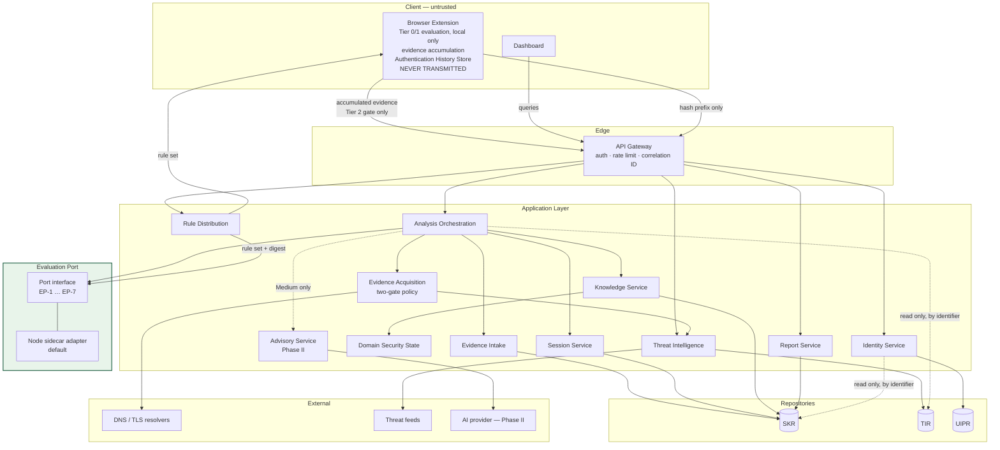
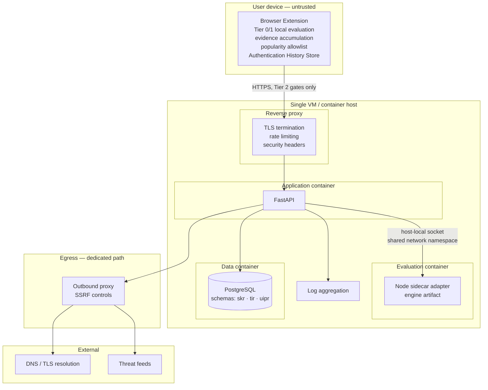
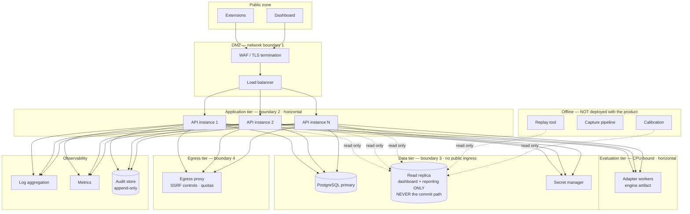

# SecureSphere X — Backend Architecture Specification

**Version:** 1.1 · **Status:** Frozen, with one declared carve-out
**Conforms to:** Specification v0.8 · Domain Model · Persistence Architecture Specification (Rev 2) · Contracts D0.1–D0.5, D0.8–D0.10 · Implementation Ownership Plan
**Rule set:** `rules-v0.1`

This document is the single authoritative reference for backend implementation. A developer should be able to implement the backend from this document alone.

---

## 0. Declared Carve-Out

One area of this specification cannot be completed from the frozen corpus.

### GAP-3 — Persistence Architecture Specification: three unreadable pages

Three pages of the ratified Persistence Architecture Specification render as the single word `SUPERSEDED`. Cross-references in the surrounding text identify the missing content as:

| Missing | Sections | Required by |
|---|---|---|
| Page 6 | §12 Repository Interaction Principles · §13 Persistence Boundaries · **§14 Canonical Identity Model** · **§15 Identity Lifecycle** | §7 Repository Layer, §19 Invariants |
| Page 12 | §30 (tail) · §31 Knowledge Lifecycle · §32 Knowledge Update Policy · **§33 Current Security State Governance** · §34 Analysis History Governance · §35 (head) | §7, §15 |
| Page 16 | §41 (tail) Ubiquitous Language · §42 (head) incl. ADR-001 | §19 |

**Scope of the carve-out.** Two areas remain unfrozen: the **Security Resource identity model** and **Current Security State governance**. Every point where the frozen text must supply the answer is marked `[GAP-3]`.

**Everything else in this specification is frozen and implementable.** The carve-out blocks the Security Knowledge Repository's identity schema. It blocks nothing else: TIR, UIPR, the analysis-record portion of SKR, configuration, contracts, observability, identity, intelligence, rule distribution and the evaluation path all proceed.

---

## 1. Backend Philosophy

### 1.1 Objectives

The backend exists to do four things the client cannot do correctly, and nothing else:

1. **Adjudicate at Tier 2 with better evidence.** Produce the authoritative Security Assessment using DNS, TLS and threat intelligence that a browser extension cannot obtain.
2. **Hold what must be shared.** Threat intelligence, rule-set versions, and cross-user knowledge cannot live on a device.
3. **Persist what must survive.** Analysis Sessions, Analysis History and knowledge objects, under the immutability guarantees the Domain Model requires.
4. **Serve what must be reconstructable.** Reports, dashboard history and forensic reconstruction, from persisted artifacts rather than recomputation.

### 1.2 Design Philosophy

**The backend is a decision authority by virtue of evidence, not by virtue of trust.** A modified client controls its own enforcement: it can ignore a Block, suppress a Warn, or never submit evidence at all. Backend evaluation therefore does not protect against a hostile client, and the architecture does not pretend otherwise. What backend evaluation provides is a verdict computed with evidence the client cannot gather, a consistent record across users, and a single rule-set version applied uniformly.

This has a direct architectural consequence: **backend unavailability degrades rather than fails.** Where the evaluation path is unreachable, a client-side Tier 2 verdict marked degraded is a legitimate outcome, not a security hole.

**The backend is a thin shell around a pure engine.** Rule evaluation is a pure function — evidence in, Analysis Pass Result out. It performs no I/O, holds no state, and reaches no database. Every stateful concern lives outside it. This is what makes forensic reconstruction meaningful: replaying a session means re-invoking a pure function against persisted inputs.

**The backend learns as little as possible.** Ordinary browsing never reaches it. Evidence is transmitted only when a Tier 2 gate fires — a credential submission, a download, a sensitive permission request. Even then, domain disclosure is suppressed for well-known sites and threat intelligence is consulted through k-anonymity. The backend's ignorance of routine user activity is an architectural property, established in §10.13 and enforced at the client.

**The backend refuses knowledge it must not hold.** The Authentication History Store is client-local and never transmitted (§20.2 of the Rule Engine Specification). The backend has no endpoint that accepts it, no schema that stores it, and no service that serves it.

### 1.3 Responsibilities

| # | Responsibility | Rationale |
|---|---|---|
| R1 | Tier 2 evaluation, including reconstruction of the preceding pass sequence | §3.2 — Tier 2 permits backend evidence and relaxed latency |
| R2 | Analysis Session materialisation, lifecycle and persistence | Persistence Spec §26 |
| R3 | Knowledge object custody — Security Resource, Domain Entity | Persistence Spec §9 |
| R4 | Threat intelligence custody and promotion | Persistence Spec §27, §37 |
| R5 | Rule-set version distribution and integrity | §12.2 — released versions immutable |
| R6 | Report metadata generation and serving | Persistence Spec §28 |
| R7 | User identity, authentication, personalisation | Persistence Spec §29 |
| R8 | Backend-exclusive evidence acquisition under the §10.13 privacy policy | D0.1 conformance classes |
| R9 | Advisory escalation *(Phase II)* | §1.4 |

### 1.4 Non-Responsibilities

Explicit, because each is a boundary that will otherwise be crossed.

| # | NOT a backend responsibility | Why |
|---|---|---|
| N1 | **Authentication History, in any form** | §20.2 — never transmitted off-device, including hashed or derived. No backend service, schema, cache or endpoint exists for it. |
| N2 | Tier 0 and Tier 1 evaluation | §16.1 — no network I/O; 10 ms and 50 ms budgets. These execute client-side and their results are never transmitted. |
| N3 | Evidence collection from live pages | The backend was not present at the navigation and would observe different infrastructure than the user (§10.13.8) |
| N4 | Enforcement — blocking, warning, navigating, rendering | Domain Model §6.6, §8.6.7 — the analytical layer recommends; the client executes |
| N5 | Replay execution | A standalone engineering tool (§4.11), never deployed with the product |
| N6 | Capture pipeline | Role C offline tooling, outside the product boundary |
| N7 | Calibration and weight tuning | Role C offline activity; the backend consumes released rule sets only |
| N8 | Rule authoring | Rule sets arrive as released, versioned, integrity-checked artifacts |

### 1.5 Architectural Principles

**P1 — Engine purity is absolute.** The evaluation path performs no I/O and reaches no database. Every input arrives as an argument.

**P2 — Determinism is a boundary property.** Given identical evidence and rule-set version, the backend produces an identical Analysis Pass Result. Wall-clock time, request ordering and database state are not inputs.

**P3 — Immutability is enforced at the repository, not by convention.** Analysis Sessions, Correlation Findings and Analysis History are append-only at the persistence layer. No update path exists in code.

**P4 — Ownership is exclusive.** Three repositories, non-overlapping aggregates, one-directional dependency `UIPR → SKR → TIR` (Persistence Spec §39).

**P5 — Contracts are generated, never hand-written twice.** Python contract types are generated from the frozen TypeScript definitions.

**P6 — Degraded capability is recorded, never silent** (§15.2 of the Rule Engine Specification).

**P7 — Analytical results are backend-computed.** Every persisted Security Evaluation, Correlation Finding and Analysis Pass Result originates in the backend. The client supplies observations; it never supplies conclusions.

**P8 — The backend's ignorance is designed.** Transmission is bounded by gate frequency, domain disclosure is gated twice, and threat intelligence is anonymised. These are architectural properties, not configuration.

### 1.6 Separation of Concerns

| Concern | Owner | Never touches |
|---|---|---|
| HTTP, serialisation, status codes | API Layer | Domain objects, repositories |
| Use-case orchestration, unit of work | Application Layer | HTTP, SQL |
| Invariants, domain semantics | Domain Layer | I/O of any kind |
| Rule evaluation | Evaluation Port adapter | Database, network, clock |
| Aggregate persistence | Repository Layer | HTTP, business rules |
| Drivers, process management, clients | Infrastructure Layer | Domain semantics |

### 1.7 Security Principles

**Zero trust toward the client.** Evidence arrives from an extension running on a machine the operator does not control. It is schema-validated, semantically validated and bounded. A client can submit observations and nothing else.

**The client cannot influence its own verdict beyond evidence.** No endpoint accepts a finding, score, tier, capability set or rule-set override.

**Least knowledge.** The backend stores the minimum required for its responsibilities and receives the minimum required to compute a verdict (§10.13).

**Trust boundaries are explicit** (§10.12) and every crossing is validated.

### 1.8 Scalability Principles

**Tier 2 gate frequency, not navigation frequency, is the load model.** Tier 0 and Tier 1 are client-local and generate no backend traffic whatsoever. Backend load scales with credential submissions, downloads and sensitive permission requests — roughly two orders of magnitude below navigation volume.

This is the single most important performance characteristic of the system. Introducing a backend call at Tier 0 or Tier 1 would change the load model by approximately 100× and would simultaneously void the privacy architecture of §10.13.

**Stateless application tier.** All request-scoped state lives in the request or the database. Horizontal scaling requires no affinity.

**The evaluation path is CPU-bound and horizontally scalable.** It holds no state between invocations.

### 1.9 Reliability Principles

**Graceful degradation over failure.** Backend evidence unavailable degrades the capability set. Evaluation path unavailable degrades to a client-side verdict marked degraded. Advisory unavailable resolves Medium to Warn.

**Fail-closed on rule-set integrity.** A rule set failing its integrity check is not used. A partial rule set produces confidently wrong scores — worse than none.

**Atomic pass commit.** A pass is committed whole or not at all. No partially aggregated score reaches Current Security State.

---

## 2. High-Level Backend Architecture

### 2.1 Subsystems

| Subsystem | Responsibility |
|---|---|
| **API Gateway** | HTTP termination, authentication, rate limiting, correlation ID assignment |
| **Analysis Subsystem** | Session materialisation, evidence intake, pass sequence reconstruction, Tier 2 orchestration |
| **Evaluation Port** | Deterministic rule evaluation through a runtime adapter (§3.4) |
| **Knowledge Subsystem** | Security Resource, Domain Entity, Analysis History, Domain Security State |
| **Intelligence Subsystem** | Intelligence Objects, feeds, promotion pipeline, k-anonymity lookup |
| **Identity Subsystem** | Users, authentication, personalisation |
| **Reporting Subsystem** | Report metadata, dashboard queries |
| **Rule Distribution** | Versioned rule-set serving and integrity |
| **Evidence Acquisition** | Backend-exclusive evidence under the two-gate policy (§10.13.4) |
| **Observability** | Structured logging, metrics, audit trail |
| **Advisory Subsystem** *(Phase II)* | AI escalation for Medium outcomes |

### 2.2 Component Diagram



**Absent by design.** No Authentication History component appears anywhere. No Replay component appears — replay is a standalone tool (§4.11), not a deployed service.

### 2.3 Dependency Graph

```
API Layer
   ↓
Application Layer ──── invokes ────► Evaluation Port (interface)
   ↓                                        ↑
Domain Layer                          implemented by
   ↓                                        │
Repository Layer                     Infrastructure adapters
   ↓
Infrastructure Layer
```

Dependencies point strictly downward. The Evaluation Port is an interface owned by the Application Layer and implemented in Infrastructure; it occupies no position in the layer stack.

Repository dependency follows Persistence Spec §39: `UIPR → SKR → TIR`, references by identifier only, read-only across boundaries.

### 2.4 Runtime Interaction — Deferred Session Materialisation

Evidence accumulates on the client through Tier 0 and Tier 1 and is transmitted only when a Tier 2 gate fires. The backend then materialises the Analysis Session and evaluates the complete pass sequence.

**Client, at navigation and DOM ready:**

1. Extension generates an Analysis Session identifier bound to one Target Resource.
2. Tier 0 evaluates locally on URL and homograph evidence. No network I/O.
3. Tier 1 evaluates locally on login-interface, script-runtime and authentication-context evidence. No network I/O.
4. Local results render a passive indicator. **They are never transmitted and never persisted.** Evidence is retained locally for the lifetime of the session.

**Client, at a Tier 2 gate:**

5. Extension submits the **accumulated evidence** for all tiers, with the session identifier, target resource and gate trigger.

**Backend:**

6. Gateway authenticates, rate-limits, assigns a correlation ID.
7. Analysis Orchestration validates the evidence bundle against the generated contracts.
8. Session Service **materialises** the Analysis Session under the client-supplied identifier if it does not yet exist.
9. Evidence Intake persists all Security Evidence, immutably, tagged by collection context.
10. Evidence Acquisition applies the two-gate policy (§10.13.4). Where permitted, it resolves DNS, TLS and threat intelligence concurrently under a deadline; where suppressed or failed, affected fields become `notCollected`.
11. Analysis Orchestration invokes the Evaluation Port **once per pass in sequence** — Tier 0, then Tier 1, then Tier 2 — each pass receiving the evidence available at that tier. Every pass is backend-computed.
12. All Pass Results are persisted **atomically** with the Current Security State update, under compare-and-set with the monotonic tier floor, and appended to Analysis History.
13. Knowledge Service updates Security Resource and Domain Entity.
14. The Security State View (D0.9) returns to the extension, which decides enforcement.

Navigations that never reach a Tier 2 gate produce **no backend record of any kind**.

**Subsequent gates in the same session.** A session may reach more than one Tier 2 gate — a download initiated after a credential submission. The Tier 0 and Tier 1 passes already exist and are immutable, so a subsequent gate evaluates **Tier 2 only**, appending exactly one pass. Reconstruction of the earlier tiers occurs once per session, at the first gate.

**Ordinal terminology.** Two distinct sequences exist within a session and are not interchangeable:

| Term | Definition | Example |
|---|---|---|
| **Pass ordinal** | 1-based index of an evaluation pass within the session. Dense and monotonic. | First gate yields passes 1, 2, 3 — Tier 0, Tier 1, Tier 2 |
| **Gate ordinal** | 1-based index of a Tier 2 gate event within the session. Dense and monotonic. | First gate is 1; a later download gate is 2, yielding pass 4 |

Idempotency for a client submission is keyed on gate ordinal; persistence and ordering of evaluation results are keyed on pass ordinal.

### 2.5 Why the Pass Sequence Is Reconstructed

Exactly one predicate in `rules-v0.1` depends on a prior pass: DL-01's `priorFindingActive`, which requires an active unsuppressed finding in an earlier committed pass of the session (Specification v0.8 §7.2).

Reconstructing the sequence backend-side satisfies that predicate without transmitting client-computed findings, and yields a complete, single-provenance Analysis History. The client's local Tier 0/1 results serve the passive indicator and are discarded.

The backend's reconstructed tier for Tier 0 and Tier 1 may differ from the client's local tier, because the backend holds evidence the client could not gather. This is expected. The client's indicator is passive; the backend's determination is authoritative and replaces it on the Tier 2 response.

---

## 3. Layered Architecture

### 3.1 API Layer

**Responsibilities.** HTTP termination, request and response serialisation, status-code mapping, schema validation at the boundary, authentication enforcement, rate limiting, correlation ID assignment, API versioning.

**Allowed dependencies.** Application Layer, Shared Kernel, middleware.
**Prohibited.** Repositories, Domain Layer internals, Evaluation Port adapters, SQL, database sessions.

**Ownership.** Role B, with Role A consulted on client-facing shapes.
**Lifecycle.** Request-scoped. No state survives a request.

**Rationale.** Keeping HTTP concerns out of the Application Layer allows the same use case to be driven by a test harness or the replay tool without modification.

### 3.2 Application Layer

**Responsibilities.** Use-case orchestration, unit-of-work definition, cross-service coordination, invocation of the Evaluation Port, mapping between contracts and domain objects, retry policy.

**Allowed.** Domain Layer, repository interfaces, the Evaluation Port interface, Shared Kernel.
**Prohibited.** HTTP objects, SQL, ORM sessions, adapter internals.

**Ownership.** Role B.
**Lifecycle.** Request-scoped services. The unit of work is defined here and nowhere else.

**Rationale.** Transaction scope belongs where the use case is known. A repository cannot know whether it is one step of a larger atomic operation, which is why the unit of work spanning Session Service and Knowledge Service is owned here rather than by either service.

### 3.3 Domain Layer

**Responsibilities.** Domain concepts as defined by the Domain Model; invariant enforcement; value objects; aggregate roots; domain services including Domain Security State computation; domain exceptions.

**Allowed.** Shared Kernel only.
**Prohibited.** Everything else — no I/O, no repositories, no HTTP, no evaluation, no clock.

**Ownership.** Role B, Architecture Owner review mandatory.
**Lifecycle.** Pure objects; no lifetime.

**Rationale.** Domain Model §7.5.4 requires the domain to remain independent of implementation technology. Purity makes that testable rather than aspirational.

### 3.4 Evaluation Port and Adapters

The evaluation path is a **port**, not a layer. It is an interface owned by the Application Layer and implemented by adapters in Infrastructure. It occupies no position in the dependency stack: the Application Layer invokes it, and it depends on nothing internal.

**Port contract.**

```
EvaluationPort  (Protocol — Application Layer owns; Infrastructure implements)

    evaluate(
        evaluation_set: EvaluationSet,        # D0.2
        rule_set_version: str,
        rule_set_digest: str,
    ) -> AnalysisPassResult                   # D0.4

    health() -> RuntimeHealth
```

**Port invariants — binding on every adapter.**

| # | Invariant |
|---|---|
| **EP-1** | Pure. No I/O, no database, no clock, no randomness. |
| **EP-2** | Deterministic. Identical inputs and rule-set version produce an identical result. |
| **EP-3** | The executed artifact is byte-identical to the extension's engine build. |
| **EP-4** | The returned rule-set version is verified against the requested one. |
| **EP-5** | Bounded by timeout. Expiry is a failure, never a partial result. |
| **EP-6** | Stateless between invocations. |
| **EP-7** | Every adapter passes the identical golden-corpus conformance suite before selection. |

**Adapters.**

| Adapter | Status | Characteristics |
|---|---|---|
| **`NodeSidecarAdapter`** | **Default** | Executes the extension's JavaScript bundle in a supervised Node process over a loopback-only transport. Byte-identity requires no additional build. Highest tooling maturity and best debuggability. |
| `EmbeddedJsAdapter` | Approved alternative | Executes the same bundle in-process through an embedded JavaScript engine. Removes the sidecar; introduces native build dependencies. |
| `WasmAdapter` | Optional, future | Executes a WebAssembly build of the engine in-process. Strongest determinism guarantees. **Selecting this adapter requires the extension to ship the matching WebAssembly build**, which entails an MV3 content-security-policy allowance; a WebAssembly backend paired with a JavaScript extension violates EP-3 and is prohibited. |
| `InProcessPythonAdapter` | **Prohibited** | A second engine implementation. Voids BI-5 and the determinism claim. |

**Adapter selection is configuration** (§9.2), not architecture. Changing adapters is not an architectural change provided EP-1 through EP-7 hold.

**Ownership.** Role B.
**Lifecycle.** Adapter instances are singletons holding a worker pool or runtime handle; individual invocations are stateless.

### 3.5 Repository Layer

**Responsibilities.** Aggregate persistence and retrieval; enforcement of boundary, reference and invariant rules for owned aggregates; optimistic concurrency primitives.

**Allowed.** Domain Layer, Infrastructure Layer.
**Prohibited.** Application Layer, API Layer, other repositories' aggregates for writing. Retry policy, which belongs to the Application Layer.

**Ownership.** Role B.
**Lifecycle.** Request-scoped, enlisted in a unit of work.

### 3.6 Infrastructure Layer

**Responsibilities.** Database drivers and session management, HTTP clients, Evaluation Port adapters and their process or runtime supervision, secret retrieval, external resolvers.

**Allowed.** Shared Kernel, third-party libraries.
**Prohibited.** Domain semantics, business rules.

**Ownership.** Role B, with Role C consulted on evidence acquisition.
**Lifecycle.** Mostly singleton; some request-scoped.

### 3.7 Shared Kernel

**Responsibilities.** Contract types generated from the frozen TypeScript definitions; identifiers; error taxonomy; correlation context.

**Allowed.** Nothing internal.
**Prohibited.** All internal layers.

**Ownership.** Role B. **Contracts are generated, never edited in Python.**

**Rationale.** A hand-maintained Python mirror of D0.1 will drift from the TypeScript source, and the drift surfaces as evidence-shape mismatch that no test catches until integration.

### 3.8 Layer Enforcement

Layering is enforced mechanically: an import-linter contract in CI, plus a check that `domain/` imports nothing but `contracts/`. A layering violation fails the build.

---

## 4. Services

### 4.1 Analysis Orchestration Service

**Purpose.** Coordinate a Tier 2 submission end to end, including materialisation of the session and reconstruction of the pass sequence.

**Responsibilities.** Validate the submission; materialise the session if absent; sequence evidence intake, acquisition, per-pass evaluation and commit; own the unit of work spanning Session Service and Knowledge Service; enforce atomicity; produce the Security State View.

**Inputs.** Accumulated evidence bundle (D0.1), client-generated session identifier, target resource, gate trigger, rule-set version.
**Outputs.** Security State View (D0.9); persisted Pass Results for every reconstructed pass.

**Internal dependencies.** Evidence Intake, Evidence Acquisition, Session Service, Knowledge Service, Evaluation Port, Advisory Service (Phase II).

**State ownership.** None. Fully stateless; all state delegated.

**Concurrency.** Multiple gates may fire on one session — a download initiated while a credential submit is pending. Submissions for a single session are serialised by a **PostgreSQL advisory lock keyed on session identifier, held for the duration of the unit of work**. This guarantees dense monotonic pass ordinals and makes the compare-and-set on Current Security State conflict-free within a session. Cross-session concurrency is unbounded.

**Failure modes.** Evidence validation failure → 422, no persistence. Commit failure → rollback; the submission is abandoned and recorded as such.

**Evaluation Port unreachable.** Evidence remains committed from TX 1; no pass commits; TX 2 does not open. The response is 200, and its body is governed entirely by the frozen Security State View contract (D0.9) — no field is added to it:

| Prior committed state for this session | Response body |
|---|---|
| Exists | A Security State View projecting that prior state, with `degraded` set true and `degradedExplanation` identifying evaluation unavailability. `sourcePassResultId` references the last committed pass. |
| None | **Null.** The contract types the view as `SecurityStateView \| null` precisely for this case: with no committed pass, `state` and `sourcePassResultId` have no values, and a partially populated view cannot be constructed. |

The client falls back to its local verdict and may resubmit. The submission is idempotent on gate ordinal, so a later success commits the passes without duplication.

**Recovery.** Submission is idempotent on `(sessionId, gateOrdinal)`. A client retry after timeout returns the committed result rather than producing a duplicate.

**Performance.** Per §16.2: p95 ≤ 250 ms where acquisition is policy-suppressed, ≤ 1000 ms where acquisition is permitted and resolvers respond, with a 1450 ms hard ceiling when the acquisition deadline is reached.

**Scalability.** Stateless. The per-session advisory lock is the only serialisation point.

### 4.2 Evidence Intake Service

**Purpose.** Validate and persist client-submitted Security Evidence.

**Responsibilities.** Schema validation against generated D0.1 contracts; semantic validation; size and cardinality bounds; rejection of any field the client must not supply; immutable persistence tagged by collection context and tier.

**State ownership.** Security Evidence records, immutable on write.

**Concurrency.** Append-only; no contention.

**Failure modes.** Schema violation → 422 with field paths. Bounds exceeded → 413. Contract version mismatch → 409 with the supported range.

**Security note.** This is the primary untrusted-input surface. A client cannot submit findings, scores, tiers or capability sets — only observations.

### 4.3 Session Service

**Purpose.** Materialise and manage Analysis Sessions.

**Responsibilities.** Materialise a session under the client-generated identifier on first Tier 2 submission; bind it to exactly one Target Resource; enforce the state machine; reserve dense monotonic pass ordinals and assign gate ordinals (§2.4); finalise sessions; enforce immutability after finalisation.

**Inputs.** Client-generated session identifier, target URL, private-context flag, lifecycle events.
**Outputs.** Session record; session state.

**State ownership.** Analysis Session aggregate (SKR).

**Concurrency.** Enlists in the unit of work held under the orchestration advisory lock. Session materialisation is idempotent on the client-supplied identifier.

**Failure modes.** Invalid state transition → 409 with current state. Write to a finalised session → 409, always.

**Note on session identity.** The session identifier is generated client-side at navigation, so one session corresponds to one navigation and one Target Resource throughout the system. The backend materialises a record only for sessions that reach a Tier 2 gate. Sessions that do not are never recorded — an intended privacy property, not an omission.

### 4.4 Knowledge Service

**Purpose.** Custody of Security Resource and Domain Entity — the platform's current understanding.

**Responsibilities.** Resolve or create canonical Security Resource identity; maintain Current Security State; append to Analysis History; accumulate Knowledge Metadata; maintain Domain Entity; invoke Domain Security State computation.

**Inputs.** Analysis Pass Results, Target Resource reference.
**Outputs.** Updated knowledge objects.

**State ownership.** Security Resource, Domain Entity, Current Security State, Knowledge Metadata, Analysis History (all SKR).

**Concurrency.** Enlists in the orchestration unit of work. Current Security State is updated by compare-and-set on a version column with the monotonic tier floor applied inside the transaction, so that two passes can never produce a tier lower than one already presented. Analysis History is append-only. Knowledge Metadata accumulates and is never overwritten.

`[GAP-3]` **Canonical identity resolution and supersession handling are governed by Persistence Spec §14 and §15.** The service interface is defined here; identity derivation, the normalisation-to-identity mapping and supersession triggers must come from the frozen text.

### 4.5 Domain Security State Service

**Purpose.** Compute the FQDN-level security state from Security-Resource-level Analysis History.

**Responsibilities.** Derive Domain Security State deterministically and reproducibly, resolving to exactly one authoritative state per Persistence Spec ADR-007.

**Placement.** A domain service within the Domain Layer, invoked by Knowledge Service. It performs no I/O; supporting history is passed in.

**Note.** ADR-007 places the specific computation algorithm outside the scope of the persistence architecture. This service is the named owner of that algorithm; its selection is a downstream analytical decision, not a persistence concern.

### 4.6 Threat Intelligence Service

**Purpose.** Custody of Intelligence Objects, independent of analytical activity.

**Responsibilities.** Ingest external feeds; maintain Confidence and Validity as first-class governed attributes; execute the internal promotion pipeline; serve both intelligence lookup paths of §10.13.5 — **k-anonymous prefix lookups** for clients and plaintext-domain lookups for Evidence Acquisition where §10.13.4 has permitted disclosure; manage the Intelligence Object lifecycle.

**State ownership.** Intelligence Objects, Threat Feed Records, IOC Collections, Threat Sources, Reputation Data (TIR).

**Concurrency.** Feed ingestion is batch and idempotent on `(source, feedRecordId)`. Lookups are read-only.

**Architectural constraint.** TIR is fully independent of SKR and UIPR. Intelligence exists and evolves whether or not any analysis has occurred. Promotion is one-directional and by identifier reference only.

### 4.7 Rule Distribution Service

**Purpose.** Serve versioned, integrity-verified rule sets to the Evaluation Port and to extension clients.

**Responsibilities.** Store released versions immutably; verify integrity digests on load; serve by version; refuse partial or failing artifacts; expose the current recommended version.

**State ownership.** Rule-set artifacts and their digests.

**Concurrency.** Read-heavy; cached in memory keyed by version with the digest as part of the cache key, so a mutated artifact cannot be served from cache.

**Failure modes.** Integrity failure → fail-closed. Fall back to the last known-good version and record the fallback. Where no known-good version exists, evaluation does not proceed and Tier 2 gates warn on unavailable protection.

**Placement rationale.** Rule sets require authenticated distribution, which a thin service provides more simply than signed-URL object storage at this scale. The artifacts themselves remain immutable and cacheable.

### 4.8 Report Service

**Purpose.** Generate and serve report metadata.

**Responsibilities.** Produce metadata referencing an Analysis Session by identifier; serve technical and user-facing projections; never embed analytical content.

**State ownership.** Report aggregate (SKR) — metadata only.

**Architectural constraint.** Analytical detail resolves through the referenced Analysis Session. Embedding it would create a second source of truth over immutable knowledge.

### 4.9 Identity Service

**Purpose.** UIPR custody — users, authentication, MFA, preferences, notification settings.

**Responsibilities.** Registration, authentication, token issuance and rotation, preference management, saved analysis references.

**State ownership.** User aggregate (UIPR).

**Architectural constraint.** May reference Analysis Session and Security Resource by identifier, read-only. Never embeds analytical data.

### 4.10 Evidence Acquisition Service

**Purpose.** Resolve evidence categories a browser extension cannot obtain, under the privacy policy of §10.13.

**Responsibilities.** Apply the two-gate acquisition policy before any outbound request; perform DNS resolution and TLS chain retrieval where permitted; convert suppression and failure alike into `notCollected(reason)`.

**External dependencies.** DNS resolvers, TLS endpoints, TIR.

**Policy enforcement.** Acquisition proceeds only where both gates of §10.13.4 open. Where either closes, affected fields are `notCollected('policy_suppressed')`, affected rules are `unevaluable`, and the pass is marked degraded. Suppression is recorded, never silent.

**Failure modes.** Any acquisition failure → `notCollected(reason)`; affected rules unevaluable; pass degraded. The pass still completes.

**Performance.** Dominates Tier 2 latency. Acquisitions run concurrently under a hard aggregate deadline; anything unresolved at the deadline becomes `notCollected('timeout')`.

**Security note.** This service issues outbound requests derived from client input and requires SSRF protection: private address ranges blocked, redirects bounded, response sizes capped, dedicated egress path, per-client quota.

### 4.11 Replay — Standalone Engineering Tool

Replay is **not a backend service** and is never deployed with the product. It is a command-line tool sharing the backend's domain, repository, contract and Evaluation Port code as a second entry point.

**Purpose.** Determinism verification as a release gate, and forensic reconstruction.

**Modes.**
- **Reconstruction replay** — each session in the golden corpus, under its own recorded rule-set version, must reproduce its original decision exactly. Any divergence blocks release.
- **Regression replay** — the golden corpus under a candidate rule-set version. Divergences are expected, enumerated and individually justified. Unexplained divergence blocks release.

**Repository interaction.** Read-only, always, and preferably against a replica or a restored dump rather than the primary. It writes only its own run records, outside SKR. It reads persisted evaluations and never re-derives them, so a stale store or an unavailable resolver cannot alter a replay result.

**Forensic workflow.**
1. Identify the session from a user report, an audit event, or an anomaly.
2. Extract the session with its evaluations and pass results.
3. Replay under the recorded rule-set version; confirm reproduction.
4. Inspect the Pass Result: which rules matched, which were suppressed and by which guard, which were unevaluable and why, effective weights, and the tier before and after the monotonic floor.
5. Optionally re-score under a candidate rule set to test whether a proposed change would have altered the outcome.

Step 4 is possible only because D0.4 persists suppressed findings together with their guard evaluations.

**Ownership.** Role B for the port and determinism semantics; Role C for corpus and reporting.

### 4.12 Advisory Service *(Phase II)*

**Purpose.** AI escalation for Medium outcomes.

**Responsibilities.** Invoke the advisory model; construct an Advisory Finding; persist invocation input and output with the session; enforce timeout.

**Failure modes.** Unreachable, timeout or malformed output → treated as unavailable; Medium resolves to Warn. The deterministic pipeline never blocks awaiting advisory input.

**Architectural constraint.** An Advisory Finding is never the sole basis for Block, is always attributed as AI-generated, and enters only a second or subsequent pass.

---

## 5. Controllers

Controllers own HTTP concerns exclusively. None contains business logic; each delegates to exactly one application service.

### 5.1 Analysis Controller

**Endpoints owned.** Tier 2 gate submission; current state retrieval; session finalisation.

**Note on session creation.** There is no session-creation endpoint. Sessions are materialised implicitly on first Tier 2 submission under the client-generated identifier, because a session that never reaches a gate must never reach the backend.

**Validation.** Schema validation against generated D0.1 and D0.10 contracts; payload bounds; rejection of any analytical field.
**Authentication.** Extension client credential.
**Authorization.** A client may act only on sessions it created.
**Error mapping.** Validation → 422 · unknown session → 404 · invalid transition → 409 · evidence too large → 413 · evaluation unavailable → 200 with a degraded Security State View.
**Response.** Security State View (D0.9).
**Logging.** Correlation ID, session ID, gate trigger, tier, degraded flag, rule-set version. **Never evidence content.**
**Metrics.** Gate latency, evaluation duration, acquisition suppression rate, degradation rate, tier distribution.
**Versioning.** URI-versioned; contract version negotiated by header.

### 5.2 Intervention Controller

**Endpoints owned.** Intervention presented; user disposition reported.
**Rationale.** D0.8 and D0.10 invariants B-10 and B-11 — the intervention lock and Authentication History guard G-02 are unimplementable without this feedback path.
**Validation.** Session must exist; intervention must correspond to a committed pass.
**Error mapping.** Unknown session → 404 · no matching pass → 409.
**Security note.** Accepts a report that an intervention occurred. It does not accept a tier, score or finding.

**Disposition handling.** `reportInterventionPresented` sets `intervention_locked` on the corresponding pass. `reportUserDisposition` is recorded as an audit event (§10.10) and is not persisted as domain data. Both endpoints are idempotent on their respective ordinals.

### 5.3 Threat Intelligence Controller

**Endpoints owned.** k-anonymity prefix lookup.
**Validation.** Prefix length must match the configured value exactly; over-long prefixes are rejected, since a client sending a longer prefix would disclose more than the policy permits.
**Authentication.** Extension client credential.
**Response.** All intelligence entries in the prefix bucket. Final matching occurs client-side.
**Logging.** Prefix bucket and result count. **Never a reconstructed domain.**

### 5.4 Rule Distribution Controller

**Endpoints owned.** Current recommended version; fetch by version; integrity digest.
**Authentication.** Client credential; rule sets are not public.
**Error mapping.** Unknown version → 404 · integrity failure → 500 with an alert raised.
**Caching.** Immutable artifacts; long-lived cache headers keyed by version.

### 5.5 Dashboard Controller

**Endpoints owned.** Analysis history, session detail, report retrieval, resource summaries.
**Authentication.** JWT bearer.
**Authorization.** Users access only their own history. Cross-user access is not modelled in Phase I.
**Error mapping.** Unauthorised → 401 · forbidden → 403 · not found → 404.
**Logging.** An attempt to access another user's data is an audit event whether or not it succeeds.

### 5.6 Identity Controller

**Endpoints owned.** Registration, login, token refresh, logout, MFA enrolment and verification, preferences, Authentication History disclosure text.
**Validation.** Credential format; password policy; MFA challenge state.
**Error mapping.** Authentication failure → 401 with a uniform message and constant-time comparison.
**Rate limiting.** Strict, per-account and per-IP.
**Logging.** Authentication outcomes are audit events. Credentials never appear in logs.

### 5.7 Health and Readiness Controller

**Endpoints owned.** Liveness, readiness, version.
**Readiness semantics.** Ready requires the database reachable, the Evaluation Port healthy, and a valid rule set loaded. A backend with no valid rule set is not ready.
**Authentication.** Liveness unauthenticated; readiness detail authenticated.

---

## 6. Business Layer

### 6.1 Composition

| Kind | Role | Example |
|---|---|---|
| **Application Service** | Orchestrates one use case; owns the unit of work | Analysis Orchestration |
| **Domain Service** | Domain logic spanning aggregates, no I/O | Domain Security State computation |
| **Domain Model** | Invariants intrinsic to one aggregate | Session state machine |

### 6.2 Pipeline Orchestration

```
validate submission
      ↓
materialise session (idempotent)     [advisory lock acquired]
      ↓
persist accumulated evidence                        [TX 1 — commit]
      ↓
apply two-gate acquisition policy (§10.13.4)
      ↓
acquire permitted backend evidence
   (concurrent, deadline-bounded; suppression and failure → notCollected)
      ↓
FOR EACH tier requiring evaluation:
    first gate in session  → tiers 0, 1, 2   (reconstruction)
    subsequent gate        → tier 2 only     (earlier passes are immutable)
    invoke Evaluation Port with evidence available at that tier
    (pure; no transaction; no I/O)
      ↓
persist all Pass Results
  + update Current Security State (CAS + monotonic floor)
  + append Analysis History
  + update knowledge objects
  + compute Domain Security State                   [TX 2 — atomic commit]
      ↓                                             [advisory lock released]
project Security State View
```

**Two transactions.** Evidence is persisted before evaluation so that an evaluation failure does not discard collected observations — re-collecting them is impossible. Evaluation is transactionless because it is pure. The commit is atomic across all Pass Results, state, history and knowledge.

**Transactions never span an Evaluation Port invocation.** Holding a database transaction across an adapter call would couple connection lifetime to evaluation latency.

### 6.3 Unit of Work and Transaction Boundaries

TX 2 is a **single unit of work owned by Analysis Orchestration**, into which Session Service and Knowledge Service both enlist. Neither opens its own transaction. This is the mechanism by which two services owning distinct aggregates commit atomically without being merged.

| Boundary | Scope | Isolation |
|---|---|---|
| TX 1 — Evidence persistence | Security Evidence rows | Read committed |
| TX 2 — Pass commit | All Pass Results · Current Security State · Analysis History · Security Resource · Domain Entity | Read committed + CAS on state version, under the session advisory lock |
| Intelligence promotion | Intelligence Object insert | Read committed; idempotent on source reference |
| Identity operations | User aggregate | Read committed |

### 6.4 Concurrency Control

The **advisory lock** is keyed on session identifier and held for the duration of the unit of work. It guarantees dense monotonic pass ordinals and serialises Current Security State updates within a session.

The **compare-and-set** on Current Security State remains in place as a correctness backstop for paths that do not hold the lock — dashboard-driven reads and any future maintenance operation. Within an orchestrated submission the lock makes conflict impossible; the CAS makes conflict detectable everywhere else.

**Retry policy is owned by the Application Layer.** A CAS conflict is retried with re-read, bounded to three attempts, then surfaced as 409. Repositories detect conflict; they do not decide what to do about it.

### 6.5 Cross-Service Interaction Rules

- Application services may call domain services and repositories. They may not call one another's internals.
- Cross-repository writes are prohibited. A use case affecting two repositories does so as two operations, with the SKR operation authoritative.
- No service reaches into another's state ownership.

### 6.6 What Belongs Here

Use-case sequencing · unit-of-work definition · retry policy · orchestration of evidence, acquisition, evaluation and persistence · projection of domain objects into contracts · authorisation decisions requiring domain knowledge.

### 6.7 What Must Never Belong Here

| Prohibited | Belongs to |
|---|---|
| Rule evaluation, scoring, suppression, aggregation | Evaluation Port adapter |
| Threshold interpretation | Rule set |
| SQL, ORM specifics | Repository Layer |
| HTTP status decisions | API Layer |
| Enforcement decisions | Client |
| Any Authentication History logic | Nowhere in the backend |

---

## 7. Repository Layer

### 7.1 Security Knowledge Repository (SKR)

**Owned aggregates.** Security Resource, Domain Entity, Analysis Session, Report metadata — with Current Security State, Knowledge Metadata and Analysis History as Security Resource components.

**Persistence strategy.** PostgreSQL. Aggregates map to tables with identifier-only references; embedding is prohibited.

**Responsibilities.** Enforce aggregate boundaries; enforce immutability of finalised Analysis Sessions and Analysis History; enforce Domain Entity smallness; resolve canonical identity.

**Caching.** Analysis Sessions, Pass Results and Report metadata are immutable and freely cacheable. Current Security State is cacheable for read paths keyed by version, and **never cached on the write path**, where compare-and-set requires a fresh read.

**Transactions.** Enlists in a unit of work owned by the Application Layer. Never opens its own transaction.

**Concurrency.** Optimistic on Current Security State via a version column. Pass ordinal assignment and the state update occur under the orchestration advisory lock (§6.4). Conflict detection remains available on every path.

**Error handling.** Conflict is reported to the Application Layer, which owns the retry policy. Attempted write to a finalised session raises a domain exception and is never retried.

**Versioning.** Rows carry the contract version they were written under, so contract evolution does not silently reinterpret historical data.

`[GAP-3]` **Canonical Identity Model (§14) and Identity Lifecycle (§15) of the Persistence Architecture Specification are unreadable.** The repository interface below is defined; identity derivation, normalisation-to-identity mapping and supersession triggers must come from the frozen text. Implementing this repository against an assumed identity model would produce a schema correctable only by data migration.

```
SecurityResourceRepository
  get_by_identity(identity) -> SecurityResource | None
  resolve_or_create(normalized_reference) -> SecurityResource     [GAP-3]
  update_current_state(id, new_state, expected_version) -> bool   (CAS)
  append_analysis_reference(id, session_id) -> None               (append-only)
  accumulate_knowledge_metadata(id, delta) -> None                (never overwrite)

DomainEntityRepository
  get_by_fqdn(fqdn) -> DomainEntity | None
  upsert_domain_state(fqdn, state) -> None

AnalysisSessionRepository
  materialize(session_id, target_resource_id, context) -> AnalysisSession
                                                                  (idempotent)
  reserve_pass_ordinals(session_id, count) -> list[int]   (dense, monotonic)
  next_gate_ordinal(session_id) -> int
  append_pass_result(session_id, pass_result) -> None             (append-only)
  finalize(session_id) -> None                                    (irreversible)
  get_with_evaluations(session_id) -> AnalysisSession              (replay input)

ReportRepository
  create_metadata(session_id, descriptor) -> Report
  get(report_id) -> Report | None
```

### 7.2 Threat Intelligence Repository (TIR)

**Owned aggregates.** Intelligence Object, Threat Feed Record, IOC Collection, Threat Source, Reputation Data.

**Persistence strategy.** PostgreSQL, separate schema. TIR is independent of SKR and UIPR and could be relocated without touching either.

**Caching.** Aggressive on lookup paths — prefix-bucket lookups are read-heavy and tolerate short staleness. Invalidated on feed ingestion.

**Concurrency.** Feed ingestion is batch and idempotent on `(source, feedRecordId)`. Lookups are read-only.

```
IntelligenceRepository
  lookup_by_hash_prefix(prefix) -> list[IntelligenceObject]
  ingest_feed_batch(source, records) -> IngestResult              (idempotent)
  promote_from_analysis(session_id, criteria) -> IntelligenceObject
  transition_lifecycle(id, to_state) -> None
```

### 7.3 User Identity & Personalisation Repository (UIPR)

**Owned aggregates.** User, Authentication, MFA, Preferences, Saved Analysis References, Notification Settings.

**Persistence strategy.** PostgreSQL, separate schema. Credential material stored as salted hashes using a memory-hard key derivation function.

**Concurrency.** Optimistic on preference updates; authentication state changes serialised per user.

**Constraint.** May reference Analysis Session and Security Resource by identifier, read-only. Never embeds analytical data.

```
UserRepository
  get_by_id / get_by_email
  create(registration) -> User
  update_credentials(id, hash, expected_version) -> bool
  save_analysis_reference(user_id, session_id) -> None           (identifier only)
```

### 7.4 Repository Governance

Cross-repository writes are prohibited. References are by identifier and read-only. Dependency direction is `UIPR → SKR → TIR`, acyclic.

Enforced mechanically: an import-linter contract prevents cross-repository imports, and a schema check confirms no foreign key crosses a repository boundary. Cross-repository references are plain identifier columns without referential constraints — a foreign key would couple the schemas and contradict the independence requirement.

### 7.5 Database Topology

All three repositories occupy one PostgreSQL instance in separate schemas. This provides logical independence — separate schemas, no cross-schema constraints, independently evolvable — while sharing operational lifecycle. Full operational independence would require separate instances and is the natural extension should availability requirements diverge.

---

## 8. Dependency Injection

### 8.1 Lifetimes

| Lifetime | Components | Rationale |
|---|---|---|
| **Singleton** | Settings, database engine and pool, Evaluation Port adapter, rule-set cache, HTTP clients, metrics registry, logger factory, popularity allowlist | Expensive to construct; safe to share; no request state |
| **Scoped (per request)** | Unit of work, all repositories, all application services, correlation context | Bound to transaction lifetime; must not leak across requests |
| **Transient** | Domain objects, value objects, DTOs | Cheap; no identity |
| **Factory** | Evaluation adapter worker leases | Acquired and released explicitly |

### 8.2 Composition

The composition root is a single module wiring interfaces to implementations. **Application services depend on repository Protocols and on the `EvaluationPort` Protocol, never on concrete classes.** This is what allows the Application Layer to be tested without a database or a runtime, and what makes the evaluation adapter swappable.

### 8.3 Configuration Injection

Settings are a validated singleton constructed at startup. No component reads environment variables directly. A component that reads its own configuration cannot be tested with alternative configuration, and its dependencies become invisible to the composition root.

### 8.4 Testing Strategy

| Level | Substitutes | Real |
|---|---|---|
| Domain unit | — | Everything (pure) |
| Application unit | Repositories (in-memory), Evaluation Port (recorded fixtures) | Application services, domain |
| Repository integration | — | PostgreSQL (ephemeral instance) |
| Evaluation integration | — | Real adapter, real rule set |
| Adapter conformance | — | Every adapter against the golden corpus (EP-7) |
| API contract | Repositories | Full HTTP stack |
| Determinism | — | Everything; via the replay tool |

**Mocking policy.** Repositories are substituted with in-memory implementations satisfying the same Protocol, not with mock objects. Behavioural fakes catch interface misuse that call-assertion mocks do not.

**The Evaluation Port is never substituted in integration tests.** Its output is the behaviour under test.

---

## 9. Configuration System

### 9.1 Hierarchy

Later sources override earlier; every layer is validated as a whole at startup.

```
1. Code defaults          (safe, minimal, never production-viable)
2. Environment file       (per-environment, version-controlled, no secrets)
3. Environment variables  (deployment-specific)
4. Secret store           (credentials, keys)
5. Runtime feature flags  (bounded set, §9.4)
```

**Startup fails on invalid configuration.** A backend that starts with a missing database URL and fails on first request has converted a configuration error into an availability incident.

### 9.2 Configuration Domains

| Domain | Examples | Secret |
|---|---|---|
| Runtime | Host, port, worker count, log level | No |
| Database | DSN, pool sizes, statement timeout | **Yes** |
| Evaluation | **Adapter selection**, worker count, invocation timeout, transport path | No |
| Rule set | Active version, artifact location, digest | No |
| Privacy | Allowlist version, k-anonymity prefix length, local-risk gate threshold | No |
| Authentication | Token TTLs, issuer, algorithm | **Yes** (signing key) |
| Evidence acquisition | Resolver endpoints, deadlines, egress config | Partly |
| Rate limiting | Per-endpoint quotas and windows | No |
| Observability | Log destination, sampling, retention | No |
| Advisory *(Phase II)* | Provider endpoint, timeout, model identifier | **Yes** |

**Adapter selection is configuration.** `evaluation.adapter` selects among `node_sidecar`, `embedded_js` and `wasm`. Selection changes no architecture, provided the chosen adapter satisfies EP-1 through EP-7 and has passed conformance (EP-7).

### 9.3 Secrets

Retrieved from a secret manager at startup; never committed, never in environment files, never logged. Signing-key rotation is supported without redeploy via a key set with an overlap window.

Secret fields are typed such that their representation is redacted. A secret reaching a log line is an incident, and the type system is the cheapest place to prevent it.

### 9.4 Feature Flags

A deliberately small, bounded set:

| Flag | Purpose | Default |
|---|---|---|
| `advisory_enabled` | Phase II AI escalation | `false` |
| `backend_evidence_enabled` | Evidence acquisition on/off | `true` |
| `promotion_pipeline_enabled` | Intelligence promotion | `false` until governance criteria are defined |

**Flags never alter evaluation semantics.** A flag that changed how a rule scores would make the rule-set version an insufficient description of a decision and void determinism. `advisory_enabled` is safe because Advisory Findings are recorded in the Pass Result and enter only a second pass.

### 9.5 Environments

| | Development | Testing | Production |
|---|---|---|---|
| Database | Local ephemeral | Ephemeral per run | Managed, backed up |
| Secrets | Local file | Generated | Secret manager |
| Rule set | Local artifact | Pinned fixture | Released, digest-verified |
| Evaluation adapter | Node sidecar | Node sidecar | Node sidecar |
| Advisory | Disabled | Stubbed | Phase II only |
| Log level | DEBUG | INFO | INFO, WARN on security |

### 9.6 Version Compatibility

Startup asserts and records: contract versions, rule-set version and digest, engine build identifier, adapter identifier, allowlist version, database schema version. A mismatch between the engine's expected contract version and the backend's is a startup failure, not a runtime surprise.

---

## 10. Security Architecture

### 10.1 Authentication

Two distinct principals:

| Principal | Mechanism | Scope |
|---|---|---|
| **Extension client** | Client credential issued at install; short-lived access token | Analysis endpoints, intelligence lookup, rule distribution |
| **Dashboard user** | Password with optional MFA; JWT access token, rotating refresh token | Dashboard, identity endpoints |

An extension token cannot read dashboard data; a user token cannot submit evidence. Conflating them would let a compromised extension credential read a user's history.

### 10.2 Authorization

Resource-scoped rather than role-scoped, because Phase I defines no roles:

- A client may act only on Analysis Sessions it created.
- A user may read only Analysis Sessions they own.
- No endpoint permits cross-user access.
- Rule distribution and intelligence lookup require authentication but no per-resource check.

### 10.3 Input Validation

Three stages, in order:

1. **Transport** — content type, size limits, well-formedness.
2. **Schema** — generated contract validation; unknown fields rejected, not ignored.
3. **Semantic** — cardinality bounds, referential existence, state validity.

Rejected outright at the boundary: any client-supplied finding, score, tier, capability set, effective weight or rule-set override. The evidence contract is the entire client input surface, and it contains observations only.

### 10.4 Output Validation

Responses are constructed from contract types, never serialised from ORM objects, preventing disclosure of columns added later.

### 10.5 Rate Limiting

| Surface | Basis | Rationale |
|---|---|---|
| Authentication | Per-account and per-IP, strict | Credential stuffing |
| Tier 2 submission | Per client credential | Gate frequency is bounded by design; a client exceeding it is malfunctioning or hostile |
| Evidence acquisition (indirect) | Per client, separate quota | Each submission may trigger outbound fetches — an amplification surface |
| Intelligence lookup | Per client | Prefix enumeration |
| Dashboard queries | Per user | Enumeration and scraping |

### 10.6 CORS and CSRF

CORS: extension and dashboard origins allow-listed explicitly; wildcards prohibited.

CSRF: analysis endpoints are token-authenticated with no ambient credentials, so CSRF does not apply. Dashboard endpoints using cookie-based refresh require `SameSite=Strict` and a double-submit token on state-changing operations.

### 10.7 JWT Strategy

Asymmetric signing (EdDSA or RS256), so the verification key may be distributed without granting issuance. Short access tokens; rotating refresh tokens with reuse detection. Claims carry subject, principal type, issued-at, expiry and key identifier. Rotation uses an overlap window with `kid` selecting the verifying key. Symmetric signing is not used: it requires every verifier to hold the issuing key.

### 10.8 Session Management

Dashboard sessions are refresh-token-based with server-side revocation. **Analysis Sessions are not user sessions**; the analytical sense is always qualified in this document.

### 10.9 Encryption

TLS 1.3 in transit, including internal hops. At rest: managed volume encryption; credential material additionally hashed with a memory-hard KDF.

### 10.10 Audit Logging

Audit events are written to an append-only store, separate from application logs, with independent retention and access control: authentication outcomes, authorisation denials, rule-set version changes, integrity failures, promotion decisions, configuration changes, cross-user access attempts, **interventions presented, and user dispositions reported**.

### 10.11 Security Headers

Strict transport security, content-type options, frame options, referrer policy, and a restrictive content security policy on any served surface.

### 10.12 Trust Boundaries

| # | Boundary | Direction | Control |
|---|---|---|---|
| TB-1 | Extension → API | Untrusted → trusted | Authentication, full validation, rate limiting |
| TB-2 | Dashboard → API | Untrusted → trusted | Authentication, authorisation, CSRF |
| TB-3 | Application → Evaluation adapter | Trusted → trusted, process or runtime boundary | Local-only transport; never network-exposed |
| TB-4 | Backend → external resolvers | Trusted → untrusted | SSRF controls, deadlines, response caps |
| TB-5 | Backend → threat feeds | Trusted → untrusted | Signature and TLS verification, schema validation |
| TB-6 | Backend → AI provider *(II)* | Trusted → untrusted | No user identifiers transmitted; output never sole basis for Block |
| TB-7 | Client device ↔ backend | **Authentication History never crosses** | No endpoint accepts it |
| TB-8 | Client → backend, domain disclosure | **Gated twice** | §10.13.4 |

### 10.13 Privacy Architecture

Tier 2 gates fire predominantly on credential submission. Unconstrained backend evidence acquisition would therefore tell the backend, with high precision, which sites the user authenticates to — the most sensitive category of browsing data. The following controls are architectural, not configurable behaviour.

#### 10.13.1 Principle

> The backend learns the minimum necessary to improve a verdict, and learns nothing at all about routine authentication to well-known services.

#### 10.13.2 Complete trust-boundary inventory

| Data | Crosses? | Mechanism |
|---|---|---|
| Target Resource URL | **Conditionally** | Plaintext, only when both gates of §10.13.4 open |
| Registrable domain, client-initiated intelligence lookup | **Never in plaintext** | k-anonymity hash prefix |
| Registrable domain, backend acquisition-time intelligence lookup | Only where already disclosed | Occurs solely for domains disclosed under §10.13.4; no additional disclosure |
| Login form structure, field types, action domain | Yes | Structural description; no field values |
| Redirect chain | Yes | URLs in the chain |
| Script runtime observations | Yes | Behavioural flags; no script source |
| Login-interface fingerprint | **Never** | Client-local; feeds the Authentication Context module only |
| Authentication History Store | **Never** | Client-local, in any form including hashed or derived |
| Credential values, form inputs, cookies, tokens | **Never** | Never collected at all |
| Tier 0/1 evidence for navigations that never gate | **Never** | Deferred session materialisation (§2.4) |
| Tier 0/1 local evaluation results | **Never** | Discarded after rendering the passive indicator |

#### 10.13.3 What never leaves the client

The Authentication History Store; login-interface fingerprints; local evaluation results at any tier; and all evidence for the large majority of navigations, which never reach a Tier 2 gate.

#### 10.13.4 Two-gate acquisition policy

Backend DNS and TLS acquisition occurs **only when both conditions hold**.

**Gate 1 — Popularity allowlist, evaluated client-side.** A bundled list of the top *N* registrable domains ships with the extension and is evaluated locally. A domain on the list is never sent for acquisition. Routine authentication to major services therefore produces no backend domain disclosure at all.

**Gate 2 — Local risk threshold.** Acquisition is requested only where the client's local evaluation is not Low. A page unremarkable on local evidence is not escalated for infrastructure inspection.

The intersection — not well-known, and already locally suspicious — is the entire population about which the backend learns a domain.

Where either gate closes, affected evidence is `notCollected('policy_suppressed')`, affected rules are `unevaluable('required_evidence_not_collected')`, and the pass is marked degraded. Suppression is recorded, never silent.

**Protocol expression.** Both gates are evaluated **client-side**, and the client transmits the outcome as evidence rather than as a decision. The submission carries the affected observation fields already marked `notCollected('policy_suppressed')`. No field conveys the local tier, the allowlist membership, or the gate decision itself — BI-32 prohibits an endpoint accepting a client-supplied tier, and the suppression reason is the only signal that crosses.

The backend does not re-evaluate the gates. It observes that the fields were suppressed, records the capability gap, and does not attempt acquisition for them. A conformant client and a conformant backend therefore require no negotiation: the evidence shape carries the entire protocol.

#### 10.13.5 Threat intelligence lookup paths

Two lookup paths exist. They have different disclosure properties and must not be conflated.

**Client-initiated lookup — k-anonymous, always.**

1. The client computes a hash of the registrable domain.
2. The client transmits a **prefix only**, through the API Gateway.
3. The backend returns every intelligence entry in that prefix bucket.
4. The client performs the final match locally.

The backend learns a bucket containing many domains, never which one. This path runs on **every** Tier 2 gate, irrespective of the two-gate acquisition policy: intelligence is consulted far more often than acquisition occurs, and must not become the channel that leaks what §10.13.4 protects. Prefix length is an empirical parameter balancing bucket size against response payload.

**Backend acquisition-time lookup — plaintext, gated.**

Where both gates of §10.13.4 open, the backend already holds the plaintext domain. Evidence Acquisition may then query the Threat Intelligence Service directly for that domain. This introduces **no disclosure beyond what §10.13.4 already permits**, and k-anonymity would add nothing.

The distinction is exact: k-anonymity protects the population §10.13.4 shields. It is not a second control over the population §10.13.4 has already released.

#### 10.13.6 Allowlist governance

Bundled with the extension, versioned, digest-verified, updated with releases. Fetching it dynamically would leak exactly the information it exists to protect. Its size is an empirical parameter: larger lists give better privacy and marginally weaker coverage of attacks on popular-but-not-top-*N* domains.

#### 10.13.7 User disclosure

The extension states plainly, in user-facing documentation and in its privacy surface:

- Nothing is transmitted for ordinary browsing.
- At the moment credentials are about to be submitted, a download initiated, or a sensitive permission requested, security metadata about that page is sent for analysis.
- Well-known sites are excluded from domain disclosure entirely.
- Threat intelligence lookups use a partial hash; the exact site is not disclosed.
- Passwords, form values, cookies and page content are never transmitted.
- The authentication history used for impersonation detection never leaves the device, and is viewable and deletable.

#### 10.13.8 Reconciliation of divergent evidence

The backend resolves DNS and TLS from a datacenter address. Phishing infrastructure cloaks against such ranges, so backend-observed infrastructure may differ from what the user reached.

| # | Rule |
|---|---|
| **R-A** | Client-observed evidence is authoritative for the rendered page — DOM, forms, scripts, redirects as experienced. |
| **R-B** | Backend-observed evidence is authoritative for infrastructure the client cannot see — DNS records, certificate chain, reputation. |
| **R-C** | Where both observe the same field and disagree, both are retained, distinguished by collection context. Neither is discarded. |
| **R-D** | Divergence is recorded as an observation, not a finding. It is a plausible cloaking indicator; a rule reading it would modify `rules-v0.1`, which is frozen. |
| **R-E** | Divergence never silently changes a verdict. Any rule reading a divergent field reads the collector-appropriate value per R-A and R-B. |

### 10.14 Threat Mitigations

| Threat | Mitigation |
|---|---|
| Forged verdict submission | No endpoint accepts findings, scores or tiers |
| Evidence poisoning to force Allow | Evidence is observations only; scoring is backend-side under a versioned rule set |
| SSRF via evidence acquisition | Private ranges blocked, redirects bounded, size capped, dedicated egress |
| Rule-set tampering | Immutable releases, digest verification, fail-closed |
| Request replay | Idempotency keyed on `(sessionId, gateOrdinal)`; short token lifetimes |
| Cross-user data access | Resource-scoped authorisation; audit on denial |
| Credential stuffing | Strict rate limiting, uniform error, constant-time comparison |
| Browsing-history inference | Deferred materialisation; two-gate policy; k-anonymity |
| Authentication History exfiltration | Structurally impossible — no endpoint, schema or service exists |

### 10.15 Zero-Trust Assumptions

The client may be modified, its credential stolen, its evidence fabricated and its enforcement bypassed. None of these compromise other users. Backend authority is per-session and per-resource; a hostile client can misrepresent its own page and nothing else. Promotion of analytical output into shared intelligence is governed and never automatic on a single session, which prevents one hostile client from poisoning shared intelligence.

---

## 11. Validation Framework

### 11.1 Pipeline

```
Transport validation      → 400 / 413 / 415
Schema validation         → 422 with field paths
Contract version check    → 409 with supported range
Semantic validation       → 422
Domain validation         → 409 (invariant violation)
Rule-set validation       (at artifact load, not per request)
```

### 11.2 Ownership

| Stage | Owner | Failure |
|---|---|---|
| Transport | Middleware | 400 / 413 / 415 |
| Schema | API Layer, generated validators | 422 |
| Contract version | API Layer | 409 |
| Semantic | Application Layer | 422 |
| Domain invariant | Domain Layer | 409 |
| Rule set (V-1…V-13) | Rule Distribution, at load | Startup failure or fail-closed |

### 11.3 Contract Validation

Validators are generated from the frozen TypeScript contracts. Unknown fields are rejected, not ignored: silent field dropping masks version skew until it manifests as a missing finding.

### 11.4 Rule-set Validation

Checks V-1 through V-13 run at artifact load. **V-6** — no primary rule's base weight reaches the High threshold — machine-checks the layered-security invariant, which a calibration-level weight change can violate trivially. **V-13** confines item-path references to an `exists.where` subtree.

### 11.5 What Validation Must Not Do

It must not repair. A malformed evidence bundle is rejected, never coerced. Coercion would make the accepted input shape depend on coercion logic rather than on the contract.

---

## 12. Error Handling Architecture

### 12.1 Hierarchy

```
SecureSphereError
├── DomainError                    → 409
│   ├── InvariantViolation
│   ├── InvalidStateTransition
│   └── ImmutabilityViolation
├── ValidationError                → 422
│   ├── SchemaValidationError
│   ├── SemanticValidationError
│   └── ContractVersionMismatch    → 409
├── AuthorizationError             → 401 / 403
├── ResourceNotFound               → 404
├── ConcurrencyConflict            → 409
├── InfrastructureError            → 503
│   ├── DatabaseUnavailable
│   └── ExternalServiceUnavailable
├── EvaluationUnavailable          → degraded response, not an error status
├── RuleSetIntegrityError          → 500 + alert
└── DegradedCapability             (not an error — recorded in the result)
```

**`EvaluationUnavailable` does not map to 503.** Backend evaluation supplies better evidence, not authority, so its absence degrades the response rather than failing the request. The client receives a Security State View marked degraded and falls back to its local verdict.

**`DegradedCapability` is not an exception.** Degradation is a recorded property of a successful pass, not a failure. Modelling it as an exception would push it into error handling, where it would be logged and discarded rather than surfaced.

### 12.2 HTTP Mapping

Mapping occurs in exactly one place — an exception handler in the API Layer. Application and domain code raise typed exceptions and never reference status codes.

Error responses carry a stable machine-readable code, a human-readable message, the correlation ID, and field paths for validation errors. They never carry stack traces, SQL, internal paths or upstream messages.

### 12.3 Retry and Idempotency

| Operation | Retryable | Idempotency key |
|---|---|---|
| Tier 2 submission | Yes | `(sessionId, gateOrdinal)` |
| Session materialisation | Yes | Client-supplied session identifier |
| Intervention report | Yes | `(sessionId, interventionOrdinal)` |
| Feed ingestion | Yes | `(source, feedRecordId)` |
| Promotion | Yes | `(sessionId, criteria)` |
| Authentication | **No** | — |

A retried submission returns the committed result rather than producing duplicate passes.

### 12.4 Failure Propagation

Infrastructure failures propagate as typed exceptions and are never silently converted into empty results. An unreachable resolver produces `notCollected`; an unreachable database produces 503; an unreachable evaluation adapter produces a degraded response.

### 12.5 Recovery

Adapter worker failure → supervised restart; one retry on a different worker; then degraded response. Database connection failure → pool-level retry with bounded backoff. Partial pass → rollback; evidence survives; the submission is re-executable. Rule-set integrity failure → fall back to last known-good and alert; where none exists, refuse to evaluate.

---

## 13. Logging Architecture

### 13.1 Levels

| Level | Use |
|---|---|
| DEBUG | Development only; never enabled in production |
| INFO | Request lifecycle, pass commits, session materialisation |
| WARN | Degradation, retries, conflicts, fallbacks, acquisition suppression |
| ERROR | Failed requests, infrastructure failures |
| CRITICAL | Integrity failures, security control failures |

### 13.2 Structured Logging

JSON only. Every entry carries timestamp, level, logger, correlation ID, principal type and event code. Message strings are for humans; **event codes are for machines**, so a message rewrite never breaks an alert.

### 13.3 Correlation

| Identifier | Scope | Purpose |
|---|---|---|
| Correlation ID | One request | End-to-end tracing |
| Trace ID | Span tree | Cross-component tracing |
| Analysis Session ID | One navigation | Groups all passes |
| Pass Result ID | One pass | Links evaluation to decision |
| Rule-set version | Per pass | Required to interpret any decision |

A logged tier is uninterpretable without the rule-set version that produced it.

### 13.4 Sensitive Data

**Never logged at any level:** credentials, tokens, session cookies, evidence content (DOM, form fields, script bodies), full URLs in production, reconstructed domains from prefix lookups, AI prompt and completion bodies, and Authentication History content — which the backend never receives.

**Logged:** identifiers, registrable domains where already disclosed under §10.13.4, event codes, timings, outcomes, tiers, degradation reasons, rule identifiers.

A redaction filter runs at the handler as defence in depth; the primary control is not passing sensitive values to the logger.

### 13.5 Audit Events

Separate append-only store with independent retention: authentication outcomes, authorisation denials, rule-set version change, rule-set integrity failure, intelligence promotion, configuration change, cross-user access attempt, intervention presented, user disposition reported.

**On user disposition.** A disposition report has no SKR consumer and is deliberately not stored as domain data — `app_user` must never embed analytical data, and the intervention lock is already carried by `analysis_pass_result.intervention_locked`. It is recorded as an audit event only. Guard G-02, which must not learn from an overridden intervention, is enforced client-side against the client-local store and does not depend on this report.

### 13.6 Retention

| Stream | Retention |
|---|---|
| Application logs | 30 days |
| Security logs | 1 year |
| Audit events | Per policy, ≥ 1 year |
| Analysis Sessions | Persistence Specification bounds |

---

## 14. Internal Backend Communication

### 14.1 Synchronous

The dominant mode. Within the application process, services call one another through interfaces — in-process, transactional, no serialisation.

**Application → Evaluation adapter** is the only boundary that may cross a process. Transport is local-only and never network-exposed; the adapter cannot initiate contact.

### 14.2 Asynchronous

Phase I is synchronous. A queue is not introduced without demonstrated need: asynchronous commit would break pass atomicity and decouple the result from the response the client awaits.

Two operations are legitimately background: threat feed ingestion (scheduled batch) and replay execution (a standalone tool, never in the request path). Both are idempotent.

### 14.3 Events

Not implemented in Phase I. Domain events remain available as a future cross-repository mechanism; nothing in Phase I requires them, and introducing them would add an eventual-consistency surface to a system whose invariants are transactional.

### 14.4 Thread Safety

The application tier is stateless; concurrency is handled by the ASGI server. Shared singletons — pools, caches, the metrics registry, the adapter — are the only shared mutable state and must be internally synchronised. The rule-set cache is immutable-on-write: a new version replaces the entry wholesale.

### 14.5 Ordering

Passes within one Analysis Session are strictly ordered by the advisory lock and dense pass ordinals. Across sessions there is no ordering guarantee and none is required.

### 14.6 Timeouts

| Interaction | Timeout | On expiry |
|---|---|---|
| Evaluation adapter invocation, per pass | 700 ms | Degraded response |
| Evaluation, aggregate across passes in one submission | 2 s | Degraded response |
| Evidence acquisition, per resolver | 800 ms | `notCollected('timeout')` |
| Evidence acquisition, aggregate | 1200 ms | Remaining → `notCollected` |
| Database statement | 5 s | `InfrastructureError` |
| Advisory *(Phase II)* | 3 s | Treated unavailable; Medium → Warn |

Every outbound call has a timeout. An untimed call is an availability incident awaiting a slow dependency.

### 14.7 Circuit Breakers

Applied to evidence acquisition and the advisory provider — both external, both degradable. Not applied to the database or the evaluation adapter: a breaker would convert a recoverable failure into a broader outage.

---

## 15. Backend State Management

### 15.1 Stateless

API Layer · application services · domain services · **Evaluation Port adapters** · Evidence Acquisition · report projection.

Adapter statelessness is architectural, not incidental: it is what makes horizontal scaling free and forensic reconstruction meaningful.

### 15.2 Stateful

| State | Owner | Mutability | Concurrency |
|---|---|---|---|
| Analysis Session | SKR | Immutable once finalised | Advisory lock |
| Security Evidence | SKR | Immutable on write | Append-only |
| Analysis Pass Result | SKR | Immutable on write | Append-only |
| **Current Security State** | SKR | **Replaceable**, never edited | Advisory lock + CAS with monotonic floor |
| Knowledge Metadata | SKR | Accumulates only | Append-only |
| Analysis History | SKR | Append-only | Append-only |
| Security Resource | SKR | Components as above | CAS |
| Domain Entity | SKR | Updatable, small | CAS |
| Intelligence Object | TIR | Lifecycle transitions | Per-object |
| User | UIPR | Updatable | CAS |
| Rule-set cache | Infrastructure | Immutable per version | Replace, never mutate |
| Popularity allowlist | Infrastructure | Immutable per version | Replace |
| Correlation context | Request | Request-scoped | None |

`[GAP-3]` **Current Security State governance is defined in Persistence Spec §33.** Concurrency control and mutability are specified here from the Rule Engine Specification §11 and surviving cross-references. Precedence rules under conflicting evidence must come from the frozen text.

### 15.3 Client-Held State the Backend Never Sees

| State | Held by | Never transmitted |
|---|---|---|
| **Authentication History Store** | Extension | In any form, including hashed or derived |
| Login-interface fingerprints | Extension | Feed the Authentication Context module only |
| Tier 0/1 evaluation results | Extension | Discarded after rendering the passive indicator |
| Evidence for non-gate navigations | Extension | Retained locally for session lifetime, then discarded |
| Session identifier for non-gate navigations | Extension | Never materialised backend-side |

The backend holds no Authentication History state of any kind: no table, no cache, no service, no endpoint, no transient buffer.

---

## 16. Performance Architecture

### 16.1 Load Model

Backend load scales with **Tier 2 gate frequency**, not navigation frequency. Credential submissions, downloads and sensitive permission requests are roughly two orders of magnitude less frequent than navigations.

This is the single most important performance characteristic of the system. Introducing a backend call at Tier 0 or Tier 1 would change the load model by approximately 100× and simultaneously void the privacy architecture of §10.13.

### 16.2 Latency Budget — Tier 2 Gate

| Stage | Budget |
|---|---|
| Gateway, authentication, rate limit | 10 ms |
| Evidence validation | 20 ms |
| Session materialisation | 10 ms |
| Evidence persistence (TX 1) | 40 ms |
| Evidence acquisition | 0 ms when policy-suppressed; ≤ 1200 ms otherwise, concurrent and deadline-bounded |
| Evaluation | 30 ms per pass; 90 ms for a first gate reconstructing three passes, 30 ms for a subsequent gate |
| Pass commit (TX 2) | 70 ms |
| Projection and response | 10 ms |

**Aggregate targets.**

| Case | Frequency | Budget |
|---|---|---|
| Acquisition suppressed by policy (§10.13.4) | Large majority | **≤ 250 ms p95** |
| Acquisition permitted, resolvers responsive | Minority | **≤ 1000 ms p95** |
| Acquisition permitted, deadline reached | Rare | ≤ 1450 ms hard ceiling |

The headline target is 1000 ms p95 across all cases. It is met because acquisition is suppressed for the large majority of gates, not because a permitted acquisition completes within it.

### 16.3 Complexity

Predicate matching is O(R) over eleven rules; aggregation O(F) over the finding set; suppression lookup O(1) indexed; subsumption O(F) with a precomputed index. All bounded by the rule set, all small constants. Reconstructing three passes triples a negligible cost. The evaluation path is not a scalability concern.

### 16.4 Caching

| Cached | Key | Invalidation |
|---|---|---|
| Rule-set artifact | version + digest | Never — immutable |
| Popularity allowlist | version | Never — immutable |
| Intelligence prefix buckets | prefix | On feed ingestion; short TTL |
| Domain Entity read path | FQDN | On write |
| Report projections | report id | Never — immutable |
| **Current Security State, write path** | — | **Not cached** — CAS requires a fresh read |

### 16.5 Database Strategy

Connection pooling sized to worker concurrency. Read replicas are viable for dashboard and reporting queries and **never for the commit path**, where replica lag would break compare-and-set. Indexes on session identifier, target resource identity and time-ordered history retrieval. Analysis History is append-only and time-partitionable.

### 16.6 Bottlenecks

| Bottleneck | Mitigation |
|---|---|
| Evidence acquisition latency | Two-gate suppression, concurrency, deadline; degradation is acceptable and recorded |
| Per-session advisory lock | Per-session, not global; contention only under concurrent gates on one page |
| Evaluation adapter CPU | Horizontal worker scaling; stateless |
| Analysis History growth | Time partitioning; retention bounds; only gated sessions are recorded |
| Intelligence lookups | Cached by prefix bucket; independent of analysis |

---

## 17. Package Structure

```
backend/
├── app/
│   ├── main.py                  ASGI entrypoint, lifespan, startup validation
│   └── composition.py           Composition root — the ONLY place wiring
│                                interfaces to implementations
│
├── api/                         API Layer. HTTP only.
│   ├── v1/
│   │   ├── analysis.py          Tier 2 submission, state, finalisation
│   │   ├── intervention.py      Intervention and disposition feedback
│   │   ├── intelligence.py      k-anonymity prefix lookup
│   │   ├── ruleset.py           Versioned rule-set distribution
│   │   ├── dashboard.py         History, reports, summaries
│   │   ├── identity.py          Registration, auth, preferences, disclosure
│   │   └── health.py            Liveness, readiness, version
│   ├── errors.py                Exception → HTTP mapping. The ONLY place
│   │                            status codes appear.
│   └── dependencies.py          Dependency providers
│
├── application/                 Use cases. Unit of work. Retry policy.
│   ├── analysis_orchestration.py
│   ├── evidence_intake.py
│   ├── evidence_acquisition.py  Two-gate policy enforcement
│   ├── session_service.py
│   ├── knowledge_service.py
│   ├── intelligence_service.py
│   ├── ruleset_service.py
│   ├── report_service.py
│   ├── identity_service.py
│   ├── advisory_service.py      Phase II
│   └── unit_of_work.py          Transaction scope spanning enlisted services
│
├── domain/                      Pure. Imports contracts/ and nothing else.
│   ├── model/                   Aggregates, entities, value objects
│   ├── invariants/              Enforceable domain rules
│   ├── services/
│   │   └── domain_security_state.py
│   └── errors.py                Domain exception hierarchy
│
├── infrastructure/
│   ├── evaluation/
│   │   ├── port.py              EvaluationPort Protocol, EP-1 … EP-7
│   │   ├── adapters/
│   │   │   ├── node_sidecar.py  Default
│   │   │   ├── embedded_js.py   Approved alternative
│   │   │   └── wasm.py          Optional
│   │   └── engine/              Engine build artifact — byte-identical to
│   │                            the extension's. Build output, not source.
│   ├── database/                Drivers, session management, migrations
│   ├── resolvers/               DNS, TLS clients with SSRF guards
│   └── secrets/                 Secret manager client
│
├── repositories/
│   ├── skr/
│   ├── tir/
│   ├── uipr/
│   └── interfaces.py            Protocols the application depends on
│
├── contracts/                   GENERATED from frozen TypeScript.
│   └── generated/               Never hand-edited. Regenerated in CI.
│
├── middleware/                  Correlation ID, auth, rate limit, logging
├── config/                      Settings, secrets, feature flags, validation
├── observability/               Structured logging, metrics, audit
├── security/                    Tokens, hashing, SSRF guards, headers
└── tests/
    ├── unit/                    Domain and application, no I/O
    ├── integration/             Real database, real adapter
    ├── contract/                Generated-contract conformance
    └── conformance/             Adapter conformance against golden corpus

tools/
└── replay/                      Standalone engineering tool.
    ├── cli.py                   Reconstruction and regression replay
    └── report.py                Replay reporting
```

### 17.1 Why Each Package Exists

**`composition.py` as the single wiring point** — dependency wiring scattered across modules makes the object graph unknowable and testing configuration-dependent.

**`contracts/generated/`** — hand-maintaining a Python mirror of the evidence contract guarantees drift. Regeneration in CI makes drift a build failure.

**`infrastructure/evaluation/port.py` separate from `adapters/`** — the Application Layer depends on the Protocol, so the runtime is swappable without touching a use case.

**`infrastructure/evaluation/engine/` holds a build artifact, not source** — it must be byte-identical to what ships in the extension. Two engine sources would void determinism.

**`application/unit_of_work.py`** — the mechanism by which Session Service and Knowledge Service commit atomically while remaining separate services owning distinct aggregates.

**`api/errors.py` as the sole location of status codes** — a status code in application logic couples a use case to HTTP and prevents the same use case being driven by the replay tool.

**`repositories/interfaces.py` separate from implementations** — the application depends on Protocols, allowing in-memory substitution without mock frameworks.

**`tools/replay/` outside `backend/`** — replay is not deployed with the product. Its placement in the tree reflects its deployment boundary.

---

## 18. Deployment Architecture

### 18.1 Project Deployment



### 18.2 Production Deployment



### 18.3 Deployment Invariants

| # | Invariant |
|---|---|
| **DI-1** | The evaluation adapter is never network-reachable from outside the application tier. |
| **DI-2** | The commit path never reads from a replica. Replica lag breaks compare-and-set. |
| **DI-3** | Replay, capture and calibration are never deployed with the product. |
| **DI-4** | Evidence acquisition uses a dedicated egress path, never general application egress. |
| **DI-5** | Audit storage is separate from application logs with independent retention and access control. |
| **DI-6** | Rule-set artifacts are served from immutable, digest-verified storage. |
| **DI-7** | The popularity allowlist ships with the extension and is never fetched at evaluation time. |

### 18.4 Scaling Boundaries

| Tier | Scaling | Constraint |
|---|---|---|
| Application | Horizontal, stateless | None |
| Evaluation | Horizontal, CPU-bound | None |
| Data | Vertical; replicas for reads | Commit path is primary-only |
| Egress | Horizontal | Per-client quotas |

---

## 19. Integration Boundaries

Responsibilities and ownership. API contracts are downstream work.

| # | Counterparty | Backend provides | Backend receives | Backend never |
|---|---|---|---|---|
| **I-1** | **Browser Extension** | Tier 2 adjudication; Security State View; rule-set distribution; intelligence prefix buckets | Accumulated Security Evidence at gate events; intervention and disposition reports | Receives Authentication History, fingerprints, local evaluation results, or evidence for non-gate navigations; issues enforcement commands |
| **I-2** | **Dashboard** | History, session detail, reports, summaries | User queries, preference updates | Serves another user's data; accepts analytical input |
| **I-3** | **Evaluation adapter** | Evaluation set, rule set, digest | Analysis Pass Result | Permits it database, network or clock access; permits a second implementation |
| **I-4** | **Database** | Schema, migrations, unit-of-work scope | Persistence | Permits cross-repository writes or foreign keys across repository boundaries |
| **I-5** | **Authentication History** | Nothing | Nothing | **Exists at all in backend scope** |
| **I-6** | **Replay tool** | Persisted evaluations and pass results, read-only | Nothing | Deploys it with the product; permits it to re-derive evaluations |
| **I-7** | **Capture pipeline** | Nothing | Nothing | Interacts. Offline tooling outside the product boundary |
| **I-8** | **Metrics and calibration** | Read-only access to persisted sessions | Released rule-set artifacts | Permits calibration to write rule sets directly |
| **I-9** | **AI provider** *(II)* | Evidence-derived prompt, no user identifiers | Advisory output | Allows advisory output to be the sole basis for Block |
| **I-10** | **Threat feeds** | — | Feed records | Trusts feed content without validation |

---

## 20. Architectural Invariants

**Layering**
- BI-1 — Dependencies point downward only. `domain/` imports `contracts/` and nothing else.
- BI-2 — Status codes appear only in `api/errors.py`.
- BI-3 — The unit of work is opened only by the Application Layer.
- BI-4 — Retry policy belongs to the Application Layer; repositories detect conflict but do not decide the response.

**Evaluation**
- BI-5 — Exactly one engine implementation exists, executable by any conformant adapter. A second implementation is prohibited.
- BI-6 — The executed artifact is byte-identical to the extension's engine build.
- BI-7 — Adapters satisfy EP-1 through EP-7; adapter selection is configuration, not architecture.
- BI-8 — No unit of work spans an adapter invocation.
- BI-9 — Every Pass Result is backend-computed. No client-supplied finding, score, tier or capability set is ever persisted.

**Determinism**
- BI-10 — Identical evidence and rule-set version produce an identical Pass Result.
- BI-11 — Every Pass Result records its rule-set version.
- BI-12 — Replay reads persisted evaluations; it never re-derives them.
- BI-13 — Feature flags never alter evaluation semantics.

**Immutability**
- BI-14 — Security Evidence, Security Evaluations, Correlation Findings and Pass Results are immutable on write.
- BI-15 — A finalised Analysis Session is never modified.
- BI-16 — Analysis History is append-only; Knowledge Metadata accumulates only.
- BI-17 — A released rule-set version is never modified.

**Ownership**
- BI-18 — Exclusive aggregate ownership; no aggregate owned by two repositories.
- BI-19 — Cross-repository writes prohibited; references by identifier, read-only.
- BI-20 — Dependency direction `UIPR → SKR → TIR`, acyclic.
- BI-21 — No foreign key crosses a repository boundary.

**Transactions and state**
- BI-22 — A submission commits atomically or not at all.
- BI-23 — Current Security State is replaced, never edited; updated under the session advisory lock with compare-and-set and the monotonic tier floor.
- BI-24 — Pass ordinals are dense and monotonic within a session.

**Privacy**
- BI-25 — **The backend never receives, stores, caches, derives or serves Authentication History content.**
- BI-26 — Tier 0 and Tier 1 produce no backend traffic. Evidence is transmitted only at a Tier 2 gate.
- BI-27 — A navigation that never reaches a Tier 2 gate produces no backend record of any kind.
- BI-28 — Domain disclosure for evidence acquisition requires both gates of §10.13.4.
- BI-29 — Client-initiated threat intelligence lookups are k-anonymous. The backend never receives a full domain through that path. Backend acquisition-time lookups use plaintext domains only where §10.13.4 has already permitted disclosure.
- BI-30 — The popularity allowlist is bundled with the extension and never fetched at evaluation time.
- BI-31 — Policy-suppressed acquisition is recorded as `notCollected('policy_suppressed')`, never silent.

**Security**
- BI-32 — No endpoint accepts a client-supplied finding, score, tier, capability set or rule-set override.
- BI-33 — Extension and user principals are distinct and non-interchangeable.
- BI-34 — Evidence content, credentials, tokens and reconstructed domains never appear in logs.
- BI-35 — Rule-set integrity failure is fail-closed.

**Contracts**
- BI-36 — Python contract types are generated from the frozen TypeScript, never hand-written.
- BI-37 — Unknown fields are rejected, never ignored.
- BI-38 — Degraded capability is recorded in the Pass Result, never silent.

---

## 21. Risk Register

| # | Risk | Likelihood | Impact | Mitigation |
|---|---|---|---|---|
| **BR-1** | GAP-3 unresolved; SKR implemented against an assumed identity model | High | Severe — schema rework with data migration | Sequence SKR identity work last; TIR, UIPR and the analysis-record portion of SKR are unaffected |
| **BR-2** | Python/TypeScript contract drift | High if hand-written | Severe — silent evidence mismatch | Generation with a CI regeneration check (BI-36) |
| **BR-3** | Sidecar operational complexity | Medium | Medium | Supervised process, health-gated readiness, worker pool with restart; the embedded-JS adapter is available without architectural change |
| **BR-4** | Evidence acquisition latency breaches budget | Medium | Medium | Two-gate suppression reduces volume; concurrency and deadline bound the rest; degradation is acceptable and recorded |
| **BR-5** | SSRF via evidence acquisition | Medium | Severe | Private ranges blocked, redirect bounds, size caps, dedicated egress, per-client quota |
| **BR-6** | An Authentication History service is created | Medium | Severe — voids the platform's strongest privacy claim | BI-25; §15.3 explicit absence; CI reachability gate extended to the backend |
| **BR-7** | A queue is introduced to "improve" throughput | Low | High — breaks atomicity | §14.2 records the prohibition and its reason |
| **BR-8** | A read replica is used on the commit path | Low | High — replica lag breaks CAS | DI-2 |
| **BR-9** | Backend evidence acquisition introduced at Tier 0 or Tier 1 | Low | Severe — voids both the load model and the privacy architecture | BI-26; §16.1 |
| **BR-10** | Advisory provider becomes load-bearing | Low | High | BI-13; advisory never sole basis for Block; Medium → Warn on failure |
| **BR-11** | Analysis History unbounded growth | Low | Medium | Only gated sessions are recorded; partitioning; retention bounds |
| **BR-12** | Promotion poisons shared intelligence | Low | High | Governance criteria required before `promotion_pipeline_enabled` is set |

---

## 22. Known Limitations and Assumptions

### 22.1 Assumptions

**AS-1 — Tier 2 gate frequency is roughly two orders of magnitude below navigation frequency.** The load model, the latency budget and the privacy architecture all rest on this. It is plausible but unmeasured.

**AS-2 — Evidence acquisition completes within 1200 ms for the large majority of permitted requests.** No measurement supports this figure. The two-gate policy reduces the affected population substantially, which increases confidence without establishing it.

**AS-3 — Concurrent Tier 2 gates on one session are rare.** The per-session advisory lock is acceptable only under this assumption.

**AS-4 — The popularity allowlist covers the large majority of legitimate authentication.** Where it does not, domain disclosure occurs more often than intended.

### 22.2 Limitations

**LM-1 — Backend-observed infrastructure may differ from client-observed infrastructure** due to cloaking. §10.13.8 specifies retention of both and prohibits silent verdict changes, but the platform cannot determine which observation the attacker intended.

**LM-2 — Rule-set rollout mechanics are unspecified.** Distribution is defined; staged rollout to clients is not. Required before a second released version exists.

**LM-3 — User-initiated deletion of analysis history is unspecified.**

**LM-4 — Backend and client evidence for one pass are collected at different times.** Collection context distinguishes them; the temporal skew is recorded but not otherwise addressed.

**LM-5 — Single-instance database topology provides logical but not operational independence** across the three repositories.

**LM-6 — Resource-scoped authorisation without roles** will require extension for any multi-tenant capability.

**LM-7 — Synchronous-only processing** would require rework if evidence acquisition latency proves unacceptable at scale.

---

## 23. Readiness

### 23.1 Implementation Sequence

| Sequence | Work | Blocked by |
|---|---|---|
| **Immediate** | Package skeleton, layering enforcement, configuration, contract generation, observability, error handling, health endpoints | Nothing |
| **Immediate** | Evaluation Port and Node sidecar adapter | Nothing |
| **Immediate** | TIR and UIPR repositories | Nothing |
| **Immediate** | Identity Service, Rule Distribution Service, Threat Intelligence Service | Nothing |
| **Immediate** | Evidence Intake, Evidence Acquisition, Analysis Orchestration, Session Service | Nothing |
| **Immediate** | SKR — Analysis Session, Pass Result, Evidence, Findings | Nothing |
| **Deferred** | SKR — Security Resource identity, Current Security State governance | `[GAP-3]` |
| **Phase II** | Advisory Service | Phase gating |

### 23.2 Downstream Documents

| Document | Status |
|---|---|
| Database Design — TIR, UIPR | Ready |
| Database Design — SKR analysis records | Ready |
| Database Design — SKR identity and Current Security State | Blocked by `[GAP-3]` |
| API Contracts | Ready |
| Implementation Plan | Ready |

### 23.3 Frozen Interfaces

Contracts D0.1–D0.5 and D0.8–D0.10 · the Analysis Pass Result shape · the `EvaluationPort` signature and invariants EP-1 through EP-7 · repository Protocol definitions · the error taxonomy and its HTTP mapping · the rule-set artifact format and digest scheme · the k-anonymity lookup protocol.

### 23.4 Status

This specification is frozen. The single carve-out is the **Security Resource identity model and Current Security State governance**, blocked by `[GAP-3]`. Every other area is implementation-ready.

*End of specification.*
