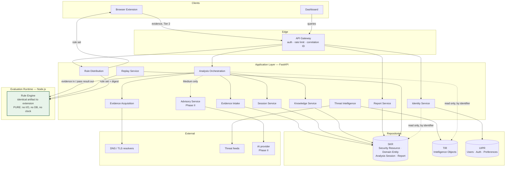

# SecureSphere X — Backend Architecture Specification

**Version:** 1.0 · **Status:** For architectural review
**Conforms to:** Specification v0.8 · Domain Model · Persistence Architecture Specification (Rev 2) · Contracts D0.1–D0.5, D0.8–D0.10 · Implementation Ownership Plan
**Rule set:** `rules-v0.1` — unchanged by this document

---

## 0. Blocking Dependencies Declared Before Design

Two gaps in the frozen corpus sit directly in this document's path. Both are declared here rather than silently filled, because filling them would constitute redesigning frozen architecture.

### GAP-3 — Persistence Architecture Specification: three unreadable pages

Three pages of the ratified Persistence Architecture Specification render as the single word `SUPERSEDED`. Cross-references in the surrounding text identify the missing content as:

| Missing | Sections | Required by |
|---|---|---|
| Page 6 | §12 Repository Interaction Principles · §13 Persistence Boundaries · **§14 Canonical Identity Model** · **§15 Identity Lifecycle** | §7 Repository Layer, §19 Invariants |
| Page 12 | §30 (tail) · §31 Knowledge Lifecycle · §32 Knowledge Update Policy · **§33 Current Security State Governance** · §34 Analysis History Governance · §35 (head) | §15 State Management, §7 Repository Layer |
| Page 16 | §41 (tail) Ubiquitous Language · §42 (head) incl. ADR-001 | §19 Invariants |

**Consequence.** §14 Canonical Identity Model and §15 Identity Lifecycle define how a Security Resource acquires and retains canonical identity, and §33 defines the governance of Current Security State. Both are load-bearing for the repository layer. This document specifies those areas **to the boundary of what is derivable from surviving cross-references**, and marks every point where the frozen text must supply the answer with `[GAP-3]`.

**This has been raised five times without resolution.** It does not block backend implementation from starting; it blocks the Security Knowledge Repository from being implemented correctly.

### GAP-5 — Engine execution locus is unresolved *(NEW — blocks §2, §4, §6, §14, §16)*

Three frozen statements cannot all hold under any single reading:

1. **Architecture.pdf §2.5, §3.3** — "Backend-Centric Decision Making: final security decisions are produced by the backend"; the Presentation Layer "never performs final security classification independently."
2. **Rule Engine §16.1, §3.2** — Tier 0 and Tier 1 SHALL NOT perform network I/O, with budgets of 10 ms and 50 ms. Evaluation at those tiers is therefore necessarily client-side.
3. **Stage 0 Completion Pack §2.1** — one TypeScript engine, browser-free, consumed by both extension and harness. A second implementation would make the §17.2 replay gate verify an engine that is not the one shipping.

Three candidate resolutions:

| | Description | Verdict |
|---|---|---|
| **E1** | Engine runs client-side only; backend is persistence, intelligence and reporting | **Rejected** — contradicts (1) |
| **E2** | Same engine build runs in both places: client at Tier 0/1, backend at Tier 2 | **Only reading consistent with all three** |
| **E3** | Engine runs backend-only | **Rejected** — contradicts (2); a 10 ms budget excludes a network round trip |

**This document is written on the E2 basis.** E2 is a derivation from frozen constraints, not a new decision — but it carries a material consequence that requires explicit sign-off:

> **The backend runtime is not Python alone.** It is FastAPI plus a Node.js **Evaluation Runtime** executing the identical TypeScript engine artifact shipped in the extension. A Python reimplementation is prohibited: it would create the second implementation §17.2 exists to prevent, and the replay gate would verify neither of the two engines actually in production.

Sections 2, 4, 6, 14 and 16 depend on this. **Confirmation required before implementation begins.**

---

## 1. Backend Philosophy

### 1.1 Objectives

The backend exists to do four things the client cannot do correctly, and nothing else:

1. **Adjudicate at Tier 2 with authority.** Produce the Security Assessment that constitutes SecureSphere X's official determination, consistently across every user.
2. **Hold what must be shared.** Threat intelligence, rule-set versions, and cross-user knowledge cannot live on a device.
3. **Persist what must survive.** Analysis Sessions, Analysis History, and knowledge objects, under the immutability guarantees the Domain Model requires.
4. **Serve what must be reconstructable.** Reports, dashboard history, and replay, from persisted artifacts rather than recomputation.

### 1.2 Design Philosophy

**The backend is a decision authority, not an evidence collector.** It never observes a page. It receives evidence gathered by a client that was there, evaluates it deterministically, and records the outcome. This inversion — the privileged component being the one furthest from the data — is deliberate: it keeps the trusted evaluation path small, auditable, and identical for every user.

**The backend is a thin shell around a pure engine.** The Evaluation Runtime is a pure function: evidence in, Analysis Pass Result out. It performs no I/O, holds no state, and reaches no database. Every stateful concern — persistence, transactions, caching, identity — lives outside it. This is what makes replay meaningful: replaying a session means re-invoking a pure function against persisted inputs.

**The backend refuses knowledge it must not hold.** The Authentication History Store is client-local and never transmitted (§20.2). The backend has no endpoint that accepts it, no schema that stores it, and no service that serves it. This is an architectural absence, enforced by having nowhere for the data to go.

### 1.3 Responsibilities

| # | Responsibility | Rationale |
|---|---|---|
| R1 | Tier 2 evaluation execution | §3.2 — Tier 2 permits backend evidence and relaxed latency |
| R2 | Analysis Session lifecycle and persistence | Persistence Spec §26 — SKR owns Analysis Session |
| R3 | Knowledge object custody (Security Resource, Domain Entity) | Persistence Spec §9 |
| R4 | Threat intelligence custody and promotion | Persistence Spec §27, §37 |
| R5 | Rule-set version distribution and integrity | §12.2 — released versions immutable |
| R6 | Report metadata generation and serving | Persistence Spec §28 |
| R7 | User identity, authentication, personalisation | Persistence Spec §29 — UIPR |
| R8 | Replay execution and determinism verification | §17.2 release gate |
| R9 | Backend-sourced evidence acquisition (DNS, TLS, reputation) | D0.1 — harness/backend-exclusive categories |
| R10 | Advisory escalation *(Phase II)* | §1.4 |

### 1.4 Non-Responsibilities

Explicit, because each is a boundary someone will otherwise cross.

| # | NOT a backend responsibility | Why |
|---|---|---|
| N1 | **Authentication History Store, in any form** | §20.2 — never transmitted off-device, including hashed or derived. There is no backend service for this. The deliverable brief lists an "Authentication History Service"; **it must not exist.** |
| N2 | Tier 0 / Tier 1 evaluation | §16.1 — no network I/O; 10 ms and 50 ms budgets |
| N3 | Evidence collection from live pages | The backend was not present at the navigation; it would observe a different page than the user (cloaking) |
| N4 | Enforcement — blocking, warning, navigating, rendering | Domain Model §6.6, §8.6.7 — the analytical layer recommends; downstream executes |
| N5 | Capture pipeline | Role C offline tooling; outside the product boundary entirely |
| N6 | Calibration and weight tuning | Role C offline activity against corpus; the backend consumes released rule sets only |
| N7 | Rule authoring | Rule sets arrive as released, versioned, integrity-checked artifacts |

### 1.5 Architectural Principles

**P1 — Engine purity is absolute.** The Evaluation Runtime performs no I/O and reaches no database. Every input arrives as an argument.

**P2 — Determinism is a boundary property.** Given identical evidence and rule-set version, the backend produces an identical Analysis Pass Result. Wall-clock time, request ordering, and database state are not inputs.

**P3 — Immutability is enforced at the repository, not by convention.** Analysis Sessions, Correlation Findings, and Analysis History are append-only at the persistence layer. No update path exists in code.

**P4 — Ownership is exclusive.** Three repositories, non-overlapping aggregates, one-directional dependency `UIPR → SKR → TIR` (Persistence Spec §39). Cross-repository writes are prohibited.

**P5 — Contracts are generated, never hand-written twice.** Python contract types are generated from the frozen TypeScript definitions. A hand-maintained Python mirror drifts, and the drift surfaces as silent evidence-shape mismatch.

**P6 — Degraded capability is recorded, never silent** (§15.1). Backend evidence unavailable means `unevaluable(backend_unreachable)` in the capability set, not an absent finding.

### 1.6 Separation of Concerns

| Concern | Owner | Never touches |
|---|---|---|
| HTTP, serialisation, status codes | API Layer | Domain objects, repositories |
| Use-case orchestration, transactions | Application Layer | HTTP, SQL |
| Invariants, domain semantics | Domain Layer | I/O of any kind |
| Rule evaluation | Evaluation Runtime *(Node)* | Database, network, clock |
| Aggregate persistence | Repository Layer | HTTP, business rules |
| Drivers, process management, clients | Infrastructure Layer | Domain semantics |

### 1.7 Security Principles

**Zero trust toward the client.** Evidence arrives from an extension running on a machine the operator does not control. It is treated as untrusted input: schema-validated, semantically validated, and bounded. A client cannot submit a Security Assessment, only evidence.

**The client cannot influence its own verdict beyond evidence.** No endpoint accepts a score, tier, finding, or rule-set override. Submitting evidence is the only channel.

**Least knowledge.** The backend stores the minimum required for its ten responsibilities. Full URLs are stored only where the Domain Model requires a Target Resource identity; the Authentication History Store is never received.

**Trust boundaries are explicit** (§10.10) and every crossing is validated.

### 1.8 Scalability Principles

**Tier 2 frequency, not navigation frequency, is the load model.** Tier 0/1 are client-local and generate no backend traffic. Backend load scales with credential submissions, downloads, and permission requests — roughly two orders of magnitude below navigation volume. This is a design property of the tier model (§13.4) and must be preserved: introducing backend calls at Tier 0/1 would void it.

**Stateless application tier.** All request-scoped state lives in the request or the database. Horizontal scaling requires no affinity.

**The Evaluation Runtime is CPU-bound and horizontally scalable.** It holds no state between invocations.

### 1.9 Reliability Principles

**Graceful degradation over failure** (§15.3). Backend evidence unavailable degrades the capability set; it does not fail the pass. Advisory unavailable resolves Medium to Warn.

**Fail-closed on rule-set integrity.** A rule set failing its integrity check is not used. A partial rule set produces confidently wrong scores — worse than none.

**Atomic pass commit** (§15.4). A pass is committed whole or not at all. No partially aggregated score reaches Current Security State.

---

## 2. High-Level Backend Architecture

### 2.1 Subsystems

| Subsystem | Responsibility | Runtime |
|---|---|---|
| **API Gateway** | HTTP termination, authentication, rate limiting, correlation ID assignment | FastAPI |
| **Analysis Subsystem** | Tier 2 orchestration, evidence intake, session lifecycle | FastAPI |
| **Evaluation Runtime** | Deterministic rule evaluation — the shipped TS engine | **Node.js sidecar** |
| **Knowledge Subsystem** | Security Resource, Domain Entity, Analysis History | FastAPI + SKR |
| **Intelligence Subsystem** | Intelligence Objects, feeds, promotion pipeline | FastAPI + TIR |
| **Identity Subsystem** | Users, authentication, personalisation | FastAPI + UIPR |
| **Reporting Subsystem** | Report metadata, dashboard queries | FastAPI + SKR |
| **Rule Distribution** | Versioned rule-set serving and integrity | FastAPI |
| **Replay Subsystem** | Determinism verification against persisted sessions | FastAPI + Evaluation Runtime |
| **Evidence Acquisition** | Backend-exclusive evidence: DNS, TLS, reputation | FastAPI |
| **Observability** | Structured logging, metrics, audit trail | Cross-cutting |
| **Advisory Subsystem** *(Phase II)* | AI escalation for Medium outcomes | FastAPI |

### 2.2 Component Diagram



**Absent by design:** there is no Authentication History component anywhere in this diagram. §20.2 makes it client-local; the backend has no place to put it.

### 2.3 Dependency Graph

```
API Layer
   ↓
Application Layer ──────────────┐
   ↓                            ↓
Domain Layer          Evaluation Runtime (process boundary)
   ↓
Repository Layer
   ↓
Infrastructure Layer
```

Dependencies point strictly downward. The Evaluation Runtime is invoked *by* the Application Layer and depends on nothing inside the backend — it receives arguments and returns a value.

Repository dependency follows Persistence Spec §39: `UIPR → SKR → TIR`, references by identifier only, read-only across boundaries.

### 2.4 Runtime Interaction — Tier 2 Gate

1. Extension reaches a Tier 2 gate; submits evidence with session and pass identifiers.
2. Gateway authenticates, rate-limits, assigns a correlation ID.
3. Analysis Orchestration validates evidence against the generated contract.
4. Evidence Intake persists Security Evidence *(immutable)*.
5. Evidence Acquisition resolves backend-exclusive categories, or marks them `notCollected`.
6. Orchestration invokes the Evaluation Runtime: evidence set + rule-set version → Analysis Pass Result.
7. Pass Result persisted **atomically** with the Current Security State update, under compare-and-set with the monotonic tier floor.
8. Knowledge Service updates Security Resource and Domain Entity.
9. Response returns the Security State View (D0.9) to the extension, which decides enforcement.

Step 6 performs no I/O. Steps 4 and 7 are the only write transactions.

---

## 3. Layered Architecture

### 3.1 API Layer

**Responsibilities.** HTTP termination, request/response serialisation, status-code mapping, schema validation at the boundary, authentication enforcement, rate limiting, correlation ID assignment, API versioning.

**Allowed dependencies.** Application Layer, Shared Kernel (contracts), middleware.
**Prohibited.** Repositories, Domain Layer internals, the Evaluation Runtime, SQL, direct database sessions.

**Ownership.** Role B (contract conformance) with Role A consulted on client-facing shapes.
**Lifecycle.** Request-scoped. No state survives a request.

**Rationale.** Keeping HTTP concerns out of the Application Layer allows the same use case to be driven by a test harness, a replay run, or a future transport without modification.

### 3.2 Application Layer

**Responsibilities.** Use-case orchestration, transaction boundary definition, cross-service coordination, invocation of the Evaluation Runtime, mapping between contracts and domain objects.

**Allowed.** Domain Layer, Repository interfaces, Evaluation Runtime client, Shared Kernel.
**Prohibited.** HTTP objects, SQL, ORM sessions directly, engine internals.

**Ownership.** Role B.
**Lifecycle.** Request-scoped services; transaction scope defined here and nowhere else.

**Rationale.** Transactions belong where the use case is known. A repository cannot know whether it is one step of a larger atomic operation.

### 3.3 Domain Layer

**Responsibilities.** Domain concepts as defined by the Domain Model; invariant enforcement; value objects; aggregate roots; domain exceptions.

**Allowed.** Shared Kernel only.
**Prohibited.** Everything else — no I/O, no repositories, no HTTP, no engine, no clock.

**Ownership.** Role B, Architecture Owner review mandatory.
**Lifecycle.** Pure objects; no lifetime.

**Rationale.** Domain Model §7.5.4 requires the domain to remain independent of implementation technology. Purity is what makes that testable rather than aspirational.

### 3.4 Evaluation Layer *(process boundary)*

**Responsibilities.** Execute `rules-v0.1` against an evaluation set; produce an Analysis Pass Result conforming to D0.4.

**Allowed.** Nothing. The runtime receives arguments and returns a value.
**Prohibited.** Database, network, filesystem, clock, randomness — enforced by CI gate G-3 on the engine package.

**Ownership.** Role B.
**Lifecycle.** Long-lived Node process; stateless between invocations; horizontally scalable.

**Rationale.** This is the identical artifact shipped in the extension (GAP-5/E2). Determinism, replay, and the §17.2 release gate all depend on there being exactly one engine.

### 3.5 Repository Layer

**Responsibilities.** Aggregate persistence and retrieval; enforcement of boundary, reference and invariant rules for owned aggregates; optimistic concurrency.

**Allowed.** Domain Layer, Infrastructure Layer.
**Prohibited.** Application Layer, API Layer, other repositories' aggregates for writing.

**Ownership.** Role B.
**Lifecycle.** Request-scoped, bound to a unit of work.

**Rationale.** Persistence Spec §8 — a repository owns the full lifecycle of its aggregates and may only read those it does not own.

### 3.6 Infrastructure Layer

**Responsibilities.** Database drivers and session management, HTTP clients, Node process supervision, secret retrieval, external resolvers.

**Allowed.** Shared Kernel, third-party libraries.
**Prohibited.** Domain semantics, business rules.

**Ownership.** Role B, with Role C consulted on evidence acquisition.
**Lifecycle.** Mostly singleton (pools, clients); some request-scoped (sessions).

### 3.7 Shared Kernel

**Responsibilities.** Contract types generated from the frozen TypeScript definitions; identifiers; error taxonomy; correlation context.

**Allowed.** Nothing internal.
**Prohibited.** All internal layers.

**Ownership.** Role B; **contracts are frozen and generated, never edited in Python.**

**Rationale.** P5. A hand-maintained Python mirror of D0.1 will drift from the TypeScript source, and the drift surfaces as evidence-shape mismatch that no test catches until integration.

### 3.8 Layer Enforcement

Layering is enforced mechanically, mirroring the frontend approach: an import-linter contract in CI, plus a check that `domain/` imports nothing but `contracts/`. A layering violation fails the build rather than surfacing at review.

---

## 4. Services

### 4.1 Analysis Orchestration Service

**Purpose.** Coordinate a single Tier 2 analysis pass end to end.

**Responsibilities.** Validate the pass request; ensure session exists and is in a valid state; sequence evidence intake, acquisition, evaluation, and commit; enforce atomicity; produce the Security State View.

**Inputs.** Evidence bundle (D0.1), session identifier, pass ordinal, trigger, rule-set version.
**Outputs.** Security State View (D0.9); persisted Analysis Pass Result.

**Internal dependencies.** Evidence Intake, Evidence Acquisition, Session Service, Evaluation Runtime client, Knowledge Service, Advisory Service (Phase II).
**External dependencies.** None directly.

**State ownership.** None. Fully stateless; all state delegated.

**Concurrency.** Multiple gates may fire on one session concurrently — a download initiated while a credential submit is pending. Passes on a single session are **serialised by an advisory lock keyed on session identifier**, because pass ordinal must be dense and monotonic, and Current Security State updates must respect the §11.3 tier floor. Cross-session concurrency is unbounded.

**Failure modes.** Evidence validation failure → 422, no persistence. Evaluation Runtime unreachable → 503, no persistence. Commit failure → transaction rollback, pass abandoned and recorded as such (§15.3).

**Recovery.** Pass commit is idempotent on `(sessionId, passOrdinal)`. A client retry after timeout returns the committed result rather than producing a second pass.

**Performance.** p95 under 1000 ms including backend evidence acquisition, per §16.1.

**Scalability.** Stateless; scales horizontally. The session advisory lock is the only serialisation point and is per-session, not global.

### 4.2 Evaluation Execution Service

**Purpose.** Provide the backend's interface to the Node Evaluation Runtime.

**Responsibilities.** Marshal the evaluation set and rule-set reference; invoke the runtime; unmarshal the Analysis Pass Result; enforce timeout; verify the returned rule-set version matches the requested one.

**Inputs.** Evaluation set, rule-set version identifier.
**Outputs.** Analysis Pass Result (D0.4).

**Internal dependencies.** Rule Distribution Service (for the resolved rule set).
**External dependencies.** Node Evaluation Runtime process.

**State ownership.** None. The runtime is stateless between invocations.

**Concurrency.** A pool of runtime workers; invocations are independent and may be freely parallelised. No shared mutable state exists to protect.

**Failure modes.** Runtime unreachable, timeout, malformed result, rule-set version mismatch. All are hard failures — the pass does not commit. **Degrading to a partial evaluation is prohibited**: a partial rule set produces confidently wrong scores.

**Recovery.** Worker restart under supervision; requests retried once against a different worker, then failed.

**Performance.** Evaluation itself is bounded by §16.2 complexity: O(R) predicate matching over eleven rules, O(F) aggregation. Expected single-digit milliseconds. Marshalling dominates.

**Scalability.** Worker count scales with CPU. This is the only CPU-bound component in the backend.

### 4.3 Evidence Intake Service

**Purpose.** Validate and persist client-submitted Security Evidence.

**Responsibilities.** Schema validation against generated D0.1 contracts; semantic validation (§11); size and cardinality bounds; rejection of any field the client must not supply; immutable persistence.

**Inputs.** Evidence bundle, session identifier, collection context.
**Outputs.** Persisted Security Evidence with assigned evidence identifiers.

**State ownership.** Security Evidence records *(immutable on write)*.

**Concurrency.** Append-only; no contention.

**Failure modes.** Schema violation → 422 with field-level detail. Bounds exceeded → 413. Contract version mismatch → 409 with the supported version range.

**Security note.** This is the primary untrusted-input surface. Evidence is validated *before* any other processing, and a client cannot submit findings, scores, tiers, or capability sets — only observations.

### 4.4 Session Service

**Purpose.** Manage Analysis Session lifecycle per §3 and §19.

**Responsibilities.** Create sessions bound to exactly one Target Resource; enforce the state machine (§19.2); assign dense monotonic pass ordinals; finalise sessions; enforce immutability after finalisation.

**Inputs.** Target URL, private-context flag, lifecycle events.
**Outputs.** Session identifier; session state.

**State ownership.** Analysis Session aggregate (SKR).

**Concurrency.** Pass ordinal assignment is serialised per session via the same advisory lock as orchestration. Session creation is unserialised.

**Failure modes.** Invalid state transition → 409 with current state. Writing to a finalised session → 409, always, without exception.

**Recovery.** Sessions abandoned mid-pass are recoverable: the pass is re-executed from persisted evidence, or the session is recorded as incomplete (§15.3).

### 4.5 Knowledge Service

**Purpose.** Custody of Security Resource and Domain Entity — the platform's current understanding.

**Responsibilities.** Resolve or create canonical Security Resource identity; maintain Current Security State (replaceable); append to Analysis History (append-only); accumulate Knowledge Metadata; maintain Domain Entity.

**Inputs.** Analysis Pass Result, Target Resource reference.
**Outputs.** Updated knowledge objects.

**State ownership.** Security Resource, Domain Entity, Current Security State, Knowledge Metadata, Analysis History (all SKR).

**Concurrency.** Current Security State is updated by **compare-and-set on a version column**, with the monotonic tier floor applied inside the transaction. Two concurrent passes cannot produce a lower tier than one already presented (§11.3). Analysis History is append-only and contention-free. Knowledge Metadata accumulates and is never overwritten.

**Failure modes.** CAS conflict → retry with re-read, bounded to three attempts, then 409.

`[GAP-3]` **Canonical identity resolution and supersession handling are governed by Persistence Spec §14 and §15, which are unreadable.** The service interface is defined here; the identity derivation rule, the normalisation-to-identity mapping, and the supersession trigger conditions must come from the frozen text.

### 4.6 Threat Intelligence Service

**Purpose.** Custody of Intelligence Objects, independent of analytical activity (Persistence Spec §11, §36).

**Responsibilities.** Ingest external feeds; maintain Confidence and Validity as first-class governed attributes; execute the internal promotion pipeline (§37); serve lookups to Evidence Acquisition; manage the Intelligence Object lifecycle (Created → Validated → Published → Retired).

**State ownership.** Intelligence Objects, Threat Feed Records, IOC Collections, Threat Sources, Reputation Data (all TIR).

**Concurrency.** Feed ingestion is batch and idempotent on feed record identity. Lookups are read-only.

**Architectural constraint.** TIR is fully independent of SKR and UIPR. Intelligence exists and evolves whether or not any analysis has occurred. Promotion is one-directional: SKR analytical output → TIR Intelligence Object, by identifier reference only, never embedding.

### 4.7 Rule Distribution Service

**Purpose.** Serve versioned, integrity-verified rule sets to the Evaluation Runtime and to extension clients.

**Responsibilities.** Store released rule-set versions immutably; verify integrity digests on load; serve by version; refuse partial or failing artifacts; expose the current recommended version.

**State ownership.** Rule-set artifacts and their digests.

**Concurrency.** Read-heavy; cached in memory keyed by version, with the digest as the cache key so a mismatched artifact cannot be served from cache.

**Failure modes.** Integrity failure → **fail-closed**. Fall back to the last known-good version and record the fallback. If no known-good version exists, evaluation does not proceed and Tier 2 gates warn on unavailable protection (§15.3).

**Rationale.** §12.2 makes a released version immutable. Serving a mutated artifact would silently change historical decisions and void replay.

### 4.8 Replay Service

**Purpose.** Execute the §17.2 release gate and support forensic reconstruction.

**Responsibilities.** Reconstruction replay — re-invoke the engine against a persisted session's evaluations under its recorded rule-set version and assert identical output. Regression replay — same inputs, candidate rule-set version, enumerate divergences.

**Inputs.** Session identifiers or a golden corpus reference; rule-set version.
**Outputs.** Replay report: reproduced, diverged, or failed, with per-session detail.

**State ownership.** Replay run records.

**Concurrency.** Embarrassingly parallel; each session is independent.

**Performance.** Batch-oriented; no interactive latency requirement.

**Architectural note.** Replay reads persisted evaluations rather than re-deriving them, so a stale fingerprint store or an unavailable resolver cannot alter a replay result. This is why D0.4 persists the complete evaluation set.

### 4.9 Report Service

**Purpose.** Generate and serve report metadata (Persistence Spec §28).

**Responsibilities.** Produce report metadata referencing an Analysis Session by identifier; serve technical and user-facing report projections; never embed analytical content.

**State ownership.** Report aggregate (SKR) — metadata only.

**Architectural constraint.** A Report contains metadata only. Analytical detail resolves through the referenced Analysis Session. Embedding it would duplicate immutable knowledge and create a second source of truth.

### 4.10 Identity Service

**Purpose.** UIPR custody — users, authentication, MFA, preferences, notification settings.

**Responsibilities.** Registration, authentication, token issuance and rotation, preference management, saved analysis references.

**State ownership.** User aggregate (UIPR).

**Architectural constraint.** UIPR may reference Analysis Session and Security Resource by identifier, read-only. It **must never embed analytical data** (Persistence Spec §29).

### 4.11 Evidence Acquisition Service

**Purpose.** Resolve the evidence categories a browser extension cannot obtain.

**Responsibilities.** DNS resolution, TLS chain retrieval, threat intelligence lookup; convert failures into `notCollected(reason)` rather than absent values.

**External dependencies.** DNS resolvers, TLS endpoints, TIR.

**Failure modes.** Any acquisition failure → the affected evidence fields become `notCollected`, the affected rules become `unevaluable`, and the pass is marked **degraded** (§15.2). The pass still completes.

**Performance.** This service dominates Tier 2 latency. Acquisitions run concurrently with a hard aggregate deadline; whatever has not resolved by the deadline is `notCollected(timeout)`.

**Security note.** This service fetches URLs supplied by clients. It requires SSRF protection: private address ranges blocked, redirects bounded, response sizes capped, and a dedicated egress path.

### 4.12 Advisory Service *(Phase II)*

**Purpose.** AI escalation for Medium outcomes.

**Responsibilities.** Invoke the advisory model; construct an Advisory Finding; persist invocation input and output with the session; enforce timeout.

**Failure modes.** Unreachable, timeout, or malformed output → treated as unavailable; Medium resolves to Phase I behaviour (Warn). The deterministic pipeline never blocks awaiting advisory input.

**Architectural constraint.** An Advisory Finding is never the sole basis for Block, is always attributed as AI-generated, and enters only a second or subsequent pass (§1.4).

---

## 5. Controllers

Controllers own HTTP concerns exclusively. None contains business logic; each delegates to exactly one application service.

### 5.1 Analysis Controller

**Endpoints owned.** Session creation; Tier 2 pass submission; current state retrieval; session finalisation.
**Validation.** Schema validation against generated D0.1/D0.10 contracts; payload bounds.
**Authentication.** Extension client credential required.
**Authorization.** A client may act only on sessions it created.
**Error mapping.** Validation → 422 · unknown session → 404 · invalid transition → 409 · runtime unavailable → 503 · evidence too large → 413.
**Response.** Security State View (D0.9).
**Logging.** Correlation ID, session ID, pass ordinal, tier, degraded flag. **Never evidence content.**
**Metrics.** Pass latency by tier, evaluation duration, degradation rate, tier distribution.
**Versioning.** URI-versioned; contract version negotiated by header.

### 5.2 Intervention Controller

**Endpoints owned.** Intervention presented; user disposition reported.
**Rationale.** D0.8/D0.10 invariants B-10 and B-11 — §11.4's intervention lock and store guard G-02 are unimplementable without this feedback path.
**Validation.** Session must exist; intervention must correspond to a committed pass.
**Error mapping.** Unknown session → 404 · no matching pass → 409.
**Security note.** Accepts a report *that* an intervention occurred. It does not accept a tier, score, or finding.

### 5.3 Rule Distribution Controller

**Endpoints owned.** Current recommended version; fetch by version; integrity digest.
**Authentication.** Client credential required; rule sets are not public.
**Error mapping.** Unknown version → 404 · integrity failure → 500 with an alert raised.
**Caching.** Immutable artifacts; long-lived cache headers keyed by version.

### 5.4 Dashboard Controller

**Endpoints owned.** Analysis history, session detail, report retrieval, resource summaries.
**Authentication.** JWT bearer (user session).
**Authorization.** Users access only their own history. Cross-user access is prohibited without an explicitly modelled role, which Phase I does not define.
**Error mapping.** Unauthorised → 401 · forbidden → 403 · not found → 404.
**Logging.** Access to another user's data is an audit event, whether or not it succeeds.

### 5.5 Identity Controller

**Endpoints owned.** Registration, login, token refresh, logout, MFA enrolment and verification, preferences.
**Validation.** Credential format; password policy; MFA challenge state.
**Error mapping.** Authentication failure → 401 with a uniform message and constant-time comparison — never distinguishing unknown user from wrong password.
**Rate limiting.** Strict, per-account and per-IP.
**Logging.** Authentication outcomes are audit events. Credentials never appear in logs at any level.

### 5.6 Health and Readiness Controller

**Endpoints owned.** Liveness, readiness, version.
**Readiness semantics.** Ready requires database reachable, Evaluation Runtime responsive, and a valid rule set loaded. **A backend with no valid rule set is not ready**, because it cannot evaluate.
**Authentication.** Liveness unauthenticated; readiness detail authenticated.

---

## 6. Business Layer

### 6.1 Composition

| Kind | Role | Example |
|---|---|---|
| **Application Service** | Orchestrates one use case; owns the transaction boundary | Analysis Orchestration |
| **Domain Service** | Domain logic spanning aggregates, no I/O | Knowledge update policy |
| **Domain Model** | Invariants intrinsic to one aggregate | Session state machine |

### 6.2 Pipeline Orchestration

The Tier 2 pass orchestration sequence:

```
validate evidence
      ↓
persist evidence            [TX 1 — commit]
      ↓
acquire backend evidence    (concurrent, deadline-bounded, failures → notCollected)
      ↓
invoke Evaluation Runtime   (pure; no transaction; no I/O)
      ↓
persist pass result
  + update Current Security State (CAS + monotonic floor)
  + append Analysis History
  + update knowledge objects        [TX 2 — atomic commit]
      ↓
project Security State View
```

**Two transactions, deliberately.** Evidence is persisted before evaluation so that a runtime failure does not discard collected observations — the evidence remains available for a retry or for forensic reconstruction. Evaluation itself is transactionless because it is pure. The commit is atomic across pass result, state, history, and knowledge, satisfying §15.4.

### 6.3 Transaction Boundaries

| Boundary | Scope | Isolation |
|---|---|---|
| TX 1 — Evidence persistence | Security Evidence rows | Read committed |
| TX 2 — Pass commit | Pass Result · Current Security State · Analysis History · Security Resource · Domain Entity | Read committed + CAS on state version |
| Session creation | Analysis Session row | Read committed |
| Intelligence promotion | Intelligence Object insert | Read committed; idempotent on source reference |

**Transactions never span the Evaluation Runtime invocation.** Holding a database transaction across a process boundary would couple database connection lifetime to engine latency and create a distributed-transaction problem the architecture does not need.

### 6.4 Cross-Service Interaction Rules

- Application services may call domain services and repositories. They may not call one another's internals.
- Cross-repository writes are prohibited. A use case needing to affect two repositories does so as two operations, with the SKR operation authoritative.
- No service reaches into another's state ownership.

### 6.5 What Belongs Here

Use-case sequencing · transaction boundaries · orchestration of evidence, evaluation and persistence · projection of domain objects into contracts · authorisation decisions requiring domain knowledge.

### 6.6 What Must Never Belong Here

| Prohibited | Belongs to |
|---|---|
| Rule evaluation, scoring, suppression, aggregation | Evaluation Runtime |
| Threshold interpretation | Rule set |
| SQL, ORM specifics | Repository Layer |
| HTTP status decisions | API Layer |
| Enforcement decisions | Client |
| Any Authentication History logic | **Nowhere — client-local (§20.2)** |

---

## 7. Repository Layer

### 7.1 Security Knowledge Repository (SKR)

**Owned aggregates.** Security Resource, Domain Entity, Analysis Session, Report metadata — with Current Security State, Knowledge Metadata and Analysis History as Security Resource components.

**Persistence strategy.** PostgreSQL. Aggregates map to tables with identifier-only references; embedding is prohibited (Persistence Spec §20).

**Responsibilities.** Enforce aggregate boundaries; enforce immutability of finalised Analysis Sessions and Analysis History; enforce Domain Entity smallness; resolve canonical identity.

**Caching.** Current Security State is cacheable per session with the version as cache key. Analysis Sessions and History are immutable and therefore freely cacheable. Knowledge objects are **not** cached for write paths — CAS requires a fresh read.

**Transactions.** Participates in a unit of work owned by the Application Layer. Never opens its own transaction.

**Concurrency.** **Optimistic** on Current Security State via a version column. Chosen over pessimistic because contention is per-session and rare — concurrent passes on one session are the exception — and pessimistic locking would serialise across the request lifetime including engine latency.

**Locking exception.** Pass ordinal assignment uses a **PostgreSQL advisory lock keyed on session identifier**. Ordinals must be dense and monotonic, which optimistic retry cannot guarantee without gaps.

**Error handling.** CAS conflict → bounded retry (three), then surfaced as 409. Attempted write to a finalised session → domain exception, never retried.

**Versioning.** Rows carry the contract version they were written under, so a contract evolution does not silently reinterpret historical data.

`[GAP-3]` **Canonical Identity Model (§14) and Identity Lifecycle (§15) are unreadable.** The repository interface below is defined; identity derivation, normalisation-to-identity mapping, and supersession triggers must come from the frozen text. **Implementing SKR against a guessed identity model would produce a schema that cannot be corrected without data migration.**

**Interface.**
```
SecurityResourceRepository
  get_by_identity(identity) -> SecurityResource | None
  resolve_or_create(normalized_reference) -> SecurityResource     [GAP-3]
  update_current_state(id, new_state, expected_version) -> bool   (CAS)
  append_analysis_reference(id, session_id) -> None               (append-only)
  accumulate_knowledge_metadata(id, delta) -> None                (never overwrite)

DomainEntityRepository
  get_by_fqdn(fqdn) -> DomainEntity | None
  upsert_domain_state(fqdn, state) -> None

AnalysisSessionRepository
  create(target_resource_id, context) -> AnalysisSession
  next_pass_ordinal(session_id) -> int                            (advisory lock)
  append_pass_result(session_id, pass_result) -> None             (append-only)
  finalize(session_id) -> None                                    (irreversible)
  get_with_evaluations(session_id) -> AnalysisSession              (replay input)

ReportRepository
  create_metadata(session_id, descriptor) -> Report
  get(report_id) -> Report | None
```

### 7.2 Threat Intelligence Repository (TIR)

**Owned aggregates.** Intelligence Object, Threat Feed Record, IOC Collection, Threat Source, Reputation Data.

**Persistence strategy.** PostgreSQL, separate schema. TIR is independent of SKR and UIPR and could be relocated without touching either.

**Caching.** Aggressive on lookup paths — indicator lookups are read-heavy and tolerate short staleness. Cache invalidated on feed ingestion.

**Concurrency.** Feed ingestion is batch and idempotent on `(source, feed_record_id)`. Lookups are read-only.

**Interface.**
```
IntelligenceRepository
  lookup_by_indicator(indicator) -> list[IntelligenceObject]
  ingest_feed_batch(source, records) -> IngestResult              (idempotent)
  promote_from_analysis(session_id, criteria) -> IntelligenceObject
  transition_lifecycle(id, to_state) -> None
```

### 7.3 User Identity & Personalisation Repository (UIPR)

**Owned aggregates.** User, Authentication, MFA, Preferences, Saved Analysis References, Notification Settings.

**Persistence strategy.** PostgreSQL, separate schema. Credential material stored as salted hashes using a memory-hard KDF.

**Concurrency.** Optimistic on preference updates; authentication state changes serialised per user.

**Constraint.** May reference Analysis Session and Security Resource by identifier, read-only. Never embeds analytical data.

**Interface.**
```
UserRepository
  get_by_id / get_by_email
  create(registration) -> User
  update_credentials(id, hash, expected_version) -> bool
  save_analysis_reference(user_id, session_id) -> None           (identifier only)
```

### 7.4 Repository Governance

Cross-repository writes are prohibited (Persistence Spec §10). References are by identifier and read-only. Dependency direction is `UIPR → SKR → TIR`, acyclic.

**Enforced mechanically:** an import-linter contract prevents `uipr/` from importing `skr/` internals and vice versa, and a schema-level check confirms no foreign key crosses a repository boundary. Cross-repository references are plain identifier columns without referential constraints — deliberately, since a foreign key would couple the schemas and contradict §11's independence requirement.

---

## 8. Dependency Injection

### 8.1 Lifetimes

| Lifetime | Components | Rationale |
|---|---|---|
| **Singleton** | Settings, database engine and pool, Evaluation Runtime client pool, rule-set cache, HTTP clients, metrics registry, logger factory | Expensive to construct; safe to share; no request state |
| **Scoped (per request)** | Database session/unit of work, all repositories, all application services, correlation context | Bound to transaction lifetime; must not leak across requests |
| **Transient** | Domain objects, value objects, DTOs | Cheap; no identity |
| **Factory** | Evaluation Runtime worker leases, replay batch contexts | Acquired and released explicitly |

### 8.2 Composition

FastAPI's dependency system provides scoped resolution. The composition root is a single module wiring interfaces to implementations. **Application services depend on repository *interfaces* (Protocols), never concrete classes** — this is what makes the Application Layer testable without a database and what allows a repository to be replaced without touching a use case.

### 8.3 Configuration Injection

Settings are a validated singleton constructed at startup. **No component reads environment variables directly.** A component that reads its own configuration cannot be tested with alternative configuration, and its dependencies become invisible to the composition root.

### 8.4 Testing Strategy

| Level | Substitutes | Real |
|---|---|---|
| Domain unit | — | Everything (pure) |
| Application unit | Repositories (in-memory), Evaluation Runtime (recorded fixtures) | Application services, domain |
| Repository integration | — | PostgreSQL (ephemeral instance) |
| Evaluation integration | — | Real Node runtime, real rule set |
| API contract | Repositories | Full HTTP stack |
| Replay | — | Everything; asserts determinism |

**Mocking policy.** Repositories are substituted with in-memory implementations satisfying the same Protocol, not with mock objects. Behavioural fakes catch interface misuse that call-assertion mocks do not.

**The Evaluation Runtime is never mocked in integration tests.** Its output *is* the behaviour under test; substituting it tests the orchestration and nothing else.

---

## 9. Configuration System

### 9.1 Hierarchy

Later sources override earlier; every layer is validated as a whole at startup.

```
1. Code defaults          (safe, minimal, never production-viable)
2. Environment file       (per-environment, version-controlled, no secrets)
3. Environment variables  (deployment-specific)
4. Secret store           (credentials, keys — never files, never env in production)
5. Runtime feature flags  (bounded set, §9.4)
```

**Startup fails on invalid configuration.** A backend that starts with a missing database URL and fails on first request has converted a configuration error into an availability incident.

### 9.2 Configuration Domains

| Domain | Examples | Secret |
|---|---|---|
| Runtime | Host, port, worker count, log level | No |
| Database | DSN, pool sizes, statement timeout | **Yes** (credentials) |
| Evaluation Runtime | Worker count, invocation timeout, socket path | No |
| Rule set | Active version, artifact location, digest | No |
| Authentication | Token TTLs, issuer, algorithm | **Yes** (signing key) |
| Evidence acquisition | Resolver endpoints, deadlines, egress config | Partly |
| Rate limiting | Per-endpoint quotas and windows | No |
| Observability | Log destination, sampling, retention | No |
| Advisory *(Phase II)* | Provider endpoint, timeout, model identifier | **Yes** (API key) |

### 9.3 Secrets

Retrieved from a secret manager at startup; never committed, never in environment files, never logged at any level. Rotation is supported without redeploy for signing keys — the JWT verifier accepts a key set with an overlap window (§10.7).

The generated settings object marks secret fields such that their `repr` is redacted. A secret reaching a log line is an incident, and the type system is the cheapest place to prevent it.

### 9.4 Feature Flags

A deliberately small, bounded set:

| Flag | Purpose | Default |
|---|---|---|
| `advisory_enabled` | Phase II AI escalation | `false` |
| `backend_evidence_enabled` | Evidence acquisition on/off | `true` |
| `promotion_pipeline_enabled` | Intelligence promotion | `false` until governed |
| `replay_endpoint_enabled` | Replay API exposure | `false` in production |

**Flags never alter evaluation semantics.** A flag that changed how a rule scores would make the rule-set version an insufficient description of a decision and void replay. `advisory_enabled` is safe precisely because Advisory Findings are recorded in the Pass Result and enter only a second pass.

### 9.5 Environments

| | Development | Testing | Production |
|---|---|---|---|
| Database | Local ephemeral | Ephemeral per run | Managed, backed up |
| Secrets | Local file | Generated | Secret manager |
| Rule set | Local artifact | Pinned fixture | Released, digest-verified |
| Evaluation Runtime | Local process | Local process | Supervised sidecar |
| Advisory | Disabled | Stubbed | Phase II only |
| Replay endpoint | Enabled | Enabled | Disabled |
| Log level | DEBUG | INFO | INFO, WARN on security |

### 9.6 Version Compatibility

Startup asserts and records: contract versions (D0.1–D0.5, D0.8–D0.10), rule-set version and digest, engine build identifier, database schema version. **A mismatch between the engine's expected contract version and the backend's is a startup failure**, not a runtime surprise.

---

## 10. Security Architecture

### 10.1 Authentication

Two distinct principals, deliberately separated:

| Principal | Mechanism | Scope |
|---|---|---|
| **Extension client** | Client credential issued at install; short-lived access token | Analysis endpoints, rule distribution |
| **Dashboard user** | Password + optional MFA; JWT access token, rotating refresh token | Dashboard, identity endpoints |

An extension client token cannot read dashboard data. A user token cannot submit evidence. Conflating them would let a compromised extension credential read a user's history.

### 10.2 Authorization

Resource-scoped rather than role-scoped, because Phase I defines no roles:

- A client may act only on Analysis Sessions it created.
- A user may read only Analysis Sessions they own.
- No endpoint permits cross-user access. Absence of the capability is the control.
- Rule distribution requires authentication but no per-resource check — rule sets are not user data.

### 10.3 Input Validation

Three stages, in order (§11):

1. **Transport** — content type, size limits, JSON well-formedness.
2. **Schema** — generated contract validation; unknown fields rejected, not ignored.
3. **Semantic** — cardinality bounds, referential existence, state validity.

**Rejected outright at the boundary:** any client-supplied finding, score, tier, capability set, effective weight, or rule-set override. The evidence contract is the entire client input surface, and it contains observations only.

### 10.4 Output Validation

Responses are constructed from contract types, not from ORM objects. This prevents accidental disclosure of columns added later — a real failure mode when responses serialise database rows directly.

### 10.5 Rate Limiting

| Surface | Basis | Rationale |
|---|---|---|
| Authentication | Per-account and per-IP, strict | Credential stuffing |
| Evidence submission | Per client credential | Tier 2 frequency is bounded by design (§1.8); a client exceeding it is malfunctioning or hostile |
| Evidence acquisition (indirect) | Per client, separate quota | Each submission may trigger outbound fetches — this is an amplification surface |
| Dashboard queries | Per user | Enumeration and scraping |

### 10.6 CORS and CSRF

CORS: extension origins allow-listed explicitly; dashboard origin allow-listed; wildcards prohibited.

CSRF: analysis endpoints are token-authenticated with no ambient credentials, so CSRF does not apply. Dashboard endpoints using cookie-based refresh require `SameSite=Strict` and a double-submit token on state-changing operations.

### 10.7 JWT Strategy

Asymmetric signing (EdDSA or RS256) — the verification key may be distributed without granting issuance. Short access tokens; rotating refresh tokens with reuse detection. Claims carry subject, principal type, issued-at, expiry, and key identifier. Key rotation uses an overlap window; `kid` selects the verifying key.

**Symmetric signing is rejected**: it requires every verifier to hold the issuing key.

### 10.8 Session Management

Dashboard sessions are refresh-token-based with server-side revocation. **Analysis Sessions are not user sessions** — the collision of terms is unfortunate and is resolved throughout this document by always qualifying the analytical one.

### 10.9 Encryption and Audit

TLS 1.3 in transit, everywhere including internal hops. At rest: managed volume encryption; credential material additionally hashed with a memory-hard KDF.

Audit events — authentication outcomes, authorisation denials, rule-set version changes, integrity failures, promotion decisions, configuration changes, replay executions — are written to an append-only audit store, separate from application logs, with independent retention.

### 10.10 Trust Boundaries

| # | Boundary | Direction | Control |
|---|---|---|---|
| TB-1 | Extension → API | Untrusted → trusted | Authentication, full validation, rate limiting |
| TB-2 | Dashboard → API | Untrusted → trusted | Authentication, authorisation, CSRF |
| TB-3 | API → Evaluation Runtime | Trusted → trusted, process boundary | Local-only socket; not network-exposed |
| TB-4 | Backend → external resolvers | Trusted → untrusted | SSRF controls, deadlines, response caps |
| TB-5 | Backend → threat feeds | Trusted → untrusted | Signature/TLS verification, schema validation |
| TB-6 | Backend → AI provider *(II)* | Trusted → untrusted | No user identifiers transmitted; output never sole basis for Block |
| TB-7 | Client device ↔ backend | **Store never crosses** | §20.2 — no endpoint accepts it |

### 10.11 Threat Mitigations

| Threat | Mitigation |
|---|---|
| Forged verdict submission | No endpoint accepts findings, scores, or tiers |
| Evidence poisoning to force Allow | Evidence is observations only; scoring is backend-side under a versioned rule set |
| SSRF via evidence acquisition | Private ranges blocked, redirects bounded, size capped, dedicated egress |
| Rule-set tampering | Immutable releases, digest verification, fail-closed |
| Replay of captured requests | Idempotency keyed on `(sessionId, passOrdinal)`; short token lifetimes |
| Cross-user data access | Resource-scoped authorisation; audit on denial |
| Credential stuffing | Strict rate limiting, uniform error, constant-time comparison |
| Auth-store exfiltration | **Structurally impossible — the backend has no endpoint, schema, or service for it** |

### 10.12 Zero-Trust Assumptions

The client may be modified, its credential may be stolen, its evidence may be fabricated, and its enforcement may be bypassed. **None of these compromise other users.** Backend authority is per-session and per-resource; a hostile client can misrepresent its own page and nothing else. Promotion of analytical output into shared threat intelligence is governed and never automatic on a single session — which is what prevents one hostile client from poisoning shared intelligence.

---

## 11. Validation Framework

### 11.1 Pipeline

```
Transport validation      → 400 / 413 / 415
Schema validation         → 422 with field paths
Contract version check    → 409 with supported range
Semantic validation       → 422
Domain validation         → 409 (invariant violation)
Rule-set validation       (startup + on load, not per request)
```

### 11.2 Ownership

| Stage | Owner | Failure |
|---|---|---|
| Transport | Middleware | 400 / 413 / 415 |
| Schema | API Layer, generated validators | 422 |
| Contract version | API Layer | 409 |
| Semantic | Application Layer | 422 |
| Domain invariant | Domain Layer | 409 |
| Rule set (V-1…V-13) | Rule Distribution, at load | Startup failure or fail-closed |

### 11.3 Contract Validation

Validators are **generated from the frozen TypeScript contracts**, not hand-written. A hand-written Python validator drifts from D0.1 silently, and the drift appears as evidence accepted by the backend that the extension never produces — or worse, evidence rejected that it does.

Unknown fields are **rejected, not ignored**. Silent field dropping masks version skew until it manifests as a missing finding.

### 11.4 Rule-set Validation

Checks V-1 through V-13 (D0.3 §8) run at artifact load, not per request. **V-6** — no primary rule's base weight reaches the High threshold — is the machine check for the §1.5 layered-security invariant, which a PATCH-level weight change can violate trivially. **V-13** confines `ItemPath` to an `exists.where` subtree.

### 11.5 What Validation Must Not Do

It must not repair. A malformed evidence bundle is rejected, never coerced. Coercion would make the accepted input shape depend on the coercion logic rather than the contract, and two clients sending different malformed payloads could produce the same evaluation input by different routes.

---

## 12. Error Handling Architecture

### 12.1 Hierarchy

```
SecureSphereError
├── DomainError                    → 409
│   ├── InvariantViolation
│   ├── InvalidStateTransition
│   └── ImmutabilityViolation
├── ValidationError                → 422
│   ├── SchemaValidationError
│   ├── SemanticValidationError
│   └── ContractVersionMismatch    → 409
├── AuthorizationError             → 401 / 403
├── ResourceNotFound               → 404
├── ConcurrencyConflict            → 409
├── InfrastructureError            → 503
│   ├── DatabaseUnavailable
│   ├── EvaluationRuntimeUnavailable
│   └── ExternalServiceUnavailable
├── RuleSetIntegrityError          → 500 + alert
└── DegradedCapability             (not an error — recorded in the result)
```

**`DegradedCapability` is deliberately not an exception.** Degradation is a recorded property of a successful pass (§15.2), not a failure. Modelling it as an exception would push it into error handling, where it would be logged and discarded rather than surfaced to the user.

### 12.2 HTTP Mapping

Mapping occurs in exactly one place — an exception handler in the API Layer. Application and domain code raise typed exceptions and never reference status codes.

Error responses carry a stable machine-readable code, a human-readable message, the correlation ID, and field paths for validation errors. **They never carry stack traces, SQL, internal paths, or upstream messages.**

### 12.3 Retry and Idempotency

| Operation | Retryable | Idempotency key |
|---|---|---|
| Pass submission | Yes | `(sessionId, passOrdinal)` |
| Session creation | Yes | Client-supplied request identifier |
| Intervention report | Yes | `(sessionId, interventionOrdinal)` |
| Feed ingestion | Yes | `(source, feedRecordId)` |
| Promotion | Yes | `(sessionId, criteria)` |
| Authentication | **No** | — |

A retried pass submission returns the committed result rather than producing a second pass. Without this, a client timeout after a successful commit produces a duplicate pass, and pass ordinals stop being dense.

### 12.4 Failure Propagation

Infrastructure failures propagate as `InfrastructureError` and are **never** silently converted into empty results. An unreachable evidence resolver produces `notCollected`; an unreachable database produces 503. The distinction matters: the first is a recorded capability gap, the second is an outage.

### 12.5 Recovery

Evaluation Runtime worker failure → supervised restart; one retry on a different worker. Database connection failure → pool-level retry with backoff, bounded. Partial pass → transaction rollback; evidence survives; the pass is re-executable. Rule-set integrity failure → fall back to last known-good and alert; if none, refuse to evaluate.

---

## 13. Logging Architecture

### 13.1 Levels

| Level | Use |
|---|---|
| DEBUG | Development only; never enabled in production |
| INFO | Request lifecycle, pass commits, session transitions |
| WARN | Degradation, retries, CAS conflicts, fallbacks |
| ERROR | Failed requests, infrastructure failures |
| CRITICAL | Integrity failures, security control failures |

### 13.2 Structured Logging

JSON only. Every entry carries: timestamp, level, logger, correlation ID, principal type, and event code. Message strings are for humans; **event codes are for machines** — dashboards and alerts key on codes, so a message rewrite never breaks an alert.

### 13.3 Correlation

| Identifier | Scope | Purpose |
|---|---|---|
| Correlation ID | One request | End-to-end tracing |
| Trace ID | Distributed span tree | Cross-service tracing |
| Analysis Session ID | One navigation | Groups all passes |
| Pass Result ID | One pass | Links evaluation to decision |
| Rule-set version | Per pass | **Required to interpret any decision** |

Rule-set version in every decision log is not optional: a logged tier is uninterpretable without knowing which weights produced it.

### 13.4 Sensitive Data

**Never logged at any level:** credentials, tokens, session cookies, evidence content (DOM, form fields, script bodies), Authentication History content *(which the backend never receives)*, full URLs at DEBUG or above in production, AI prompt and completion bodies.

**Logged:** identifiers, registrable domains, event codes, timings, outcomes, tiers, degradation reasons, rule identifiers.

A redaction filter runs at the handler as defence in depth, but the primary control is not passing sensitive values to the logger.

### 13.5 Audit Events

Separate append-only store with independent retention: authentication outcomes, authorisation denials, rule-set version change, rule-set integrity failure, intelligence promotion, configuration change, replay execution, cross-user access attempt.

### 13.6 Retention

| Stream | Retention | Rationale |
|---|---|---|
| Application logs | 30 days | Operational debugging |
| Security logs | 1 year | Incident investigation |
| Audit events | Per policy, ≥ 1 year | Governance |
| Analysis Sessions | Persistence Spec bounds | Domain data, not logs |

---

## 14. Internal Backend Communication

### 14.1 Synchronous

The dominant mode. Within the FastAPI process, application services call one another through interfaces — in-process, transactional, no serialisation.

**API → Evaluation Runtime** is the only intra-backend process boundary. Local-only transport (Unix domain socket or loopback), never network-exposed. Request/response, no streaming, no callbacks. The runtime cannot initiate contact.

### 14.2 Asynchronous

Phase I is deliberately synchronous. **A queue is not introduced without a demonstrated need**, because asynchronous commit would break the atomicity §15.4 requires and would decouple the pass result from the response the client is waiting on.

Two operations are legitimately background: threat feed ingestion (scheduled batch) and replay execution (long-running, non-interactive). Both are idempotent and neither participates in the request path.

### 14.3 Events

Not implemented in Phase I. Persistence Spec §10 permits domain events as a future cross-repository mechanism; nothing in Phase I requires them. Introducing them prematurely would add an eventual-consistency surface to a system whose invariants are currently transactional.

### 14.4 Thread Safety

The application tier is stateless; concurrency is handled by the ASGI server. Shared singletons — pools, caches, the metrics registry — are the only shared mutable state and must be internally synchronised. The rule-set cache is immutable-on-write: a new version replaces the entry wholesale rather than mutating it.

### 14.5 Ordering

Passes within one Analysis Session are strictly ordered by the advisory lock and dense pass ordinals. Across sessions there is no ordering guarantee and none is required — sessions are independent by construction (§3.1).

### 14.6 Timeouts

| Interaction | Timeout | On expiry |
|---|---|---|
| Evaluation Runtime invocation | 2 s | Fail the pass; 503 |
| Evidence acquisition, per resolver | 800 ms | `notCollected(timeout)` |
| Evidence acquisition, aggregate | 1200 ms | Remaining → `notCollected` |
| Database statement | 5 s | `InfrastructureError` |
| Advisory *(Phase II)* | 3 s | Treated unavailable; Medium → Warn |

Every outbound call has a timeout. An untimed call is an availability incident waiting for a slow dependency.

### 14.7 Circuit Breakers

Applied to evidence acquisition and the advisory provider — both external, both non-essential, both degradable. **Not applied to the database or the Evaluation Runtime**: neither is degradable, and a breaker would convert a recoverable failure into a broader outage.

---

## 15. Backend State Management

### 15.1 Stateless

API Layer · Application services · Domain services · **Evaluation Runtime** · Evidence Acquisition · Report projection.

The Evaluation Runtime's statelessness is architectural, not incidental. It is what makes horizontal scaling free and replay meaningful.

### 15.2 Stateful

| State | Owner | Mutability | Concurrency |
|---|---|---|---|
| Analysis Session | SKR | Immutable once finalised | Advisory lock for ordinals |
| Security Evidence | SKR | Immutable on write | Append-only |
| Analysis Pass Result | SKR | Immutable on write | Append-only |
| **Current Security State** | SKR | **Replaceable**, never edited | **CAS on version + monotonic floor** |
| Knowledge Metadata | SKR | Accumulates only | Append-only |
| Analysis History | SKR | Append-only | Append-only |
| Security Resource | SKR | Components as above | CAS |
| Domain Entity | SKR | Updatable, small | CAS |
| Intelligence Object | TIR | Lifecycle transitions | Per-object |
| User | UIPR | Updatable | CAS |
| Rule-set cache | Infrastructure | Immutable per version | Replace, never mutate |
| Correlation context | Request | Request-scoped | None |

`[GAP-3]` **Current Security State governance is defined in Persistence Spec §33, which is unreadable.** This document specifies its concurrency control and mutability from §11 of the Rule Engine Specification and from surviving cross-references. Precedence rules and the update policy under conflicting evidence must come from the frozen text.

### 15.3 Authentication History — Explicit Absence

**The backend holds no Authentication History state of any kind.** No table, no cache, no service, no endpoint, no transient buffer. §20.2 makes it client-local and never transmitted in any form, including hashed, aggregated, or derived.

The example service list in the brief includes an "Authentication History Service." **It must not be created.** A backend service by that name would either be dead code or a violation.

### 15.4 Replay State

Replay runs hold batch progress and per-session outcomes. This state is operational, not analytical — it is not a domain object and does not enter the knowledge chain. Replay **reads** persisted evaluations and **writes** only its own run records.

---

## 16. Performance Architecture

### 16.1 Load Model

Backend load scales with **Tier 2 gate frequency**, not navigation frequency. Credential submissions, downloads and sensitive permission requests are roughly two orders of magnitude less frequent than navigations. This is a design property of the tier model (§13.4) and is **the single most important performance characteristic of the system**. Introducing a backend call at Tier 0 or Tier 1 would void it and change the load model by ~100×.

### 16.2 Latency Budget — Tier 2

| Stage | Budget | Notes |
|---|---|---|
| Gateway, auth, rate limit | 10 ms | |
| Evidence validation | 20 ms | |
| Evidence persistence (TX 1) | 30 ms | |
| Evidence acquisition | ≤ 1200 ms | Concurrent; deadline-bounded; **dominates** |
| Evaluation Runtime | 50 ms | Marshalling dominates; evaluation itself is single-digit ms |
| Pass commit (TX 2) | 60 ms | |
| Projection and response | 10 ms | |
| **Total p95** | **≤ 1000 ms** | §16.1; achievable because acquisition rarely reaches its deadline |

### 16.3 Complexity

Per §16.2 of the Specification: predicate matching O(R) over eleven rules; aggregation O(F) over the finding set; suppression lookup O(1) indexed; subsumption O(F) with a precomputed index. All bounded by the rule set, all small constants. **The engine is not a scalability concern.**

### 16.4 Caching

| Cached | Key | Invalidation |
|---|---|---|
| Rule-set artifact | version + digest | Never — immutable |
| Threat intelligence lookups | indicator | On feed ingestion; short TTL |
| Domain Entity read path | FQDN | On write |
| Report projections | report id | Never — immutable |
| **Current Security State (write path)** | — | **Not cached** — CAS requires a fresh read |

### 16.5 Database Strategy

Connection pooling sized to worker concurrency. Read replicas are viable for dashboard and reporting queries; **not** for the pass commit path, where replica lag would break CAS. Indexes on session identifier, target resource identity, and time-ordered history retrieval. Analysis History is append-only and time-partitionable.

### 16.6 Bottlenecks

| Bottleneck | Mitigation |
|---|---|
| Evidence acquisition latency | Concurrency + deadline; degradation is acceptable and recorded |
| Per-session advisory lock | Per-session, not global; contention only under concurrent gates on one page |
| Evaluation Runtime CPU | Horizontal worker scaling; stateless |
| Analysis History growth | Time partitioning; retention bounds |
| Threat intelligence lookups | Cached; independent of analysis (Persistence Spec §11) |

---

## 17. Package Structure

```
backend/
├── app/
│   ├── main.py                  ASGI entrypoint, lifespan, startup validation
│   └── composition.py           Composition root — the ONLY place wiring
│                                interfaces to implementations
│
├── api/                         API Layer. HTTP only.
│   ├── v1/
│   │   ├── analysis.py          Session, pass submission, state
│   │   ├── intervention.py      B-10/B-11 feedback path
│   │   ├── ruleset.py           Versioned rule-set distribution
│   │   ├── dashboard.py         History, reports, summaries
│   │   ├── identity.py          Registration, auth, preferences
│   │   └── health.py            Liveness, readiness, version
│   ├── errors.py                Exception → HTTP mapping. The ONLY place
│   │                            status codes appear.
│   └── dependencies.py          FastAPI dependency providers
│
├── application/                 Use cases. Transaction boundaries.
│   ├── analysis_orchestration.py
│   ├── evidence_intake.py
│   ├── evidence_acquisition.py
│   ├── session_service.py
│   ├── knowledge_service.py
│   ├── intelligence_service.py
│   ├── ruleset_service.py
│   ├── report_service.py
│   ├── identity_service.py
│   ├── replay_service.py
│   └── advisory_service.py      Phase II
│
├── domain/                      Pure. Imports contracts/ and nothing else.
│   ├── model/                   Aggregates, entities, value objects
│   ├── invariants/              Enforceable domain rules
│   ├── services/                Cross-aggregate domain logic
│   └── errors.py                Domain exception hierarchy
│
├── evaluation/                  Boundary to the Node runtime.
│   ├── client.py                Marshalling, invocation, timeout
│   ├── pool.py                  Worker lease management
│   └── runtime/                 The TS engine artifact — BUILD OUTPUT,
│                                identical to the extension's. Not source.
│
├── repositories/                Persistence. One package per repository.
│   ├── skr/
│   ├── tir/
│   ├── uipr/
│   ├── interfaces.py            Protocols the application depends on
│   └── unit_of_work.py          Transaction scope
│
├── contracts/                   GENERATED from frozen TypeScript.
│   └── generated/               Never hand-edited. Regenerated in CI.
│
├── middleware/                  Correlation ID, auth, rate limit, logging
├── config/                      Settings, secrets, feature flags, validation
├── observability/               Structured logging, metrics, audit
├── security/                    Tokens, hashing, SSRF guards, headers
└── tests/
    ├── unit/                    Domain and application, no I/O
    ├── integration/             Real database, real runtime
    ├── contract/                Generated-contract conformance
    └── replay/                  Determinism verification
```

### 17.1 Why Each Package Exists

**`composition.py` as the single wiring point** — dependency wiring scattered across modules makes the object graph unknowable and testing configuration-dependent.

**`contracts/generated/`** — hand-maintaining a Python mirror of D0.1 guarantees drift. Regeneration in CI makes drift a build failure.

**`evaluation/runtime/` holds a build artifact, not source** — it must be byte-identical to what ships in the extension. Two engine sources would void §17.2.

**`errors.py` as the sole location of status codes** — a status code in application logic couples a use case to HTTP and prevents the same use case being driven by replay.

**`repositories/interfaces.py` separate from implementations** — the application depends on Protocols, which is what allows in-memory substitution in tests without mock frameworks.

---

## 18. Integration Boundaries

Responsibilities and ownership only. **No API contracts are defined here** — that is downstream work.

| # | Counterparty | Backend provides | Backend receives | Backend never |
|---|---|---|---|---|
| **I-1** | **Browser Extension** | Tier 2 evaluation; Security State View; rule-set distribution | Security Evidence; intervention reports; disposition reports | Receives Authentication History; issues enforcement commands; receives findings or scores |
| **I-2** | **Dashboard** | History, session detail, reports, summaries | User queries, preference updates | Serves another user's data; accepts analytical input |
| **I-3** | **Rule Engine** | Rule set + digest; evaluation set | Analysis Pass Result | Reimplements it in Python; permits it database or network access |
| **I-4** | **Database** | Schema, migrations, transaction scope | Persistence | Permits cross-repository writes or foreign keys across repository boundaries |
| **I-5** | **Authentication Store** | **Nothing** | **Nothing** | **Exists at all in backend scope** (§20.2) |
| **I-6** | **Replay System** | Persisted evaluations and pass results | Replay reports | Re-derives evaluations; replay reads persisted state only |
| **I-7** | **Capture Pipeline** | Nothing | Nothing | Interacts. Capture is Role C offline tooling, outside the product boundary |
| **I-8** | **Metrics System** | Operational metrics; benchmark reads of persisted sessions | — | Permits calibration to write rule sets; released artifacts only |
| **I-9** | **AI Provider** *(II)* | Evidence-derived prompt, no user identifiers | Advisory output | Allows advisory output to be the sole basis for Block |
| **I-10** | **Threat Feeds** | — | Feed records | Trusts feed content without validation |

**I-5 and I-7 are the two boundaries most likely to be violated by well-intentioned future work.** Both are recorded as architectural absences rather than unimplemented features.

---

## 19. Architectural Invariants

The backend must never violate any of the following.

**Layering**
- BI-1 — Dependencies point downward only. `domain/` imports `contracts/` and nothing else.
- BI-2 — Status codes appear only in `api/errors.py`.
- BI-3 — Transactions are opened only by the Application Layer.

**Engine**
- BI-4 — The Evaluation Runtime performs no I/O, database access, network access, clock reads, or randomness.
- BI-5 — Exactly one engine implementation exists. A Python reimplementation is prohibited.
- BI-6 — The backend engine artifact is byte-identical to the extension's.
- BI-7 — No transaction spans an Evaluation Runtime invocation.

**Determinism**
- BI-8 — Identical evidence + identical rule-set version ⇒ identical Pass Result.
- BI-9 — Every Pass Result records its rule-set version.
- BI-10 — Replay reads persisted evaluations; it never re-derives them.
- BI-11 — Feature flags never alter evaluation semantics.

**Immutability**
- BI-12 — Security Evidence, Security Evaluations, Correlation Findings, and Pass Results are immutable on write.
- BI-13 — A finalised Analysis Session is never modified.
- BI-14 — Analysis History is append-only; Knowledge Metadata accumulates only.
- BI-15 — A released rule-set version is never modified.

**Ownership**
- BI-16 — Exclusive aggregate ownership; no aggregate owned by two repositories.
- BI-17 — Cross-repository writes prohibited; references by identifier, read-only.
- BI-18 — Dependency direction `UIPR → SKR → TIR`, acyclic.
- BI-19 — No foreign key crosses a repository boundary.

**Transactions and state**
- BI-20 — A pass commits atomically or not at all.
- BI-21 — Current Security State is replaced, never edited; updated under CAS with the monotonic tier floor.
- BI-22 — Pass ordinals are dense and monotonic within a session.

**Security**
- BI-23 — **The backend never receives, stores, caches, derives, or serves Authentication History content.**
- BI-24 — No endpoint accepts a client-supplied finding, score, tier, capability set, or rule-set override.
- BI-25 — Extension and user principals are distinct and non-interchangeable.
- BI-26 — Evidence content, credentials, and tokens never appear in logs.
- BI-27 — Rule-set integrity failure is fail-closed.

**Contracts**
- BI-28 — Python contract types are generated from the frozen TypeScript, never hand-written.
- BI-29 — Unknown fields are rejected, never ignored.
- BI-30 — Degraded capability is recorded in the Pass Result, never silent.

---

## 20. Risk Assessment

| # | Risk | Likelihood | Impact | Mitigation |
|---|---|---|---|---|
| **BR-1** | **GAP-3 unresolved; SKR implemented against a guessed identity model** | **High** — five requests unanswered | **Severe** — schema rework with data migration | Resolve before SKR implementation. Sequence SKR last among repositories. TIR and UIPR are unaffected and can proceed. |
| **BR-2** | **GAP-5 rejected; E2 not accepted** | Medium | **Severe** — §2, §4, §6, §14, §16 require rework | Obtain sign-off before implementation. E1 and E3 each contradict a frozen document; if either is chosen, the contradicting document must be amended first. |
| **BR-3** | Python/TypeScript contract drift | High if hand-written | Severe — silent evidence mismatch | Generation + CI regeneration check (BI-28) |
| **BR-4** | Node sidecar operational complexity | Medium | Medium | Supervised process, health-gated readiness, worker pool with restart |
| **BR-5** | Evidence acquisition latency breaches budget | Medium | Medium | Concurrency, deadlines, degradation is acceptable and recorded |
| **BR-6** | SSRF via evidence acquisition | Medium | **Severe** | Private ranges blocked, redirect bounds, size caps, dedicated egress, per-client quota |
| **BR-7** | Advisory provider becomes load-bearing | Low | High | BI-11; Advisory never sole basis for Block; Medium → Warn on failure |
| **BR-8** | CAS contention under concurrent gates | Low | Low | Per-session scope; bounded retry; 409 thereafter |
| **BR-9** | Analysis History unbounded growth | Medium | Medium | Partitioning, retention bounds |
| **BR-10** | Someone builds an Authentication History Service | **Medium** — it is in the brief's example list | **Severe** — voids the platform's strongest privacy claim | BI-23; §15.3 explicit absence; extend CI gate G-6 to the backend |
| **BR-11** | Queue introduced to "improve" pass handling | Low | High — breaks atomicity §15.4 | §14.2 records the prohibition and its reason |
| **BR-12** | Read replica used on the commit path | Low | High — replica lag breaks CAS | §16.5 explicit |
| **BR-13** | Rule authoring migrates into the backend | Low | Medium | N7; backend consumes released artifacts only |

---

## 21. Architecture Review — Critical Self-Assessment

### 21.1 Hidden Assumptions

**A1 — E2 is assumed and unconfirmed.** The largest assumption in this document. Sections 2, 4, 6, 14 and 16 rest on it. It is derived from frozen constraints rather than invented, but it is not ratified.

**A2 — Evidence acquisition is assumed feasible within budget.** No measurement supports the 1200 ms aggregate deadline. DNS and TLS resolution against hostile infrastructure may routinely exceed it, which would make degradation the normal case rather than the exception. **This should be measured before Stage 7, and Role C's capture pipeline already performs exactly these operations** — the data may already exist.

**A3 — Tier 2 frequency is assumed ~100× below navigation frequency.** Plausible but unmeasured. If credential fields are more common than expected, the load model shifts materially.

**A4 — Concurrent gates on one session are assumed rare.** The per-session advisory lock is acceptable only under that assumption.

### 21.2 Missing Responsibilities

**M1 — Rule-set rollout mechanics are unspecified.** How a new released version reaches extension clients — push, poll, staged rollout — is undefined. Not blocking Phase I with a single version, but required before the second.

**M2 — Data retention and deletion are unspecified.** No user-initiated deletion path for analysis history is defined. This is a likely examiner question and plausibly a regulatory one.

**M3 — Backend evidence acquisition is itself an observation.** The DNS and TLS data the backend resolves is Security Evidence collected by a *different* producer at a *different* time than the client's observation. D0.1's `CollectionContext` accommodates this, but the temporal skew between client-observed and backend-observed evidence within one pass is not addressed anywhere.

### 21.3 Undefined Ownership

**U1 — Target Resource identity derivation.** `[GAP-3]`.
**U2 — Domain Security State computation** is explicitly out of scope of the Persistence Specification (ADR-007) and is not defined elsewhere. Something must compute it; no document says what.

### 21.4 Potential Coupling

**C1 — Orchestration knows the pipeline order.** Deliberate — the order is architecturally fixed — but it means a tier-model change touches orchestration.

**C2 — The generated contract layer couples backend releases to contract releases.** Correct, but it means a contract version bump requires a coordinated deploy.

### 21.5 Architectural Smells

**S1 — Analysis Orchestration is large.** It touches six services. It is a coordinator by design, but it will attract logic that belongs elsewhere. Watch its growth.

**S2 — "Session" is overloaded** — Analysis Session versus user session. Mitigated by always qualifying; a rename would be better but would contradict frozen vocabulary.

**S3 — The Node sidecar is unusual** for a Python backend and will invite proposals to "simplify" by reimplementing. BI-5 exists specifically to refuse that.

### 21.6 Future Technical Debt

**D1 — Synchronous-only design** will require rework if evidence acquisition latency proves unacceptable.
**D2 — No event infrastructure** means cross-repository consistency is transactional; a future distributed deployment would need it.
**D3 — Resource-scoped authorization without roles** will need extension for any enterprise multi-tenant feature.

### 21.7 Scalability Limitations

Single-database-instance write path. Per-session advisory lock. Evidence acquisition as a synchronous dependency on external infrastructure. All acceptable at project scale; all would need attention at commercial scale.

### 21.8 Security Weaknesses

**W1 — Evidence acquisition is an SSRF surface** and the most exposed part of the backend. Mitigations are specified; they must be implemented and tested, not assumed.

**W2 — Extension client credentials are on user devices** and extractable. Mitigated by scope: such a credential grants only the ability to submit evidence about one's own sessions.

**W3 — Promotion could poison shared intelligence** if it acted on a single hostile session. Governance criteria must require corroboration; those criteria are not defined in any document I hold.

### 21.9 Recommendations

1. Resolve GAP-3 before implementing SKR. *(Blocking for that repository only.)*
2. Ratify or reject E2 before implementation begins. *(Blocking broadly.)*
3. Measure evidence acquisition latency using existing capture data before committing to the budget.
4. Define promotion governance criteria before enabling the pipeline; keep `promotion_pipeline_enabled` false until then.
5. Extend CI gate G-6 to the backend so BI-23 is machine-enforced rather than documented.
6. Specify rule-set rollout before a second version exists.
7. Assign ownership of Domain Security State computation.

---

## 22. Readiness Assessment

### 22.1 Is the backend architecture complete?

**Complete except in two named areas**, both declared in §0 rather than filled by invention.

Fully specified: philosophy, layering, services, controllers, business layer, dependency injection, configuration, security, validation, error handling, logging, communication, state, performance, package structure, integration boundaries, invariants.

Incomplete: SKR identity handling `[GAP-3]` and Current Security State governance `[GAP-3]`.
Conditional: everything resting on E2 `[GAP-5]`.

### 22.2 Can implementation begin?

**Yes, for most of the backend.** Sequenced:

| Sequence | Work | Blocked by |
|---|---|---|
| **Now** | Package skeleton, layering enforcement, configuration, contract generation, logging, error handling, health endpoints | Nothing |
| **Now** | TIR and UIPR repositories | Nothing — GAP-3 affects SKR only |
| **Now** | Identity Service, Rule Distribution Service | Nothing |
| **After E2 sign-off** | Evaluation Runtime boundary, Analysis Orchestration, Evidence Intake | GAP-5 |
| **After GAP-3** | SKR repositories, Knowledge Service, Session persistence | GAP-3 |
| **Phase II** | Advisory Service | Phase gating |

### 22.3 Decisions remaining before coding

1. **Ratify or reject E2.** *(Blocking for the analysis path.)*
2. **Resolve GAP-3.** *(Blocking for SKR only.)*
3. Confirm PostgreSQL for all three repositories in one instance with separate schemas.
4. Confirm the Node sidecar deployment model — same container or separate.
5. Assign ownership of Domain Security State computation.

### 22.4 Deferred

Event infrastructure · asynchronous processing · read replicas · multi-tenancy and roles · rule-set staged rollout · Advisory Service · promotion pipeline activation.

### 22.5 Interfaces that must remain frozen

D0.1–D0.5 and D0.8–D0.10 · the Analysis Pass Result shape · the Evaluation Runtime invocation signature · repository Protocol definitions · the error taxonomy and its HTTP mapping · rule-set artifact format and digest scheme.

---

# READY WITH MINOR REVISIONS

The architecture is implementation-ready for the configuration, contract, identity, intelligence, rule-distribution, and observability subsystems, all of which may begin immediately.

Two items gate the remainder, and neither is a design deficiency in this document:

- **GAP-5 / E2** — ratification of the engine execution locus. E2 is the only reading consistent with Architecture.pdf §2.5, Rule Engine §16.1, and the single-engine constraint. Its consequence — a Node Evaluation Runtime alongside FastAPI — requires explicit sign-off.
- **GAP-3** — the unreadable Persistence Specification pages. This blocks the Security Knowledge Repository specifically, and nothing else. It has now been raised six times.

Neither prevents backend work from starting today.
