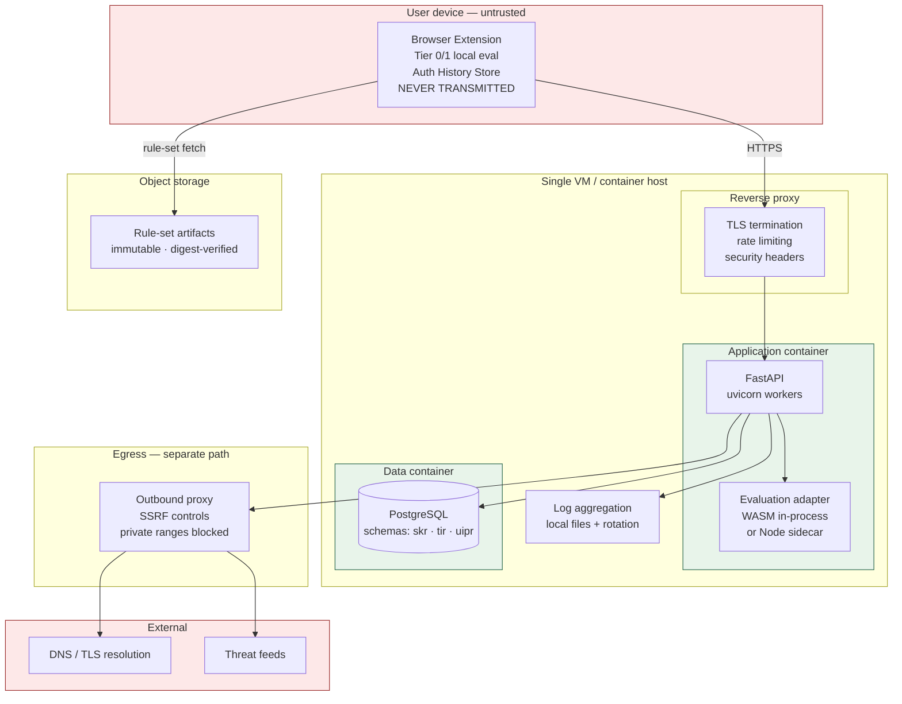
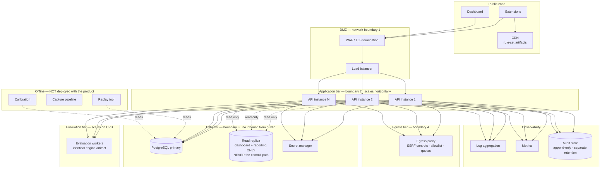

# SecureSphere X — Final Backend Architecture Review

**Reviewing:** Backend Architecture Specification v1.0
**Posture:** Independent Principal Architect. This review does not defend the document under review.
**Outcome:** stated in §8.

---

## 0. Summary of Findings

Five substantive problems. Two are defects in the reviewed document, not merely omissions.

| # | Finding | Severity |
|---|---|---|
| **F-1** | **Internal contradiction.** BI-24 prohibits accepting client-computed findings, scores or tiers. E2 requires client-computed Tier 0/1 Pass Results to reach SKR-owned Analysis History. Both cannot hold. | **Critical** |
| **F-2** | **GAP-5's conclusion is overstated.** "The only architecture consistent with the frozen specs" is false. At least three viable architectures exist. WebAssembly was dismissed without analysis and is arguably superior. | **High** |
| **F-3** | **Unaddressed privacy exposure.** Tier 2 gates fire on credential submission. Backend evidence acquisition therefore reveals to the backend exactly which sites the user authenticates to — the most sensitive category of browsing data. Section 10 does not confront this. | **High** |
| **F-4** | **Replay is misplaced.** A production service with an endpoint that re-executes arbitrary historical sessions, disabled by feature flag in production. If it is disabled in production it does not belong in the production service. | **Medium** |
| **F-5** | **Service boundaries do not survive their own transaction model.** Session Service and Knowledge Service are separate services that must commit in one transaction. That is not a boundary; it is a split with a coordination tax. | **Medium** |

---

## 1. Challenging Every Major Architectural Decision

Each decision classified as **REQUIRED** (logically entailed by frozen specifications) or **CHOICE** (design preference presented as necessity).

### D-1 — Backend evaluates at Tier 2

**CHOICE, and the justification given was wrong.**

The document justified backend Tier 2 evaluation on *authority*: the backend produces the official determination. That justification does not survive scrutiny.

**A hostile client controls enforcement regardless.** It can ignore a Block, suppress a Warn, or never submit evidence. Backend evaluation therefore buys nothing against a modified extension. The reviewed document's framing — backend as trusted adjudicator over an untrusted client — describes a control that does not exist.

What backend evaluation *actually* buys, and the correct justification:

1. **Evidence availability.** DNS, TLS chain, and threat intelligence are unavailable to the extension. A verdict computed with them is better-informed, for an honest client.
2. **Record integrity.** A consistent, auditable record across users, independent of client version.
3. **Consistency.** Every user's evidence is evaluated under the same rule-set version.

**Consequence of the corrected justification:** if backend evidence is unavailable, client-side Tier 2 evaluation is a legitimate *degraded* path, not a security hole. The reviewed document treats runtime unavailability as a hard 503. That is unnecessarily brittle given what the backend actually contributes.

**Alternatives.** Client evaluates all tiers, backend persists and re-evaluates asynchronously for the record. Preserves latency, removes the runtime from the request path, and — see F-1 — resolves the contradiction below.

**Risk accepted.** Synchronous coupling of a user-visible gate to backend availability, for a benefit that is informational rather than protective.

### D-2 — Node.js sidecar

**CHOICE presented as REQUIRED.** See §2. Three viable alternatives exist; one was not considered.

### D-3 — Two transactions per pass

**REQUIRED** by §15.4 (atomic commit) combined with the prohibition on holding a transaction across a process boundary. Persisting evidence before evaluation is a genuine design choice, and the right one: a runtime failure must not discard collected observations, since re-collecting them is impossible.

**Trade-off accepted:** orphaned evidence when a pass never completes. Acceptable — evidence without a pass is a forensic artifact, not corruption.

### D-4 — Optimistic concurrency on Current Security State

**CHOICE.** Alternative is pessimistic locking. Optimistic is correct because contention is per-session and rare, and pessimistic locking would hold a lock across the engine invocation.

**Risk:** the reviewed document specifies CAS *and* a per-session advisory lock for ordinal assignment. Two concurrency mechanisms on one aggregate is a smell. If the advisory lock is held for the whole pass, CAS is redundant. If it is held only for ordinal assignment, there is a window between ordinal assignment and commit in which two passes interleave. **The document does not specify which.** This is a real gap — see §8 MR-6.

### D-5 — Generated Python contracts

**REQUIRED** in effect. Hand-maintaining a Python mirror of D0.1 guarantees drift, and drift surfaces as silent evidence mismatch. The only real alternative is a schema-first IDL from which both TypeScript and Python are generated — arguably cleaner, but it would mean regenerating the frozen contracts, which is a larger change than the problem warrants.

### D-6 — Three repositories, one PostgreSQL instance

**CHOICE.** Persistence Spec §47 names PostgreSQL, so the engine is fixed; the *topology* is not.

**Contradiction with §11 of the Persistence Spec.** That section requires each repository to be capable of existing and evolving independently, and specifically that TIR holds and evolves intelligence regardless of analytical activity. A single instance couples their availability: SKR's database going down takes TIR with it.

Separate schemas satisfy logical independence; separate instances would satisfy operational independence. For project scale, one instance is right — but the trade-off should be recorded rather than glossed, because the frozen text asserts independence.

### D-7 — Synchronous-only, no queue

**CHOICE, and correct for Phase I.** A queue would break §15.4's atomicity and decouple the pass result from the response the client awaits. The prohibition and its reason are recorded, which is what matters — the risk is a future engineer adding one to "improve throughput."

### D-8 — Evidence Acquisition inside the backend

**CHOICE, and the weakest one in the document.** See F-3 and §3.2.

---

## 2. Re-examination of GAP-5

### 2.1 The claim under review

The reviewed document states that FastAPI + Node.js + one TypeScript engine is "the only reading consistent with all three" frozen constraints.

**That claim is false.** It conflates *one engine implementation* with *one engine runtime*. The constraint is on implementations. Multiple execution strategies preserve a single implementation.

### 2.2 A material fact the analysis missed

**Because D0.3 made rules data, the engine is much smaller than "an engine."** It is an interpreter over a closed set of twelve operators, plus suppression, aggregation and subsumption arithmetic. Realistically 300–500 lines of logic. Every rule, weight, threshold, suppression and refinement set lives in the versioned JSON artifact, not in code.

This materially changes the cost calculus for every alternative below, and the reviewed document did not account for it.

### 2.3 Alternatives

#### A-1 — Python reimplementation

| Dimension | Assessment |
|---|---|
| Correctness | Two implementations; divergence possible |
| Replay determinism | Weakened. §17.2 verifies one of two engines. |
| Maintainability | Every operator change lands twice |
| Operational | **Simplest — no sidecar, no IPC, no supervision** |
| Performance | Best — in-process |
| Testing | Needs a shared conformance suite both must pass |
| CI | Dual test matrix |
| Evolution | Drift risk compounds |

**Verdict: rejected, but less emphatically than the reviewed document claimed.** A 400-line interpreter with a golden-corpus conformance suite is not unreasonable engineering — it is how multiple conformant implementations of small specifications routinely coexist. It is rejected here on *team capacity*: three students maintaining two interpreters in lockstep is unrealistic, and the failure mode is silent divergence.

#### A-2 — WebAssembly

**Not considered in the reviewed document. It should have been.**

| Dimension | Assessment |
|---|---|
| Correctness | One artifact, byte-identical across host and browser |
| Replay determinism | **Strongest.** WASM execution is deterministic by specification. No JIT variance, no ambient clock or randomness unless explicitly imported — the host controls the import surface absolutely. |
| Maintainability | One source, one build |
| Operational | **No sidecar, no IPC, no process supervision, no health gating, no worker pool.** In-process via `wasmtime`. |
| Performance | QuickJS-in-WASM is slower than V8. Irrelevant: eleven rules, O(R) matching, microseconds of work. |
| Testing | Identical artifact under test everywhere |
| CI | Single build, digest-verified |
| Evolution | Runs anywhere a WASM runtime exists — future Go, Rust, or Java surfaces come free |

**Toolchain.** Javy compiles JavaScript to WASM with QuickJS embedded, preserving the TypeScript source. AssemblyScript would require rewriting the engine in a TypeScript-*like* language and is rejected on that basis.

**Risks.** Javy is less mature than Node. Debugging is harder. The browser must load WASM to preserve byte-identity — extensions can, but it complicates the extension build.

**Assessment: architecturally superior, operationally simpler, and the strongest determinism story.** It eliminates the entire class of problems the Node sidecar introduces — process supervision, IPC framing, worker pooling, health gating, restart semantics. The reviewed document specified all of that machinery and never asked whether it was necessary.

#### A-3 — Embedded JavaScript runtime in-process

`py_mini_racer` (V8) or PythonMonkey (SpiderMonkey) executing the engine bundle inside the Python process.

| Dimension | Assessment |
|---|---|
| Correctness | Same JS artifact as the browser |
| Replay determinism | Good; requires disabling ambient clock and randomness — CI gate G-3 already forbids both in the engine |
| Operational | **No sidecar.** In-process. |
| Performance | Excellent — real V8 |
| Risks | Binding maturity; native build dependencies; GIL interaction under concurrency |

**Assessment: viable, and simpler than the sidecar.** Weaker than WASM on sandboxing and determinism guarantees, stronger on performance and toolchain maturity.

#### A-4 — RPC to a Node service

The reviewed document's choice. Variants: Unix socket, loopback HTTP, gRPC.

| Dimension | Assessment |
|---|---|
| Correctness | Byte-identical artifact |
| Determinism | Good |
| Operational | **Worst.** Supervision, health checks, IPC framing, worker pool, restart policy, deployment coupling |
| Performance | Marshalling overhead dominates actual evaluation |
| Testing | Integration tests need a live runtime |
| Evolution | Fine |

**Assessment: correct but the most operationally expensive option.** Its one genuine advantage is boringness — Node is well understood, debuggable with standard tools, and carries no toolchain risk.

#### A-5 — Generated multi-language engines

A single specification generating both TypeScript and Python. Moves the trust boundary to the generator, which then needs its own verification. Rejected: it introduces a component more complex than the thing it generates.

#### A-6 — No backend engine at all

Client evaluates every tier; backend supplies evidence, persists, and re-evaluates asynchronously for the record.

**This deserves serious consideration and did not receive it.** It removes the engine from the backend request path entirely — no sidecar, no WASM, no reimplementation. Given D-1's corrected justification, the backend's contribution is evidence and record-keeping, neither of which requires synchronous evaluation.

**Cost:** the client's Tier 2 verdict is computed without DNS, TLS, or threat intelligence unless it fetches them first — which reintroduces the round trip it was meant to avoid. The client would evaluate twice: once on local evidence, once after backend evidence arrives.

**Assessment: viable and simplest, at the cost of a weaker Tier 2 verdict.** Should be evaluated explicitly rather than assumed away.

### 2.4 Recommendation

| Rank | Option | Rationale |
|---|---|---|
| **1** | **WebAssembly (A-2)** | Byte-identical, strongest determinism, no sidecar, no process management. Toolchain risk is the only real objection and is mitigable with a spike. |
| **2** | **Embedded JS runtime (A-3)** | Nearly all the operational benefit, mature runtimes, weaker sandboxing |
| **3** | Node sidecar (A-4) | Correct, boring, operationally most expensive |
| **4** | No backend engine (A-6) | Simplest; weaker Tier 2 verdict |
| **5** | Python reimplementation (A-1) | Rejected on team capacity |

**Required action:** a **two-day spike** comparing A-2 and A-3 against a golden-corpus replay before this decision is frozen. The reviewed document's conclusion was reached by elimination rather than comparison, and elimination was performed against an incomplete candidate set.

---

## 3. Challenging Every Service Boundary

### 3.1 Authentication History — correctly absent

The strongest decision in the reviewed document. §20.2 makes the store client-local; the backend has no endpoint, schema, cache or service. Modelling this as an architectural *absence* rather than an unimplemented feature is right, and BR-10's flag — that the brief's own example list contains it — is a legitimate catch.

**No change.**

### 3.2 Evidence Acquisition — the weakest service in the design

Three problems, one of them serious.

**(a) It reveals authentication targets to the backend.** Tier 2 gates fire predominantly on credential submission. Backend evidence acquisition therefore tells the backend, with high precision, **which sites the user logs into**. That is the most sensitive category of browsing data, and it is precisely the exposure the platform's Privacy-by-Design commitment exists to avoid.

The reviewed document's §10 discusses trust boundaries and never confronts this. **This is a genuine omission, not a nuance.**

Mitigations that should have been specified:
- **k-anonymity hash-prefix lookups** for threat intelligence, following the Safe Browsing model — the backend learns a prefix bucket, not a domain.
- **Popularity allowlist**, evaluated client-side: no backend acquisition for domains in a bundled top-N list, which covers the large majority of legitimate authentications.
- **Explicit disclosure** in user-facing documentation of exactly what is transmitted at a Tier 2 gate.

**(b) Cloaking.** The backend resolves DNS and TLS from a datacenter address. Phishing infrastructure cloaks against datacenter ranges — this is documented in the reviewed corpus for the capture pipeline and applies identically here. Backend-acquired evidence may describe *different infrastructure* than the user reached.

Consequence: backend evidence is not merely additional, it is **potentially contradictory**. The architecture has no mechanism for reconciling client-observed and backend-observed evidence that disagree.

**(c) SSRF.** Correctly identified in the reviewed document. Mitigations specified. No change.

**Verdict: keep the service, add k-anonymity and the allowlist, and specify divergence handling.**

### 3.3 Replay — does not belong in the production backend

The reviewed document places Replay in the backend and then disables it in production by feature flag. **A capability disabled in production does not belong in the production service.** It is a release-gate and forensic tool.

Concretely: a production service holding an endpoint that re-executes arbitrary historical sessions is an attack surface and a resource-exhaustion vector, guarded only by a boolean.

**Recommendation: extract Replay as a standalone tool** sharing the engine and repository code, deployed separately or run in CI. It reads the database or a dump. Nothing about §17.2 requires it to be a live endpoint.

### 3.4 Rule Distribution — likely not a service

Rule sets are immutable, versioned, digest-verified artifacts. That is object storage with signatures, not an application service.

Making it a service means every client rule-set fetch consumes backend capacity and couples client updates to backend availability. Static hosting with signed artifacts and long cache lifetimes is simpler and more available.

**Counter-argument for keeping it:** distribution requires authentication (rule sets are not public), and a signed-URL scheme is more machinery than an endpoint.

**Verdict: legitimate as a thin service, but the reviewed document does not justify it.** Record the reasoning or move it to object storage.

### 3.5 Knowledge and Session — should merge

Both own SKR aggregates. Both are written in the same transaction (TX 2). Neither can be deployed, scaled, or failed independently of the other.

**A boundary that cannot be crossed by a transaction is a boundary. A boundary that must be crossed by every transaction is a split.** These should be one SKR Application Service with internal modules, or the transaction model is wrong.

**Recommendation: merge.**

### 3.6 Intelligence — correctly separate

TIR is independent of SKR by Persistence Spec §11 and §36. Intelligence exists whether or not analysis has occurred. Separate service, separate schema, separately evolvable. **No change** — though see D-6 on the single-instance topology partially undermining this.

### 3.7 Missing services

**MS-1 — Domain Security State computation has no owner.** Persistence Spec ADR-007 places the algorithm explicitly out of scope. The reviewed document flags this in §21.3/U2 and then assigns it to nobody. Something must compute it. It should be a domain service inside the SKR subsystem.

**MS-2 — Schema migration has no owner.** Not a runtime service, but an unassigned responsibility.

**MS-3 — Promotion governance criteria are undefined.** The reviewed document enables the pipeline behind a flag defaulted false, but never states the criteria. Without them, the flag can never responsibly be turned on. This is also a security matter — see §8 MR-8.

---

## 4. Challenging the Layered Architecture

### 4.1 The Evaluation Layer is not a layer

It appears in the layer stack but has no position in the dependency graph: it is invoked by the Application Layer and depends on nothing internal. That is a **port and adapter**, not a layer.

Calling it a layer implies other layers may depend on it, which they must not. **Recommendation: reclassify as an Evaluation Port with an adapter in Infrastructure.** This also makes the WASM/sidecar/in-process choice a swappable adapter rather than an architectural change — which is exactly the property §2 argues for.

### 4.2 Transaction definition in the Application Layer

Standard unit-of-work, but it does mean the Application Layer knows an infrastructure concept. Acceptable and conventional. **No change**, but it is not the "clean" separation the reviewed document implies.

### 4.3 Circular dependencies

None found. `contracts → domain → repositories → infrastructure` with the Application Layer above is acyclic. Import-linter enforcement is specified.

### 4.4 Infrastructure leakage

**One instance.** The reviewed document specifies CAS with a version column at the Repository Layer, but the *retry policy* — three attempts, then 409 — sits in the reviewed §7.1 description of repositories. Retry-then-surface-as-409 is a use-case decision, not a persistence decision. **Move retry policy to the Application Layer.**

### 4.5 Domain Layer purity

Correctly specified: imports `contracts/` and nothing else, enforced by import-linter. This is the strongest layering decision in the document.

---

## 5. Challenging Technology Choices

| Technology | Status | Assessment |
|---|---|---|
| **FastAPI** | **Preference** | Any ASGI framework satisfies every architectural requirement. Not constraining. |
| **PostgreSQL** | **Frozen** | Persistence Spec §47 names it. Engine fixed; topology is not. |
| **One DB instance, three schemas** | **Preference** | Partially undermines Persistence Spec §11's independence requirement. Correct at project scale; record the trade-off. |
| **Node.js runtime** | **Preference presented as requirement** | See §2. Should be an adapter, not an architectural commitment. |
| **Process model (sidecar)** | **Preference** | The most consequential unexamined choice in the document |
| **DI via FastAPI `Depends`** | **Preference** | The Protocol-based design is architectural; the mechanism is not |
| **Repository pattern** | **Frozen** | Persistence Spec §4 — repositories are the unit of persistence authority |
| **Structured JSON logging** | **Preference** | Correlation identifiers and the sensitive-data prohibition are architectural; the format is not |
| **Generated contracts** | **Effectively required** | The alternative guarantees drift |
| **Deployment model** | **Unspecified** | See §6 |

**Most constraining choice: the Node sidecar.** It dictates the process model, deployment topology, health-check semantics, and scaling unit — and it was selected without comparison.

---

## 6. Deployment Architecture

Absent from the reviewed document. Two topologies are given: what a three-person team will actually run, and what production would require.

### 6.1 Project deployment — realistic

### 6.2 Production deployment

### 6.3 Boundaries

| Kind | Boundary | Control |
|---|---|---|
| **Trust** | Client → API | Authentication, full validation, rate limiting |
| **Trust** | API → Evaluation | Local only; never network-exposed |
| **Trust** | Backend → external | SSRF controls, deadlines, response caps |
| **Trust** | Client device ↔ backend | **Auth History never crosses** |
| **Network** | Public → DMZ | WAF, TLS |
| **Network** | DMZ → app | Private subnet, no public ingress |
| **Network** | App → data | Private subnet, no public route |
| **Network** | App → internet | Dedicated egress proxy only |
| **Process** | FastAPI ↔ Evaluation | In-process (WASM) or supervised sidecar |
| **Scaling** | App tier | Stateless, horizontal |
| **Scaling** | Evaluation tier | CPU-bound, horizontal |
| **Scaling** | Data tier | Vertical; replicas for reads only |

### 6.4 Deployment invariants

- **DI-1** — The Evaluation runtime is never network-reachable from outside the application tier.
- **DI-2** — The commit path never reads from a replica. Replica lag breaks CAS.
- **DI-3** — Replay and calibration are never deployed with the product.
- **DI-4** — Egress for evidence acquisition uses a dedicated path, never the general application egress.
- **DI-5** — Audit storage is separate from application logs with independent retention and separate access control.
- **DI-6** — Rule-set artifacts are served from immutable, digest-verified storage.

---

## 7. Integration Readiness

| Next document | Ready? | Blocked by |
|---|---|---|
| **Database Design — TIR** | **Yes** | Nothing |
| **Database Design — UIPR** | **Yes** | Nothing |
| **Database Design — SKR** | **No** | GAP-3 — §14 Canonical Identity Model, §15 Identity Lifecycle, §33 Current Security State Governance |
| **API Contracts — identity, dashboard, rule distribution** | **Yes** | Nothing |
| **API Contracts — analysis** | **Partially** | GAP-5 resolution determines whether an evaluation endpoint exists and what it returns |
| **API Contracts — intervention feedback** | **Yes** | D0.8/D0.10 define it |
| **Implementation Plan** | **Yes** | Sequencing is knowable; SKR sequences last |

### Unresolved architectural decisions

| # | Decision | Blocks |
|---|---|---|
| **UD-1** | Engine execution strategy — WASM / embedded / sidecar / none | Analysis API contracts, deployment, CI |
| **UD-2** | GAP-3 resolution | SKR database design |
| **UD-3** | Whether client Tier 0/1 results are persisted, and how (F-1) | Analysis API contracts, SKR schema |
| **UD-4** | Backend evidence acquisition privacy model (F-3) | Analysis API contracts, threat intelligence lookup design |
| **UD-5** | Advisory lock versus CAS scope (D-4) | SKR schema and concurrency tests |
| **UD-6** | Domain Security State computation ownership | SKR design |

---

## 8. Final Architecture Verdict

# APPROVE WITH REQUIRED REVISIONS

The architecture is sound in its fundamentals — layering, ownership, immutability, determinism, and the explicit absence of Authentication History are all correct and well-justified. It does not require redesign.

It is not approvable as written. One internal contradiction, one overstated conclusion reached without comparison, and one unaddressed privacy exposure must be resolved first.

### Mandatory revisions

**MR-1 — Resolve F-1, the BI-24 contradiction.** *(Critical.)*
BI-24 prohibits accepting client-computed findings, scores or tiers. E2 requires client-computed Tier 0/1 Pass Results to reach SKR-owned Analysis History. Choose one:
- **(a)** Tier 0/1 results are never persisted; Analysis History records backend-adjudicated passes only. Simplest; BI-24 survives intact.
- **(b)** The client uploads Tier 0/1 **evidence**, and the backend re-evaluates it for the record. Preserves BI-24, gives a complete history, adds backend load.
- **(c)** Client results are persisted as explicitly-labelled unverified client claims, distinct from adjudicated results. Honest, but weakens BI-24.

**(b) is recommended.** Evidence flows up; verdicts do not. It preserves every invariant and gives the record a single provenance.

**MR-2 — Run the engine-strategy spike before freezing GAP-5.** *(Critical.)*
Two days comparing WebAssembly (Javy) and an embedded JS runtime against golden-corpus replay. The reviewed conclusion was reached by elimination against an incomplete candidate set. WASM is the current recommendation on determinism and operational simplicity.

**MR-3 — Reclassify the Evaluation Layer as a port with adapters.** *(High.)*
Makes MR-2's outcome a swappable adapter rather than an architectural commitment, and corrects a layer that has no position in the dependency graph.

**MR-4 — Specify the evidence-acquisition privacy model.** *(High.)*
Tier 2 gates fire on credential submission; backend acquisition therefore reveals authentication targets. Specify k-anonymity hash-prefix lookups, a client-side popularity allowlist, and explicit user-facing disclosure. Without this, Privacy-by-Design is contradicted at the single most sensitive point in the system.

**MR-5 — Specify handling of divergent client and backend evidence.** *(High.)*
Cloaking means backend-observed infrastructure may differ from client-observed. The architecture currently has no reconciliation rule.

**MR-6 — Specify the advisory-lock scope precisely.** *(Medium.)*
Whether it is held for ordinal assignment only or for the whole pass determines whether CAS is necessary or redundant, and whether an interleaving window exists.

**MR-7 — Extract Replay from the production backend.** *(Medium.)*
A capability disabled by flag in production does not belong in the production service.

**MR-8 — Define promotion governance criteria.** *(Medium.)*
Required before the pipeline can responsibly be enabled, and a security control: single-session promotion would let one hostile client poison shared intelligence.

**MR-9 — Merge Session and Knowledge services.** *(Medium.)*
They share a transaction and cannot be independently deployed, scaled or failed.

**MR-10 — Assign ownership of Domain Security State computation.** *(Medium.)*

**MR-11 — Move CAS retry policy to the Application Layer.** *(Low.)*

**MR-12 — Record the single-instance database trade-off** against Persistence Spec §11's independence requirement. *(Low.)*

### Not blocking

GAP-3 remains unresolved and blocks SKR database design only. Every other backend workstream may proceed. This is now the seventh time it has been raised.

### Recommended sequencing

1. MR-2 spike *(2 days, Jayanth)* — unblocks UD-1, MR-3, deployment, CI
2. MR-1 decision *(architecture review)* — unblocks analysis API contracts
3. MR-4, MR-5 *(design note)* — unblocks evidence acquisition
4. MR-6 through MR-12 *(document revisions)*
5. GAP-3 resolution — unblocks SKR

Backend implementation of configuration, contracts, observability, identity, TIR and rule distribution may begin immediately and is unaffected by every item above.
