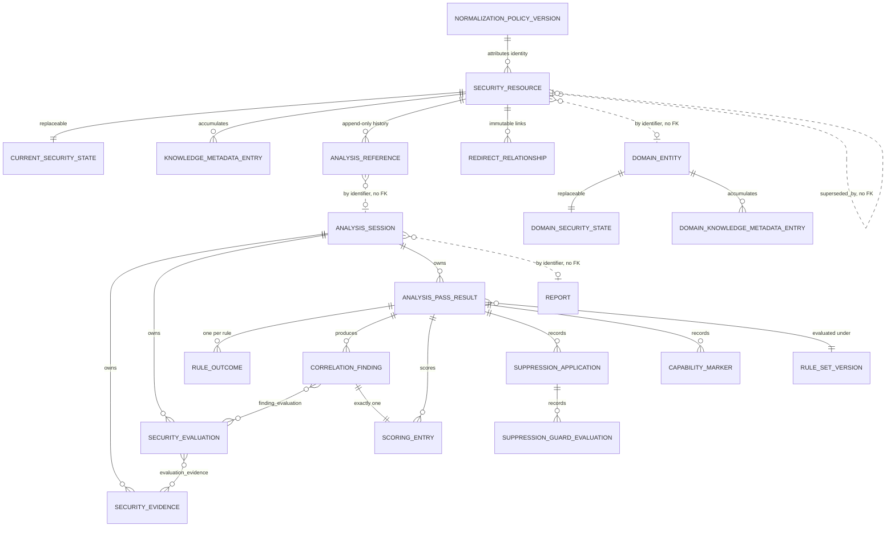
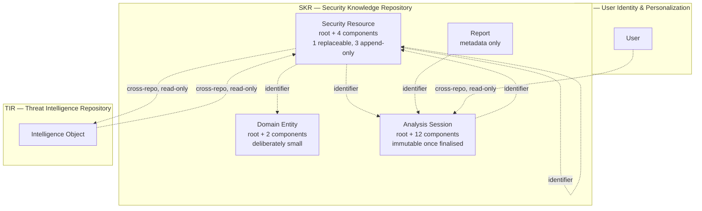
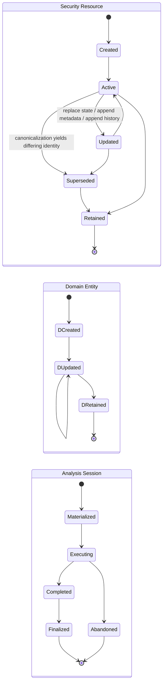

# SecureSphere X — Logical Database Design Specification

**Version:** 1.1 · **Status:** For freeze
**Implements:** Persistence Architecture Specification (Rev 2, including GAP-3 Reconstruction) · Backend Architecture v1.1 · Rule Engine Specification v0.8 · Contracts D0.1–D0.5, D0.8–D0.10
**Target:** PostgreSQL 15+
**Accepted assumptions:** N-1 (lazy supersession timing) · N-2 (merge and split expressed through supersession)

---

## 1. Database Philosophy

### 1.1 Objectives

This design translates the frozen persistence architecture into a logical relational model. It has four objectives and no others:

1. **Faithful implementation.** Every table, column and constraint originates in an architectural decision. Where the architecture is silent, this document records the silence rather than filling it.
2. **Structural enforcement of invariants.** Append-only, immutability, exclusive ownership and identity stability are enforced by the schema, not by application discipline. An invariant that depends on every caller behaving correctly is not an invariant.
3. **Replay sufficiency.** The persisted record must be sufficient to reconstruct any historical decision exactly, without re-deriving anything.
4. **Privacy by construction.** Data the architecture forbids the platform to hold has no table. Data whose precision would reveal user behaviour is stored at reduced precision.

### 1.2 Responsibilities

| The database is responsible for | The database is NOT responsible for |
|---|---|
| Persisting aggregates under their owning repository | Enforcing cross-repository transaction scope — no such transaction exists |
| Enforcing aggregate boundary and reference rules | Computing scores, tiers, or Domain Security State |
| Enforcing immutability and append-only guarantees | Holding rule weights, thresholds or suppression definitions |
| Guaranteeing identity determinism and stability | Deciding when supersession is evaluated |
| Preserving the complete evaluation record for replay | Rule evaluation of any kind |

### 1.3 Design Assumptions

| # | Assumption | Source |
|---|---|---|
| A-1 | Supersession is evaluated lazily, on canonicalization under the current policy version. | N-1, accepted |
| A-2 | Merge and split produce no distinct persistence construct; both are expressed as supersession. | N-2, accepted |
| A-3 | Deletion is prohibited across the analytical record. No retention or expiry mechanism is designed. | Persistence §6, §21, §34.7, AM-4 |
| A-4 | Analysis Sessions exist only for navigations that reached a Tier 2 gate. | Backend §2.4, deferred materialisation |
| A-5 | All three repositories occupy one PostgreSQL instance in separate schemas. | Backend §7.5 |
| A-6 | The rule-set artifact is authoritative for rule content. The database stores its version and digest, never its decomposition. | Rule Engine §12.1 |

### 1.4 Logical and Physical Separation

This document specifies the **logical** model: entities, relationships, keys, constraints, and the PostgreSQL constructs required to express them. It commits to index *intent* and partition *strategy* where the architecture determines them.

It deliberately does **not** commit to: fill factors, tablespaces, autovacuum tuning, connection pool sizing, replication topology, or index selection beyond the access paths the architecture makes certain. Those follow measurement, and fixing them now would freeze guesses.

### 1.5 Architectural Alignment

Five architectural properties shape this model more than any other consideration:

**The mutable/immutable seam runs inside the Security Resource aggregate, not around it.** Persistence §13.5 makes Current Security State replaceable while Knowledge Metadata accumulates and Analysis History appends. This produces three different table designs within one aggregate, and it is the single most consequential structural decision in the model.

**Repository boundaries are schema boundaries with no referential constraints crossing them.** Persistence §12.5.6 prohibits a referential constraint across a repository boundary, because it would couple their evolution and contradict §11.

**Identity is deterministic, so the primary key can be derived rather than assigned.** Persistence §14.3 requires the same raw reference under the same policy version to always yield the same Resource Identity. This is directly expressible as a name-based UUID.

**The tri-state observation model must survive into storage.** D0.1 distinguishes `present`, `absent` and `notCollected(reason)`. NULL means unknown and would conflate the latter two, reintroducing at the storage layer the exact failure Rule Engine §15.1 exists to prevent.

**Replay reads persisted evaluations and never re-derives them.** Backend BI-12. The evaluation record must therefore be stored losslessly, including findings that scored zero and suppressions that did not apply.

---

## 2. Domain-to-Database Mapping

### 2.1 Aggregate Mapping

| Aggregate | Repository | Schema | Root table | Lifecycle | Persistence strategy | Identifier strategy |
|---|---|---|---|---|---|---|
| **Security Resource** | SKR | `skr` | `security_resource` | Created → Active → Updated → Superseded (opt) → Retained Permanently | Root row plus four component structures with differing mutability | **Deterministic** UUIDv5 over policy version and canonical form |
| **Domain Entity** | SKR | `skr` | `domain_entity` | Created → Updated → Retained | Root row plus state row plus accumulating metadata | Deterministic UUIDv5 over FQDN |
| **Analysis Session** | SKR | `skr` | `analysis_session` | Created → Executing → Completed → Immutable | Immutable once finalised; child rows append-only | Client-generated UUID, materialised on first Tier 2 gate |
| **Report** | SKR | `skr` | `report` | Created → Retained | Metadata only; no analytical content | Assigned UUIDv4 |
| **Intelligence Object** | TIR | `tir` | `intelligence_object` | Created → Validated → Published → Retired (opt) | Lifecycle transitions on a mutable row; history preserved | Assigned UUIDv4 |
| **User** | UIPR | `uipr` | `app_user` | Created → Updated → Retained | Mutable root plus child credential and preference structures | Assigned UUIDv4 |

### 2.2 Why Two Identifier Strategies

**Deterministic identifiers (UUIDv5) for Knowledge Objects.** Persistence §14.3 requires Resource Identity to be deterministic: the same raw reference under the same policy version must always yield the same identity. A name-based UUID expresses this exactly — the identity *is* a function of its inputs, so determinism is a property of the key rather than of a lookup procedure. It also makes the identity independently recomputable during forensic work.

**Assigned identifiers (UUIDv4) elsewhere.** Analysis Sessions, Reports, Intelligence Objects and Users have no deterministic derivation in the architecture. Analysis Session identifiers are generated client-side at navigation (Backend §4.3) and materialised on first gate.

### 2.3 Repository-to-Schema Mapping

```
PostgreSQL instance
├── schema  skr    — Security Knowledge Repository
├── schema  tir    — Threat Intelligence Repository
└── schema  uipr   — User Identity & Personalization Repository
```

Separate schemas provide logical independence and permit relocation to separate instances without model change, per Backend §7.5. Cross-schema foreign keys are prohibited (§7.4 of this document).

---

## 3. Entity Catalogue

### 3.1 SKR — Security Knowledge Repository

#### 3.1.1 `normalization_policy_version`

| | |
|---|---|
| **Purpose** | The versioned, immutable-once-released policy by which raw resource references are canonicalized into a single deduplicated Security Resource identity. |
| **Owner** | SKR |
| **Identifier** | `policy_version` — semantic version string, natural key |
| **Lifecycle** | Draft → Released → Retained. Retained indefinitely. |
| **Mutability** | Mutable while unreleased. **Immutable once released.** |
| **Invariants** | A released version is never edited; behavioural change requires a new version; prior versions remain available so historical normalization behaviour is reconstructable. |
| **Source** | Persistence §16, §40, ADR-006 |

#### 3.1.2 `security_resource`

| | |
|---|---|
| **Purpose** | The canonical record of one normalized web resource — the primary analytical entity. |
| **Owner** | SKR |
| **Identifier** | `resource_identity` — deterministic UUIDv5 over `(policy_version, canonical_form)` |
| **Lifecycle** | Created → Active → Updated → Superseded (optional) → Retained Permanently |
| **Mutability** | The root row's identity columns are immutable. `lifecycle_state` and `superseded_by` transition forward only. |
| **Invariants** | Identity never rewritten · never deleted · superseded resource retains identity, history, metadata and references · every identity attributable to the policy version that produced it |
| **Source** | Persistence §17, §19, §22, §14, §15, §30, §44 |

#### 3.1.3 `current_security_state`

| | |
|---|---|
| **Purpose** | The platform's present belief about one Security Resource. |
| **Owner** | SKR, as a component of the Security Resource aggregate |
| **Identifier** | `resource_identity` — 1:1 with the owning resource |
| **Lifecycle** | Exists from resource creation; persists for the resource's lifetime including after supersession |
| **Mutability** | **Replaceable.** Replaced wholesale; never edited retroactively; forward-only |
| **Invariants** | The only replaceable construct in the knowledge model · exactly one per resource · never an input to replay · traceable to the analytical record that produced it · not carried forward across supersession |
| **Source** | Persistence §33 |

#### 3.1.4 `knowledge_metadata_entry`

| | |
|---|---|
| **Purpose** | Accumulated context retained across analyses of one Knowledge Object. |
| **Owner** | SKR, component of Security Resource |
| **Identifier** | `entry_id` UUIDv4 |
| **Lifecycle** | Appended; never revised |
| **Mutability** | **Accumulates only.** Never overwritten, never deleted |
| **Invariants** | Append-only · each entry attributable to the analytical record that produced it |
| **Source** | Persistence §21, §22, §32.2, ADR-004 |

> **Modelling note.** The architecture states that Knowledge Metadata accumulates but does not enumerate its attributes — the candidate field list on page 13 of the source falls inside §35 and is unplaced (AM-2). An append-only entry table implements the accumulation invariant without asserting a field set. Should §35 later place those fields, a monotonic projection can be derived from these entries with no change to this table.

#### 3.1.5 `analysis_reference`

| | |
|---|---|
| **Purpose** | An immutable pointer entry within a Security Resource's Analysis History, referencing one Analysis Session. |
| **Owner** | SKR, component of Security Resource |
| **Identifier** | `(resource_identity, analysis_session_id)` — composite natural key |
| **Lifecycle** | Appended on session finalisation; retained permanently |
| **Mutability** | **Immutable.** Never edited, deleted or reordered |
| **Invariants** | Append-only · points to a finalised session · no duplicate entry per session · ordering stable · retained through supersession |
| **Source** | Persistence §22, §23, §34 |

> **Modelling note on apparent redundancy.** `analysis_session` also carries a `resource_identity` column, and it would be possible to derive Analysis History from it. The two are not redundant: they belong to **different aggregates**. Persistence §22 composes Analysis History from Analysis Reference entries inside the Security Resource aggregate, while §26 permits an Analysis Session to reference a Security Resource. Collapsing one into the other would reinterpret the aggregate composition, and it would leave invariant AHC-3 — no duplicate entries — with no place to live.

#### 3.1.6 `redirect_relationship`

| | |
|---|---|
| **Purpose** | An immutable directional link record within a Security Resource's Redirect Relationships. |
| **Owner** | SKR, component of Security Resource |
| **Identifier** | `relationship_id` UUIDv4 |
| **Lifecycle** | Appended; retained permanently |
| **Mutability** | **Immutable** |
| **Invariants** | Append-only · directional · references the target resource by identifier |
| **Source** | Persistence §22, §23 |

#### 3.1.7 `domain_entity`

| | |
|---|---|
| **Purpose** | The canonical record of one FQDN's accumulated, domain-level knowledge. |
| **Owner** | SKR |
| **Identifier** | `domain_identity` — deterministic UUIDv5 over the FQDN |
| **Lifecycle** | Created → Updated → Retained |
| **Mutability** | Mutable state; identity immutable; **never superseded** |
| **Invariants** | Small aggregate · never absorbs URL lists, Analysis History, Reports or Intelligence Objects · Domain Identity never superseded |
| **Source** | Persistence §17, §19, §25, §30, §14.10 |

#### 3.1.8 `domain_security_state`

| | |
|---|---|
| **Purpose** | The FQDN-level security state derived from Security-Resource-level Analysis History. |
| **Owner** | SKR, component of Domain Entity |
| **Identifier** | `domain_identity` — 1:1 |
| **Lifecycle** | Exists from domain entity creation |
| **Mutability** | Replaceable |
| **Invariants** | Deterministically derived · reproducible · resolves to exactly one authoritative state · the computation algorithm is out of scope |
| **Source** | Persistence §35, ADR-007 |

#### 3.1.9 `domain_knowledge_metadata_entry`

Structure and governance identical to `knowledge_metadata_entry`, scoped to a Domain Entity. **Source:** Persistence §22.

#### 3.1.10 `analysis_session`

| | |
|---|---|
| **Purpose** | One immutable execution of the analysis engine against one Target Resource. |
| **Owner** | SKR |
| **Identifier** | `analysis_session_id` — client-generated UUID |
| **Lifecycle** | Materialised → Executing → Completed → Immutable |
| **Mutability** | Mutable until finalised; **immutable thereafter** |
| **Invariants** | One session per Target Resource per navigation · materialised only on first Tier 2 gate · never altered or deleted once finalised · pass and gate ordinals dense and monotonic |
| **Source** | Persistence §17, §26, §30; Backend §4.3 |

#### 3.1.11 `security_evidence`

| | |
|---|---|
| **Purpose** | Objective observations collected from the Target Resource. |
| **Owner** | SKR, owned by Analysis Session |
| **Identifier** | `evidence_id` UUIDv4 |
| **Lifecycle** | Written once at intake |
| **Mutability** | **Immutable on write** |
| **Invariants** | Immutable · tri-state preserved per field · attributable to a collector and tier · never contains credentials, form values, cookies or page content |
| **Source** | Persistence §23, §26; D0.1 |

#### 3.1.12 `security_evaluation`

| | |
|---|---|
| **Purpose** | The deterministic analytical output of exactly one Internal Evaluation Module for one pass. |
| **Owner** | SKR, owned by Analysis Session |
| **Identifier** | `evaluation_id` UUIDv4 |
| **Lifecycle** | Written once per module per pass |
| **Mutability** | **Immutable on write** |
| **Invariants** | Exactly one per module per pass, never zero, never two · `unevaluable` is a produced evaluation, not an absent one · references its supporting evidence |
| **Source** | D0.2; Rule Engine §2.2 |

#### 3.1.13 `analysis_pass_result`

| | |
|---|---|
| **Purpose** | The complete record of one evaluation pass — the artifact that makes a decision explainable, reproducible and auditable. |
| **Owner** | SKR, owned by Analysis Session |
| **Identifier** | `pass_result_id` UUIDv4 |
| **Lifecycle** | Written once per pass |
| **Mutability** | **Immutable on write** |
| **Invariants** | Records rule-set version · records raw and effective tier · score equals the sum of counted effective weights · committed atomically |
| **Source** | D0.4; Rule Engine §9.5 |

#### 3.1.14 `rule_outcome`

| | |
|---|---|
| **Purpose** | The outcome of one rule for one pass — matched, not matched, or unevaluable. |
| **Owner** | SKR, owned by Analysis Pass Result |
| **Identifier** | `(pass_result_id, rule_id)` |
| **Mutability** | **Immutable** |
| **Invariants** | Exactly one outcome per rule in the active rule set per pass, never zero · `unevaluable` distinguishable from `notMatched` |
| **Source** | D0.4 P-1; Rule Engine §15.2 |

#### 3.1.15 `correlation_finding`

| | |
|---|---|
| **Purpose** | An analytical conclusion emerging from relationships between multiple Security Evaluations. |
| **Owner** | SKR, owned by Analysis Pass Result |
| **Identifier** | `finding_id` UUIDv4 |
| **Mutability** | **Immutable** |
| **Invariants** | References evaluations, never other findings · **carries no weight** — scoring is a property of a rule-set evaluation, not of the finding |
| **Source** | D0.4 §1, §2.4, §10.1 |

#### 3.1.16 `correlation_finding_evaluation`

Associative entity resolving the many-to-many relationship between findings and the evaluations they derive from. Composites reference the union of their constituents' evaluations. **Immutable.** **Source:** D0.4 §10.1.

#### 3.1.17 `scoring_entry`

| | |
|---|---|
| **Purpose** | The scoring treatment of one finding under one rule-set version. |
| **Owner** | SKR, owned by Analysis Pass Result |
| **Identifier** | `(pass_result_id, finding_id)` |
| **Mutability** | **Immutable** |
| **Invariants** | `effective_weight = base_weight × (1 − max_reduction)` exactly · subsumed and suppressed findings remain recorded with `counted_in_score` false · aggravator contributes only where its parent qualifies |
| **Source** | D0.4 §4, P-3…P-8 |

#### 3.1.18 `suppression_application`

| | |
|---|---|
| **Purpose** | The record of a suppression tested against a finding — whether or not it applied. |
| **Owner** | SKR, owned by Analysis Pass Result |
| **Identifier** | `application_id` UUIDv4 |
| **Mutability** | **Immutable** |
| **Invariants** | Recorded whether applied or not · declared reduction recorded even when not applied · `blocked_by_rule_id` set where a blocking rule fired |
| **Source** | D0.4 §3; Rule Engine §6.1 |

> **Why suppressions that did not apply are stored.** Rule Engine §6.1 requires suppression to be non-destructive and its guard evaluation recorded. When diagnosing a false negative, the suppression record is where the answer is. Storing only applied suppressions would make the most common forensic question unanswerable.

#### 3.1.19 `suppression_guard_evaluation`

Per-guard evaluation result within a suppression application. **Immutable.** **Source:** D0.4 §3.

#### 3.1.20 `capability_marker`

| | |
|---|---|
| **Purpose** | Record of a rule or module that could not be evaluated, and why. |
| **Owner** | SKR, owned by Analysis Pass Result |
| **Identifier** | `marker_id` UUIDv4 |
| **Mutability** | **Immutable** |
| **Invariants** | Degraded capability recorded, never silent · a CRED-family rule unevaluable implies the pass is degraded |
| **Source** | D0.4 §5; Rule Engine §15.1, §15.2 |

#### 3.1.21 `advisory_finding` *(Phase II)*

AI advisory output consumed by correlation in a second or subsequent pass. Carries the invocation input and returned output. Explicitly non-deterministic; never the sole basis for a Block; always attributed as AI-generated. **Immutable.** **Source:** Rule Engine §1.4.

#### 3.1.22 `report`

| | |
|---|---|
| **Purpose** | Metadata describing a generated report, referencing the Analysis Session it summarizes. |
| **Owner** | SKR |
| **Identifier** | `report_id` UUIDv4 |
| **Mutability** | Immutable |
| **Invariants** | **Metadata only** — never embeds analytical content · references its session by identifier |
| **Source** | Persistence §17, §28 |

#### 3.1.23 `rule_set_version`

| | |
|---|---|
| **Purpose** | Registry of released rule-set versions with their integrity digests. |
| **Owner** | SKR |
| **Identifier** | `rule_set_version` string |
| **Mutability** | **Immutable once released** |
| **Invariants** | A released version is never modified · the artifact is authoritative; **no table decomposes its weights, thresholds or suppression definitions** |
| **Source** | Rule Engine §12.1, §12.2 |

> **Why rule content is not modelled.** Rule Engine §12.1 requires rules to be a versioned data artifact external to the engine. Decomposing weights or thresholds into tables would make the rule-set version an insufficient description of a decision and would void replay: a historical pass could then be re-scored against mutated database rows rather than against the artifact it actually ran under.

### 3.2 TIR — Threat Intelligence Repository

| Entity | Purpose | Identifier | Mutability | Source |
|---|---|---|---|---|
| `threat_source` | An external or internal origin of threat intelligence | UUIDv4 | Mutable | §9 |
| `threat_feed_record` | One ingested record from a feed | UUIDv4 | Immutable on write | §9 |
| `intelligence_object` | One unit of externally sourced or internally promoted threat intelligence | UUIDv4 | Lifecycle transitions; never deleted | §17, §27, §30 |
| `ioc_collection` | A named grouping of indicators | UUIDv4 | Mutable | §9 |
| `ioc_collection_member` | Membership of an intelligence object in a collection | Composite | Append-only | §9 |
| `reputation_data` | Reputation attributes sourced from a provider | UUIDv4 | Replaceable per source | §9 |
| `intelligence_promotion` | Record of an internal promotion from SKR analytical output | UUIDv4 | Immutable | §37 |

**Governing invariants.** Intelligence Objects carry Confidence and Validity as first-class governed attributes, distinct from any Security Resource or Domain Entity they reference. TIR holdings exist and evolve regardless of analytical activity. A retired Intelligence Object preserves historical references and is not deleted. Promotion is one-directional and references its originating session **by identifier only**, never embedding it. **Source:** §11, §27, §30, §36, §37.

### 3.3 UIPR — User Identity & Personalization Repository

| Entity | Purpose | Identifier | Mutability | Source |
|---|---|---|---|---|
| `app_user` | The identity record for one platform user | UUIDv4 | Mutable | §17, §29 |
| `user_authentication` | Credential material, stored as a salted memory-hard hash | UUIDv4 | Replaceable | §29 |
| `user_mfa_factor` | An enrolled multi-factor authentication factor | UUIDv4 | Mutable | §29 |
| `user_preference` | A user preference setting | Composite | Replaceable | §29 |
| `saved_analysis_reference` | A user's saved reference to an Analysis Session or Security Resource | UUIDv4 | Append and remove | §29 |
| `notification_setting` | Notification configuration | Composite | Replaceable | §29 |

**Governing invariant.** User **must never embed analytical data**; it may only reference it. `saved_analysis_reference` therefore holds identifiers with no foreign key and no copied analytical content. **Source:** §21, §29.

### 3.4 Entities Deliberately Absent

| Absent | Reason |
|---|---|
| Any Authentication History table | Client-local, never transmitted in any form. Persistence §13.4; Rule Engine §20.2; Backend BI-25 |
| Any login-interface fingerprint table | Client-local. Backend §15.3 |
| Any table of Tier 0/1 client evaluation results | Never transmitted. Backend §15.3 |
| Any rule weight, threshold or suppression definition table | The rule-set artifact is authoritative. §3.1.23 |
| Any retention or expiry table | Deletion is prohibited by construction. AM-4 |
| Any evidence table for non-gate navigations | Never transmitted. Backend BI-27 |

---

## 4. Relationship Model

### 4.1 SKR Relationships

| # | Relationship | Cardinality | Kind | Integrity | Why it exists |
|---|---|---|---|---|---|
| R-1 | `security_resource` → `normalization_policy_version` | N:1 | Dependency | FK, RESTRICT | §14.4 requires every Resource Identity to be attributable to the policy version that produced it |
| R-2 | `security_resource` → `current_security_state` | 1:1 | Composition | FK, CASCADE prohibited | §22 composes the resource from its current state; §33.7 fixes exactly one per resource |
| R-3 | `security_resource` → `knowledge_metadata_entry` | 1:N | Composition | FK | §22; accumulation requires many entries |
| R-4 | `security_resource` → `analysis_reference` | 1:N | Composition | FK | §22 composes Analysis History from reference entries |
| R-5 | `security_resource` → `redirect_relationship` | 1:N | Composition | FK | §22 |
| R-6 | `redirect_relationship` → target `security_resource` | N:1 | **Identifier reference** | **No FK** | The target is a separate aggregate instance; §20 permits identifier reference only |
| R-7 | `security_resource` → superseding `security_resource` | N:1 | **Identifier reference** | **No FK** | Supersession links two aggregate instances; §14.8 |
| R-8 | `security_resource` → `domain_entity` | N:1 | **Identifier reference** | **No FK** | §19 — Security Resource *may reference* Domain Entity; embedding prohibited |
| R-9 | `domain_entity` → `domain_security_state` | 1:1 | Composition | FK | §22 |
| R-10 | `domain_entity` → `domain_knowledge_metadata_entry` | 1:N | Composition | FK | §22 |
| R-11 | `analysis_reference` → `analysis_session` | 1:1 | **Identifier reference** | **No FK** | Analysis Session is a separate aggregate; §20 |
| R-12 | `analysis_session` → `security_resource` | N:1 | **Identifier reference** | **No FK** | §26 — session *may reference* resource, by identifier |
| R-13 | `analysis_session` → `security_evidence` | 1:N | Composition | FK | §26 — session owns its evidence |
| R-14 | `analysis_session` → `security_evaluation` | 1:N | Composition | FK | §26 |
| R-15 | `analysis_session` → `analysis_pass_result` | 1:N | Composition | FK | Backend §2.5 — a session holds all its passes |
| R-16 | `security_evaluation` → `security_evidence` | M:N | Aggregation | FK via associative | Domain Model §6.3 — every evaluation references its supporting evidence |
| R-17 | `analysis_pass_result` → `rule_outcome` | 1:N | Composition | FK | D0.4 P-1 — one outcome per rule per pass |
| R-18 | `analysis_pass_result` → `correlation_finding` | 1:N | Composition | FK | D0.4 |
| R-19 | `correlation_finding` → `security_evaluation` | M:N | Aggregation | FK via associative | §10.1 — findings reference evaluations, never other findings |
| R-20 | `analysis_pass_result` → `scoring_entry` | 1:N | Composition | FK | D0.4 §4 |
| R-21 | `scoring_entry` → `correlation_finding` | 1:1 | Dependency | FK | D0.4 P-3 — every finding has exactly one scoring entry |
| R-22 | `analysis_pass_result` → `suppression_application` | 1:N | Composition | FK | D0.4 §3 |
| R-23 | `suppression_application` → `suppression_guard_evaluation` | 1:N | Composition | FK | Rule Engine §6.1 — guard evaluation recorded |
| R-24 | `analysis_pass_result` → `capability_marker` | 1:N | Composition | FK | Rule Engine §15.2 |
| R-25 | `analysis_pass_result` → `rule_set_version` | N:1 | Dependency | FK, RESTRICT | §12.3 — every pass records its rule-set version |
| R-26 | `analysis_pass_result` → `advisory_finding` | N:1 | Dependency | FK, nullable | Phase II; §1.4 |
| R-27 | `report` → `analysis_session` | N:1 | **Identifier reference** | **No FK** | §28 — report references the session it summarizes; separate aggregate |
| R-28 | `security_resource` → `intelligence_object` | N:N | **Cross-repository reference** | **No FK** | §9 — SKR *may reference* Intelligence Objects |

### 4.2 TIR Relationships

| # | Relationship | Cardinality | Integrity | Why |
|---|---|---|---|---|
| R-30 | `intelligence_object` → `threat_source` | N:1 | FK | §27 — Source is a first-class attribute |
| R-31 | `threat_feed_record` → `threat_source` | N:1 | FK | §9 |
| R-32 | `intelligence_object` → `threat_feed_record` | N:1, nullable | FK | §37 — external sourcing path |
| R-33 | `intelligence_promotion` → `intelligence_object` | 1:1 | FK | §37 — internal promotion path |
| R-34 | `intelligence_promotion` → `analysis_session` | N:1 | **Cross-repository, no FK** | §37 — references originating session by identifier only, never embedding |
| R-35 | `ioc_collection_member` → `ioc_collection`, `intelligence_object` | N:1 each | FK | §9 |
| R-36 | `intelligence_object` → `security_resource` / `domain_entity` | N:1, nullable | **Cross-repository, no FK** | §27 — TIR *may reference* SKR aggregates, read-only |

### 4.3 UIPR Relationships

| # | Relationship | Cardinality | Integrity | Why |
|---|---|---|---|---|
| R-40 | `app_user` → `user_authentication` | 1:N | FK | §29 |
| R-41 | `app_user` → `user_mfa_factor` | 1:N | FK | §29 |
| R-42 | `app_user` → `user_preference` | 1:N | FK | §29 |
| R-43 | `app_user` → `notification_setting` | 1:N | FK | §29 |
| R-44 | `app_user` → `saved_analysis_reference` | 1:N | FK | §29 |
| R-45 | `saved_analysis_reference` → `analysis_session` / `security_resource` | N:1 | **Cross-repository, no FK** | §29 — User may reference, must never embed |

### 4.4 Dependency Direction

```
uipr ──────► skr ──────► tir
       (by identifier, read-only, no referential constraint)
```

**Source:** Persistence §39, §44, ADR-005. TIR remains completely independent of SKR and UIPR.

### 4.5 Why Some Relationships Carry No Foreign Key

Three distinct cases, all producing the same schema treatment:

| Case | Example | Reason |
|---|---|---|
| **Cross-repository** | R-28, R-34, R-36, R-45 | §12.5.6 — a referential constraint across a repository boundary would couple their evolution and contradict §11 |
| **Cross-aggregate within one repository** | R-6, R-7, R-8, R-11, R-12, R-27 | §20 — all inter-aggregate association is identifier reference, never containment. A foreign key implies a containment guarantee the aggregate boundary denies |
| **Self-referential across instances** | R-7 supersession | The superseding resource is a distinct aggregate instance, not a component |

In every case the column holds a UUID with a documented target and **no `REFERENCES` clause**. Referential correctness is an application-layer responsibility, exercised through repositories, per §8 — a repository is not responsible for the internal consistency of aggregates it does not own.

---

## 5. Logical Schema

Logical types are stated abstractly; PostgreSQL realisation is §15. Entity tables are marked **E**, supporting tables **S**, associative tables **A**.

### 5.1 `skr.normalization_policy_version` **E**

| Column | Type | Null | Default | Notes |
|---|---|---|---|---|
| `policy_version` | VERSION_STRING | No | — | **PK.** Semantic version |
| `policy_digest` | DIGEST | No | — | Integrity digest of the policy artifact |
| `released` | BOOLEAN | No | `false` | Once true, the row is immutable |
| `released_on` | TIMESTAMP | Yes | — | Operational timestamp, not user activity |
| `supersedes_version` | VERSION_STRING | Yes | — | FK → self, RESTRICT |
| `description` | TEXT | Yes | — | |

- **Candidate keys:** `policy_version`; `policy_digest`
- **Unique:** `policy_digest`; `(policy_version, released)` — the released-state key that dependent tables reference
- **Check:** `released = false OR released_on IS NOT NULL`
- **Immutability:** UPDATE and DELETE prohibited where `released = true`, except the single `false → true` release transition (§16)

### 5.2 `skr.security_resource` **E**

| Column | Type | Null | Default | Notes |
|---|---|---|---|---|
| `resource_identity` | UUID | No | — | **PK.** Deterministic UUIDv5 over `(policy_version, canonical_form)` |
| `canonical_form` | TEXT | No | — | The normalized resource reference |
| `canonical_form_digest` | DIGEST | No | — | Digest of `canonical_form`, for bounded-width indexing |
| `policy_version` | VERSION_STRING | No | — | Composite FK → `normalization_policy_version(policy_version, released)`, RESTRICT |
| `policy_released` | BOOLEAN | No | `true` | CHECK pinned true; forces the FK to resolve only against a released policy |
| `domain_identity` | UUID | Yes | — | Identifier reference, **no FK** |
| `lifecycle_state` | RESOURCE_LIFECYCLE | No | `'created'` | created / active / superseded |
| `superseded_by_identity` | UUID | Yes | — | Identifier reference, **no FK** |
| `superseded_on` | DATE | Yes | — | Day granularity |
| `created_on` | DATE | No | current date | Day granularity |
| `contract_version` | VERSION_STRING | No | — | Contract version under which the row was written |

- **Candidate keys:** `resource_identity`; `(canonical_form_digest, policy_version)`
- **Unique:** `(canonical_form_digest, policy_version)` — **the deterministic identity constraint.** Two rows cannot represent one canonical form under one policy version
- **Checks:**
  - `(lifecycle_state = 'superseded') = (superseded_by_identity IS NOT NULL)`
  - `(superseded_by_identity IS NOT NULL) = (superseded_on IS NOT NULL)`
  - `superseded_by_identity <> resource_identity`
  - `policy_released` — pinned true
- **Immutability:** `resource_identity`, `canonical_form`, `canonical_form_digest`, `policy_version`, `created_on` are immutable after insert. `lifecycle_state` transitions forward only. DELETE prohibited unconditionally

> **Why `created_on` and `superseded_on` are DATE.** These reveal when a user first encountered a resource. Timestamp precision across a set of resources reconstructs a browsing timeline; day granularity does not, and no architectural requirement needs finer.

### 5.3 `skr.current_security_state` **E**

| Column | Type | Null | Default | Notes |
|---|---|---|---|---|
| `resource_identity` | UUID | No | — | **PK**, FK → `security_resource`, RESTRICT |
| `state_version` | BIGINT | No | `1` | Monotonic counter supporting CSG-1 |
| `score` | INTEGER | No | — | |
| `tier` | RISK_TIER | No | — | low / medium / high |
| `degraded` | BOOLEAN | No | `false` | |
| `rule_set_version` | VERSION_STRING | No | — | Composite FK → `rule_set_version(rule_set_version, released)`, RESTRICT |
| `rule_set_released` | BOOLEAN | No | `true` | CHECK pinned true |
| `source_analysis_session_id` | UUID | No | — | Identifier reference, **no FK** — CSG-2 traceability |
| `source_pass_result_id` | UUID | No | — | Identifier reference, **no FK** |
| `replaced_on` | DATE | No | current date | Day granularity |

- **Candidate keys:** `resource_identity`
- **Checks:** `score >= 0`; `state_version >= 1`
- **Mutability:** UPDATE permitted and expected; **every UPDATE replaces all value columns and increments `state_version`**. Partial-column UPDATE is prohibited. DELETE prohibited

> **Why one replaceable row rather than a revision chain.** ADR-004 fixes exactly three knowledge constructs and Current Security State is the replaceable one. A revision chain would introduce a fourth construct and a second historical record alongside Analysis History, which already holds that history. §33.3 requires wholesale replacement, and a single row replaced entirely expresses that directly.
>
> **Why `state_version` exists.** §33.8 CSG-1 requires replacement to be atomic and unobservable in a partial condition. §3 of the Persistence Architecture places the concurrency *mechanism* out of scope, so this column carries the requirement without prescribing how the application uses it. Backend §6.4 specifies the compare-and-set discipline.

### 5.4 `skr.knowledge_metadata_entry` **S**

| Column | Type | Null | Default | Notes |
|---|---|---|---|---|
| `entry_id` | UUID | No | generated | **PK** |
| `resource_identity` | UUID | No | — | FK → `security_resource`, RESTRICT |
| `entry_key` | TEXT | No | — | |
| `entry_value` | JSONB | No | — | |
| `source_analysis_session_id` | UUID | No | — | Identifier reference, **no FK** |
| `source_pass_result_id` | UUID | No | — | Identifier reference, **no FK** |
| `recorded_on` | DATE | No | current date | |
| `sequence_number` | BIGINT | No | — | Dense within `resource_identity` |

- **Unique:** `(resource_identity, sequence_number)`
- **Immutability:** INSERT only. UPDATE and DELETE prohibited

### 5.5 `skr.analysis_reference` **S**

| Column | Type | Null | Default | Notes |
|---|---|---|---|---|
| `resource_identity` | UUID | No | — | **PK part**, FK → `security_resource`, RESTRICT |
| `analysis_session_id` | UUID | No | — | **PK part.** Identifier reference, **no FK** |
| `sequence_number` | BIGINT | No | — | Dense, monotonic within resource |
| `session_finalized_on` | DATE | No | — | Ordering basis per §34.6 |

- **PK:** `(resource_identity, analysis_session_id)` — implements AHC-3, no duplicate entry per session
- **Unique:** `(resource_identity, sequence_number)`
- **Immutability:** INSERT only. UPDATE and DELETE prohibited — AHI-3

### 5.6 `skr.redirect_relationship` **S**

| Column | Type | Null | Default | Notes |
|---|---|---|---|---|
| `relationship_id` | UUID | No | generated | **PK** |
| `resource_identity` | UUID | No | — | FK → `security_resource`, RESTRICT |
| `target_resource_identity` | UUID | No | — | Identifier reference, **no FK** |
| `redirect_mechanism` | REDIRECT_MECHANISM | No | — | http_3xx / javascript / meta_refresh / unknown |
| `hop_position` | SMALLINT | No | — | |
| `observed_in_session_id` | UUID | No | — | Identifier reference, **no FK** |
| `recorded_on` | DATE | No | current date | |

- **Checks:** `hop_position >= 0`; `target_resource_identity <> resource_identity`
- **Immutability:** INSERT only

### 5.7 `skr.domain_entity` **E**

| Column | Type | Null | Default | Notes |
|---|---|---|---|---|
| `domain_identity` | UUID | No | — | **PK.** Deterministic UUIDv5 over the FQDN |
| `fqdn` | TEXT | No | — | |
| `registrable_domain` | TEXT | No | — | eTLD+1 |
| `lifecycle_state` | DOMAIN_LIFECYCLE | No | `'created'` | created / active — **no superseded value exists** |
| `created_on` | DATE | No | current date | |
| `contract_version` | VERSION_STRING | No | — | |

- **Unique:** `fqdn`
- **Immutability:** `domain_identity`, `fqdn`, `registrable_domain` immutable. DELETE prohibited

> **Why `DOMAIN_LIFECYCLE` has no `superseded` value.** §14.10 states verbatim that a Domain Identity has no supersession concept. Omitting the value from the type makes the invariant unexpressible rather than merely prohibited — the strongest available enforcement.
>
> **Why this table is deliberately narrow.** §25 requires Domain Entity to remain a small aggregate for the life of the system and prohibits it absorbing URL lists, history, reports or intelligence. Every future column proposed for this table should be tested against that prohibition.

### 5.8 `skr.domain_security_state` **E**

| Column | Type | Null | Default | Notes |
|---|---|---|---|---|
| `domain_identity` | UUID | No | — | **PK**, FK → `domain_entity`, RESTRICT |
| `state_version` | BIGINT | No | `1` | |
| `derived_state` | JSONB | No | — | Shape governed by the Analysis Engine, not by this schema |
| `derivation_input_digest` | DIGEST | No | — | Supports the reproducibility requirement of ADR-007 |
| `replaced_on` | DATE | No | current date | |

> **Why `derived_state` is JSONB.** ADR-007 places the computation algorithm explicitly out of scope of the persistence architecture, and §35's opening — which would define its persistence contract — is missing (AM-3). Committing to a column set would be inventing the specification this document is forbidden to write. JSONB stores the derived state faithfully while `derivation_input_digest` preserves the reproducibility ADR-007 requires.

### 5.9 `skr.domain_knowledge_metadata_entry` **S**

Structure identical to §5.4, keyed on `domain_identity` with FK → `domain_entity`. INSERT only.

### 5.10 `skr.rule_set_version` **E**

| Column | Type | Null | Default | Notes |
|---|---|---|---|---|
| `rule_set_version` | VERSION_STRING | No | — | **PK** |
| `rule_set_digest` | DIGEST | No | — | Integrity digest |
| `artifact_uri` | TEXT | Yes | — | Location of the authoritative artifact |
| `artifact_bytes` | BYTEA | Yes | — | Optional in-database copy |
| `released` | BOOLEAN | No | `false` | |
| `released_on` | TIMESTAMP | Yes | — | Operational |

- **Unique:** `rule_set_digest`; `(rule_set_version, released)` — the released-state key that dependent tables reference
- **Check:** `artifact_uri IS NOT NULL OR artifact_bytes IS NOT NULL`
- **Immutability:** immutable once `released = true`

### 5.11 `skr.analysis_session` **E**

| Column | Type | Null | Default | Notes |
|---|---|---|---|---|
| `analysis_session_id` | UUID | No | — | **PK.** Client-generated |
| `resource_identity` | UUID | No | — | Identifier reference, **no FK** |
| `target_url_digest` | DIGEST | No | — | Digest, not the URL |
| `session_state` | SESSION_STATE | No | `'materialized'` | materialized / executing / completed / finalized / abandoned |
| `is_private_context` | BOOLEAN | No | `false` | |
| `rule_set_version` | VERSION_STRING | No | — | Composite FK → `rule_set_version(rule_set_version, released)`, RESTRICT |
| `rule_set_released` | BOOLEAN | No | `true` | CHECK pinned true |
| `next_pass_ordinal` | INTEGER | No | `1` | Allocation cursor |
| `next_gate_ordinal` | INTEGER | No | `1` | Allocation cursor |
| `materialized_on` | DATE | No | current date | |
| `finalized_on` | DATE | Yes | — | |
| `contract_version` | VERSION_STRING | No | — | |

- **Checks:**
  - `(session_state = 'finalized') = (finalized_on IS NOT NULL)`
  - `next_pass_ordinal >= 1`, `next_gate_ordinal >= 1`
- **Immutability:** all columns immutable once `session_state = 'finalized'`. DELETE prohibited

> **Why `target_url_digest` and not the URL.** The Target Resource's canonical form is already held once, on `security_resource`. Storing the URL again here would duplicate the most privacy-sensitive value in the schema for no analytical gain. The digest supports correlation and integrity checking without a second plaintext copy.

### 5.12 `skr.security_evidence` **S**

| Column | Type | Null | Default | Notes |
|---|---|---|---|---|
| `evidence_id` | UUID | No | generated | **PK** |
| `analysis_session_id` | UUID | No | — | FK → `analysis_session`, RESTRICT |
| `evidence_category` | EVIDENCE_CATEGORY | No | — | Nine categories per D0.1 |
| `collector` | COLLECTOR_KIND | No | — | extension / capture_harness / backend |
| `collector_version` | VERSION_STRING | No | — | |
| `tier` | SMALLINT | No | — | 0, 1 or 2 |
| `pass_ordinal` | INTEGER | No | — | |
| `observations` | JSONB | No | — | **Tri-state preserved.** See below |
| `collected_on` | DATE | No | — | Day granularity per D0.1 |
| `contract_version` | VERSION_STRING | No | — | |

- **Unique:** `(analysis_session_id, evidence_category, collector, pass_ordinal)`; `(analysis_session_id, evidence_id)` — the session-scoped key referenced by `evaluation_evidence`
- **Checks:**
  - `tier BETWEEN 0 AND 2`
  - **Tri-state structural check:** every value in `observations` is an object carrying a `state` key whose value is exactly one of `present`, `absent`, `notCollected`, and where `state = 'notCollected'` a `reason` key is present
- **Immutability:** INSERT only

> **Why observations are JSONB and not columns.** D0.1 defines nine evidence categories carrying roughly eighty fields, each a tri-state discriminated union. A relational decomposition would produce eighty columns plus eighty state discriminators, and the tri-state would still have to be encoded — NULL cannot express it, because NULL means unknown and would conflate `absent` with `notCollected`.
>
> The access pattern justifies the choice independently: evidence is read **whole** by the evaluation path and by replay, never queried by inner field on any write path. The category and collector, which *are* queried, are real indexed columns.
>
> The structural CHECK constraint is what keeps this from being an unconstrained document store. It enforces at the storage layer the distinction that Rule Engine §15.1 exists to protect — a collector cannot record `absent` where it means `notCollected` without the shape being wrong.

### 5.13 `skr.security_evaluation` **S**

| Column | Type | Null | Default | Notes |
|---|---|---|---|---|
| `evaluation_id` | UUID | No | generated | **PK** |
| `analysis_session_id` | UUID | No | — | FK → `analysis_session`, RESTRICT |
| `pass_ordinal` | INTEGER | No | — | |
| `module_id` | MODULE_ID | No | — | Ten modules per Rule Engine §2.6 |
| `module_version` | VERSION_STRING | No | — | |
| `evaluability` | EVALUABILITY | No | — | evaluated / unevaluable |
| `unevaluable_reason` | UNEVALUABLE_REASON | Yes | — | |
| `findings` | JSONB | Yes | — | Typed per module, D0.2 |
| `indicators` | JSONB | No | `'[]'` | |
| `consistency` | CONSISTENCY | No | — | consistent / inconsistent / indeterminate |
| `summary` | TEXT | No | — | |
| `contract_version` | VERSION_STRING | No | — | |

- **Unique:** `(analysis_session_id, pass_ordinal, module_id)` — **implements E-8**, exactly one evaluation per module per pass; `(analysis_session_id, evaluation_id)` — the session-scoped key referenced by `evaluation_evidence`
- **Checks:**
  - `(evaluability = 'unevaluable') = (unevaluable_reason IS NOT NULL)`
  - `(evaluability = 'evaluated') = (findings IS NOT NULL)`
- **Immutability:** INSERT only

> **Why `unevaluable` is a row rather than an absent row.** D0.2 E-6 requires `unevaluable` to be a produced evaluation, not a missing one. If a module that could not run simply wrote nothing, replay could not distinguish "this module found nothing" from "this module could not look" — the §15.1 failure, reintroduced beneath every application guard.

### 5.14 `skr.evaluation_evidence` **A**

| Column | Type | Null | Notes |
|---|---|---|---|
| `analysis_session_id` | UUID | No | Session scope, carried so both references can be constrained to it |
| `evaluation_id` | UUID | No | **PK part** |
| `evidence_id` | UUID | No | **PK part** |

- **PK:** `(evaluation_id, evidence_id)`
- **Composite FKs:** `(analysis_session_id, evaluation_id)` → `security_evaluation`; `(analysis_session_id, evidence_id)` → `security_evidence`
- **Immutability:** INSERT only

Resolves R-16. Implements Domain Model §6.3 — every evaluation references its supporting evidence.

> **Why the session identifier is carried here.** With two independent foreign keys, an evaluation from one session could reference evidence from another, producing a session whose evaluations do not correspond to its evidence. Replay would reproduce that corruption faithfully, because replay reads what was stored. Carrying `analysis_session_id` and constraining both references through it makes the cross-session association unrepresentable.

### 5.15 `skr.analysis_pass_result` **E**

| Column | Type | Null | Default | Notes |
|---|---|---|---|---|
| `pass_result_id` | UUID | No | generated | **PK** |
| `analysis_session_id` | UUID | No | — | FK → `analysis_session`, RESTRICT |
| `pass_ordinal` | INTEGER | No | — | Dense, monotonic within session |
| `gate_ordinal` | INTEGER | Yes | — | Present for Tier 2 passes only |
| `tier` | SMALLINT | No | — | 0, 1 or 2 |
| `trigger` | PASS_TRIGGER | No | — | Six triggers per Backend §8 |
| `rule_set_version` | VERSION_STRING | No | — | Composite FK → `rule_set_version(rule_set_version, released)`, RESTRICT |
| `rule_set_released` | BOOLEAN | No | `true` | CHECK pinned true |
| `primary_sum` | INTEGER | No | — | |
| `aggravator_sum` | INTEGER | No | — | |
| `score` | INTEGER | No | — | |
| `threshold_medium` | INTEGER | No | — | As applied |
| `threshold_high` | INTEGER | No | — | As applied |
| `raw_tier` | RISK_TIER | No | — | From score alone |
| `effective_tier` | RISK_TIER | No | — | After the monotonic floor |
| `monotonic_floor_applied` | BOOLEAN | No | `false` | |
| `intervention_locked` | BOOLEAN | No | `false` | |
| `degraded` | BOOLEAN | No | `false` | |
| `degraded_reason` | TEXT | Yes | — | |
| `advisory_finding_id` | UUID | Yes | — | FK → `advisory_finding`, Phase II |
| `evaluated_on` | DATE | No | — | Day granularity |
| `contract_version` | VERSION_STRING | No | — | |

- **Unique:** `(analysis_session_id, pass_ordinal)`; `(analysis_session_id, gate_ordinal)` where `gate_ordinal IS NOT NULL`
- **Checks:**
  - `score = primary_sum + aggravator_sum`
  - `(tier = 2) OR (gate_ordinal IS NULL)`
  - `(degraded = true) = (degraded_reason IS NOT NULL)`
  - `pass_ordinal >= 1`
- **Immutability:** INSERT only

> **Why both `raw_tier` and `effective_tier` are stored.** Rule Engine §11.3 permits a later pass to be held at a tier above its own score by the monotonic floor. Recording only the final tier would make escalation history unreconstructable: replay could not distinguish *this scored Medium* from *this scored Low and was floored at Medium*.
>
> **Why the reference is to a released version specifically.** §12.7 requires replay to read no mutable row. A `rule_set_version` row is mutable while `released = false`, so an ordinary foreign key would permit a pass to depend on a row that can still change. A PostgreSQL foreign key cannot carry a predicate, so the released state is encoded into the key itself: the parent carries `UNIQUE (rule_set_version, released)`, the child carries a `rule_set_released` column pinned true by CHECK, and the composite foreign key can therefore resolve only against a released — and hence immutable — row. The same pattern applies to `security_resource.policy_version` and `current_security_state.rule_set_version`.
>
> **Why thresholds are copied onto the row.** Thresholds live in the rule-set artifact. Copying the values *as applied* makes the row self-explaining during forensic work without requiring the artifact to be resolved, and provides a cross-check that the recorded version was the one actually used. This duplicates two integers per pass and is the only deliberate denormalization in the model.

### 5.16 `skr.rule_outcome` **S**

| Column | Type | Null | Notes |
|---|---|---|---|
| `pass_result_id` | UUID | No | **PK part**, FK → `analysis_pass_result` |
| `rule_id` | TEXT | No | **PK part** |
| `outcome` | RULE_OUTCOME | No | matched / not_matched / unevaluable |
| `finding_id` | UUID | Yes | FK → `correlation_finding`, present when matched |
| `unevaluable_reason` | UNEVALUABLE_REASON | Yes | |
| `unevaluable_modules` | TEXT[] | Yes | |

- **Composite FK:** `(pass_result_id, finding_id)` → `correlation_finding`, so a matched outcome can reference only a finding from its own pass
- **Checks:**
  - `(outcome = 'matched') = (finding_id IS NOT NULL)`
  - `(outcome = 'unevaluable') = (unevaluable_reason IS NOT NULL)`
- **Immutability:** INSERT only

> **Why every rule gets a row, including `not_matched`.** D0.4 P-1 requires exactly one outcome per rule per pass, never zero. A rule absent from the set is a defect, not a non-match. Without this, the capability set cannot be constructed and a dead module reads as a clean bill of health.

### 5.17 `skr.correlation_finding` **S**

| Column | Type | Null | Default | Notes |
|---|---|---|---|---|
| `finding_id` | UUID | No | generated | **PK** |
| `pass_result_id` | UUID | No | — | FK → `analysis_pass_result` |
| `rule_id` | TEXT | No | — | |
| `emerged_in_pass` | INTEGER | No | — | Correlation Context |
| `constituent_conjunction` | TEXT[] | Yes | — | Composites only; null at `rules-v0.1` |

- **Unique:** `(pass_result_id, finding_id)` — the pass-scoped key referenced by `scoring_entry` and `rule_outcome`
- **Immutability:** INSERT only
- **No weight column.** §2.4 of the Rule Engine Specification makes scoring a property of a rule-set evaluation, not of a finding. Weight lives in `scoring_entry`

### 5.18 `skr.finding_evaluation` **A**

| Column | Type | Null | Notes |
|---|---|---|---|
| `finding_id` | UUID | No | **PK part**, FK → `correlation_finding` |
| `evaluation_id` | UUID | No | **PK part**, FK → `security_evaluation` |

Resolves R-19. Implements §10.1 — findings reference evaluations, never other findings. **There is deliberately no `finding_finding` table.** INSERT only.

### 5.19 `skr.scoring_entry` **S**

| Column | Type | Null | Default | Notes |
|---|---|---|---|---|
| `pass_result_id` | UUID | No | — | **PK part**, FK → `analysis_pass_result` |
| `finding_id` | UUID | No | — | **PK part**, FK → `correlation_finding` |
| `rule_id` | TEXT | No | — | |
| `rule_type` | RULE_TYPE | No | — | primary / aggravator |
| `parent_rule_id` | TEXT | Yes | — | |
| `base_weight` | INTEGER | No | — | As applied |
| `max_reduction` | NUMERIC(4,3) | No | `0` | 0 ≤ r ≤ 1 |
| `effective_weight` | INTEGER | No | — | |
| `subsumed` | BOOLEAN | No | `false` | |
| `parent_qualified` | BOOLEAN | Yes | — | Aggravators only |
| `counted_in_score` | BOOLEAN | No | — | |

- **Composite FK:** `(pass_result_id, finding_id)` → `correlation_finding`, replacing the independent finding reference
- **Checks:**
  - `max_reduction BETWEEN 0 AND 1`
  - `effective_weight = ROUND(base_weight * (1 - max_reduction))` — **implements P-4**
  - `(rule_type = 'aggravator') = (parent_rule_id IS NOT NULL)`
  - `subsumed = true → counted_in_score = false` — **implements P-6**
- **Immutability:** INSERT only

### 5.20 `skr.suppression_application` **S**

| Column | Type | Null | Default | Notes |
|---|---|---|---|---|
| `application_id` | UUID | No | generated | **PK** |
| `pass_result_id` | UUID | No | — | FK → `analysis_pass_result` |
| `suppression_id` | TEXT | No | — | S-01, S-02, A-01 |
| `target_finding_id` | UUID | No | — | Composite FK `(pass_result_id, target_finding_id)` → `correlation_finding` |
| `target_rule_id` | TEXT | No | — | |
| `blocked_by_rule_id` | TEXT | Yes | — | Set where a blocking rule fired |
| `applied` | BOOLEAN | No | — | |
| `declared_reduction` | NUMERIC(4,3) | No | — | Recorded even when not applied |

- **Unique:** `(pass_result_id, suppression_id, target_finding_id)`
- **Immutability:** INSERT only

### 5.21 `skr.suppression_guard_evaluation` **S**

| Column | Type | Null | Notes |
|---|---|---|---|
| `application_id` | UUID | No | **PK part**, FK → `suppression_application` |
| `guard_index` | SMALLINT | No | **PK part** |
| `held` | BOOLEAN | No | |

INSERT only. Implements the guard-evaluation recording requirement of Rule Engine §6.1.

### 5.22 `skr.capability_marker` **S**

| Column | Type | Null | Notes |
|---|---|---|---|
| `marker_id` | UUID | No | **PK** |
| `pass_result_id` | UUID | No | FK → `analysis_pass_result` |
| `subject_kind` | CAPABILITY_SUBJECT | No | rule / module |
| `subject_id` | TEXT | No | |
| `reason` | UNEVALUABLE_REASON | No | |

- **Unique:** `(pass_result_id, subject_kind, subject_id)`
- **Immutability:** INSERT only

### 5.23 `skr.advisory_finding` **S** *(Phase II)*

| Column | Type | Null | Default | Notes |
|---|---|---|---|---|
| `advisory_finding_id` | UUID | No | generated | **PK** |
| `analysis_session_id` | UUID | No | — | FK → `analysis_session` |
| `entered_at_pass_ordinal` | INTEGER | No | — | |
| `invocation_input` | JSONB | No | — | Persisted per §1.4 |
| `returned_output` | JSONB | No | — | |
| `provider_identifier` | TEXT | No | — | |
| `is_ai_generated` | BOOLEAN | No | `true` | Always true |

- **Checks:** `entered_at_pass_ordinal >= 2` — **implements §1.4**, advisory enters only a second or subsequent pass; `is_ai_generated = true`
- **Immutability:** INSERT only

### 5.24 `skr.report` **E**

| Column | Type | Null | Default | Notes |
|---|---|---|---|---|
| `report_id` | UUID | No | generated | **PK** |
| `analysis_session_id` | UUID | No | — | Identifier reference, **no FK** |
| `report_kind` | REPORT_KIND | No | — | technical / user_facing |
| `descriptor` | JSONB | No | — | **Metadata only** |
| `generated_on` | DATE | No | current date | |

- **Immutability:** INSERT only
- **Constraint by design:** no column holds analytical content. Consumers resolve detail through the referenced session

### 5.25 TIR Tables

| Table | Key columns | Notes |
|---|---|---|
| `tir.threat_source` **E** | `source_id` PK; `source_name` unique; `source_kind`; `trust_level` | |
| `tir.threat_feed_record` **S** | `feed_record_id` PK; `source_id` FK; `external_record_id`; `payload` JSONB; `ingested_at`; unique `(source_id, external_record_id)` — idempotent ingestion | INSERT only |
| `tir.intelligence_object` **E** | `intelligence_object_id` PK; `source_id` FK; `feed_record_id` FK nullable; `indicator_kind`; `indicator_digest`; `confidence`; `validity_from`; `validity_to`; `lifecycle_state`; `retired_on` | Lifecycle transitions; **never deleted** |
| `tir.ioc_collection` **E** | `collection_id` PK; `collection_name` unique | |
| `tir.ioc_collection_member` **A** | `(collection_id, intelligence_object_id)` PK | Append only |
| `tir.reputation_data` **S** | `reputation_id` PK; `source_id` FK; `subject_digest`; `attributes` JSONB; `observed_at` | Replaceable per source |
| `tir.intelligence_promotion` **S** | `promotion_id` PK; `intelligence_object_id` FK; `origin_analysis_session_id` **no FK**; `origin_kind`; `promoted_on`; `criteria_reference` | INSERT only |

**Cross-repository columns without FK:** `intelligence_object.referenced_resource_identity`, `.referenced_domain_identity`, `intelligence_promotion.origin_analysis_session_id`.

**Checks:** `confidence BETWEEN 0 AND 1`; `validity_to IS NULL OR validity_to > validity_from`; `(lifecycle_state = 'retired') = (retired_on IS NOT NULL)`.

### 5.26 UIPR Tables

| Table | Key columns | Notes |
|---|---|---|
| `uipr.app_user` **E** | `user_id` PK; `email_digest` unique; `display_name`; `created_at`; `status` | |
| `uipr.user_authentication` **S** | `authentication_id` PK; `user_id` FK; `credential_hash`; `kdf_parameters` JSONB; `version`; `rotated_at` | Replaceable |
| `uipr.user_mfa_factor` **S** | `factor_id` PK; `user_id` FK; `factor_kind`; `secret_reference`; `enrolled_at`; `status` | Secret held externally |
| `uipr.user_preference` **S** | `(user_id, preference_key)` PK; `preference_value` JSONB | Replaceable |
| `uipr.notification_setting` **S** | `(user_id, channel)` PK; `enabled`; `configuration` JSONB | Replaceable |
| `uipr.saved_analysis_reference` **S** | `saved_reference_id` PK; `user_id` FK; `referenced_kind`; `referenced_id` **no FK**; `saved_at` | **Identifier only, no analytical content** |

> **Why `email_digest` and not `email`.** The email address is a direct identifier and appears in no query that a digest cannot serve. Authentication compares digests; display uses the encrypted value held separately where required by the deployment.

---

## 6. Aggregate Persistence

### 6.1 Persistence by Aggregate

| Aggregate | Root table | Component tables | Boundary enforcement |
|---|---|---|---|
| **Security Resource** | `security_resource` | `current_security_state`, `knowledge_metadata_entry`, `analysis_reference`, `redirect_relationship` | Components carry FK to the root with RESTRICT; no component is reachable except through the root |
| **Domain Entity** | `domain_entity` | `domain_security_state`, `domain_knowledge_metadata_entry` | As above. Deliberately narrow per §25 |
| **Analysis Session** | `analysis_session` | `security_evidence`, `security_evaluation`, `evaluation_evidence`, `analysis_pass_result`, `rule_outcome`, `correlation_finding`, `finding_evaluation`, `scoring_entry`, `suppression_application`, `suppression_guard_evaluation`, `capability_marker`, `advisory_finding` | All components immutable; the root becomes immutable at finalisation |
| **Report** | `report` | — | Metadata only |
| **Intelligence Object** | `intelligence_object` | `ioc_collection_member`, `intelligence_promotion` | |
| **User** | `app_user` | `user_authentication`, `user_mfa_factor`, `user_preference`, `notification_setting`, `saved_analysis_reference` | |

### 6.2 Transaction Boundaries

A unit of work never spans repositories (Persistence §12.6). Within SKR, the Backend Architecture defines two:

**TX 1 — Evidence persistence.** `security_evidence` rows for the submission, plus `analysis_session` materialisation where the session does not yet exist. Committed before evaluation so that an evaluation failure does not discard collected observations, which cannot be re-collected.

**TX 2 — Pass commit.** Atomic across: all `analysis_pass_result` rows for the submission and every component beneath them; `analysis_reference` append; `knowledge_metadata_entry` appends; `current_security_state` replacement; `domain_security_state` replacement. Per Backend §6.3 this is one unit of work into which Session Service and Knowledge Service both enlist.

**No transaction spans an Evaluation Port invocation** (Backend BI-8). The engine call sits between TX 1 and TX 2.

### 6.3 Aggregate Consistency

| Rule | Enforcement |
|---|---|
| Every aggregate's invariants hold at commit | CHECK constraints and triggers, evaluated at statement time |
| No aggregate is embedded in another | No column holds a nested aggregate; all inter-aggregate association is a UUID |
| Components are unreachable except through their root | Component FKs are RESTRICT; no component table is exposed independently by a repository |
| Immutability is structural | INSERT-only tables have UPDATE and DELETE revoked and a guard trigger |

### 6.4 Persistence Invariants

| # | Invariant | Enforcement |
|---|---|---|
| PI-1 | Analysis Session immutable once finalised | Trigger rejecting UPDATE where `session_state = 'finalized'` |
| PI-2 | Analysis History append-only | UPDATE/DELETE revoked and trigger-guarded on `analysis_reference` |
| PI-3 | Knowledge Metadata accumulates only | UPDATE/DELETE revoked on metadata entry tables |
| PI-4 | Current Security State replaced wholesale | Application contract plus `state_version` monotonicity check |
| PI-5 | Released policy and rule-set versions immutable | Trigger permitting only the single `released false → true` transition |
| PI-6 | Nothing in the analytical record is deleted | Two independent controls: DELETE is never granted to any application role, and schema ownership is separated from write access so the grant cannot be self-restored; plus a `BEFORE DELETE` guard trigger on **every** SKR table |
| PI-7 | Identity never rewritten | Trigger rejecting change to `resource_identity`, `canonical_form`, `policy_version` |
| PI-8 | Domain Identity never superseded | The enum has no `superseded` value |
| PI-9 | One evaluation per module per pass | UNIQUE `(analysis_session_id, pass_ordinal, module_id)` |
| PI-10 | One outcome per rule per pass | PK `(pass_result_id, rule_id)` plus an application-level completeness check against the active rule set |

---

## 7. Repository Mapping

### 7.1 Owned Tables

| Repository | Schema | Owned tables |
|---|---|---|
| **SKR** | `skr` | `normalization_policy_version`, `security_resource`, `current_security_state`, `knowledge_metadata_entry`, `analysis_reference`, `redirect_relationship`, `domain_entity`, `domain_security_state`, `domain_knowledge_metadata_entry`, `rule_set_version`, `analysis_session`, `security_evidence`, `security_evaluation`, `evaluation_evidence`, `analysis_pass_result`, `rule_outcome`, `correlation_finding`, `finding_evaluation`, `scoring_entry`, `suppression_application`, `suppression_guard_evaluation`, `capability_marker`, `advisory_finding`, `report` |
| **TIR** | `tir` | `threat_source`, `threat_feed_record`, `intelligence_object`, `ioc_collection`, `ioc_collection_member`, `reputation_data`, `intelligence_promotion` |
| **UIPR** | `uipr` | `app_user`, `user_authentication`, `user_mfa_factor`, `user_preference`, `notification_setting`, `saved_analysis_reference` |

### 7.2 Access Boundaries

| Repository | May read | May write | Must never own |
|---|---|---|---|
| SKR | `tir.intelligence_object`, `uipr.app_user` | `skr.*` only | Users, Threat Intelligence |
| TIR | `skr.security_resource`, `skr.domain_entity` | `tir.*` only | Analysis Sessions, Security Resource, Users |
| UIPR | `skr.analysis_session`, `skr.security_resource` | `uipr.*` only | Knowledge Objects, Intelligence Objects |

**Source:** Persistence §9, §38.

### 7.3 Enforcement

Enforcement is at the role level, with ownership separated from write access. Six roles exist: three owner roles that create and own objects and to which no application connects, and three application roles that hold `SELECT, INSERT, UPDATE` on their own schema and `SELECT` on exactly the schemas §7.2 permits.

**No application role holds DELETE on any table.** Because application roles own nothing, they cannot restore the privilege to themselves. A repository can neither write outside its schema nor delete within it, irrespective of what application code attempts.

### 7.4 Prohibited Cross-Repository Ownership

**No foreign key crosses a schema boundary.** Cross-repository references are plain UUID columns with a documented target and no `REFERENCES` clause.

*Rationale.* Persistence §12.5.6 prohibits a referential constraint across a repository boundary because it couples their evolution and contradicts §11's independence requirement. Practically: a cross-schema FK would make TIR's availability dependent on SKR's, and would prevent relocating a repository to a separate instance without model change.

---

## 8. Identity Model Implementation

### 8.1 Identity Generation

Resource Identity is a **name-based UUID (version 5)** over a namespace and a name composed of the policy version and the canonical form:

```
resource_identity = uuid_v5(NS_SECURESPHERE_RESOURCE, policy_version || '|' || canonical_form)
domain_identity   = uuid_v5(NS_SECURESPHERE_DOMAIN,   fqdn)
```

`NS_SECURESPHERE_RESOURCE` and `NS_SECURESPHERE_DOMAIN` are fixed namespace UUIDs, recorded in the migration that establishes them and never changed.

**Why this satisfies §14.3.** Determinism is a property of the key itself: the same canonical form under the same policy version always produces the same identity, computable independently by any component without a database lookup. This also makes identity recomputable during forensic work — an identity can be verified against its inputs rather than trusted.

**Generation locus.** The identity is computed by the application before insert, not by a database default. The database enforces the *consequence* of determinism through the unique constraint on `(canonical_form_digest, policy_version)`; it does not perform the derivation, because the canonicalization function belongs to the Normalization Policy artifact, not to the schema.

### 8.2 Normalization Support

| Requirement | Implementation |
|---|---|
| Policy is versioned | `normalization_policy_version.policy_version` |
| A released version is immutable | Trigger permitting only `released false → true`; all other UPDATE and all DELETE rejected |
| Change requires a new version | New row; no in-place edit path exists |
| Prior versions remain available | No deletion; RESTRICT on the FK from `security_resource` prevents removal of a version any resource depends on |
| Historical behaviour reconstructable | `security_resource.policy_version` records the version that produced each identity |

### 8.3 Canonical Identifiers and Aliases

The unique constraint `(canonical_form_digest, policy_version)` implements deduplication: many raw references canonicalize to one `canonical_form`, and one canonical form under one policy version resolves to exactly one row.

**No alias table exists.** §14.5 concludes that aliases are a property of the normalization function rather than of the aggregate, and that any raw reference can be canonicalized on demand under a stated policy version. Adding an alias set would alter the aggregate composition fixed by §22, which this design may not do.

*Recorded for physical design:* should on-demand canonicalization prove impractical for high-volume lookup, an alias index would be a **physical** optimization — a materialized lookup structure, not an aggregate component — requiring no change to this logical model (AM-5).

### 8.4 Supersession

Supersession is represented on the superseded row, not by a separate table:

| Column | Role |
|---|---|
| `lifecycle_state = 'superseded'` | Marks the transition |
| `superseded_by_identity` | Identifier reference to the superseding resource, **no FK** |
| `superseded_on` | Day-granularity date |

**Guarantees preserved.** The superseded row retains its `resource_identity`, its `current_security_state`, all `knowledge_metadata_entry` rows, its complete `analysis_reference` history, and its `redirect_relationship` records. Nothing is moved, copied forward, or deleted (§14.8, §14.12, §44).

**Why no FK on `superseded_by_identity`.** The superseding resource is a distinct aggregate instance, not a component. §20 requires inter-aggregate association to be identifier reference. A foreign key would additionally impose an ordering constraint on insertion that the lazy evaluation of N-1 does not guarantee.

**Merge and split.** Per N-2, neither produces a distinct construct. Convergence of two references onto one identity, and divergence of one into two, are both expressed as supersession — the prior resource is marked superseded and retained. No additional column, table or lifecycle state is required.

**N-1 dependency.** Lazy evaluation means a Security Resource may remain `active` under a superseded policy version until its reference is next canonicalized. The schema accommodates this without special treatment: `lifecycle_state` is independent of `policy_version`, and no constraint requires a resource's policy version to be the current one. **Should N-1 be resolved as eager instead, this schema still holds** — eager evaluation is a bulk process over the same columns. This is the sense in which N-1 affects behaviour rather than structure.

### 8.5 Redirects

`redirect_relationship` records immutable directional links with `hop_position` establishing chain order. The target is an identifier reference with no FK, because the target Security Resource is a separate aggregate and may not exist as a row at the time the relationship is recorded.

### 8.6 Version Attribution

Every Resource Identity is attributable to the policy version that produced it, via `security_resource.policy_version` with a RESTRICT foreign key. The RESTRICT is the enforcement: a policy version cannot be removed while any resource depends on it, which is what makes §40's reconstructability guarantee structural rather than procedural.

### 8.7 Identity Preservation

| Invariant | Enforcement |
|---|---|
| II-1 deterministic | UUIDv5 derivation plus the unique constraint |
| II-2 stable across lifecycle including supersession | Trigger rejecting any change to `resource_identity` |
| II-3 never rewritten; differing identity only by supersession | Same trigger; supersession creates a new row |
| II-4 superseded resource retains everything, not deleted | DELETE revoked; RESTRICT on all component FKs |
| II-5 Domain Identity never superseded | `DOMAIN_LIFECYCLE` has no `superseded` value |
| II-6 attributable to policy version | NOT NULL FK with RESTRICT |
| II-7 many references to one identity; one reference to exactly one | Unique `(canonical_form_digest, policy_version)` |
| II-8 identity descriptors immutable | Immutability trigger |

---

## 9. Knowledge Persistence

### 9.1 Three Constructs, Three Table Designs

ADR-004 fixes three constructs with three mutability rules. Each receives a structurally different implementation, and the difference is the point:

| Construct | Table design | Permitted operation | Prohibited |
|---|---|---|---|
| **Current Security State** | One row per resource, replaced wholesale | UPDATE of all value columns with `state_version` increment | Partial UPDATE; DELETE |
| **Knowledge Metadata** | Append-only entry table | INSERT | UPDATE; DELETE |
| **Analysis History** | Append-only reference table | INSERT | UPDATE; DELETE |

### 9.2 How Mutable and Immutable Data Coexist

The mutable/immutable boundary runs **inside** the Security Resource aggregate (§13.5). One aggregate therefore spans a replaceable row and three append-only tables.

Coexistence is safe because of a property established in §33.6: **Current Security State is never an input to replay.** Replay reads `analysis_pass_result` and its immutable components. Replacing the state row can therefore never alter a replay result — which is precisely what makes it safe to hold a mutable construct inside an aggregate whose determinism guarantee depends on immutability.

The relationship is one of derivation, not duplication: Analysis History is authoritative for what occurred; Current Security State is authoritative for what the platform presently believes. Where they appear to disagree, Analysis History governs (§33.5, CSI-5).

### 9.3 Current Security State Storage

Traceability (CSG-2) is carried by `source_analysis_session_id` and `source_pass_result_id`, both identifier references without FK. Every state is therefore attributable to the analytical record that produced it, and a state of unknown provenance cannot be written.

Atomicity (CSG-1) is supported by `state_version`. The concurrency mechanism is delegated to Backend §6.4 per Persistence §3.

### 9.4 Analysis History Storage

`analysis_reference` holds an immutable pointer per finalised session, with `sequence_number` dense and monotonic within the resource and `session_finalized_on` providing the ordering basis of §34.6.

The composite primary key `(resource_identity, analysis_session_id)` implements AHC-3 directly: a duplicate entry for one session is not representable.

### 9.5 Knowledge Metadata Storage

An append-only entry table with `(entry_key, entry_value)` and a dense `sequence_number`. Accumulation is monotonic by construction — the record grows and never contracts (§32.3).

Where §35 later places the candidate field list of AM-2, a monotonic projection can be materialized from these entries with no change to this table.

### 9.6 Domain Knowledge Storage

`domain_security_state` holds a derived state with a `derivation_input_digest` supporting ADR-007's reproducibility requirement. `domain_knowledge_metadata_entry` mirrors resource-level metadata.

`domain_entity` remains deliberately narrow. Any future column proposed for it must be tested against §25's prohibition on absorbing URL lists, history, reports or intelligence — a prohibition ADR-002 records as the reason the two-tier model exists at all.

---

## 10. Lifecycle Persistence

### 10.1 Security Resource

| Transition | Persistence effect |
|---|---|
| → Created | INSERT `security_resource` with derived identity; INSERT `current_security_state` with initial values |
| Created → Active | UPDATE `lifecycle_state` |
| Active → Updated | Any of: replace `current_security_state`; INSERT `knowledge_metadata_entry`; INSERT `analysis_reference` |
| Updated → Active | No persistence effect; the state column does not oscillate |
| Active → Superseded | UPDATE `lifecycle_state`, `superseded_by_identity`, `superseded_on`. **Nothing is moved or removed** |
| → Retained Permanently | No column change. **Retention is not a stored state**: it is the absence of a deletion path, which §15.1's privilege model and delete guards make unconditional. `resource_lifecycle` therefore carries no `retained` value, and §18.4's diagram shows Retained as the terminal condition rather than a stored value |

> **Why `Updated` is not a stored state.** §30 lists Updated as a lifecycle state, but it describes an activity rather than a resting condition — the aggregate returns to Active on completion. Persisting it would create a state the aggregate is only transiently in and which no query needs. The activity is fully recorded by the rows the transition produced.

### 10.2 Domain Entity

`Created → Updated → Retained`, with the same treatment as §10.1: `Updated` is an activity that returns the aggregate to its resting state, and `Retained` is the absence of a deletion path rather than a stored value. `domain_lifecycle` therefore carries `('created','active')` only.

**No supersession representation exists**, per §14.10. The enum has no `superseded` value, so the prohibition is unexpressible rather than merely forbidden.

### 10.3 Analysis Session

`materialized → executing → completed → finalized`, with `abandoned` as an alternative terminal state (Backend §15.3). On `finalized` the root and all components become immutable and an `analysis_reference` is appended to the owning Security Resource.

### 10.4 Intelligence Object

`created → validated → published → retired`. Retirement sets `retired_on` and preserves all historical references. The row is never deleted (§30).

### 10.5 Archival and Retirement

**Archival is a retention state, not a removal** (§15.5). A Security Resource in Retained Permanently remains addressable by its identity and retains its history, metadata and references. No archive table, no archive flag, no move operation.

**Restoration is not a defined transition**, because nothing becomes unaddressable (§15.5).

### 10.6 How Historical State Is Preserved

Three mechanisms, each structural:

1. **Nothing is deleted.** DELETE is revoked across SKR.
2. **Nothing is edited.** Immutable tables have UPDATE revoked; mutable rows are replaced wholesale, never partially.
3. **The record is self-describing.** Every pass carries its rule-set version, its thresholds as applied, its complete finding set including suppressed and subsumed findings, and its capability set. A historical decision is interpretable without reference to current configuration.

---

## 11. Integrity Rules

### 11.1 Entity Invariants

| # | Invariant | Enforcement |
|---|---|---|
| EI-1 | Resource identity is unique per canonical form and policy version | UNIQUE `(canonical_form_digest, policy_version)` |
| EI-2 | A superseded resource has a superseding identity and a date, and vice versa | CHECK |
| EI-3 | A resource does not supersede itself | CHECK |
| EI-4 | Exactly one Current Security State per resource | PK on `resource_identity` |
| EI-5 | Exactly one evaluation per module per pass | UNIQUE |
| EI-6 | Exactly one outcome per rule per pass | PK |
| EI-7 | Every finding has exactly one scoring entry | PK on `(pass_result_id, finding_id)` |
| EI-8 | Effective weight equals base weight times one minus max reduction | CHECK |
| EI-9 | Score equals primary sum plus aggravator sum | CHECK |
| EI-10 | A subsumed finding is not counted | CHECK |
| EI-11 | Advisory findings enter only a second or later pass | CHECK `entered_at_pass_ordinal >= 2` |
| EI-12 | Gate ordinal appears only on Tier 2 passes | CHECK |
| EI-13 | Evidence observations preserve the tri-state | Structural CHECK on JSONB |
| EI-14 | Feed ingestion is idempotent | UNIQUE `(source_id, external_record_id)` |
| EI-15 | Confidence is a proportion | CHECK `BETWEEN 0 AND 1` |
| EI-16 | A finding, its scoring entry and its rule outcome belong to the same pass | Composite FK on `(pass_result_id, finding_id)` |
| EI-17 | An evaluation and the evidence it references belong to the same session | Composite FKs through `analysis_session_id` on `evaluation_evidence` |
| EI-18 | Only a released Normalization Policy may be referenced | Composite FK `(policy_version, released)` with the child column pinned true |
| EI-19 | Only a released rule set may be referenced | Composite FK `(rule_set_version, released)` with the child column pinned true |
| EI-20 | Current Security State replacement increments `state_version` by exactly one | Trigger `enforce_state_version` |
| EI-21 | Created does not transition directly to Superseded | Trigger `protect_identity` |

### 11.2 Ownership Invariants

| # | Invariant | Enforcement |
|---|---|---|
| OI-1 | No aggregate is owned by two repositories | Schema separation; role privileges |
| OI-2 | No repository writes outside its schema | Role privileges |
| OI-3 | No foreign key crosses a schema boundary | Design rule, verified by the check in §21 |
| OI-4 | Components are reachable only through their aggregate root | Component FK with RESTRICT; no independent exposure |

### 11.3 Relational Integrity

Foreign keys use **RESTRICT**, never CASCADE, throughout. CASCADE would provide a deletion path, and deletion is prohibited across the analytical record. RESTRICT makes the prohibition structural rather than procedural: an attempted delete fails at the constraint rather than silently propagating.

### 11.4 Prohibited States

| # | State | Prevented by |
|---|---|---|
| PS-1 | A Domain Entity marked superseded | The enum has no such value |
| PS-2 | A resource identity changed after insert | Immutability trigger |
| PS-3 | An edited or deleted Analysis History entry | Revoked privileges plus trigger |
| PS-4 | An overwritten Knowledge Metadata entry | Revoked privileges |
| PS-5 | An edited released policy or rule-set version | Trigger permitting only the release transition |
| PS-6 | A modified finalised Analysis Session | Trigger on `session_state` |
| PS-7 | A finding referencing another finding | No such table or column exists |
| PS-8 | A weight column on a finding | Not modelled |
| PS-9 | Analytical content in a Report | Not modelled |
| PS-10 | Analytical content in a User record | Not modelled |
| PS-11 | Any Authentication History content | No table exists |
| PS-12 | An evaluation absent for a module in a pass | UNIQUE plus application completeness check |
| PS-13 | A rule outcome absent for a rule in a pass | Application completeness check against the active rule set |
| PS-14 | Any row in `skr` deleted by an application role | DELETE never granted; owner separated from writer; guard trigger on every SKR table |
| PS-15 | A scoring entry or rule outcome referencing a finding from another pass | Composite FK |
| PS-16 | An evaluation referencing evidence from another session | Composite FK through session scope |
| PS-17 | A pass or resource referencing an unreleased, still-mutable version | Composite FK on the released-state key |
| PS-18 | Current Security State replaced without a version increment | Trigger |
| PS-19 | A resource superseded directly from Created | Trigger |

> **On PS-12 and PS-13.** These require *presence*, which a constraint cannot express — a database cannot require that a row exist. Both are verified at commit by the application, and both are asserted by the replay gate, which fails if a pass cannot be reproduced. This is recorded as a known limitation of structural enforcement in §21.

### 11.5 Invariants Enforced Outside the Database

The following architectural invariants have no relational expression and are enforced by the application, with the replay gate as the compensating control. They are listed here so that no invariant appears to be structurally guaranteed when it is not.

| # | Invariant | Source | Compensating control |
|---|---|---|---|
| AE-1 | Exactly one evaluation row exists per module per pass — *presence*, not uniqueness | D0.2 E-8 | Commit-time completeness check; replay gate |
| AE-2 | Exactly one outcome row exists per rule per pass — *presence* | D0.4 P-1 | Commit-time completeness check; replay gate |
| AE-3 | Pass and gate ordinals are dense, without gaps | Backend §2.4 | Allocation cursor on `analysis_session`; commit-time check |
| AE-4 | An Analysis Reference points to a **finalised** session | §34.9 AHC-1 | Appended only on finalisation |
| AE-5 | **The monotonic tier floor holds across passes** — `effective_tier` never falls below a tier that produced an intervention | Rule Engine §11.3 | Computed and applied by the engine; recorded in `raw_tier`, `effective_tier` and `monotonic_floor_applied`, so a violation is detectable by inspection and by replay |
| AE-6 | Current Security State is replaced wholesale, not partially | §33.3 | Partially enforced by EI-20; full enforcement is application-side |

---

## 12. Versioning Strategy

### 12.1 Policy Versions

Immutable once released; new behaviour requires a new row; prior versions retained and protected by RESTRICT. §8.2.

### 12.2 Rule-Set Versions

Registry only. Every `analysis_pass_result` carries `rule_set_version` with a RESTRICT foreign key, so a version referenced by any pass cannot be removed. **No table decomposes rule content.**

### 12.3 Contract Versions

`contract_version` appears on `security_resource`, `domain_entity`, `analysis_session`, `security_evidence`, `security_evaluation` and `analysis_pass_result`. A row records the contract version under which it was written, so contract evolution does not silently reinterpret historical data.

### 12.4 Schema Evolution

Additive by default. See §16.

### 12.5 Identity Evolution

Identity does not evolve; it is superseded. A policy change produces new identities for subsequently canonicalized references and leaves existing identities untouched (§8.4).

### 12.6 Knowledge Evolution

Three mechanisms only: replacement of Current Security State, accumulation into Knowledge Metadata, appending to Analysis History (§32.2). No fourth path exists in the schema.

### 12.7 Replay Compatibility

Replay requires, for a given session: its evidence, its evaluations, its pass results with all components, and the rule-set version. All are immutable and all carry their contract version. **Replay reads no mutable row.** A schema change that altered the shape of an immutable table would break replay for existing rows, which is why §16 confines such changes to additive columns.

---

## 13. Indexing Strategy

Only indexes the architecture makes certain are recommended. Selection beyond these follows measurement.

| # | Index | Table | Justification |
|---|---|---|---|
| IX-1 | UNIQUE `(canonical_form_digest, policy_version)` | `security_resource` | Enforces EI-1 and serves the primary identity lookup — canonicalize, then resolve |
| IX-2 | `(domain_identity)` WHERE `domain_identity IS NOT NULL` | `security_resource` | Resolving all resources beneath a domain |
| IX-3 | `(superseded_by_identity)` WHERE NOT NULL | `security_resource` | Supersession chain traversal, forensic |
| IX-4 | `(resource_identity, sequence_number DESC)` | `analysis_reference` | Analysis History retrieval, newest first — the dominant dashboard query |
| IX-5 | `(analysis_session_id, pass_ordinal)` | `analysis_pass_result` | Replay reads a session's passes in order |
| IX-6 | `(analysis_session_id, pass_ordinal, module_id)` UNIQUE | `security_evaluation` | Enforces EI-5; serves replay's evaluation-set assembly |
| IX-7 | `(analysis_session_id, evidence_category)` | `security_evidence` | Replay and forensic evidence retrieval |
| IX-8 | `(pass_result_id)` | `rule_outcome`, `correlation_finding`, `scoring_entry`, `suppression_application`, `capability_marker` | Pass reconstruction reads all components by pass |
| IX-9 | `(rule_set_version)` | `analysis_pass_result` | Regression replay selects by version |
| IX-10 | `(indicator_digest)` | `tir.intelligence_object` | The dominant intelligence lookup |
| IX-11 | `(source_id, external_record_id)` UNIQUE | `tir.threat_feed_record` | Enforces EI-14; idempotent ingestion |
| IX-12 | `(email_digest)` UNIQUE | `uipr.app_user` | Authentication lookup |
| IX-13 | `(user_id)` | `uipr.saved_analysis_reference` | Dashboard retrieval |
| IX-14 | `(referenced_resource_identity)` WHERE NOT NULL | `tir.intelligence_object` | Cross-repository reference resolution, read-only |

**Deliberately not indexed.** JSONB inner fields on `security_evidence.observations` and `security_evaluation.findings`. Neither is queried by inner field on any architectural access path; both are read whole. A GIN index would add write cost on the hottest insert path for a query pattern that does not exist.

---

## 14. Performance Considerations

### 14.1 Expected Query Patterns

| Pattern | Frequency | Path |
|---|---|---|
| Resolve identity from canonical form | Every Tier 2 gate | IX-1 |
| Insert evidence for a submission | Every Tier 2 gate | Append |
| Insert pass results and components | Every Tier 2 gate | Append |
| Replace Current Security State | Every Tier 2 gate | PK lookup plus UPDATE |
| Append Analysis History | Every Tier 2 gate | Append |
| Read Analysis History for a resource | Dashboard | IX-4 |
| Reconstruct a session for replay | Release gate, forensic | IX-5, IX-6, IX-7, IX-8 |
| Intelligence lookup by indicator | Every Tier 2 gate | IX-10 |

### 14.2 Write and Read Characteristics

**Write-heavy on append, light on update.** One submission produces roughly: 3–9 evidence rows, 10–30 evaluation rows, 3 pass results, ~33 rule outcomes, a variable number of findings and scoring entries, plus one state replacement and one history append. Almost all of it is INSERT.

**Read pattern is bimodal.** Dashboard reads are narrow and recent. Replay reads are wide and whole-session. The two do not compete: replay is batch and can run against a replica, dashboards are interactive.

### 14.3 Scalability

**The load model is Tier 2 gate frequency, not navigation frequency** (Backend §16.1) — roughly two orders of magnitude below browsing volume, because deferred materialisation means most navigations produce no row at all. This is the single most important scaling property of the schema, and it is a consequence of the architecture rather than of anything in this design.

### 14.4 Storage Growth

Growth is monotonic; nothing is deleted (A-3). The largest tables by row count will be `rule_outcome` (~11 rows per pass) and `security_evaluation` (~10 per pass). The largest by volume will be `security_evidence`, whose JSONB payloads dominate.

### 14.5 Partitioning

**Table partitioning is out of scope for Schema Version 1.** No table in this schema is partitioned, and no primary key carries a partition column.

**Why this is a logical decision rather than a physical one.** PostgreSQL requires every UNIQUE and PRIMARY KEY constraint on a partitioned table to include all partition key columns. Adopting partitioning for `analysis_pass_result` would therefore require its primary key to become `(pass_result_id, evaluated_on)`, and would propagate that column into seven referencing tables — `rule_outcome`, `correlation_finding`, `scoring_entry`, `suppression_application`, `capability_marker`, and the two associative tables reached through them. Partition readiness cannot be added later without changing keys; it can only be designed in from the start or declined.

**Why it is declined.** Three reasons, in order of weight:

1. **The load model bounds growth far below the threshold at which partitioning pays.** Backend §16.1 fixes backend load at Tier 2 gate frequency, not navigation frequency — roughly two orders of magnitude lower — and deferred materialisation means most navigations create no row at all. Realistic volume stays well within the range PostgreSQL handles unpartitioned.
2. **The cost of readiness is certain and immediate; the benefit is contingent and deferred.** Composite keys would widen every key, index and foreign key across the session subtree permanently, and would surface in the identifiers that appear in API paths — paid whether or not partitioning is ever adopted. §14 of this specification requires that premature optimisation be avoided, and adopting a structural cost for an unmeasured benefit is exactly that.
3. **Declining is reversible through a defined process; adopting is not free to undo.** Partitioning remains available as a MAJOR schema migration under §16.2.

**Future partitioning is a MAJOR migration.** It requires changing the primary key of every partitioned table and propagating the partition column through seven foreign keys. It falls under the Prohibited tier of §16.2 and requires architecture-level review per Persistence §43. It is not a tuning change and must never be treated as one.

### 14.6 Denormalization Trade-offs

**One deliberate denormalization:** `threshold_medium` and `threshold_high` are copied onto `analysis_pass_result` from the rule-set artifact. This costs two integers per pass and makes a historical decision self-explaining without resolving the artifact, while providing a cross-check that the recorded version was the one applied.

**One deliberate non-normalization:** `security_evidence.observations` and `security_evaluation.findings` as JSONB, justified in §5.12 and §5.13 by read-whole access and the tri-state requirement.

**Everything else is normalized.** No aggregate is duplicated, no analytical value is copied between tables, and no summary column exists that could drift from the rows it summarizes.

---

## 15. PostgreSQL Design

### 15.1 Schemas and Roles

**Ownership is separated from write access.** Each schema is owned by a role the application never connects as. Application roles receive only the verbs the architecture permits, and **DELETE is never granted to any application role**.

```sql
CREATE SCHEMA skr;  CREATE SCHEMA tir;  CREATE SCHEMA uipr;

-- Owner roles: create and own objects. No application ever connects as these.
CREATE ROLE skr_owner  NOLOGIN;
CREATE ROLE tir_owner  NOLOGIN;
CREATE ROLE uipr_owner NOLOGIN;

-- Application roles: never own an object, never receive DELETE.
CREATE ROLE skr_writer  NOLOGIN;
CREATE ROLE tir_writer  NOLOGIN;
CREATE ROLE uipr_writer NOLOGIN;

ALTER SCHEMA skr  OWNER TO skr_owner;
ALTER SCHEMA tir  OWNER TO tir_owner;
ALTER SCHEMA uipr OWNER TO uipr_owner;

-- Only owners may create. Writers may resolve names only.
GRANT USAGE, CREATE ON SCHEMA skr  TO skr_owner;
GRANT USAGE, CREATE ON SCHEMA tir  TO tir_owner;
GRANT USAGE, CREATE ON SCHEMA uipr TO uipr_owner;
GRANT USAGE ON SCHEMA skr  TO skr_writer;
GRANT USAGE ON SCHEMA tir  TO tir_writer;
GRANT USAGE ON SCHEMA uipr TO uipr_writer;

-- Write verbs are enumerated. DELETE and TRUNCATE appear nowhere.
GRANT SELECT, INSERT, UPDATE ON ALL TABLES IN SCHEMA skr  TO skr_writer;
GRANT SELECT, INSERT, UPDATE ON ALL TABLES IN SCHEMA tir  TO tir_writer;
GRANT SELECT, INSERT, UPDATE ON ALL TABLES IN SCHEMA uipr TO uipr_writer;

ALTER DEFAULT PRIVILEGES FOR ROLE skr_owner IN SCHEMA skr
  GRANT SELECT, INSERT, UPDATE ON TABLES TO skr_writer;
ALTER DEFAULT PRIVILEGES FOR ROLE tir_owner IN SCHEMA tir
  GRANT SELECT, INSERT, UPDATE ON TABLES TO tir_writer;
ALTER DEFAULT PRIVILEGES FOR ROLE uipr_owner IN SCHEMA uipr
  GRANT SELECT, INSERT, UPDATE ON TABLES TO uipr_writer;

-- Cross-repository access: read-only, exactly the pairs §7.2 permits.
GRANT USAGE  ON SCHEMA tir  TO skr_writer;
GRANT SELECT ON ALL TABLES IN SCHEMA tir  TO skr_writer;   -- SKR reads Intelligence Objects
GRANT USAGE  ON SCHEMA uipr TO skr_writer;
GRANT SELECT ON ALL TABLES IN SCHEMA uipr TO skr_writer;   -- SKR reads Users
GRANT USAGE  ON SCHEMA skr  TO tir_writer;
GRANT SELECT ON ALL TABLES IN SCHEMA skr  TO tir_writer;   -- TIR reads Resource, Domain
GRANT USAGE  ON SCHEMA skr  TO uipr_writer;
GRANT SELECT ON ALL TABLES IN SCHEMA skr  TO uipr_writer;  -- UIPR reads Session, Resource

ALTER DEFAULT PRIVILEGES FOR ROLE tir_owner  IN SCHEMA tir  GRANT SELECT ON TABLES TO skr_writer;
ALTER DEFAULT PRIVILEGES FOR ROLE uipr_owner IN SCHEMA uipr GRANT SELECT ON TABLES TO skr_writer;
ALTER DEFAULT PRIVILEGES FOR ROLE skr_owner  IN SCHEMA skr  GRANT SELECT ON TABLES TO tir_writer, uipr_writer;
```

**Why ownership must be separated.** A table's owner holds every privilege on it inherently, and a revocation against the owner has no effect. An application role that creates its own tables therefore retains DELETE regardless of any `REVOKE`. Separating the owner from the writer is what makes the prohibition real: the writer never holds DELETE because it is never granted, and it cannot grant DELETE to itself because it does not own the object.

Role-level enforcement means a repository cannot write outside its schema, and no application role can delete anything, even where application code attempts it. This is what makes OI-2 and PI-6 structural rather than procedural.

### 15.2 UUID Strategy

| Use | Version | Rationale |
|---|---|---|
| `resource_identity`, `domain_identity` | **v5, name-based** | Determinism is required by §14.3 and is a property of the key |
| `analysis_session_id` | **v4, client-generated** | Generated at navigation; the backend materialises under the supplied value |
| All other surrogate keys | **v4** | No deterministic derivation exists |

```sql
CREATE EXTENSION IF NOT EXISTS pgcrypto;   -- gen_random_uuid()
```

UUIDv5 derivation is performed by the application, not by a database function, because the canonicalization it consumes belongs to the Normalization Policy artifact.

### 15.3 Enumerated Types

```sql
CREATE TYPE skr.resource_lifecycle   AS ENUM ('created','active','superseded');
CREATE TYPE skr.domain_lifecycle     AS ENUM ('created','active');   -- no 'superseded': §14.10
CREATE TYPE skr.session_state        AS ENUM ('materialized','executing','completed','finalized','abandoned');
CREATE TYPE skr.risk_tier            AS ENUM ('low','medium','high');
CREATE TYPE skr.rule_outcome_kind    AS ENUM ('matched','not_matched','unevaluable');
CREATE TYPE skr.rule_type            AS ENUM ('primary','aggravator');
CREATE TYPE skr.evaluability         AS ENUM ('evaluated','unevaluable');
CREATE TYPE skr.consistency_kind     AS ENUM ('consistent','inconsistent','indeterminate');
CREATE TYPE skr.collector_kind       AS ENUM ('extension','capture_harness','backend');
CREATE TYPE skr.capability_subject   AS ENUM ('rule','module');
CREATE TYPE skr.report_kind          AS ENUM ('technical','user_facing');
CREATE TYPE skr.redirect_mechanism   AS ENUM ('http_3xx','javascript','meta_refresh','unknown');

CREATE TYPE skr.module_id AS ENUM (
  'url','ssl','dns','redirect','login_form','javascript',
  'homograph','auth_context','download_context','permission_context');

CREATE TYPE skr.evidence_category AS ENUM (
  'url','transport','dns','redirect','login_interface','script_runtime',
  'domain_representation','download_context','permission_context');

-- Mirrors D0.2 UnevaluableReason exactly. `policy_suppressed` and `timeout`
-- are evidence-level reasons (D0.1 NotCollectedReason) and do not appear here:
-- suppressed or timed-out evidence yields 'required_evidence_not_collected'
-- at the evaluation level (§10.13.4, §14.6).
CREATE TYPE skr.unevaluable_reason AS ENUM (
  'required_evidence_not_collected','store_unavailable','fingerprint_version_mismatch',
  'evidence_contract_mismatch','backend_unreachable','module_error');

-- Mirrors D0.1 NotCollectedReason exactly. Carried on evidence observations.
CREATE TYPE skr.not_collected_reason AS ENUM (
  'api_unavailable','permission_denied','tier_not_reached','network_unreachable',
  'timeout','cross_origin_blocked','collector_error','policy_suppressed','not_applicable');

CREATE TYPE skr.pass_trigger AS ENUM (
  'navigation_commit','dom_ready','gate_credential_submit',
  'gate_download_initiate','gate_permission_request','advisory_reevaluation');

CREATE TYPE tir.intelligence_lifecycle AS ENUM ('created','validated','published','retired');
```

#### 15.3.1 Wire-to-Storage Naming Mapping

Canonical enum members are defined in the D0.x contracts in `lowerCamelCase` where the member is a compound term, and PostgreSQL types carry the `snake_case` equivalent. The mapping is mechanical and total:

| Canonical (D0.x, wire) | Storage (PostgreSQL) | Rule |
|---|---|---|
| `loginForm`, `authContext`, `downloadContext`, `permissionContext` | `login_form`, `auth_context`, `download_context`, `permission_context` | lowerCamelCase → snake_case |
| `loginInterface`, `scriptRuntime`, `domainRepresentation` | `login_interface`, `script_runtime`, `domain_representation` | lowerCamelCase → snake_case |
| `notMatched` | `not_matched` | lowerCamelCase → snake_case |
| `Low`, `Medium`, `High` | `low`, `medium`, `high` | Capitalised → lowercase |
| all others | identical | no transformation |

**Invariant NM-1.** The canonical form is authoritative. Storage carries the transformed form; **the wire never carries the storage form**, and no API response may emit a `snake_case` enum member where the contract defines `lowerCamelCase`. The transformation is applied at the repository boundary and nowhere else.

*Rationale.* Without a stated rule an implementer could serialise either form, and two conformant components would disagree on the wire. The mapping is recorded here because the repository layer is where it is applied.

#### 15.3.2 Storage-Only Enumerations

The following types exist only in the database and have **no canonical contract counterpart**. They are projections of contract structures into relational form, and they SHALL NOT appear on the wire.

| Type | Projection of | Note |
|---|---|---|
| `skr.capability_subject` | D0.4 `CapabilitySet.unevaluableRules` and `.unevaluableModules` | Two contract arrays are stored as one table with a discriminator |
| `skr.report_kind` | Backend §4.9 technical and user-facing report projections | Prose concept; no D0.x definition |
| `skr.resource_lifecycle`, `skr.domain_lifecycle`, `tir.intelligence_lifecycle` | Persistence §30 aggregate lifecycles | Persistence concepts; never transmitted |
| `skr.session_state` | Persistence §30 session lifecycle | See §15.3.3 |

**Invariant NM-2.** A storage-only enumeration SHALL NOT be exposed by any API without first being promoted to a canonical D0.x contract under the governance of the Canonical Contract Register.

#### 15.3.3 Analysis Session State — Two Distinct Vocabularies

Two specifications define states for an Analysis Session. They describe **different things** and neither supersedes the other.

| Vocabulary | Source | Scope |
|---|---|---|
| `CREATED · EVALUATING · IDLE · GATED · ESCALATING · INTERVENED · FINALIZED · ABANDONED` | Rule Engine §19.1 | **Client-side runtime** state machine. Includes states that exist only in the browser — `GATED` and `INTERVENED` describe user interaction, and `IDLE` describes waiting between passes. |
| `materialized · executing · completed · finalized · abandoned` | Persistence §30, this specification | **Persisted aggregate** lifecycle. The backend materialises a session only on the first Tier 2 gate (§2.4), so it never observes the runtime states that precede materialisation. |

**Projection rule.** The persisted lifecycle is a projection of the runtime machine, not a copy:

| Runtime state | Persisted state |
|---|---|
| `CREATED`, `IDLE` before first gate | *(no row — session not yet materialised)* |
| `GATED` at first gate | `materialized` |
| `EVALUATING`, `ESCALATING` | `executing` |
| `IDLE`, `INTERVENED` after a committed pass | `completed` |
| `FINALIZED` | `finalized` |
| `ABANDONED` | `abandoned` |

**Invariant NM-3.** Neither vocabulary is renamed. Any API exposing session state SHALL state which vocabulary it emits.

**Why ENUM rather than lookup tables.** Every vocabulary above is closed by a frozen contract. Adding a value is a contract change requiring coordinated migration, which is the correct cost — a lookup table would make it a data change and permit silent divergence between the database's accepted values and the contract's.

**Why `domain_lifecycle` omits `superseded`.** §14.10 states verbatim that a Domain Identity has no supersession concept. Omitting the value makes the invariant unexpressible rather than merely prohibited.

### 15.4 Representative Table Definitions

```sql
-- Identity root -------------------------------------------------------------
CREATE TABLE skr.security_resource (
  resource_identity        UUID PRIMARY KEY,
  canonical_form           TEXT NOT NULL,
  canonical_form_digest    BYTEA NOT NULL,
  policy_version           TEXT NOT NULL,
  policy_released          BOOLEAN NOT NULL DEFAULT true CHECK (policy_released),
  domain_identity          UUID,          -- identifier reference, NO FK (§20)
  lifecycle_state          skr.resource_lifecycle NOT NULL DEFAULT 'created',
  superseded_by_identity   UUID,          -- identifier reference, NO FK (§14.8)
  superseded_on            DATE,
  created_on               DATE NOT NULL DEFAULT CURRENT_DATE,
  contract_version         TEXT NOT NULL,

  CONSTRAINT sr_identity_unique
    UNIQUE (canonical_form_digest, policy_version),
  CONSTRAINT sr_supersession_coherent
    CHECK ((lifecycle_state = 'superseded') = (superseded_by_identity IS NOT NULL)),
  CONSTRAINT sr_supersession_dated
    CHECK ((superseded_by_identity IS NOT NULL) = (superseded_on IS NOT NULL)),
  CONSTRAINT sr_no_self_supersession
    CHECK (superseded_by_identity IS DISTINCT FROM resource_identity),

  -- H-2: only a RELEASED, and therefore immutable, policy may be referenced.
  CONSTRAINT sr_released_policy
    FOREIGN KEY (policy_version, policy_released)
    REFERENCES skr.normalization_policy_version (policy_version, released)
    ON DELETE RESTRICT ON UPDATE RESTRICT
);

-- The one replaceable construct ---------------------------------------------
CREATE TABLE skr.current_security_state (
  resource_identity          UUID PRIMARY KEY
                               REFERENCES skr.security_resource(resource_identity)
                               ON DELETE RESTRICT,
  state_version              BIGINT NOT NULL DEFAULT 1 CHECK (state_version >= 1),
  score                      INTEGER NOT NULL CHECK (score >= 0),
  tier                       skr.risk_tier NOT NULL,
  degraded                   BOOLEAN NOT NULL DEFAULT false,
  rule_set_version           TEXT NOT NULL,
  rule_set_released          BOOLEAN NOT NULL DEFAULT true CHECK (rule_set_released),
  source_analysis_session_id UUID NOT NULL,   -- identifier reference, NO FK
  source_pass_result_id      UUID NOT NULL,   -- identifier reference, NO FK
  replaced_on                DATE NOT NULL DEFAULT CURRENT_DATE,

  -- H-2: only a RELEASED, and therefore immutable, rule set may be referenced.
  CONSTRAINT css_released_ruleset
    FOREIGN KEY (rule_set_version, rule_set_released)
    REFERENCES skr.rule_set_version (rule_set_version, released)
    ON DELETE RESTRICT
);

-- Evidence: tri-state preserved structurally --------------------------------
CREATE TABLE skr.security_evidence (
  evidence_id         UUID PRIMARY KEY DEFAULT gen_random_uuid(),
  analysis_session_id UUID NOT NULL
                        REFERENCES skr.analysis_session(analysis_session_id)
                        ON DELETE RESTRICT,
  evidence_category   skr.evidence_category NOT NULL,
  collector           skr.collector_kind NOT NULL,
  collector_version   TEXT NOT NULL,
  tier                SMALLINT NOT NULL CHECK (tier BETWEEN 0 AND 2),
  pass_ordinal        INTEGER NOT NULL CHECK (pass_ordinal >= 1),
  observations        JSONB NOT NULL,
  collected_on        DATE NOT NULL,
  contract_version    TEXT NOT NULL,

  CONSTRAINT ev_one_per_category_collector_pass
    UNIQUE (analysis_session_id, evidence_category, collector, pass_ordinal),
  -- M-1: session-scoped key so evaluation_evidence can be constrained to one session
  CONSTRAINT ev_session_scoped UNIQUE (analysis_session_id, evidence_id),

  -- Tri-state must survive into storage. NULL means unknown and would
  -- conflate 'absent' with 'notCollected' (Rule Engine §15.1, D0.1 I-2).
  CONSTRAINT ev_tristate_shape CHECK (
    NOT EXISTS (
      SELECT 1 FROM jsonb_each(observations) AS o(k, v)
      WHERE jsonb_typeof(v) <> 'object'
         OR NOT (v ? 'state')
         OR (v->>'state') NOT IN ('present','absent','notCollected')
         OR ((v->>'state') = 'notCollected' AND NOT (v ? 'reason'))
    )
  )
);

-- Scoring: the arithmetic is a constraint, not a convention -----------------
CREATE TABLE skr.scoring_entry (
  pass_result_id    UUID NOT NULL REFERENCES skr.analysis_pass_result(pass_result_id)
                      ON DELETE RESTRICT,
  finding_id        UUID NOT NULL,
  rule_id           TEXT NOT NULL,
  rule_type         skr.rule_type NOT NULL,
  parent_rule_id    TEXT,
  base_weight       INTEGER NOT NULL CHECK (base_weight >= 0),
  max_reduction     NUMERIC(4,3) NOT NULL DEFAULT 0
                      CHECK (max_reduction >= 0 AND max_reduction <= 1),
  effective_weight  INTEGER NOT NULL CHECK (effective_weight >= 0),
  subsumed          BOOLEAN NOT NULL DEFAULT false,
  parent_qualified  BOOLEAN,
  counted_in_score  BOOLEAN NOT NULL,

  PRIMARY KEY (pass_result_id, finding_id),
  CONSTRAINT se_effective_weight_exact
    CHECK (effective_weight = ROUND(base_weight * (1 - max_reduction))),   -- P-4
  CONSTRAINT se_aggravator_has_parent
    CHECK ((rule_type = 'aggravator') = (parent_rule_id IS NOT NULL)),
  CONSTRAINT se_subsumed_not_counted
    CHECK (NOT (subsumed AND counted_in_score)),                           -- P-6

  -- M-1: the finding must belong to THIS pass. Independent foreign keys would
  -- permit a pass-3 scoring entry to reference a pass-1 finding, and replay
  -- would reproduce that corruption faithfully.
  CONSTRAINT se_finding_same_pass
    FOREIGN KEY (pass_result_id, finding_id)
    REFERENCES skr.correlation_finding (pass_result_id, finding_id)
    ON DELETE RESTRICT
);

-- M-1: the pass-scoped key the composite references above resolve against.
ALTER TABLE skr.correlation_finding
  ADD CONSTRAINT cf_pass_scoped UNIQUE (pass_result_id, finding_id);

-- M-1: same-session scoping for the evaluation/evidence association.
ALTER TABLE skr.security_evaluation
  ADD CONSTRAINT sev_session_scoped UNIQUE (analysis_session_id, evaluation_id);

CREATE TABLE skr.evaluation_evidence (
  analysis_session_id UUID NOT NULL,
  evaluation_id       UUID NOT NULL,
  evidence_id         UUID NOT NULL,
  PRIMARY KEY (evaluation_id, evidence_id),
  CONSTRAINT ee_evaluation_same_session
    FOREIGN KEY (analysis_session_id, evaluation_id)
    REFERENCES skr.security_evaluation (analysis_session_id, evaluation_id)
    ON DELETE RESTRICT,
  CONSTRAINT ee_evidence_same_session
    FOREIGN KEY (analysis_session_id, evidence_id)
    REFERENCES skr.security_evidence (analysis_session_id, evidence_id)
    ON DELETE RESTRICT
);
```

### 15.5 Immutability Enforcement

```sql
CREATE OR REPLACE FUNCTION skr.reject_mutation() RETURNS trigger AS $$
BEGIN
  RAISE EXCEPTION 'immutable: % on %.% is prohibited by the persistence architecture',
                  TG_OP, TG_TABLE_SCHEMA, TG_TABLE_NAME;
END;
$$ LANGUAGE plpgsql;

-- Applied to every append-only table
CREATE TRIGGER analysis_reference_immutable
  BEFORE UPDATE OR DELETE ON skr.analysis_reference
  FOR EACH ROW EXECUTE FUNCTION skr.reject_mutation();
-- likewise: knowledge_metadata_entry, redirect_relationship, security_evidence,
-- security_evaluation, evaluation_evidence, analysis_pass_result, rule_outcome,
-- correlation_finding, finding_evaluation, scoring_entry, suppression_application,
-- suppression_guard_evaluation, capability_marker, advisory_finding, report,
-- tir.threat_feed_record, tir.intelligence_promotion

-- Identity is never rewritten (II-2, II-3, PS-2)
CREATE OR REPLACE FUNCTION skr.protect_identity() RETURNS trigger AS $$
BEGIN
  IF NEW.resource_identity     <> OLD.resource_identity
  OR NEW.canonical_form        <> OLD.canonical_form
  OR NEW.canonical_form_digest <> OLD.canonical_form_digest
  OR NEW.policy_version        <> OLD.policy_version
  OR NEW.created_on            <> OLD.created_on THEN
    RAISE EXCEPTION 'identity columns are immutable (Persistence §4, §44)';
  END IF;
  IF OLD.lifecycle_state = 'superseded' AND NEW.lifecycle_state <> 'superseded' THEN
    RAISE EXCEPTION 'superseded is terminal (§15.4.1)';
  END IF;
  IF OLD.lifecycle_state = 'created' AND NEW.lifecycle_state = 'superseded' THEN
    RAISE EXCEPTION 'Created cannot transition directly to Superseded; Active is required (§15.3)';
  END IF;
  RETURN NEW;
END;
$$ LANGUAGE plpgsql;

CREATE TRIGGER security_resource_identity_protected
  BEFORE UPDATE ON skr.security_resource
  FOR EACH ROW EXECUTE FUNCTION skr.protect_identity();

-- A released version is immutable except for the single release transition
CREATE OR REPLACE FUNCTION skr.protect_released_version() RETURNS trigger AS $$
BEGIN
  IF OLD.released THEN
    RAISE EXCEPTION 'a released version is immutable (§16, §12.2)';
  END IF;
  RETURN NEW;
END;
$$ LANGUAGE plpgsql;

CREATE TRIGGER policy_version_immutable
  BEFORE UPDATE OR DELETE ON skr.normalization_policy_version
  FOR EACH ROW EXECUTE FUNCTION skr.protect_released_version();

-- A finalised session is immutable (PI-1, PS-6)
CREATE OR REPLACE FUNCTION skr.protect_finalized_session() RETURNS trigger AS $$
BEGIN
  IF OLD.session_state = 'finalized' THEN
    RAISE EXCEPTION 'a finalised Analysis Session is immutable (§26)';
  END IF;
  RETURN NEW;
END;
$$ LANGUAGE plpgsql;

CREATE TRIGGER analysis_session_finalized_immutable
  BEFORE UPDATE ON skr.analysis_session
  FOR EACH ROW EXECUTE FUNCTION skr.protect_finalized_session();

-- Deletion is prohibited across the whole analytical record, not only the
-- append-only tables. Privilege revocation alone is insufficient: it is
-- defeated by object ownership. These guards are the second control, and
-- they hold irrespective of who executes the statement.
CREATE TRIGGER security_resource_no_delete
  BEFORE DELETE ON skr.security_resource
  FOR EACH ROW EXECUTE FUNCTION skr.reject_mutation();

CREATE TRIGGER current_security_state_no_delete
  BEFORE DELETE ON skr.current_security_state
  FOR EACH ROW EXECUTE FUNCTION skr.reject_mutation();

CREATE TRIGGER domain_entity_no_delete
  BEFORE DELETE ON skr.domain_entity
  FOR EACH ROW EXECUTE FUNCTION skr.reject_mutation();

CREATE TRIGGER domain_security_state_no_delete
  BEFORE DELETE ON skr.domain_security_state
  FOR EACH ROW EXECUTE FUNCTION skr.reject_mutation();

-- Unconditional: an abandoned session is still part of the record.
CREATE TRIGGER analysis_session_no_delete
  BEFORE DELETE ON skr.analysis_session
  FOR EACH ROW EXECUTE FUNCTION skr.reject_mutation();

-- M-2: replacement must increment the version by exactly one. This also
-- catches a partial UPDATE that omits the increment.
CREATE OR REPLACE FUNCTION skr.enforce_state_version() RETURNS trigger AS $$
BEGIN
  IF NEW.state_version <> OLD.state_version + 1 THEN
    RAISE EXCEPTION
      'Current Security State replacement must increment state_version by exactly 1 (CSG-1, §33.8)';
  END IF;
  RETURN NEW;
END;
$$ LANGUAGE plpgsql;

CREATE TRIGGER css_version_monotonic
  BEFORE UPDATE ON skr.current_security_state
  FOR EACH ROW EXECUTE FUNCTION skr.enforce_state_version();

CREATE TRIGGER domain_security_state_version_monotonic
  BEFORE UPDATE ON skr.domain_security_state
  FOR EACH ROW EXECUTE FUNCTION skr.enforce_state_version();
```

### 15.6 Generated Columns

Used sparingly, and only where a value is a pure function of columns in the same row:

```sql
ALTER TABLE skr.analysis_pass_result
  ADD COLUMN floored BOOLEAN
  GENERATED ALWAYS AS (effective_tier <> raw_tier) STORED;
```

Not used for scores, weights or tiers. Those are engine outputs, and deriving them in the database would create a second computation path that could disagree with the engine — precisely the divergence the single-engine constraint exists to prevent.

### 15.7 Partial Indexes

```sql
CREATE INDEX sr_by_domain ON skr.security_resource (domain_identity)
  WHERE domain_identity IS NOT NULL;

CREATE INDEX sr_superseded ON skr.security_resource (superseded_by_identity)
  WHERE superseded_by_identity IS NOT NULL;

CREATE INDEX io_by_resource ON tir.intelligence_object (referenced_resource_identity)
  WHERE referenced_resource_identity IS NOT NULL;
```

### 15.8 Materialized Views

**None are specified.** No architectural access path requires one, and a materialized view over the analytical record would create a second, staleable representation of immutable data.

Should dashboard aggregation later justify one, it must be built over immutable tables only — never over `current_security_state`, whose replacement would leave the view describing a moment that no longer exists.

### 15.9 JSONB Usage — Complete Inventory

| Column | Justification |
|---|---|
| `security_evidence.observations` | Tri-state discriminated union across ~80 fields; read whole; structurally constrained by CHECK |
| `security_evaluation.findings` | Typed per module by D0.2; ten distinct shapes; read whole |
| `security_evaluation.indicators` | Variable-length list; surfaced for explanation, never predicated on |
| `domain_security_state.derived_state` | Shape governed by an algorithm explicitly out of scope (ADR-007); §35's opening is missing (AM-3) |
| `knowledge_metadata_entry.entry_value` | Field set not enumerated by the architecture (AM-2) |
| `report.descriptor` | Metadata only; no analytical content |
| `tir.threat_feed_record.payload` | External shape, not under our control |
| `uipr.user_preference.preference_value`, `notification_setting.configuration` | Open-ended user configuration |

**JSONB is used where the architecture declines to fix a shape, or where the access pattern is read-whole. It is used nowhere as a substitute for a decision this document could have made.**

---

## 16. Migration Strategy

### 16.1 Schema Versioning

A single ordered migration sequence covering all three schemas, each migration versioned, forward-only, and recorded in a `schema_migration` table outside the three repository schemas. The applied schema version is asserted at backend startup (Backend §9.6).

### 16.2 Migration Philosophy

**Additive by default.** Adding a nullable column or a new table is safe. Dropping or retyping a column on an immutable table is not, because existing rows carry the contract version under which they were written and replay depends on their shape.

**Three tiers of change:**

| Tier | Examples | Constraint |
|---|---|---|
| **Safe** | New table; new nullable column; new index; new CHECK on future rows | No coordination required |
| **Coordinated** | New ENUM value; new NOT NULL column with default; new constraint on existing rows | Requires a contract version increment and a coordinated backend deploy |
| **Prohibited** | Dropping a column on an immutable table; retyping an existing column; adding a cross-schema FK; adding a DELETE path to the analytical record; **introducing table partitioning**, which requires changing primary keys and propagating the partition column through seven foreign keys (§14.5) | Requires architecture-level review under Persistence §43 |

### 16.3 Backward Compatibility

Rows carry `contract_version`. A reader encountering an older contract version must interpret the row under that version's rules, never under the current one. This is what makes additive evolution safe for immutable data.

### 16.4 Immutable Historical Data

**Migrations never rewrite rows in immutable tables.** Where a new column is added to such a table, existing rows carry NULL and are interpreted under their recorded contract version. Backfilling would constitute editing the historical record, which §6 prohibits.

### 16.5 Future Extensibility

The model accommodates without structural change: additional evaluation modules (a new `module_id` ENUM value); additional rules (rule identifiers are TEXT, not enumerated); composite findings (`constituent_conjunction` already exists); additional evidence categories (a new ENUM value plus a JSONB shape); Phase II advisory (already modelled); additional repositories (a new schema, no cross-schema FK to remove).

---

## 17. Security and Compliance

### 17.1 Sensitive Data Classification

| Class | Data | Treatment |
|---|---|---|
| **Never persisted** | Authentication History, fingerprints, credential values, form inputs, cookies, page content, Tier 0/1 client results, evidence for non-gate navigations | No table exists |
| **High — direct identifier** | User email | Digest for lookup; plaintext held encrypted only where the deployment requires it |
| **High — behavioural** | Canonical form of a resource, target URL digest | Stored once, on `security_resource`; date-granularity timestamps only |
| **Medium** | Evidence observations, evaluations, findings | Session-scoped; structural descriptions, no field values |
| **Low** | Rule identifiers, tiers, scores, ordinals, versions | |

### 17.2 Timestamp Granularity as a Privacy Control

Columns recording **user activity** are DATE: `security_resource.created_on`, `superseded_on`, `analysis_session.materialized_on`, `finalized_on`, `security_evidence.collected_on`, `analysis_pass_result.evaluated_on`, `current_security_state.replaced_on`, `analysis_reference.session_finalized_on`.

Columns recording **operational events** are TIMESTAMP: policy release, rule-set release, feed ingestion, user account creation.

*Rationale.* Precise timestamps across a set of resources reconstruct a behavioural timeline — when a user visited which sites, in what order, and how long they lingered. Day granularity does not, and no architectural requirement needs finer. Ordering within a session is carried by pass and gate ordinals, not by time.

### 17.3 Auditability

Every analytical decision is reconstructable from immutable rows: its evidence, its evaluations, its complete finding set including suppressed and subsumed findings, its guard evaluations, its capability set, its thresholds as applied, and its rule-set version. This is the audit property, and it is a consequence of storing what §11 of this document requires rather than of any separate audit mechanism.

### 17.4 Integrity

Digests on policy versions and rule-set versions permit artifact verification. `derivation_input_digest` supports ADR-007's reproducibility requirement. Immutability triggers make tampering visible as a failed statement rather than a silent overwrite.

### 17.5 Retention

**No retention policy exists, by construction.** Persistence §6, §21 and §34.7 prohibit deletion of the analytical record without exception.

**This is recorded as a compliance consideration rather than resolved.** Should a regulatory or user-initiated deletion requirement arise, it cannot be satisfied within the current architecture and would require the §43 process (AM-4). Physical design should not assume a deletion path can be added later without architecture-level review.

### 17.6 Privacy Boundaries

| Boundary | Enforcement |
|---|---|
| Authentication History never persisted | No table |
| Uneventful browsing never persisted | Deferred materialisation — no session row exists |
| User records hold no analytical data | `saved_analysis_reference` holds identifiers only |
| Reports hold no analytical content | Metadata only |
| Behavioural timing not reconstructable | DATE granularity on user-activity columns |

### 17.7 Access Assumptions

Six roles: three owners that create and own objects and are never used for application connections, and three application roles with `SELECT, INSERT, UPDATE` confined to their own schema plus `SELECT` on exactly the schemas §7.2 permits. Application connections use the application role of the repository they serve.

**No application role holds DELETE on any table in any schema**, and because these roles own no objects they cannot grant it to themselves. A guard trigger on every SKR table provides a second, independent control.

### 17.8 Encryption and Backup

At rest: full-volume encryption. Credential material additionally hashed with a memory-hard KDF, with parameters stored alongside so rotation is possible.

Backups inherit the no-deletion property: a restore must not be usable to reintroduce a deleted row, because no row is ever deleted. Backup retention should therefore be set for disaster recovery, not for archival — the live database is already the archive.

---

## 18. Database Diagrams

### 18.1 Entity Relationship Diagram — SKR Core



### 18.2 Aggregate Relationship Diagram



Every dotted edge is an identifier reference with **no foreign key**.

### 18.3 Repository Ownership Diagram


Dependency direction `UIPR → SKR → TIR` is acyclic. No foreign key crosses a schema boundary.

### 18.4 Lifecycle Relationship Diagram



Domain Entity has **no** Superseded state. Superseded and Finalized are terminal with respect to reversal. No state transitions to deletion.

---

## 19. Data Dictionary

Types are PostgreSQL. "Meaning" states the business role, not the storage form.

### 19.1 `skr.normalization_policy_version`

| Field | Type | Null | Default | Constraints | Meaning |
|---|---|---|---|---|---|
| `policy_version` | TEXT | No | — | PK | The version under which raw references are canonicalized |
| `policy_digest` | BYTEA | No | — | UNIQUE | Integrity digest of the policy artifact |
| `released` | BOOLEAN | No | `false` | Trigger-protected | Once true the row is immutable |
| `released_on` | TIMESTAMPTZ | Yes | — | CHECK with `released` | Operational release time |
| `supersedes_version` | TEXT | Yes | — | FK self, RESTRICT | The version this one replaces |
| `description` | TEXT | Yes | — | — | Human note |

### 19.2 `skr.security_resource`

| Field | Type | Null | Default | Constraints | Meaning |
|---|---|---|---|---|---|
| `resource_identity` | UUID | No | — | PK, immutable | The canonical identity of one normalized web resource |
| `canonical_form` | TEXT | No | — | Immutable | The normalized reference from which identity derives |
| `canonical_form_digest` | BYTEA | No | — | UNIQUE with `policy_version` | Bounded-width form for indexing |
| `policy_version` | TEXT | No | — | Composite FK RESTRICT, immutable | Attributes identity to its producing policy |
| `policy_released` | BOOLEAN | No | `true` | CHECK pinned true | Forces the reference to resolve only against a released, immutable policy |
| `domain_identity` | UUID | Yes | — | No FK | The FQDN-level entity above this resource |
| `lifecycle_state` | ENUM | No | `'created'` | Forward-only | created / active / superseded |
| `superseded_by_identity` | UUID | Yes | — | No FK, CHECK | The identity now representing this resource |
| `superseded_on` | DATE | Yes | — | CHECK | Day-granularity supersession date |
| `created_on` | DATE | No | current date | Immutable | Day-granularity creation date |
| `contract_version` | TEXT | No | — | — | Contract version under which the row was written |

### 19.3 `skr.current_security_state`

| Field | Type | Null | Default | Constraints | Meaning |
|---|---|---|---|---|---|
| `resource_identity` | UUID | No | — | PK, FK RESTRICT | The resource this belief concerns |
| `state_version` | BIGINT | No | `1` | CHECK ≥ 1 | Monotonic counter supporting atomic replacement |
| `score` | INTEGER | No | — | CHECK ≥ 0 | Aggregate score from the producing pass |
| `tier` | ENUM | No | — | — | low / medium / high |
| `degraded` | BOOLEAN | No | `false` | — | Whether the producing pass was degraded |
| `rule_set_version` | TEXT | No | — | Composite FK RESTRICT | Rule set under which the belief was formed |
| `rule_set_released` | BOOLEAN | No | `true` | CHECK pinned true | Forces the reference to resolve only against a released, immutable rule set |
| `source_analysis_session_id` | UUID | No | — | No FK | Traceability — CSG-2 |
| `source_pass_result_id` | UUID | No | — | No FK | Traceability — CSG-2 |
| `replaced_on` | DATE | No | current date | — | Day-granularity replacement date |

### 19.4 `skr.analysis_reference`

| Field | Type | Null | Default | Constraints | Meaning |
|---|---|---|---|---|---|
| `resource_identity` | UUID | No | — | PK part, FK RESTRICT | The resource whose history this entry belongs to |
| `analysis_session_id` | UUID | No | — | PK part, no FK | The session this entry points to |
| `sequence_number` | BIGINT | No | — | UNIQUE with resource | Dense monotonic position in history |
| `session_finalized_on` | DATE | No | — | — | Ordering basis per §34.6 |

### 19.5 `skr.knowledge_metadata_entry`

| Field | Type | Null | Default | Constraints | Meaning |
|---|---|---|---|---|---|
| `entry_id` | UUID | No | generated | PK | Entry identity |
| `resource_identity` | UUID | No | — | FK RESTRICT | Owning resource |
| `entry_key` | TEXT | No | — | — | Metadata key |
| `entry_value` | JSONB | No | — | — | Metadata value |
| `source_analysis_session_id` | UUID | No | — | No FK | Producing session |
| `source_pass_result_id` | UUID | No | — | No FK | Producing pass |
| `recorded_on` | DATE | No | current date | — | Day granularity |
| `sequence_number` | BIGINT | No | — | UNIQUE with resource | Dense accumulation position |

### 19.6 `skr.analysis_session`

| Field | Type | Null | Default | Constraints | Meaning |
|---|---|---|---|---|---|
| `analysis_session_id` | UUID | No | — | PK | Client-generated session identity |
| `resource_identity` | UUID | No | — | No FK | The Target Resource analysed |
| `target_url_digest` | BYTEA | No | — | — | Digest, not a second plaintext URL copy |
| `session_state` | ENUM | No | `'materialized'` | Trigger-protected | Lifecycle state |
| `is_private_context` | BOOLEAN | No | `false` | — | Private browsing indicator |
| `rule_set_version` | TEXT | No | — | Composite FK RESTRICT | Rule set applied |
| `rule_set_released` | BOOLEAN | No | `true` | CHECK pinned true | Released-only reference |
| `next_pass_ordinal` | INTEGER | No | `1` | CHECK ≥ 1 | Pass ordinal allocation cursor |
| `next_gate_ordinal` | INTEGER | No | `1` | CHECK ≥ 1 | Gate ordinal allocation cursor |
| `materialized_on` | DATE | No | current date | — | Day granularity |
| `finalized_on` | DATE | Yes | — | CHECK with state | Day granularity |
| `contract_version` | TEXT | No | — | — | |

### 19.7 `skr.security_evidence`

| Field | Type | Null | Default | Constraints | Meaning |
|---|---|---|---|---|---|
| `evidence_id` | UUID | No | generated | PK | |
| `analysis_session_id` | UUID | No | — | FK RESTRICT | Owning session |
| `evidence_category` | ENUM | No | — | UNIQUE composite | One of nine categories |
| `collector` | ENUM | No | — | UNIQUE composite | Which producer observed it |
| `collector_version` | TEXT | No | — | — | |
| `tier` | SMALLINT | No | — | CHECK 0–2 | Tier at which collection occurred |
| `pass_ordinal` | INTEGER | No | — | UNIQUE composite | |
| `observations` | JSONB | No | — | Tri-state CHECK | The observed facts, tri-state preserved |
| `collected_on` | DATE | No | — | — | Day granularity |
| `contract_version` | TEXT | No | — | — | |

### 19.8 `skr.security_evaluation`

| Field | Type | Null | Default | Constraints | Meaning |
|---|---|---|---|---|---|
| `evaluation_id` | UUID | No | generated | PK | |
| `analysis_session_id` | UUID | No | — | FK RESTRICT | |
| `pass_ordinal` | INTEGER | No | — | UNIQUE composite | |
| `module_id` | ENUM | No | — | UNIQUE composite | One of ten modules |
| `module_version` | TEXT | No | — | — | |
| `evaluability` | ENUM | No | — | CHECK | evaluated / unevaluable |
| `unevaluable_reason` | ENUM | Yes | — | CHECK | Why the module could not evaluate |
| `findings` | JSONB | Yes | — | CHECK | Typed findings per D0.2 |
| `indicators` | JSONB | No | `'[]'` | — | Named observations for explanation |
| `consistency` | ENUM | No | — | — | Within-domain coherence |
| `summary` | TEXT | No | — | — | |
| `contract_version` | TEXT | No | — | — | |

### 19.9 `skr.analysis_pass_result`

| Field | Type | Null | Default | Constraints | Meaning |
|---|---|---|---|---|---|
| `pass_result_id` | UUID | No | generated | PK | |
| `analysis_session_id` | UUID | No | — | FK RESTRICT | |
| `pass_ordinal` | INTEGER | No | — | UNIQUE, CHECK ≥ 1 | Dense position among passes |
| `gate_ordinal` | INTEGER | Yes | — | UNIQUE partial, CHECK | Present on Tier 2 passes only |
| `tier` | SMALLINT | No | — | CHECK 0–2 | |
| `trigger` | ENUM | No | — | — | What caused this pass |
| `rule_set_version` | TEXT | No | — | Composite FK RESTRICT | **Required to interpret the score** |
| `rule_set_released` | BOOLEAN | No | `true` | CHECK pinned true | Released-only reference; makes the replay input structurally immutable |
| `primary_sum` | INTEGER | No | — | CHECK | Sum of counted primary weights |
| `aggravator_sum` | INTEGER | No | — | CHECK | Sum of qualified aggravator weights |
| `score` | INTEGER | No | — | CHECK equals sum | |
| `threshold_medium` | INTEGER | No | — | — | Threshold as applied |
| `threshold_high` | INTEGER | No | — | — | Threshold as applied |
| `raw_tier` | ENUM | No | — | — | Tier from score alone |
| `effective_tier` | ENUM | No | — | — | Tier after the monotonic floor |
| `monotonic_floor_applied` | BOOLEAN | No | `false` | — | Whether §11.3 raised the tier |
| `intervention_locked` | BOOLEAN | No | `false` | — | Whether an intervention was already presented |
| `degraded` | BOOLEAN | No | `false` | CHECK with reason | |
| `degraded_reason` | TEXT | Yes | — | CHECK | |
| `advisory_finding_id` | UUID | Yes | — | FK | Phase II |
| `evaluated_on` | DATE | No | — | — | Day granularity |
| `contract_version` | TEXT | No | — | — | |

### 19.10 Remaining SKR Tables

| Table | Key fields | Meaning |
|---|---|---|
| `rule_outcome` | `(pass_result_id, rule_id)`, `outcome`, `finding_id`, `unevaluable_reason`, `unevaluable_modules` | One outcome per rule per pass, never zero |
| `correlation_finding` | `finding_id`, `pass_result_id`, `rule_id`, `emerged_in_pass`, `constituent_conjunction` | Emergent knowledge; **carries no weight** |
| `finding_evaluation` | `(finding_id, evaluation_id)` | Findings reference evaluations, never findings |
| `evaluation_evidence` | `(evaluation_id, evidence_id)` + `analysis_session_id` | Every evaluation traces to its evidence, constrained to the same session |
| `scoring_entry` | `(pass_result_id, finding_id)`, weights, `subsumed`, `counted_in_score` | Scoring under one rule-set version |
| `suppression_application` | `application_id`, `suppression_id`, `applied`, `declared_reduction`, `blocked_by_rule_id` | Recorded whether applied or not |
| `suppression_guard_evaluation` | `(application_id, guard_index)`, `held` | Per-guard result |
| `capability_marker` | `marker_id`, `subject_kind`, `subject_id`, `reason` | What could not be evaluated, and why |
| `advisory_finding` | `advisory_finding_id`, `invocation_input`, `returned_output`, `entered_at_pass_ordinal` | Phase II; never sole basis for Block |
| `redirect_relationship` | `relationship_id`, `target_resource_identity`, `hop_position` | Immutable directional links |
| `domain_entity` | `domain_identity`, `fqdn`, `registrable_domain`, `lifecycle_state` | Deliberately narrow |
| `domain_security_state` | `domain_identity`, `derived_state`, `derivation_input_digest` | Algorithm out of scope |
| `report` | `report_id`, `analysis_session_id`, `report_kind`, `descriptor` | Metadata only |
| `rule_set_version` | `rule_set_version`, `rule_set_digest`, `artifact_uri`, `released` | Registry; **no rule content** |

### 19.11 TIR and UIPR

| Table | Key fields | Meaning |
|---|---|---|
| `tir.threat_source` | `source_id`, `source_name`, `source_kind`, `trust_level` | Feed or provider origin |
| `tir.threat_feed_record` | `feed_record_id`, `(source_id, external_record_id)` UNIQUE, `payload` | Idempotent ingestion unit |
| `tir.intelligence_object` | `intelligence_object_id`, `indicator_digest`, `confidence`, `validity_from/to`, `lifecycle_state` | Governed independently of analysis |
| `tir.intelligence_promotion` | `promotion_id`, `origin_analysis_session_id` (no FK) | One-directional promotion record |
| `tir.ioc_collection` / `_member` | `collection_id`; `(collection_id, intelligence_object_id)` | Indicator grouping |
| `tir.reputation_data` | `reputation_id`, `subject_digest`, `attributes` | Provider reputation |
| `uipr.app_user` | `user_id`, `email_digest` UNIQUE, `status` | Platform user |
| `uipr.user_authentication` | `authentication_id`, `credential_hash`, `kdf_parameters` | Memory-hard hashed credential |
| `uipr.user_mfa_factor` | `factor_id`, `factor_kind`, `secret_reference` | Secret held externally |
| `uipr.user_preference` | `(user_id, preference_key)`, `preference_value` | |
| `uipr.notification_setting` | `(user_id, channel)`, `enabled`, `configuration` | |
| `uipr.saved_analysis_reference` | `saved_reference_id`, `referenced_kind`, `referenced_id` (no FK) | **Identifiers only, never analytical content** |

---

## 20. Architectural Traceability

### 20.1 Architecture → Aggregate → Repository → Tables

| Architecture source | Aggregate | Repository | Tables |
|---|---|---|---|
| Persistence §17, §19, §22 | Security Resource | SKR | `security_resource`, `current_security_state`, `knowledge_metadata_entry`, `analysis_reference`, `redirect_relationship` |
| Persistence §17, §22, §25 | Domain Entity | SKR | `domain_entity`, `domain_security_state`, `domain_knowledge_metadata_entry` |
| Persistence §26; D0.2, D0.4 | Analysis Session | SKR | `analysis_session`, `security_evidence`, `security_evaluation`, `evaluation_evidence`, `analysis_pass_result`, `rule_outcome`, `correlation_finding`, `finding_evaluation`, `scoring_entry`, `suppression_application`, `suppression_guard_evaluation`, `capability_marker`, `advisory_finding` |
| Persistence §28 | Report | SKR | `report` |
| Persistence §16, §40 | *(policy artifact)* | SKR | `normalization_policy_version` |
| Rule Engine §12 | *(rule artifact)* | SKR | `rule_set_version` |
| Persistence §27, §36, §37 | Intelligence Object | TIR | `intelligence_object`, `threat_source`, `threat_feed_record`, `ioc_collection`, `ioc_collection_member`, `reputation_data`, `intelligence_promotion` |
| Persistence §29 | User | UIPR | `app_user`, `user_authentication`, `user_mfa_factor`, `user_preference`, `notification_setting`, `saved_analysis_reference` |

### 20.2 Constraint → Invariant Traceability

| Constraint | Table | Invariant | Architectural source |
|---|---|---|---|
| UNIQUE `(canonical_form_digest, policy_version)` | `security_resource` | II-1, II-7 | §14.3, §16 |
| FK `policy_version` RESTRICT | `security_resource` | II-6 | §14.4, §40 |
| Trigger `protect_identity` | `security_resource` | II-2, II-3, PS-2 | §4, §44 |
| CHECK supersession coherence | `security_resource` | II-4 | §14.8, §30 |
| ENUM without `superseded` | `domain_entity` | II-5, PS-1 | §14.10, p.7 verbatim |
| PK `resource_identity` | `current_security_state` | CSI-6 | §33.7 |
| `state_version` CHECK | `current_security_state` | CSG-1 | §33.8 |
| `source_*` NOT NULL | `current_security_state` | CSG-2 | §33.8 |
| Trigger `reject_mutation` | `analysis_reference` | AHI-1, AHI-3, PI-2 | §21, §34.2 |
| PK `(resource_identity, analysis_session_id)` | `analysis_reference` | AHC-3 | §34.9 |
| Trigger `reject_mutation` | `knowledge_metadata_entry` | PI-3 | §21, §32.1 |
| Trigger `protect_finalized_session` | `analysis_session` | PI-1, PS-6 | §26, §6 |
| UNIQUE `(session, pass, module)` | `security_evaluation` | EI-5, PI-9, PS-12 | D0.2 E-8 |
| CHECK evaluability coherence | `security_evaluation` | E-6 | D0.2, §15.2 |
| CHECK tri-state shape | `security_evidence` | EI-13 | D0.1 I-2; Rule Engine §15.1 |
| PK `(pass_result_id, rule_id)` | `rule_outcome` | EI-6, PI-10 | D0.4 P-1 |
| CHECK `effective_weight` exact | `scoring_entry` | EI-8 | D0.4 P-4 |
| CHECK subsumed not counted | `scoring_entry` | EI-10 | D0.4 P-6 |
| CHECK `score = primary + aggravator` | `analysis_pass_result` | EI-9 | D0.4 P-8 |
| `raw_tier` + `effective_tier` columns | `analysis_pass_result` | §11.3 reconstructability | Rule Engine §11.3 |
| FK `rule_set_version` RESTRICT | `analysis_pass_result` | §12.3 | Rule Engine §12.3 |
| CHECK `entered_at_pass_ordinal >= 2` | `advisory_finding` | EI-11 | Rule Engine §1.4 |
| Trigger `protect_released_version` | `normalization_policy_version`, `rule_set_version` | PI-5, PS-5 | §16, §12.2 |
| Owner/writer role separation; DELETE never granted; guard trigger on every table | all `skr` | PI-6, PS-14, A-3, II-4 | §6, §21, §34.7, §44 |
| Composite FK on released-state key | `security_resource`, `current_security_state`, `analysis_session`, `analysis_pass_result` | EI-18, EI-19, PS-17, replay | §12.7, §16, §12.2 |
| Composite FK `(pass_result_id, finding_id)` | `scoring_entry`, `rule_outcome`, `suppression_application` | EI-16, PS-15 | D0.4 |
| Composite FK through `analysis_session_id` | `evaluation_evidence` | EI-17, PS-16 | Domain Model §6.3 |
| Trigger `enforce_state_version` | `current_security_state`, `domain_security_state` | EI-20, PS-18, CSG-1 | §33.8 |
| Trigger rejecting Created → Superseded | `security_resource` | EI-21, PS-19 | §15.3 |
| No partitioning; no partition column in any key | all | §14.5 | Backend §16.1; §14 premature-optimisation rule |
| No cross-schema FK | all | OI-3 | §12.5.6, §11 |
| DATE on user-activity columns | multiple | §17.2 | Privacy-by-Design |
| No Authentication History table | — | PS-11 | Rule Engine §20.2; Backend BI-25 |
| No rule content tables | — | §12.2 | Rule Engine §12.1 |

### 20.3 Constructs With No Architectural Origin

**None.** Every table, column, constraint, index and type in this specification traces to a cited architectural source. Where the architecture is silent — the Knowledge Metadata field set (AM-2), the Domain Security State shape (AM-3) — the design records the silence with JSONB rather than inventing a structure.

---

## 21. Validation Review

| # | Check | Result |
|---|---|---|
| 1 | Aggregate boundaries unchanged | **Pass.** Six aggregates, exactly as §18 of the Persistence Architecture. None added, merged, split or reassigned. Component tables carry RESTRICT FKs to their root; no component is independently exposed. |
| 2 | Repository ownership preserved | **Pass.** Three schemas matching §9 ownership exactly. Six roles separate object ownership from application write access; each application role writes only within its own schema and reads only the schemas §7.2 permits. |
| 3 | Identity invariants hold | **Pass.** II-1 through II-8 each map to a named constraint or trigger (§20.2). Determinism is a property of the key itself. |
| 4 | Replay remains deterministic | **Pass.** Every replay input is immutable. The composite foreign key on the released-state key makes it structurally impossible for a pass or a resource to reference an unreleased — and therefore still mutable — rule set or policy. **Replay reads no mutable row**, and this is now enforced rather than assumed. |
| 5 | Append-only guarantees intact | **Pass.** Sixteen tables are INSERT-only. Deletion is prohibited across **every** SKR table by two independent controls: DELETE is never granted to an application role, and ownership is separated so the grant cannot be self-restored; a `BEFORE DELETE` guard trigger is the second control. |
| 6 | Current Security State remains replaceable | **Pass.** One row per resource, replaced wholesale, traceable to its producing pass, never an input to replay. `state_version` monotonicity is enforced by trigger: a replacement that does not increment by exactly one is rejected. |
| 7 | Persistence boundaries respected | **Pass.** The mutable/immutable seam runs inside the Security Resource aggregate as §13.5 requires. No table exists for information §13.4 excludes. |
| 8 | Backend Architecture requires no modification | **Pass.** TX 1 and TX 2 map directly to the tables of §6.2. `state_version` carries the CAS requirement Backend §6.4 specifies without altering it. |
| 9 | Rule Engine requires no modification | **Pass.** D0.1 through D0.4 shapes are persisted faithfully, including tri-state, unevaluable evaluations, non-matched outcomes, suppressed findings and guard evaluations. |
| 10 | Persistence Architecture fully realised | **Pass**, with the two ambiguities below recorded rather than resolved. |

### 21.1 Inconsistencies Identified

**None between this design and the frozen architecture.** Three findings are recorded, all of which are properties of the architecture rather than defects in this design.

**V-1 — Presence constraints are not structurally enforceable.** PS-12 and PS-13 require that a row *exist* for every module and every rule in each pass. No relational constraint can require existence. Both are verified by the application at commit and asserted by the replay gate, which fails if a pass cannot be reproduced. This is a genuine limit of structural enforcement, and it is enumerated in full at §11.5 together with the other invariants enforced outside the database.

**V-2 — Knowledge Metadata field set is unresolved (AM-2).** The candidate list on page 13 of the Persistence source falls inside §35 and is unplaced. The append-only entry design implements the accumulation invariant without asserting a field set, and a monotonic projection can be materialized later with no schema change.

**V-3 — Domain Security State shape is unresolved (AM-3).** §35's opening is missing. `derived_state` is JSONB with a `derivation_input_digest` supporting ADR-007's reproducibility requirement. Committing to a column set would invent the specification this document may not write.

### 21.2 Assumptions Exercised

| Assumption | Effect on the schema |
|---|---|
| **N-1** lazy supersession | **None structural.** `lifecycle_state` is independent of `policy_version`; no constraint requires a resource's policy version to be current. Eager evaluation would be a bulk process over the same columns. |
| **N-2** merge/split as supersession | **None structural.** No merge or split table, column or state is required. |

**Neither assumption produced a schema-level contradiction.** Both are confirmed as behavioural rather than structural, as accepted.

---

## 22. Readiness Assessment

| Downstream activity | Status | Notes |
|---|---|---|
| **API Contract Design** | **Ready** | Every persisted shape is defined; identifier strategies fixed and **single-column**, since partitioning is out of scope (§14.5) and no composite key surfaces in an API path; cross-repository references identified as identifiers rather than joins |
| **Implementation Planning** | **Ready** | Table count, ownership and migration sequence are determinate; SKR, TIR and UIPR are independently implementable |
| **Physical Database Implementation** | **Ready** | Schemas, types, constraints, triggers, roles and index intent are specified. Partitioning is resolved as out of scope for Schema Version 1 (§14.5) |

### 22.1 Decisions Deferred to Physical Design

| # | Decision | Constraint carried forward |
|---|---|---|
| PD-1 | Index selection beyond the fourteen in §13 | Follows measurement |
| PD-2 | Whether `rule_set_version.artifact_bytes` is populated or the artifact is external | Either satisfies the integrity requirement |
| PD-3 | Storage parameters, autovacuum, fill factor | Follows measurement |

**Partitioning is not among these.** It is resolved in §14.5: out of scope for Schema Version 1, available thereafter only as a MAJOR migration.

### 22.2 Blockers

**None.**

---

## Conclusion

### Logical Database Design COMPLETE — Ready for API Contract Design

| Completion criterion | Status |
|---|---|
| No architectural redesign occurred | **Met.** No aggregate, ownership, boundary, lifecycle, identity rule or replay behaviour was altered. §20.3 confirms every construct traces to a cited source. |
| All aggregates fully modelled | **Met.** Six aggregates across three schemas, with all components. |
| Repository ownership unambiguous | **Met.** Schema separation plus role-level write confinement. No foreign key crosses a boundary. |
| Identity fully represented | **Met.** Deterministic UUIDv5 derivation, policy-version attribution with RESTRICT, supersession without loss, Domain Identity structurally incapable of supersession. |
| Replay guarantees valid | **Met.** Every replay input is immutable and no mutable row participates. |
| Persistence Architecture faithfully implemented | **Met**, with AM-2 and AM-3 recorded as architectural silences rather than filled by invention. |
| API Contracts designable without database redesign | **Met.** |

**N-1 and N-2 produced no schema-level contradiction and are confirmed behavioural.**

One item carries forward, non-blocking: **AM-4**, the absence of any deletion path, which physical design should treat as a fixed property of the architecture rather than a gap to be closed later.

---

## Appendix A — Integrated Change Log

Every modification in v1.1 traces to a verified finding or to a necessary propagation of one. No modification was made for any other reason.

### A.1 C-1 — Deletion Enforcement

| | |
|---|---|
| **Original defect** | `GRANT CREATE ON SCHEMA` made the application role the object owner. An owner's privileges cannot be revoked, so `REVOKE DELETE` was a no-op. Five SKR tables additionally carried no delete guard, and the `analysis_session` guard fired only where the session was finalised. A Security Resource could be deleted in two statements. |
| **Sections modified** | §6.4 (PI-6) · §7.3 · §11.4 (PS-14) · §15.1 · §15.5 · §17.7 · §20.2 · §21 checks 2 and 5 |
| **Nature of change** | Six roles replace three: `skr_owner`/`tir_owner`/`uipr_owner` create and own objects and are never used for application connections; `skr_writer`/`tir_writer`/`uipr_writer` receive `SELECT, INSERT, UPDATE` only. DELETE and TRUNCATE appear in no grant. `BEFORE DELETE` guard triggers added to `security_resource`, `current_security_state`, `domain_entity`, `domain_security_state` and `analysis_session`; the session guard is now unconditional. |
| **Reason** | Persistence §6, §21, §34.7 and §44 prohibit deletion. PI-6 asserted enforcement that did not exist. |
| **Propagation** | Privilege model, SQL, integrity rules, prohibited states, repository mapping, security section, traceability matrix, validation review |
| **Architectural impact** | **None.** No aggregate, ownership rule, boundary or lifecycle semantic altered. |

### A.2 H-1 — Partition Decision · **Option B adopted**

| | |
|---|---|
| **Original defect** | §14.5 recommended partitioning and PD-1 deferred the key to physical design. PostgreSQL requires every UNIQUE and PRIMARY KEY on a partitioned table to include all partition key columns, so the deferral was not available: adopting partitioning later would require changing every primary key and propagating the partition column through seven foreign keys. |
| **Decision** | **Option B — partitioning is out of scope for Schema Version 1.** No table is partitioned; no primary key carries a partition column. |
| **Sections modified** | §14.5 (rewritten) · §16.2 (Prohibited tier) · §22.1 (PD-1 removed, PD-2…PD-4 renumbered) · §22 readiness · §20.2 · Conclusion |
| **Justification** | Three reasons, in order of weight. **First**, the load model bounds growth far below the threshold at which partitioning pays: Backend §16.1 fixes backend load at Tier 2 gate frequency rather than navigation frequency, roughly two orders of magnitude lower, and deferred materialisation means most navigations create no row at all. **Second**, the cost of readiness is certain and immediate while the benefit is contingent and deferred — composite keys would widen every key, index and foreign key across the session subtree permanently, and would surface in the identifiers appearing in API paths, paid whether or not partitioning is ever adopted. §14 requires that premature optimisation be avoided, and accepting a certain structural cost for an unmeasured benefit is exactly that. **Third**, declining is reversible through a defined process, and partitioning remains available as a MAJOR migration under §16.2. |
| **Architectural impact** | **None.** Partitioning is a physical concern; the Persistence Architecture §3 places it out of scope entirely. |

### A.3 H-2 — Replay Determinism

| | |
|---|---|
| **Original defect** | `analysis_pass_result.rule_set_version`, `current_security_state.rule_set_version`, `analysis_session.rule_set_version` and `security_resource.policy_version` referenced tables whose rows remain mutable while `released = false`. §12.7's claim that replay reads no mutable row held only by convention. |
| **Sections modified** | §5.1 · §5.2 · §5.3 · §5.10 · §5.11 · §5.15 · §11.1 (EI-18, EI-19) · §11.4 (PS-17) · §15.4 · §19 · §20.2 · §21 check 4 |
| **Nature of change** | The released state is encoded into the key. Parents carry `UNIQUE (version, released)`. Children carry a `*_released` BOOLEAN pinned true by CHECK and a composite foreign key `(version, released)`, which can therefore resolve only against a released — and hence immutable — row. |
| **Reason** | A PostgreSQL foreign key cannot carry a predicate. Encoding the state into the key is the enforceable relational solution. |
| **Architectural impact** | **None.** No semantic change to versioning; the existing rule is now enforced. |

### A.4 M-1 — Cross-Pass Integrity

| | |
|---|---|
| **Original defect** | `scoring_entry` and `rule_outcome` carried independent foreign keys to `analysis_pass_result` and `correlation_finding`, permitting a scoring entry in one pass to reference a finding from another. `evaluation_evidence` permitted an evaluation from one session to reference evidence from another. Replay would reproduce such corruption faithfully. |
| **Sections modified** | §5.12 · §5.13 · §5.14 (rewritten) · §5.16 · §5.17 · §5.19 · §5.20 · §11.1 (EI-16, EI-17) · §11.4 (PS-15, PS-16) · §15.4 · §19.10 · §20.2 · §21 |
| **Nature of change** | `correlation_finding` gains `UNIQUE (pass_result_id, finding_id)`; `scoring_entry`, `rule_outcome` and `suppression_application` reference it compositely. `security_evaluation` and `security_evidence` each gain a session-scoped unique key; `evaluation_evidence` carries `analysis_session_id` and constrains both references through it. |
| **Architectural impact** | **None.** No relationship added or removed; existing associations are constrained to their architectural scope. |

### A.5 M-2 — Current Security State Version

| | |
|---|---|
| **Original defect** | `state_version` was documented as monotonic but nothing prevented an UPDATE leaving it unchanged or decrementing it. CSG-1 rested on it. |
| **Sections modified** | §11.1 (EI-20) · §11.4 (PS-18) · §15.5 · §21 check 6 |
| **Nature of change** | Trigger `enforce_state_version` rejects any UPDATE where `NEW.state_version <> OLD.state_version + 1`. Applied to `current_security_state` and `domain_security_state`. |
| **Secondary effect** | Partially enforces wholesale replacement: a partial UPDATE that omits the increment now fails. |
| **Architectural impact** | **None.** Persistence §3 places the concurrency mechanism downstream; this enforces the conceptual requirement without prescribing the mechanism. |

### A.6 M-3 — Lifecycle Enforcement

| | |
|---|---|
| **Original defect** | `Created → Superseded` was representable although §15.3 requires `Created → Active` first. |
| **Sections modified** | §11.1 (EI-21) · §11.4 (PS-19) · §15.5 |
| **Nature of change** | `protect_identity` extended to reject the transition. |
| **Architectural impact** | **None.** |

### A.7 M-4 — Repository Permissions

| | |
|---|---|
| **Original defect** | §7.2 permits cross-repository reads; §15.1 granted `USAGE ON SCHEMA` only, which permits name resolution but confers no table privilege. The stated access did not exist. |
| **Sections modified** | §7.3 · §15.1 · §17.7 |
| **Nature of change** | `GRANT SELECT ON ALL TABLES` plus matching `ALTER DEFAULT PRIVILEGES` for exactly the pairs §7.2 permits, and no others. |
| **Architectural impact** | **None.** Grants now match the boundary the architecture already defined. |

### A.8 Consistency Pass — Non-Finding Propagation

Two wording alignments were required by §11's consistency gate. Both are text-to-type alignment, not model change.

| Item | Change |
|---|---|
| §10.1, §10.2, §18.4 | `Retained` and `Retained Permanently` were shown as lifecycle states in prose and diagram but exist in no enum. Now stated explicitly as the absence of a deletion path rather than a stored value, consistent with §10.1's existing treatment of `Updated`. |
| §21.1 | V-1 now cross-references §11.5, the new enumeration of invariants enforced outside the database. |

### A.9 Disclosure Added

**§11.5 — Invariants Enforced Outside the Database.** The verification noted that Rule Engine §11.3's monotonic tier floor appeared in no integrity rule despite being architecturally required. §11.5 now enumerates all six invariants that have no relational expression, with their compensating controls. This adds no constraint; it removes a false impression that every invariant was structurally guaranteed.

---

## Appendix B — Regression Matrix

| ID | Original defect | Correction applied | Sections modified | Verification performed | Result | Residual risk | Status |
|---|---|---|---|---|---|---|---|
| **C-1** | Revocation defeated by object ownership; five tables unguarded; two-statement deletion path | Owner/writer role separation; DELETE never granted; unconditional guard trigger on every SKR table | §6.4, §7.3, §11.4, §15.1, §15.5, §17.7, §20.2, §21 | Traced the exploit path against the corrected privilege model: the writer owns nothing, so cannot self-grant; both DELETE statements are rejected by trigger regardless of role | **Pass** | Superuser can still bypass triggers. Accepted — no relational system defends against superuser, and this is an operational control | **Resolved** |
| **H-1** | Partition key deferred, but PK structure makes deferral impossible | Option B: partitioning out of scope for Schema Version 1; recorded as a MAJOR migration | §14.5, §16.2, §22.1, §22, §20.2 | Confirmed no PK carries a partition column and no §14.5 recommendation remains; confirmed §16.2 Prohibited tier now names partitioning | **Pass** | If volume unexpectedly exceeds the load model, partitioning becomes a MAJOR migration. Bounded by Backend §16.1 and explicitly documented | **Resolved** |
| **H-2** | Unreleased, mutable version rows referencable by replay inputs | Released state encoded into the key; composite FK with child column pinned true | §5.1, §5.2, §5.3, §5.10, §5.11, §5.15, §11.1, §11.4, §15.4, §19, §20.2, §21 | Confirmed every version reference is composite and every child carries a CHECK-pinned true column | **Pass** | None. The unreleased row is unreferencable | **Resolved** |
| **M-1** | Findings, scoring and outcomes could span passes; evaluations could span sessions | Pass-scoped and session-scoped unique keys with composite FKs | §5.12–§5.20, §11.1, §11.4, §15.4, §19.10, §20.2 | Confirmed no independent finding reference remains; `evaluation_evidence` carries session scope | **Pass** | None | **Resolved** |
| **M-2** | `state_version` monotonicity unenforced | Trigger requiring increment by exactly one | §11.1, §11.4, §15.5, §21 | Confirmed trigger present on both replaceable-state tables | **Pass** | Full wholesale-replacement enforcement remains application-side (AE-6, disclosed) | **Resolved** |
| **M-3** | `Created → Superseded` representable | Trigger rejection | §11.1, §11.4, §15.5 | Confirmed guard present in `protect_identity` | **Pass** | None | **Resolved** |
| **M-4** | Cross-repository SELECT never granted | Explicit grants and default privileges for the §7.2 pairs | §7.3, §15.1, §17.7 | Confirmed grants match §7.2 exactly, with no additional pair | **Pass** | None | **Resolved** |

---

## Appendix C — Final Validation Results

### C.1 Freeze Gate

| # | Gate | Result |
|---|---|---|
| 1 | Every blocker resolved | **Pass** — C-1, H-1, H-2 all closed |
| 2 | No unresolved architectural contradiction | **Pass** — the three contradictions identified in verification are eliminated |
| 3 | No stale content | **Pass** — `REVOKE DELETE ON ALL TABLES`: 0 occurrences; "Recommended, deferred until measured": 0; the surviving `PD-1` is the renumbered index-selection item, not the partition item |
| 4 | Every correction propagated | **Pass** — see Appendix A propagation columns |
| 5 | No obsolete SQL | **Pass** — the superseded privilege block, the single-column version foreign keys and the two-column `evaluation_evidence` definition are all replaced |
| 6 | No obsolete diagram | **Pass** — no diagram referenced partitioning, the privilege model, or the corrected foreign keys; §18.1's ERD relationships are unchanged because no relationship was added or removed |
| 7 | No broken cross-reference | **Pass** — verified programmatically; zero dangling internal section references |
| 8 | Every finding has a documented implementation | **Pass** — Appendix A |
| 9 | Internally consistent | **Pass** — including the two consistency-pass alignments of A.8 |

### C.2 Verification Questions

| Question | Answer |
|---|---|
| **Can any analytical record now be deleted?** | **No.** Two independent controls. DELETE is granted to no application role, and because application roles own no objects they cannot grant it to themselves. A `BEFORE DELETE` guard trigger on every SKR table is the second control and holds irrespective of role. The two-statement exploit path is rejected at the first statement. |
| **Can replay reference mutable data?** | **No.** Every version reference resolves through a composite key on `(version, released)` with the child column pinned true by CHECK. An unreleased — and therefore still mutable — row cannot be referenced. |
| **Can cross-pass corruption occur?** | **No.** Findings, scoring entries, rule outcomes and suppression applications are bound to one pass by composite foreign key; evaluations and evidence are bound to one session. |
| **Can illegal lifecycle transitions occur?** | **No.** `Superseded` is terminal, `Created → Superseded` is rejected, and `domain_lifecycle` has no `superseded` value at all. |
| **Are repository permissions now consistent?** | **Yes.** Grants match §7.2 exactly — no permitted pair is missing and no additional pair exists. |
| **Did any correction modify aggregate boundaries?** | **No.** Six aggregates, unchanged. No table added to or removed from any aggregate. |
| **Did any correction modify repository ownership?** | **No.** Three repositories owning the same tables as v1.0. Role separation changes *who may act*, not *who owns what* architecturally. |
| **Did any correction introduce architectural changes?** | **No.** Every change is a privilege, constraint or trigger that enforces an invariant the architecture already stated. |
| **Does any correction require API redesign?** | **No** — and Option B was chosen partly to guarantee this. Option A would have made primary keys composite and surfaced the partition column in API path identifiers. Under Option B every identifier remains a single-column UUID. |

### C.3 Structural Comparison, v1.0 → v1.1

| | v1.0 | v1.1 |
|---|---|---|
| Aggregates | 6 | 6 |
| Repositories | 3 | 3 |
| Tables | 37 | 37 |
| Relationships | 45 | 45 |
| Database roles | 3 | 6 |
| Guard triggers | 17 append-only + 3 specific | 17 append-only + 5 delete guards + 2 version guards + 3 specific |
| Composite foreign keys | 0 | 7 |
| Entity invariants | EI-1…EI-15 | EI-1…EI-21 |
| Prohibited states | PS-1…PS-13 | PS-1…PS-19 |
| Partitioned tables | undecided | **0, decided** |

**No structural element of the model changed.** Every difference is an added enforcement mechanism or a resolved decision.

---

# Final Approval Status

## APPROVED

All seven verified findings are resolved. No architectural contradiction remains. No implementation blocker remains.

**Logical Database Design Specification v1.1 supersedes v1.0 and becomes the canonical database specification.**

Three properties are now structurally guaranteed that v1.0 asserted without enforcing: the analytical record cannot be deleted, replay cannot reference a mutable row, and cross-pass corruption cannot be represented.

One decision was required and is taken: **partitioning is out of scope for Schema Version 1**, on the grounds that the load model bounds growth well below the threshold at which it pays, and that partition-ready keys impose a certain, permanent, API-visible cost for an unmeasured benefit. It remains available as a MAJOR migration under §16.2.

**Proceed to API Contract Design.**

One item carries forward, unchanged and non-blocking: **AM-4** — deletion of the analytical record is prohibited by construction; no deletion path exists at any layer. Where an external or regulatory obligation demands removal, that is routed to the §43 architecture-change process, which is defined in the Persistence Architecture Specification and is not part of this delivered set. Downstream work should treat this as a fixed property of the frozen architecture rather than as a gap to be closed later. *Not Verifiable: Persistence §6, §21, §43 and §44, cited in this document and in support of AM-4, are external to this repository and absent from this corpus.*
