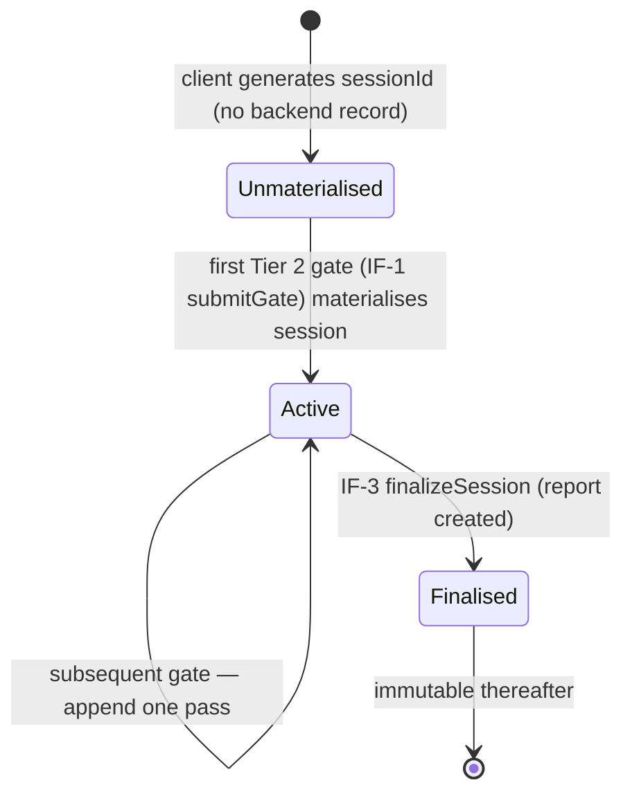

# SecureSphere X — Interface Control Document

**Version:** 2.0 · **Status:** Frozen for implementation
**Generated:** freshly from the corrected repository state; supersedes any prior ICD export.
**Frozen baseline (authoritative artifacts, per MANIFEST.md §1):**
`Backend-Architecture-Specification-v1_3.md` (1.3) · `API-Contract-Specification-v1_2.md` (1.2) · `openapi.yaml` (OpenAPI 3.1.0, info 1.2.0) · canonical D0.x JSON schemas `d0_1_schema.json` / `d0_3_schema.json` / `d0_4_schema.json` / `d0_9_schema.json` / `d0_10_schema.json` and their TypeScript sources (`evidence_contract_v1.ts`, `ruleset_format_v1.ts`, `passresult_contract_v1.ts`, `boundary_interfaces_v1.ts`, `evaluation_contract_v1.ts`, `snapshot_format_v1.ts`) · `SecureSphereX-RuleEngine-Spec-v0_8.md` (0.8) · `Logical-Database-Design-Specification-v1_1.md` (1.1).
**Authority note:** `openapi.yaml` is the implementation contract; its canonical-backed payloads are external `$ref` into the flat `./d0_*_schema.json` files. This ICD restates no JSON — it references operationIds and schema names.

---

## 0. Interface Inventory

Every cross-component/ownership boundary. The 26 HTTP operations of `openapi.yaml` are grouped by owning Backend controller (§5.1–5.7); the two non-HTTP boundaries the architecture freezes are listed last.

| # | Interface | Provider | Consumer |
|---|---|---|---|
| **IF-1** | Gate submission — `POST /v1/analysis/sessions/{sessionId}/gates` (`submitGate`) | Analysis Controller (Backend §5.1) | Browser Extension |
| **IF-2** | Session state read — `GET /v1/analysis/sessions/{sessionId}/state` (`getSessionState`) | Analysis Controller (§5.1) | Browser Extension |
| **IF-3** | Finalisation — `POST /v1/analysis/sessions/{sessionId}/finalization` (`finalizeSession`) | Analysis Controller (§5.1) | Browser Extension |
| **IF-4** | Intervention presented — `POST /v1/analysis/sessions/{sessionId}/interventions` (`reportInterventionPresented`) | Intervention Controller (§5.2) | Browser Extension |
| **IF-5** | Disposition — `PUT /v1/analysis/sessions/{sessionId}/interventions/{interventionOrdinal}/disposition` (`reportUserDisposition`) | Intervention Controller (§5.2) | Browser Extension |
| **IF-6** | Intelligence lookup — `POST /v1/intelligence/lookups` (`lookupIntelligenceByPrefix`) | Threat Intelligence Controller (§5.3) | Browser Extension |
| **IF-7** | Rule distribution — `GET /v1/rulesets/current` (`getCurrentRuleSetVersion`), `GET /v1/rulesets/{ruleSetVersion}` (`getRuleSetByVersion`), `GET /v1/rulesets/{ruleSetVersion}/digest` (`getRuleSetDigest`) | Rule Distribution Controller (§5.4) | Browser Extension |
| **IF-8** | Analysis history — `GET /v1/dashboard/history` (`getAnalysisHistory`) | Dashboard Controller (§5.5) | Dashboard |
| **IF-9** | Session detail — `GET /v1/dashboard/sessions/{sessionId}` (`getSessionDetail`) | Dashboard Controller (§5.5) | Dashboard |
| **IF-10** | Report view — `GET /v1/dashboard/reports/{reportId}` (`getReport`) | Dashboard Controller (§5.5) | Dashboard |
| **IF-11** | Resource summary — `GET /v1/dashboard/resources/{resourceIdentity}` (`getResourceSummary`) | Dashboard Controller (§5.5) | Dashboard |
| **IF-12** | Identity — `registerUser`, `login`, `refreshTokens`, `logout`, `listMfaFactors`, `enrolMfaFactor`, `verifyMfaChallenge`, `getPreferences`, `updatePreferences`, `getAuthenticationHistoryDisclosure` (§8.6 endpoint set) | Identity Controller (§5.6) | Dashboard |
| **IF-13** | Health & version — `GET /health/live` (`getLiveness`), `GET /health/ready` (`getReadiness`), `GET /health/version` (`getVersion`) | Health & Readiness Controller (§5.7) | Orchestrator / Dashboard |
| **IF-14** | Evaluation Port — `evaluate()` / `health()` (Backend §3.4) | Application Layer (owns interface) → Infrastructure adapter (implements) | Analysis Orchestration |
| **IF-15** | Role A ↔ Role B analysis invocation — D0.10 `AnalysisInvoker` / `InvocationContext` (`boundary_interfaces_v1.ts`) | Role A (caller) | Role B (provider) |

**Checkpoint.** IF-1…IF-13 = the 24 paths / 26 operations verified in `openapi.yaml` (operation count confirmed = 26). IF-14 and IF-15 are the two frozen non-HTTP boundaries. Confirm this grouping before elaborating detail.

---

## 1. Global Conventions

ICD-native facts shared across interfaces; anything already fixed in a baseline artifact is referenced, not restated.

**1.1 Standard error envelope.** `openapi.yaml` component `Error`: `required: [code, message, correlationId, fieldErrors]`, `additionalProperties: false`; `code` is the stable machine-readable contract, `message` is not versioned; `fieldErrors` is an array of `{path, code}` or null. The body never carries a stack trace, SQL, internal path, upstream message, or evidence content. Canonical error→status mapping: API Contract §11.2. Status inventory: API Contract §10.3.

**1.2 Correlation ID.** Request parameter and response header `X-Correlation-Id` (component `CorrelationId`), present on responses across the analysis, intervention, intelligence and dashboard operations; also carried in the error body as `correlationId`. It is not a security token.

**1.3 Contract version.** Response header `X-Contract-Version` (component `ContractVersion`) accompanies analysis/intervention responses; the URI carries the major API version (`/v1`), the D0.x contract version is header-negotiated (API Contract §9.2). Version mismatch surfaces as 409 (API Contract §11.3).

**1.4 Backward compatibility — older installed Browser Extension vs newer Backend.** The extension credential is embedded in the extension **build** and presented on each request; there is no token exchange and nothing derives, refreshes, or rotates it server-side (`openapi.yaml` `securitySchemes.extensionCredential` description; Backend §10.1.1). An older installed extension therefore keeps authenticating under its build credential until that build is retired, while contract-shape compatibility is governed by the negotiated `X-Contract-Version` within the server's supported range — a version outside that range is refused with 409 rather than breaking silently. Startup asserts the engine/contract/rule-set/schema versions and fails closed on mismatch (Backend §9.6).

**1.5 Authentication principals.** Two disjoint HTTP bearer schemes in `openapi.yaml`: `extensionCredential` (identifies the build, assumed public, not a rate-limiting key) and `userToken` (asymmetrically signed JWT, EdDSA or RS256). Per-operation application is given in each interface's Security field and summarised in §2. Wrong principal on a surface → 403 (API Contract §5.4).

**1.6 Rate limiting.** Extension surfaces limited per source address (the build credential is not an installation key — `extensionCredential` description). The `429` responses appear on `submitGate`, `getSessionState`, `lookupIntelligenceByPrefix`, `getAnalysisHistory`, `registerUser`, `login`, `verifyMfaChallenge` (verified in per-operation code lists). Detailed policy: API Contract §15.5.

**1.7 Canonical vs transport payloads.** Canonical-backed payloads are external `$ref` into `./d0_*_schema.json`; transport-only envelopes (request wrappers, view projections, health/version bodies) are defined in `openapi.yaml` `components/schemas` and are that document's own responsibility (API Contract §18.1). Serialisation rules: API Contract §13.

---

## 2. Per-Interface Detail

Each field documents only what is unique to the interface; shared facts reference §1 or a baseline locator. Payload cites the `operationId` and the schema name(s) verified in `openapi.yaml`; canonical elements are cited by their `d0_*_schema.json#/$defs/...` target.

### IF-1 · Gate submission

| Field | Content |
|---|---|
| Purpose | Submit accumulated evidence at a Tier 2 gate; the backend materialises the session and adjudicates. |
| Provider → Consumer | Analysis Controller (Backend §5.1) → Browser Extension |
| Owner | Analysis Orchestration Service |
| Trigger | A Tier 2 gate fires client-side |
| Contract | **Pre:** client-generated `sessionId`; `X-Contract-Version` in range. **Post:** passes committed with Current Security State. **Invariant (shared state):** Current Security State replaced, not edited. |
| Payload | Request `operationId: submitGate`, body `GateSubmissionRequest`, carrying `d0_1_schema.json#/$defs/SecurityEvidence`. Response 200: `d0_9_schema.json#/$defs/SecurityStateView` (nullable). |
| Error Propagation | Codes present: 200, 401, 403, 409, 413, 415, 422, 429. Evaluation unavailable → 200 degraded (API Contract §11.4), not 503. Envelope §1.1. |
| Validation (delta) | Client-supplied `tier` not accepted (Backend §5.1, BI-32); path `sessionId` authoritative. Beyond that: `d0_1` schema. |
| Security (delta) | `extensionCredential` (verified). Own-session only (Backend §10.2). Per-source-address limit (§1.6). |
| Test Checklist | [ ] Happy path [ ] Invalid input (422) [ ] Timeout (re-submit) [ ] Auth failure (401/403) [ ] Internal failure (adapter down → 200 degraded) |
| Change Approval | Architecture Owner + Role A + Role B |

### IF-2 · Session state read

| Field | Content |
|---|---|
| Purpose | Read the current Security State View for a materialised session. |
| Provider → Consumer | Analysis Controller (§5.1) → Browser Extension |
| Owner | Session Service |
| Trigger | Extension reads state after a gate response |
| Contract | **Pre:** session materialised. **Post:** none (safe read). |
| Payload | `operationId: getSessionState`; 200 → `d0_9_schema.json#/$defs/SecurityStateView` (nullable). 404 if not materialised. |
| Error Propagation | Codes present: 200, 401, 403, 404, 429. Envelope §1.1. |
| Validation (delta) | None beyond schema. |
| Security (delta) | `extensionCredential` (verified); own-session only. |
| Test Checklist | [ ] Happy path [ ] Invalid input [ ] Timeout [ ] Auth failure [ ] Internal failure |
| Change Approval | Architecture Owner + Role A + Role B |

### IF-3 · Finalisation

| Field | Content |
|---|---|
| Purpose | Finalise the session; trigger report-metadata creation in the same unit of work. |
| Provider → Consumer | Analysis Controller (§5.1) → Browser Extension |
| Owner | Analysis Orchestration; Report Service within the finalisation unit of work |
| Trigger | Client finalises a session |
| Contract | **Pre:** session materialised. **Post:** session immutable; report created. |
| Payload | `operationId: finalizeSession`, body `FinalizationRequest`; 204 on success. |
| Error Propagation | Codes present: 204, 401, 403, 404, 422. Envelope §1.1. |
| Validation (delta) | `FinalizationRequest` fields per `openapi.yaml`. |
| Security (delta) | `extensionCredential` (verified); own-session only. |
| Test Checklist | [ ] Happy path [ ] Invalid input (422) [ ] Timeout (idempotent) [ ] Auth failure [ ] Internal failure |
| Change Approval | Architecture Owner + Role B |

### IF-4 · Intervention presented

| Field | Content |
|---|---|
| Purpose | Report that an intervention was presented; lock the corresponding pass. |
| Provider → Consumer | Intervention Controller (§5.2) → Browser Extension |
| Owner | Session Service / Analysis Orchestration |
| Trigger | Extension presents a warning/block |
| Contract | **Pre:** intervention corresponds to a committed pass. **Post:** pass locked; audit event raised. |
| Payload | `operationId: reportInterventionPresented`, body `InterventionPresentedRequest`, referencing `d0_9_schema.json#/$defs/RecommendedResponse`; 204. |
| Error Propagation | Codes present: 204, 401, 403, 404, 409, 422. No matching committed pass → 409. |
| Validation (delta) | No tier/score/finding accepted (Backend §5.2, BI-32). |
| Security (delta) | `extensionCredential` (verified); own-session only. |
| Test Checklist | [ ] Happy path [ ] Invalid input (422) [ ] Timeout (idempotent) [ ] Auth failure [ ] Internal failure (409) |
| Change Approval | Architecture Owner + Role A + Role B |

### IF-5 · Disposition

| Field | Content |
|---|---|
| Purpose | Report the user's disposition to a presented intervention. |
| Provider → Consumer | Intervention Controller (§5.2) → Browser Extension |
| Owner | Intervention Controller (audit only) |
| Trigger | User heeds / overrides / dismisses |
| Contract | **Post:** recorded as an audit event, not persisted as domain data (Backend §5.2). |
| Payload | `operationId: reportUserDisposition`, body `DispositionRequest`, referencing `d0_10_schema.json#/$defs/UserDisposition`; 204. |
| Error Propagation | Codes present: 204, 401, 403, 404, 422. Envelope §1.1. |
| Validation (delta) | `UserDisposition` enum (D0.10). |
| Security (delta) | `extensionCredential` (verified); own-session only. |
| Test Checklist | [ ] Happy path [ ] Invalid input (422) [ ] Timeout (idempotent) [ ] Auth failure [ ] Internal failure |
| Change Approval | Architecture Owner + Role B |

### IF-6 · Intelligence lookup

| Field | Content |
|---|---|
| Purpose | k-anonymous prefix lookup; return the bucket for client-side final matching. |
| Provider → Consumer | Threat Intelligence Controller (§5.3) → Browser Extension |
| Owner | Threat Intelligence Service |
| Trigger | Extension needs intelligence for a candidate domain |
| Contract | **Pre:** `hashPrefix` of the configured length. **Post:** full bucket returned; backend never receives a full domain. Safe read. |
| Payload | `operationId: lookupIntelligenceByPrefix`, body `IntelligenceLookupRequest`; 200 → `IntelligenceLookupResponse` (transport-only; element `IntelligenceEntry`). |
| Error Propagation | Codes present: 200, 401, 422, 429. Over-/under-length prefix → 422 (API Contract §15.4). |
| Validation (delta) | Prefix length is a security constraint, exact-match (API Contract §8.3.1). |
| Security (delta) | `extensionCredential` (verified). Per-source-address limit. |
| Test Checklist | [ ] Happy path [ ] Invalid input (422) [ ] Timeout [ ] Auth failure [ ] Internal failure |
| Change Approval | Architecture Owner + Role B + Privacy reviewer |

### IF-7 · Rule distribution

| Field | Content |
|---|---|
| Purpose | Serve the recommended rule-set version, a versioned artifact, and its digest. |
| Provider → Consumer | Rule Distribution Controller (§5.4) → Browser Extension |
| Owner | Rule Distribution Service |
| Trigger | Extension checks for / fetches a rule set |
| Contract | **Post:** released artifact immutable; digest verifiable. |
| Payload | `getCurrentRuleSetVersion` → `RuleSetPointer`; `getRuleSetByVersion` → `d0_3_schema.json#/$defs/RuleSet`; `getRuleSetDigest` → `RuleSetDigest`. |
| Error Propagation | `getCurrentRuleSetVersion`: 200, 401. `getRuleSetByVersion`: 200, 401, 404, 409, 500 (integrity failure → 500). `getRuleSetDigest`: 200, 401, 404. |
| Validation (delta) | Caching headers per response (`CacheControlNoCache` on current, `CacheControlImmutable` on versioned). |
| Security (delta) | `extensionCredential` (verified) — rule sets are not public. |
| Test Checklist | [ ] Happy path [ ] Invalid input (404) [ ] Timeout [ ] Auth failure [ ] Internal failure (500) |
| Change Approval | Architecture Owner + Rule-set Release Authority |

### IF-8 · Analysis history

| Field | Content |
|---|---|
| Purpose | Return the user's saved analysis references, cursor-paginated. |
| Provider → Consumer | Dashboard Controller (§5.5) → Dashboard |
| Owner | Report/Knowledge query path |
| Trigger | User opens history |
| Contract | **Post:** none (read); scoped to the user's saved references. |
| Payload | `operationId: getAnalysisHistory`; 200 → `HistoryPage` (element `HistoryEntry`), referencing `d0_4_schema.json#/$defs/RiskTier`. |
| Error Propagation | Codes present: 200, 401, 403, 429. Envelope §1.1. |
| Validation (delta) | Filters/cursor per `openapi.yaml`. Returns no pass internals. |
| Security (delta) | `userToken` (verified); own data only. Per-user limit. |
| Test Checklist | [ ] Happy path [ ] Invalid input [ ] Timeout [ ] Auth failure (401/403) [ ] Internal failure |
| Change Approval | Architecture Owner + Role B |

### IF-9 · Session detail

| Field | Content |
|---|---|
| Purpose | Return the explanation-level view of a session. |
| Provider → Consumer | Dashboard Controller (§5.5) → Dashboard |
| Owner | Report/Knowledge query path |
| Trigger | User opens a session |
| Contract | **Pre:** user owns the session. **Post:** none (read). |
| Payload | `operationId: getSessionDetail`; 200 → `SessionDetail`, embedding `d0_9_schema.json#/$defs/ExplanationItem` and referencing `d0_4_schema.json#/$defs/RiskTier`. |
| Error Propagation | Codes present: 200, 401, 403, 404. Not owned → 403 (API Contract §6.2). |
| Validation (delta) | Response omits scoring internals (Backend AD-5). |
| Security (delta) | `userToken` (verified); own data only. |
| Test Checklist | [ ] Happy path [ ] Invalid input [ ] Timeout [ ] Auth failure (403) [ ] Internal failure |
| Change Approval | Architecture Owner + Role B + Privacy reviewer |

### IF-10 · Report view

| Field | Content |
|---|---|
| Purpose | Return report metadata and its projection. |
| Provider → Consumer | Dashboard Controller (§5.5) → Dashboard |
| Owner | Report Service |
| Trigger | User opens a report |
| Contract | **Pre:** user owns the referenced session. **Post:** none (read). |
| Payload | `operationId: getReport`; 200 → `ReportView`. |
| Error Propagation | Codes present: 200, 401, 403, 404. Envelope §1.1. |
| Validation (delta) | Inherits IF-9 depth limits. |
| Security (delta) | `userToken` (verified); own data only. |
| Test Checklist | [ ] Happy path [ ] Invalid input [ ] Timeout [ ] Auth failure [ ] Internal failure |
| Change Approval | Architecture Owner + Role B |

### IF-11 · Resource summary

| Field | Content |
|---|---|
| Purpose | Return Current Security State summary for a resource. |
| Provider → Consumer | Dashboard Controller (§5.5) → Dashboard |
| Owner | Knowledge Service |
| Trigger | User opens a resource summary |
| Contract | **Post:** none (read); no persistence-internal state exposed. |
| Payload | `operationId: getResourceSummary`; 200 → `ResourceSummary`. |
| Error Propagation | Codes present: 200, 401, 403, 404. Envelope §1.1. |
| Validation (delta) | None beyond schema. |
| Security (delta) | `userToken` (verified). |
| Test Checklist | [ ] Happy path [ ] Invalid input [ ] Timeout [ ] Auth failure [ ] Internal failure |
| Change Approval | Architecture Owner + Role B |

### IF-12 · Identity (endpoint set)

| Field | Content |
|---|---|
| Purpose | Account and session lifecycle for dashboard users. |
| Provider → Consumer | Identity Controller (§5.6) → Dashboard |
| Owner | Identity Service |
| Trigger | User authenticates or manages account |
| Contract | Per operation (API Contract §8.6). Login/refresh return tokens with rotation; logout revokes the refresh token. No client-enrolment endpoint (AC-6). |
| Payload | `registerUser` (`RegistrationRequest` → 201 `UserProfile`); `login` (`LoginRequest` → 200 `TokenResponse`); `refreshTokens` (`RefreshRequest` → 200 `TokenResponse`); `logout` → 204; `listMfaFactors` → 200 `MfaFactor`; `enrolMfaFactor` (`MfaEnrolmentRequest` → 201 `MfaEnrolmentResponse`); `verifyMfaChallenge` (`MfaChallengeRequest` → 200 `TokenResponse`); `getPreferences`/`updatePreferences` → 200 `Preferences`; `getAuthenticationHistoryDisclosure` → 200 `DisclosureText`. |
| Error Propagation | Per-operation codes (verified): `registerUser` 201/409/422/429; `login` 200/401/422/429; `refreshTokens` 200/401; `logout` 204/401; `listMfaFactors` 200/401; `enrolMfaFactor` 201/401/422; `verifyMfaChallenge` 200/401/429; `getPreferences` 200/401; `updatePreferences` 200/401/422; `getAuthenticationHistoryDisclosure` 200/401. Uniform 401 on auth failure (API Contract §5.4). |
| Validation (delta) | Credential/password/MFA-state rules (Backend §5.6). |
| Security (delta) | `security: []` (none) on `registerUser`, `login`, `refreshTokens`, `verifyMfaChallenge`; `userToken` on `logout`, `listMfaFactors`, `enrolMfaFactor`, `getPreferences`, `updatePreferences`, `getAuthenticationHistoryDisclosure` (all verified). |
| Test Checklist | [ ] Happy path [ ] Invalid input (422) [ ] Timeout [ ] Auth failure (uniform 401) [ ] Internal failure |
| Change Approval | Architecture Owner + Role B + Security reviewer |

### IF-13 · Health & version

| Field | Content |
|---|---|
| Purpose | Liveness, readiness, and version reporting. |
| Provider → Consumer | Health & Readiness Controller (§5.7) → Orchestrator / Dashboard |
| Owner | Health & Readiness Controller |
| Trigger | Orchestrator probe; version query |
| Contract | **Post:** readiness requires DB reachable, Evaluation Port healthy, and a valid rule set loaded (Backend §5.7). |
| Payload | `getLiveness` → 200 `LivenessStatus`; `getReadiness` → 200 `ReadinessStatus` (+ 503 when not ready); `getVersion` → 200 `VersionManifest`. |
| Error Propagation | `getLiveness`: 200. `getReadiness`: 200, 503. `getVersion`: 200, 401. |
| Validation (delta) | None. |
| Security (delta) | `getLiveness` none (`security: []`); `getReadiness` and `getVersion` accept **either** `extensionCredential` **or** `userToken` (both verified). |
| Test Checklist | [ ] Happy path [ ] Invalid input [ ] Timeout [ ] Auth failure (version without token) [ ] Internal failure (not ready → 503) |
| Change Approval | Architecture Owner + Ops |

### IF-14 · Evaluation Port (in-process)

| Field | Content |
|---|---|
| Purpose | Deterministic rule evaluation over a runtime adapter, isolated from the Application Layer. |
| Provider → Consumer | Application Layer owns the interface; Infrastructure adapter implements → Analysis Orchestration invokes (Backend §3.4) |
| Owner | Application Layer (interface); adapter selection is configuration |
| Trigger | Analysis Orchestration invokes once per pass in sequence (Backend §3, step 11) |
| Contract | Invariants EP-1…EP-7 (Backend §3.4): pure, deterministic, no I/O/DB/clock/randomness, timeout-bounded. |
| Payload | `evaluate(...) -> AnalysisPassResult`; `health() -> RuntimeHealth` (Backend §3.4). Not an HTTP payload. Result corresponds to `d0_4_schema.json` (D0.4 Analysis Pass Result). |
| Error Propagation | Adapter unavailable → surfaces as degraded 200 at IF-1 (API Contract §11.4). Timeout → failure, never partial. |
| Validation (delta) | Returned rule-set version verified against requested (EP-family). |
| Security (delta) | Local-only; never network-exposed. Engine has no DB/network/clock access. |
| Test Checklist | [ ] Happy path [ ] Invalid input (version mismatch) [ ] Timeout (→ failure) [ ] Auth failure (n/a) [ ] Internal failure (degraded upstream) |
| Change Approval | Architecture Owner + Role B |

### IF-15 · Role A ↔ Role B analysis invocation (in-process)

| Field | Content |
|---|---|
| Purpose | Split of concerns: Role A observes the browser and invokes; Role B evaluates and never observes the browser. |
| Provider → Consumer | Role A (caller) → Role B (provider) — `boundary_interfaces_v1.ts` |
| Owner | D0.8/D0.9/D0.10 boundary contract |
| Trigger | Role A detects a browser event |
| Contract | Role A renders and enforces; Role B publishes (D0.9). `InvocationContext.tier` exists in-process but is narrowed out of the HTTP projection onto IF-1 (Backend §5.1, BI-32). |
| Payload | D0.10 `InvocationContext`, `AnalysisInvoker` (`boundary_interfaces_v1.ts`). This is the canonical structure IF-1/IF-4 project onto the wire; the wire narrows, never widens. |
| Error Propagation | In-process; committed atomically or not. |
| Validation (delta) | Projection is a subset selection (API Contract §9.1). |
| Security (delta) | Internal boundary; the trust boundary is crossed only at the HTTP projection. |
| Test Checklist | [ ] Happy path [ ] Invalid input [ ] Timeout [ ] Auth failure (n/a) [ ] Internal failure |
| Change Approval | Architecture Owner + Role A + Role B |

---

## 3. Sequence Diagram — Gate submission → Evaluation → Decision → Warning → Dashboard

Only the multi-component gate workflow is diagrammed; single-hop interfaces are not.

```mermaid
sequenceDiagram
    autonumber
    participant EXT as Browser Extension (Role A)
    participant AC as Analysis Controller (§5.1)
    participant AOS as Analysis Orchestration (Role B)
    participant EP as Evaluation Port (§3.4 adapter)
    participant IC as Intervention Controller (§5.2)
    participant DC as Dashboard Controller (§5.5)
    participant DASH as Dashboard

    EXT->>AC: IF-1 submitGate (GateSubmissionRequest; d0_1 SecurityEvidence)
    AC->>AOS: authenticated (extensionCredential), validated
    AOS->>AOS: materialise session (client sessionId)
    loop once per pass, Tier 0 → 1 → 2
        AOS->>EP: IF-14 evaluate() -> AnalysisPassResult (d0_4)  [timeout → degraded]
    end
    AOS-->>AC: d0_9 SecurityStateView | null
    AC-->>EXT: 200 (degraded if adapter unavailable — §11.4)
    Note over EXT: Role A renders/enforces; warning shown
    EXT->>IC: IF-4 reportInterventionPresented (204; locks pass)
    EXT->>IC: IF-5 reportUserDisposition (204; audit only)
    Note over EXT,DASH: later, user-initiated
    EXT->>AC: IF-3 finalizeSession (204; report created)
    DASH->>DC: IF-8/IF-9 getAnalysisHistory / getSessionDetail (explanation-level)
```

---

## 4. State Diagram — Analysis Session (shared by client + backend)

Session lifecycle is shared across the client (session-id generation, gate submission) and the backend (materialisation, commit, finalisation). The canonical state vocabulary is storage-internal (LDD) and has no API representation.



---

## 5. Ownership Matrix

| Interface | Provider | Consumer | Owner | Change Approval Authority |
|---|---|---|---|---|
| IF-1 submitGate | Analysis Controller §5.1 | Extension | Analysis Orchestration | Arch Owner + Role A + Role B |
| IF-2 getSessionState | Analysis Controller §5.1 | Extension | Session Service | Arch Owner + Role A + Role B |
| IF-3 finalizeSession | Analysis Controller §5.1 | Extension | Analysis Orchestration / Report Service | Arch Owner + Role B |
| IF-4 reportInterventionPresented | Intervention Controller §5.2 | Extension | Session Service | Arch Owner + Role A + Role B |
| IF-5 reportUserDisposition | Intervention Controller §5.2 | Extension | Intervention Controller (audit) | Arch Owner + Role B |
| IF-6 lookupIntelligenceByPrefix | Threat Intelligence Controller §5.3 | Extension | Threat Intelligence Service | Arch Owner + Role B + Privacy |
| IF-7 rule distribution | Rule Distribution Controller §5.4 | Extension | Rule Distribution Service | Arch Owner + Release Authority |
| IF-8 getAnalysisHistory | Dashboard Controller §5.5 | Dashboard | Report/Knowledge query path | Arch Owner + Role B |
| IF-9 getSessionDetail | Dashboard Controller §5.5 | Dashboard | Report/Knowledge query path | Arch Owner + Role B + Privacy |
| IF-10 getReport | Dashboard Controller §5.5 | Dashboard | Report Service | Arch Owner + Role B |
| IF-11 getResourceSummary | Dashboard Controller §5.5 | Dashboard | Knowledge Service | Arch Owner + Role B |
| IF-12 identity set | Identity Controller §5.6 | Dashboard | Identity Service | Arch Owner + Role B + Security |
| IF-13 health & version | Health & Readiness Controller §5.7 | Orchestrator / Dashboard | Health & Readiness Controller | Arch Owner + Ops |
| IF-14 Evaluation Port | Application Layer (iface) | Analysis Orchestration | Application Layer; adapter = config | Arch Owner + Role B |
| IF-15 Role A↔B invocation | Role A | Role B | D0.8/9/10 boundary contract | Arch Owner + Role A + Role B |

---

## 6. Change Control

**Proposal.** A change to any interface names the IF-n, the field(s) affected, and the driving decision.

**Approval.** The §5 Change Approval Authority for that interface signs off; cross-cutting changes (envelope, versioning, auth — §1) additionally require the Architecture Owner.

**Same-change propagation.** A contract change is incomplete until every consumer is updated in the same change (MANIFEST §6; Contract Integrity Report G-5). For a canonical D0.x element this means: the D0.x TypeScript source, its generated `d0_*_schema.json` (regenerated, never hand-edited — MANIFEST §6), the `openapi.yaml` `$ref` consumers, the LDD storage counterpart, and any Backend/API-Contract section that references the value. The `contract-conformance-check.py` gate (G-8) must pass.

**Version bump.** Canonical contract changes bump the D0.x version constant; `openapi.yaml` `info.version` bumps with the API contract; the D0.x contract version is negotiated per request via `X-Contract-Version` within the supported range.

---

## 7. Open Items & Consistency Check

### 7.1 Open items
None. Every interface in §0 is grounded in `openapi.yaml` operations and Backend §5/§3.4/D0.10 boundaries verified in this session; no `REQUIRES ARCHITECTURE CLARIFICATION` or `DESIGN BASELINE CONFLICT` item remains against the corrected repository. (The transport-only identity/intelligence/report bodies that were unspecified in an earlier baseline are now concrete named component schemas in `openapi.yaml` — `RegistrationRequest`/`UserProfile`, `MfaEnrolmentRequest`/`MfaEnrolmentResponse`, `IntelligenceLookupResponse`/`IntelligenceEntry`, `ReportView` — all verified present.)

### 7.2 Consistency check
- **Inventory ↔ detail parity.** Every §0 entry IF-1…IF-15 has a §2 block, and every §2 block appears in §0. No mismatch.
- **operationId existence.** All 26 operationIds named in this ICD were verified present in `openapi.yaml` (`grep operationId:` → 26 matches, names identical, including `registerUser` and `enrolMfaFactor`).
- **Schema references resolve.** Canonical `$ref` targets cited (`d0_1`/`d0_3`/`d0_4`/`d0_9`/`d0_10` `$defs`) resolve in the corrected flat schema files; transport-only schema names cited (`GateSubmissionRequest`, `SessionDetail`, `ReportView`, `ResourceSummary`, `HistoryPage`, `TokenResponse`, `UserProfile`, `MfaEnrolmentResponse`, `VersionManifest`, etc.) are defined in `openapi.yaml` `components/schemas`.
- **No duplicated interface.** Each of the 24 paths maps to exactly one IF; identity's ten operations are grouped under IF-12 by shared controller/principal.
- **No dangling file reference.** Every artifact named (authoritative specs, `openapi.yaml`, `d0_*_schema.json`, TS contracts) exists at the path cited (MANIFEST §1, corrected).
